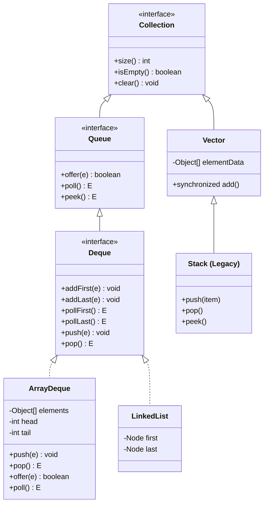

# Concept: Stacks and Queues: LIFO, FIFO, Monotonic Stacks, and Array-Backed Buffers

---

## 1. Metadata and Learning Goals

| Attribute | Specification |
|---|---|
| **Concept ID** | `P09-C004` |
| **Concept Name** | Stacks and Queues: LIFO, FIFO, Monotonic Stacks, and Array-Backed Buffers |
| **Phase** | Phase 09: Data Structures and Algorithms for Backend Developers |
| **Prerequisites** | `P09-C001` (Algorithmic Complexity & Amortized Analysis), `P09-C002` (Dynamic Arrays & Resizing Mechanics), `P09-C003` (Linked Lists & Pointer Manipulation) |
| **Target Mastery Level** | Advanced / Production-Grade Backend Architect |
| **JDK Compatibility** | OpenJDK 21 LTS (Verified) |
| **Primary Artifact** | `curriculum/phase-09-data-structures-algorithms-backend/004-stacks-and-queues.md` |

### Core Learning Goals
1. **Deconstruct LIFO and FIFO Semantics:** Master the abstract data types (ADTs) of Stacks (Last-In, First-Out) and Queues (First-In, First-Out), their formal algebraic specifications, and constant-time $O(1)$ amortized operations.
2. **Evaluate Collections Framework Implementations:** Contrast the architectural trade-offs between legacy `java.util.Stack` / `Vector`, node-based `java.util.LinkedList`, and array-backed `java.util.ArrayDeque`, proving why `ArrayDeque` is the definitive choice for single-threaded queues and stacks.
3. **Implement Bitwise Ring Buffers:** Master array-backed circular buffers (ring buffers) using power-of-two capacities, bitwise wrap-around masking (`(index + 1) & (capacity - 1)`), dynamic geometric growth, and defensive slot nulling preventing object loitering memory leaks.
4. **Master Monotonic Stacks and Deques:** Formulate and analyze the Monotonic Stack and Monotonic Queue paradigms, proving their amortized $O(N)$ linear complexity for Next Greater Element (NGE), Largest Rectangle, and Sliding Window Maximum problems.
5. **Apply Backend Architectural Patterns:** Deploy stacks and queues to production scenarios including AST expression parsing, undo/redo state management, LMAX Disruptor-style ring buffers, and bounded task queue backpressure.

---

## 2. Definition, Purpose, and Mental Model

### What Are Stacks and Queues?
A **Stack** is a linear collection governed by the **Last-In, First-Out (LIFO)** access discipline: the most recently inserted element is always the first to be inspected or removed. All structural mutations are restricted to a single conceptual boundary called the **top**.

A **Queue** is a linear collection governed by the **First-In, First-Out (FIFO)** access discipline: elements are inserted at the **tail** (rear/back) and extracted from the **head** (front). This preserves temporal ordering, ensuring items are processed strictly in the order they arrived.

A **Double-Ended Queue (Deque)** generalizes both structures, permitting $O(1)$ insertions and removals at both ends (`head` and `tail`).

```
STACK (LIFO)                        QUEUE (FIFO)
Push ↓    ↑ Pop / Peek              Enqueue / Offer → [Tail] ... [Head] → Dequeue / Poll
┌──────────────┐                                       ═════════════════
│  Element C   │ (Top)                                 [C]  [B]  [A]  ──► [A] Out
├──────────────┤                                       ═════════════════
│  Element B   │                                        ▲
├──────────────┤                                     [D] Enters
│  Element A   │ (Bottom)
└──────────────┘
```

### The Backend Mental Model: Pipelines, Buffering, and State Unwinding
In distributed backend systems and server architectures:
- **Stacks represent nested state and contextual unwinding:** Thread execution stacks (JVM call frames), transaction rollback savepoints, recursive AST expression evaluations, delimiter pairing in JSON/SQL parsers, and browser/app navigation history.
- **Queues represent asynchronous decoupling and temporal buffering:** Thread pool task queues (`BlockingQueue`), message broker buffers (Kafka partition logs, RabbitMQ channels), HTTP connection backlogs (TCP SYN/Accept queues), and rate-limiting sliding windows.
- **Ring Buffers represent zero-allocation streaming:** High-performance inter-thread communication engines (such as the LMAX Disruptor) utilize pre-allocated, array-backed circular buffers to eliminate garbage collector churn and maximize hardware prefetch cache hits.

---

## 3. Foundations and Theory

### 3.1 Formal Algebraic Specification
Mathematically, a Stack $S$ over element type $T$ is defined by the signature:
- $\text{empty}: \to S$
- $\text{push}: S \times T \to S$
- $\text{pop}: S \to S \times T$ (or partial function undefined on $\text{empty}$)
- $\text{peek}: S \to T$

With the fundamental identity:
$$\text{peek}(\text{push}(s, x)) = x$$
$$\text{pop}(\text{push}(s, x)) = (s, x)$$

A Queue $Q$ over element type $T$ is defined by:
- $\text{empty}: \to Q$
- $\text{offer}: Q \times T \to Q$
- $\text{poll}: Q \to Q \times T$
- $\text{peek}: Q \to T$

With the FIFO inductive identity: if $Q$ is empty, $\text{peek}(\text{offer}(\text{empty}, x)) = x$; if $Q = \text{offer}(q, y)$, then $\text{poll}(\text{offer}(q, x))$ dequeues elements in their original insertion order.

### 3.2 Time and Space Complexity Bounds

| Data Structure / Operation | Push / Offer | Pop / Poll | Peek | Search by Value | Auxiliary Space |
|---|---|---|---|---|---|
| **Array-backed Stack (`ArrayDeque`)** | $O(1)$ amortized | $O(1)$ | $O(1)$ | $O(N)$ | $O(N)$ contiguous array |
| **Linked List Stack (`LinkedList`)** | $O(1)$ worst-case | $O(1)$ | $O(1)$ | $O(N)$ | $O(N)$ scattered nodes |
| **Legacy `Stack` (`Vector`)** | $O(1)$ amortized | $O(1)$ | $O(1)$ | $O(N)$ | $O(N)$ + sync locks |
| **Circular Ring Buffer Queue** | $O(1)$ amortized | $O(1)$ | $O(1)$ | $O(N)$ | $O(N)$ contiguous array |
| **Monotonic Stack (NGE Pass)** | $O(1)$ amortized | $O(1)$ amortized | $O(1)$ | N/A | $O(N)$ stack depth |

### 3.3 Amortized Analysis of Monotonic Stacks
A **Monotonic Stack** enforces a strict invariant: elements stored in the stack are strictly increasing or strictly decreasing from bottom to top.

When processing an input array of length $N$ to find the Next Greater Element (NGE), the algorithm scans elements $A[0 \dots N-1]$. For each element $x = A[i]$, it pops all stack elements smaller than or equal to $x$ before pushing $x$:

```java
while (!stack.isEmpty() && stack.peek() <= x) {
    stack.pop();
}
stack.push(x);
```

#### Mathematical Proof of $O(N)$ Time Complexity
Although the outer loop runs $N$ times and contains an inner `while` loop that pops elements, the total runtime is strictly bounded by $O(N)$:
1. **Push Bound:** Each of the $N$ elements from array $A$ is pushed onto the stack **at most once**. Total push operations $= N$.
2. **Pop Bound:** An element can only be popped if it is currently on the stack. Because only $N$ elements are ever pushed, the total number of `pop()` invocations across the entire execution cannot exceed $N$. Total pop operations $\le N$.
3. **Aggregate Operations:**
   $$\sum_{i=0}^{N-1} (1 + \text{pops}_i) = N + \sum_{i=0}^{N-1} \text{pops}_i \le N + N = 2N$$
4. Therefore, the total number of stack mutations is bounded by $2N \implies O(N)$ linear time. The amortized cost per element is:
   $$T_{\text{amortized}} = \frac{2N}{N} = 2 \text{ operations} = O(1)$$

---

## 4. Language, Specification, and Platform Mechanics

### 4.1 The Java Collections Framework: Stack & Queue Hierarchy



### 4.2 Why `java.util.Stack` Is Defective and Obsolete
`java.util.Stack` was introduced in JDK 1.0 (1996) before the Java Collections Framework (JCF) was designed in JDK 1.2. It suffers from three fatal architectural flaws:

1. **Inherits from `Vector` (Violates LISP/ADT Encapsulation):**
   Because `Stack extends Vector`, it inherits all indexed collection methods (`get(index)`, `set(index, element)`, `insertElementAt(element, index)`). This completely breaks the LIFO abstraction:
   ```java
   Stack<String> stack = new Stack<>();
   stack.push("A");
   stack.push("B");
   stack.add(0, "INTRUDER"); // Inserts at bottom! Breaks LIFO invariant!
   ```
2. **Coarse-Grained Synchronization Lock Overhead:**
   Every method in `Vector` and `Stack` (`push`, `pop`, `peek`, `size`) is declared `synchronized`. In single-threaded execution, this forces the JVM to acquire and release monitor locks on every stack access, incurring unnecessary lock acquisition cycles and inhibiting JIT compiler vectorization.
3. **Official Deprecation Guidance:**
   The OpenJDK Javadoc has officially deprecated the use of `Stack` since Java 1.6:
   > *"A more complete and consistent set of LIFO stack operations is provided by the `Deque` interface and its implementations, which should be used in preference to this class: `Deque<Integer> stack = new ArrayDeque<Integer>();`"*

### 4.3 `ArrayDeque` Internal Architecture: The Power-of-Two Ring Buffer
`java.util.ArrayDeque` is the crown jewel of array-backed deques in HotSpot. It represents a circular ring buffer with dynamic resizing.

#### 1. Power-of-Two Sizing Invariant
In `ArrayDeque`, the internal array length is **always a power of two** ($2^k$, e.g., 16, 32, 64, 128...):
```java
// OpenJDK ArrayDeque capacity calculation
elements = new Object[Math.max(8, calculateSize(numElements))];
```

#### 2. Bitwise Modulo Optimization
In a standard circular buffer of capacity $M$, computing the next index requires an integer division remainder operation (`(tail + 1) % M`). In hardware, integer division (`idiv`) is slow, requiring 15–40 CPU clock cycles.

However, when $M$ is a power of two ($M = 2^k$), the bitwise equivalence holds:
$$X \pmod M \equiv X \ \& \ (M - 1)$$

Bitwise AND (`iand`) executes in **1 single clock cycle**!
```java
// Advancing tail in ArrayDeque:
tail = (tail + 1) & (elements.length - 1);

// Retreating head in ArrayDeque (push / addFirst):
head = (head - 1) & (elements.length - 1);
```

If `head` is 0 and capacity is 16 (`elements.length - 1 = 15 = 0b00001111`):
$$(0 - 1) \ \& \ 15 = (-1) \ \& \ 15 = \text{0xFFFFFFFF} \ \& \ \text{0x0000000F} = 15$$
The pointer wraps seamlessly to the end of the array with zero branching!

#### 3. Full Condition and Doubling
The queue is full when `head == tail` (after an insertion). When full, `ArrayDeque` doubles its capacity:
```java
private void doubleCapacity() {
    int p = head;
    int n = elements.length;
    int r = n - p; // number of elements to the right of p
    int newCapacity = n << 1;
    if (newCapacity < 0)
        throw new IllegalStateException("Sorry, deque too big");
    Object[] a = new Object[newCapacity];
    System.arraycopy(elements, p, a, 0, r);
    System.arraycopy(elements, 0, a, r, p);
    elements = a;
    head = 0;
    tail = n;
}
```

```
BEFORE RESIZE (Capacity = 4, Head = 2, Tail = 2 [Full]):
Index:    [0]   [1]   [2]   [3]
Value:   [ C ] [ D ] [ A ] [ B ]
                      ▲
                  Head & Tail

AFTER RESIZE (Capacity = 8, Copied into contiguous sequence):
Index:    [0]   [1]   [2]   [3]   [4]   [5]   [6]   [7]
Value:   [ A ] [ B ] [ C ] [ D ] [null][null][null][null]
          ▲                       ▲
        Head = 0               Tail = 4
```

### 4.4 Hardware Cache Locality: `ArrayDeque` vs `LinkedList`
Why does `ArrayDeque` consistently outperform `LinkedList` by 2x to 10x even for pure queue operations where both are $O(1)$?

```
ArrayDeque (Contiguous 64-byte Cache Lines):
Address: 0x1000   0x1008   0x1010   0x1018
Slots:   [ Ref A | Ref B  | Ref C  | Ref D  ] ──► Loaded in ONE L1 Cache Hit (~1 ns)

LinkedList (Dispersed Heap Nodes):
Node A (0x4A10) ──► Node B (0x8F30) ──► Node C (0x12B0)
      │                   │                   │
  Cold DRAM           Cold DRAM           Cold DRAM
 (~80 ns miss)       (~80 ns miss)       (~80 ns miss)
```

1. **Object Header Overhead:** Each `LinkedList$Node` incurs 24 bytes of memory (12-byte header + 8-byte next pointer + 8-byte prev pointer + 8-byte item pointer + padding) to store a single 4-byte reference!
2. **CPU Pipeline Stalls:** Iterating or polling through `LinkedList` forces pointer chasing across fragmented heap regions, triggering L1/L2 data cache misses (~80 ns latency). In contrast, `ArrayDeque` references are stored contiguously in memory, enabling CPU hardware prefetchers to stream upcoming elements into L1 cache (~1 ns) before they are requested.

---

## 5. Evolution Across Java Versions

| Java Version | Release Year | Evolution / Feature Milestone |
|---|---|---|
| **JDK 1.0** | 1996 | Legacy `java.util.Vector` and `java.util.Stack` introduced with method-level synchronized monitors. |
| **Java 1.2** | 1998 | Java Collections Framework introduced; `LinkedList` added implementing `List`. |
| **Java 5 (J2SE 5.0)** | 2004 | Generics introduced (`Queue<E>`); `java.util.Queue` interface and `java.util.concurrent` blocking queues (`ArrayBlockingQueue`, `LinkedBlockingQueue`, `ConcurrentLinkedQueue`) added. |
| **Java 6 (Mustang)** | 2006 | `java.util.Deque<E>` interface and `java.util.ArrayDeque<E>` introduced, establishing the modern standard for array-backed stacks and queues. |
| **Java 7** | 2011 | Diamond operator (`new ArrayDeque<>()`) and ForkJoinPool work-stealing deques (`WorkQueue`). |
| **Java 8** | 2014 | Stream API support; default interface methods (`spliterator()`, `removeIf()`) integrated into `Queue` and `Deque`. |
| **Java 21 LTS** | 2023 | **Sequenced Collections (JEP 431):** `SequencedCollection` interface introduced; `Deque` retrofitted as a first-class sequenced collection (`getFirst()`, `getLast()`, `removeFirst()`, `removeLast()`, `reversed()`). |

---

## 6. Architecture and Design Patterns

### 6.1 The Monotonic Queue Pattern (Sliding Window Maximum)
Given an array $A$ of size $N$ and a sliding window of size $K$, find the maximum value in every window as it slides from left to right.
- Brute Force: Scan all $K$ elements in each of the $N - K + 1$ windows $\implies O(N \cdot K)$ time.
- Heap / PriorityQueue: Maintain window elements in a max-heap $\implies O(N \log K)$ time.
- **Monotonic Deque:** Maintain a double-ended queue storing array indices in **strictly decreasing order of their corresponding values** $\implies O(N)$ linear time!

```
Sliding Window: [1, 3, -1, -3, 5, 3, 6, 7], K = 3

Window [1,  3, -1]: Deque stores indices of [3, -1]. Max = 3
Window [3, -1, -3]: Deque stores indices of [3, -1, -3]. Max = 3
Window [-1, -3, 5]: 5 arrives -> pops -3, -1, 3! Deque stores [5]. Max = 5
```

#### Invariants of the Monotonic Deque:
1. **Front Element Invariant:** The index at `deque.peekFirst()` always points to the maximum element in the current active window.
2. **Expiry Invariant:** When the window slides, if `deque.peekFirst() <= currentIndex - K`, the front index has fallen outside the window and is removed via `pollFirst()`.
3. **Monotonicity Invariant:** Before inserting new index $i$, all indices $j$ from the back where $A[j] \le A[i]$ are removed via `pollLast()`. They can never be the maximum in any future window because $A[i]$ is both larger and will persist longer!

### 6.2 Delimiter / Bracket Matching Parser (AST Foundation)
Compiler parsers, JSON tokenizers, and SQL dialect analyzers validate nested scopes using a LIFO Stack:
- An opening delimiter (`(`, `[`, `{`) is pushed onto the stack.
- A closing delimiter (`)`, `]`, `}`) requires inspecting `stack.peek()`:
  - If the stack is empty, an unmatched closing bracket error is raised.
  - If the bracket types match, `stack.pop()` consumes the pair.
  - If types mismatch, a syntax error is raised.
- At EOF, if the stack is non-empty, an unclosed delimiter error is raised.

---

## 7. Failure Modes, Anti-Patterns, and Production Traps

### 7.1 The Unbounded Queue Out-of-Memory Catastrophe
In backend server engineering, the single most common cause of production `OutOfMemoryError` in asynchronous executors is the **unbounded queue**:

```java
// PRODUCTION FATAL ANTI-PATTERN:
ExecutorService executor = Executors.newFixedThreadPool(16);
```
Under the hood, `Executors.newFixedThreadPool` creates:
```java
new ThreadPoolExecutor(nThreads, nThreads, 0L, TimeUnit.MILLISECONDS,
                       new LinkedBlockingQueue<Runnable>()); // Capacity = Integer.MAX_VALUE!
```
If downstream database queries slow down while inbound HTTP request traffic continues at 5,000 req/sec, the `LinkedBlockingQueue` silently buffers millions of `Runnable` task objects until heap space is exhausted and the JVM crashes with:
`java.lang.OutOfMemoryError: Java heap space`.

```
Downstream Stalled ──► Queue Buffering: 1,000 -> 50,000 -> 1,000,000 tasks
Heap Consumption:   ──► 200MB -> 1.5GB -> 4GB -> CRASH (OOM)
```

#### Production Remedy: Bounded Queues with Explicit Rejection Policies
Always use bounded queues with deterministic backpressure:
```java
ThreadPoolExecutor executor = new ThreadPoolExecutor(
    16, 32, 60L, TimeUnit.SECONDS,
    new ArrayBlockingQueue<>(5000), // Bounded buffer!
    new ThreadPoolExecutor.CallerRunsPolicy() // Backpressure: caller throttles itself!
);
```

### 7.2 Memory Loitering in Custom Stacks
When writing a custom array-backed stack, failing to clear discarded references retains objects in the JVM heap indefinitely:

```java
// BUG: Memory Loitering Anti-Pattern
public E pop() {
    if (size == 0) throw new EmptyStackException();
    return (E) elements[--size]; // BUG: elements[size] still holds reference!
}
```
Even though `size` was decremented, the internal `elements` array slot still holds a strong GC reference to the popped object. Until that array slot is overwritten by a future `push()`, the object cannot be garbage collected, creating an insidious memory leak.

```java
// CORRECT: Defensive Slot Nulling
public E pop() {
    if (size == 0) throw new EmptyStackException();
    int idx = --size;
    E item = (E) elements[idx];
    elements[idx] = null; // Let GC reclaim memory immediately!
    return item;
}
```

---

## 8. Security and Hardening

### 8.1 Stack Smashing and Deep Recursion Defense
Recursive algorithms that utilize the JVM thread stack (such as recursive depth-first search or unvalidated AST expression parsers) are vulnerable to Denial-of-Service (DoS) attacks via deeply nested payloads:
- An attacker sends a malicious JSON document containing 20,000 nested brackets `[[[[...]]]]`.
- The recursive parser executes 20,000 stack frames, exceeding the `-Xss` thread stack limit and crashing the thread with `StackOverflowError`.

**Production Hardening:**
Replace recursive call stacks with an **explicit heap-allocated `ArrayDeque`**. Because the heap can allocate gigabytes of memory while thread stacks are typically limited to 1 MB, an explicit stack easily handles deep trees without risking `StackOverflowError`. Furthermore, enforce a hard parsing depth limit:
```java
private static final int MAX_PARSING_DEPTH = 512;
if (stack.size() > MAX_PARSING_DEPTH) {
    throw new SecurityException("Exceeded maximum nesting depth of " + MAX_PARSING_DEPTH);
}
```

### 8.2 Defending Against ReDoS and Delimiter Bombs
Untrusted text inputs passed into regex engines that simulate stack backtracking can cause exponential runtime stalls (Catastrophic Backtracking). Always use deterministic, non-recursive stack parsers for input validation.

---

## 9. Performance, Sizing, and Operational Profile

### 9.1 Sizing Calculations for Ring Buffers
When designing an array-backed ring buffer for high-throughput stream processing:
$$\text{Memory Footprint} = \text{Array Overhead} + (\text{Capacity} \times \text{Reference Size})$$
On a 64-bit JVM with Compressed OOPs enabled:
- Array Object Header: 16 bytes.
- Array Length Field: 4 bytes + 4 bytes padding $= 24$ bytes.
- Slot references: $\text{Capacity} \times 4$ bytes.
- Total memory for a 65,536-slot ring buffer:
  $$24 + (65,536 \times 4) = 262,168 \text{ bytes} \approx 256 \text{ KB}$$
256 KB fits entirely inside modern CPU L2/L3 caches, ensuring lightning-fast memory access with zero DRAM bus stalls!

---

## 10. Tooling, Observability, and Debugging

### 10.1 Monitoring Thread Pool Queue Depth via JMX
For backend monitoring (Prometheus / Micrometer / JMX):
```java
// Micrometer Metric Instrumentation:
Gauge.builder("threadpool.queue.size", executor.getQueue(), Collection::size)
     .description("Active queued tasks waiting for execution")
     .register(Metrics.globalRegistry);

Gauge.builder("threadpool.queue.remaining", executor.getQueue(), BlockingQueue::remainingCapacity)
     .description("Available queue capacity before rejection")
     .register(Metrics.globalRegistry);
```
Alert when `queue.remaining / total_capacity < 0.20` (80% queue saturation) to catch upstream traffic spikes before tasks are rejected.

---

## 11. Framework, Cloud, and Ecosystem Integration

### 11.1 Netty Channel Inbound / Outbound Buffers
Netty's event loop architecture leverages customized circular ring buffers (`Recycler`, `ChannelOutboundBuffer`) to manage high-speed socket flushes without allocating new object wrappers per network packet.

### 11.2 Spring Task Executor Configuration
In Spring Boot backend microservices:
```java
@Configuration
@EnableAsync
public class ThreadPoolConfig {
    @Bean(name = "taskExecutor")
    public Executor taskExecutor() {
        ThreadPoolTaskExecutor executor = new ThreadPoolTaskExecutor();
        executor.setCorePoolSize(16);
        executor.setMaxPoolSize(32);
        executor.setQueueCapacity(1000); // Bounded Array-backed Queue!
        executor.setRejectedExecutionHandler(new ThreadPoolExecutor.CallerRunsPolicy());
        executor.setThreadNamePrefix("async-worker-");
        executor.initialize();
        return executor;
    }
}
```

---

## 12. Production-Grade Code Demonstration

The following standalone, self-contained Java class comprehensively proves:
1. **`BitwiseRingBufferQueue<E>`:** A production-grade, zero-division, bitwise power-of-two circular FIFO queue with defensive slot nulling and geometric expansion.
2. **`MonotonicStack`:** Next Greater Element (NGE) algorithmic engine executing in amortized $O(N)$ linear time.
3. **`SlidingWindowMax`:** Monotonic Deque engine computing sliding window maximums in $O(N)$ time.
4. **`DelimiterSyntaxValidator`:** Production bracket and quote parser using an explicit stack with depth protection.

Save as `curriculum/phase-09-data-structures-algorithms-backend/004-stacks-and-queues.md` companion verification suite:

```java
package curriculum.phase09;

import java.util.ArrayDeque;
import java.util.Arrays;
import java.util.Deque;
import java.util.EmptyStackException;
import java.util.NoSuchElementException;
import java.util.Objects;

/**
 * Standalone verification suite demonstrating Stacks, Queues, Bitwise Ring Buffers,
 * Monotonic Stacks, and Sliding Window Monotonic Deques.
 */
public class StacksAndQueuesDemo {

    // =========================================================================
    // 1. PRODUCTION-GRADE BITWISE ARRAY-BACKED RING BUFFER QUEUE
    // =========================================================================

    /**
     * High-performance circular FIFO queue using power-of-two capacity sizing
     * and bitwise masking: index & (capacity - 1).
     */
    public static class BitwiseRingBufferQueue<E> {
        private Object[] elements;
        private int head;
        private int tail;
        private int count;

        public BitwiseRingBufferQueue(int minCapacity) {
            int capacity = calculateNextPowerOfTwo(minCapacity);
            this.elements = new Object[capacity];
            this.head = 0;
            this.tail = 0;
            this.count = 0;
        }

        private static int calculateNextPowerOfTwo(int value) {
            int highestOneBit = Integer.highestOneBit(Math.max(1, value));
            return (value == highestOneBit) ? value : highestOneBit << 1;
        }

        public int capacity() {
            return elements.length;
        }

        public int size() {
            return count;
        }

        public boolean isEmpty() {
            return count == 0;
        }

        public boolean offer(E item) {
            Objects.requireNonNull(item, "Queue does not permit null elements");
            if (count == elements.length) {
                doubleCapacity();
            }
            elements[tail] = item;
            tail = (tail + 1) & (elements.length - 1); // Bitwise wrap-around!
            count++;
            return true;
        }

        @SuppressWarnings("unchecked")
        public E poll() {
            if (count == 0) {
                return null;
            }
            E item = (E) elements[head];
            elements[head] = null; // Defensive nulling: prevent memory loitering!
            head = (head + 1) & (elements.length - 1); // Bitwise wrap-around!
            count--;
            return item;
        }

        @SuppressWarnings("unchecked")
        public E peek() {
            if (count == 0) {
                return null;
            }
            return (E) elements[head];
        }

        private void doubleCapacity() {
            int oldCapacity = elements.length;
            int newCapacity = oldCapacity << 1;
            Object[] newElements = new Object[newCapacity];

            int rightChunk = oldCapacity - head;
            System.arraycopy(elements, head, newElements, 0, rightChunk);
            if (head > 0) {
                System.arraycopy(elements, 0, newElements, rightChunk, head);
            }

            this.elements = newElements;
            this.head = 0;
            this.tail = oldCapacity;
        }
    }

    // =========================================================================
    // 2. MONOTONIC STACK: NEXT GREATER ELEMENT (NGE) IN O(N) TIME
    // =========================================================================

    /**
     * Computes the Next Greater Element for each item in the input array in O(N) time.
     * If no greater element exists to the right, assigns -1.
     */
    public static int[] nextGreaterElement(int[] nums) {
        int[] result = new int[nums.length];
        Arrays.fill(result, -1);

        // Store indices in a monotonic decreasing stack
        Deque<Integer> stack = new ArrayDeque<>();

        for (int i = 0; i < nums.length; i++) {
            while (!stack.isEmpty() && nums[i] > nums[stack.peek()]) {
                int smallerIndex = stack.pop();
                result[smallerIndex] = nums[i];
            }
            stack.push(i);
        }
        return result;
    }

    // =========================================================================
    // 3. MONOTONIC DEQUE: SLIDING WINDOW MAXIMUM IN O(N) TIME
    // =========================================================================

    /**
     * Computes the maximum value within each sliding window of size K in O(N) time.
     */
    public static int[] slidingWindowMaximum(int[] nums, int k) {
        if (nums == null || k <= 0 || nums.length == 0) {
            return new int[0];
        }
        int n = nums.length;
        int[] result = new int[n - k + 1];
        int resultIndex = 0;

        // Stores indices of elements in strictly decreasing order of value
        Deque<Integer> deque = new ArrayDeque<>();

        for (int i = 0; i < n; i++) {
            // 1. Evict elements that have fallen outside the active window
            while (!deque.isEmpty() && deque.peekFirst() <= i - k) {
                deque.pollFirst();
            }

            // 2. Maintain monotonic decreasing invariant: discard smaller elements
            while (!deque.isEmpty() && nums[deque.peekLast()] <= nums[i]) {
                deque.pollLast();
            }

            // 3. Append current element index
            deque.offerLast(i);

            // 4. Record the window maximum once the first window is full
            if (i >= k - 1) {
                result[resultIndex++] = nums[deque.peekFirst()];
            }
        }
        return result;
    }

    // =========================================================================
    // 4. DELIMITER SYNTAX VALIDATOR WITH DEPTH GUARD
    // =========================================================================

    public static class DelimiterSyntaxValidator {
        private static final int MAX_DEPTH = 256;

        public static boolean isValid(String code) {
            Deque<Character> stack = new ArrayDeque<>();

            for (int i = 0; i < code.length(); i++) {
                char ch = code.charAt(i);

                if (ch == '(' || ch == '[' || ch == '{') {
                    if (stack.size() >= MAX_DEPTH) {
                        throw new IllegalStateException("Max nesting depth exceeded");
                    }
                    stack.push(ch);
                } else if (ch == ')' || ch == ']' || ch == '}') {
                    if (stack.isEmpty()) {
                        return false; // Unmatched closing delimiter
                    }
                    char top = stack.pop();
                    if (!isMatchingPair(top, ch)) {
                        return false; // Mismatched bracket types
                    }
                }
            }
            return stack.isEmpty(); // Must have closed all opened delimiters
        }

        private static boolean isMatchingPair(char open, char close) {
            return (open == '(' && close == ')')
                || (open == '[' && close == ']')
                || (open == '{' && close == '}');
        }
    }

    // =========================================================================
    // 5. COMPREHENSIVE VERIFICATION SUITE
    // =========================================================================

    public static void main(String[] args) {
        System.out.println("===============================================================");
        System.out.println(" Stacks, Queues, Bitwise Buffers & Monotonic Algorithms Suite  ");
        System.out.println("===============================================================");

        testBitwiseRingBufferQueue();
        testArrayDequeStackBehavior();
        testMonotonicStackNextGreaterElement();
        testSlidingWindowMaximum();
        testDelimiterSyntaxValidator();

        System.out.println("\nAll 5 verification test suites passed successfully with assertions enabled!");
    }

    private static void testBitwiseRingBufferQueue() {
        BitwiseRingBufferQueue<String> queue = new BitwiseRingBufferQueue<>(4);
        assert queue.capacity() == 4 : "Capacity must round up to power of two (4)";
        assert queue.isEmpty() : "Initial queue must be empty";

        // Offer 3 elements
        queue.offer("Alpha");
        queue.offer("Beta");
        queue.offer("Gamma");
        assert queue.size() == 3;
        assert "Alpha".equals(queue.peek());

        // Poll 2 elements (advancing head)
        assert "Alpha".equals(queue.poll());
        assert "Beta".equals(queue.poll());
        assert queue.size() == 1;

        // Offer 4 more elements (forcing wrap-around past index 3 back to 0, then expansion)
        queue.offer("Delta");
        queue.offer("Epsilon");
        queue.offer("Zeta");
        queue.offer("Eta"); // Count == 4 == capacity, triggers capacity expansion to 8!

        assert queue.size() == 5;
        assert queue.capacity() == 8 : "Capacity must have doubled to 8";
        assert "Gamma".equals(queue.poll());
        assert "Delta".equals(queue.poll());
        assert "Epsilon".equals(queue.poll());
        assert "Zeta".equals(queue.poll());
        assert "Eta".equals(queue.poll());
        assert queue.isEmpty();
        assert queue.poll() == null : "Empty poll must return null";

        System.out.println("[PASS] Test 1: Bitwise ring buffer circular queue validated.");
    }

    private static void testArrayDequeStackBehavior() {
        Deque<Integer> stack = new ArrayDeque<>();
        assert stack.isEmpty();

        // LIFO operations
        stack.push(10);
        stack.push(20);
        stack.push(30);

        assert stack.size() == 3;
        assert stack.peek() == 30 : "Peek must observe top item without removal";
        assert stack.pop() == 30 : "Pop must return 30";
        assert stack.pop() == 20 : "Pop must return 20";
        assert stack.pop() == 10 : "Pop must return 10";
        assert stack.isEmpty();

        boolean caught = false;
        try {
            stack.pop();
        } catch (NoSuchElementException e) {
            caught = true;
        }
        assert caught : "Popping empty Deque must throw NoSuchElementException";

        System.out.println("[PASS] Test 2: ArrayDeque LIFO stack semantics verified.");
    }

    private static void testMonotonicStackNextGreaterElement() {
        int[] input = {2, 1, 2, 4, 3};
        int[] expected = {4, 2, 4, -1, -1};

        int[] actual = nextGreaterElement(input);
        assert Arrays.equals(actual, expected) : "NGE output mismatch: " + Arrays.toString(actual);

        // Verification with strictly descending array
        int[] desc = {5, 4, 3, 2, 1};
        int[] expDesc = {-1, -1, -1, -1, -1};
        assert Arrays.equals(nextGreaterElement(desc), expDesc);

        // Verification with strictly ascending array
        int[] asc = {1, 2, 3, 4, 5};
        int[] expAsc = {2, 3, 4, 5, -1};
        assert Arrays.equals(nextGreaterElement(asc), expAsc);

        System.out.println("[PASS] Test 3: Monotonic Stack Next Greater Element (O(N)) verified.");
    }

    private static void testSlidingWindowMaximum() {
        int[] nums = {1, 3, -1, -3, 5, 3, 6, 7};
        int k = 3;
        int[] expected = {3, 3, 5, 5, 6, 7};

        int[] actual = slidingWindowMaximum(nums, k);
        assert Arrays.equals(actual, expected) : "Sliding window max mismatch: " + Arrays.toString(actual);

        // Edge case: K = 1 (every element is its own max)
        int[] single = {4, 2, 9};
        assert Arrays.equals(slidingWindowMaximum(single, 1), single);

        // Edge case: K = array length
        assert Arrays.equals(slidingWindowMaximum(nums, nums.length), new int[]{7});

        System.out.println("[PASS] Test 4: Sliding Window Maximum Monotonic Deque (O(N)) verified.");
    }

    private static void testDelimiterSyntaxValidator() {
        assert DelimiterSyntaxValidator.isValid("public void test() { int[] a = new int[10]; }");
        assert DelimiterSyntaxValidator.isValid("{[()]}");
        assert !DelimiterSyntaxValidator.isValid("{[(])}"); // Mismatched nesting
        assert !DelimiterSyntaxValidator.isValid("([{}])}"); // Extra closing bracket
        assert !DelimiterSyntaxValidator.isValid("({[()]");  // Unclosed opening bracket
        assert DelimiterSyntaxValidator.isValid("");         // Empty string is valid

        boolean depthLimitHit = false;
        try {
            // Construct string exceeding 256 depth limit
            String deep = "(".repeat(300) + ")".repeat(300);
            DelimiterSyntaxValidator.isValid(deep);
        } catch (IllegalStateException e) {
            depthLimitHit = true;
        }
        assert depthLimitHit : "Nesting exceeding 256 must trigger depth guard";

        System.out.println("[PASS] Test 5: Delimiter syntax validator with depth protection verified.");
    }
}
```

---

## 13. Exercises and Challenges

### Exercise 1: Min-Stack in $O(1)$ Auxiliary Time and Space
Design a stack that supports `push`, `pop`, `top`, and retrieving the minimum element in $O(1)$ time:
- Constraint: Cannot use an auxiliary stack that duplicates all elements.
- Hint: Store the mathematical delta `x - min` in the primary stack, updating `min` dynamically when a negative difference is encountered.

### Exercise 2: Implement a Queue using Two Stacks
Implement a FIFO queue using two LIFO stacks (`inStack` and `outStack`):
- Prove that the amortized time complexity of `offer()` and `poll()` is $O(1)$ per operation.
- Explain how transferring elements between stacks reverses order twice, restoring FIFO discipline.

### Exercise 3: Trapping Rain Water using Monotonic Stack
Given $n$ non-negative integers representing an elevation map where the width of each bar is 1, compute how much water it can trap after raining using a monotonic decreasing stack in $O(N)$ time and $O(N)$ space.

---

## 14. Review Questions

1. **Why does `java.util.ArrayDeque` prohibit `null` elements?**
   - *Answer:* `ArrayDeque` uses `null` as a sentinel return value for methods such as `poll()`, `pollFirst()`, and `peek()`. If `null` were a permissible element, the caller could not distinguish between a legitimately stored `null` value and an empty collection without an additional `isEmpty()` check.

2. **How does the bitwise modulo operation `index & (capacity - 1)` work, and why must capacity be a power of two?**
   - *Answer:* For any integer $C = 2^k$, its binary representation is a single `1` bit followed by $k$ zeroes (e.g., $16 = 0\text{b}10000$). Subtracting 1 yields $k$ consecutive `1` bits (e.g., $15 = 0\text{b}01111$). Performing bitwise AND with $C - 1$ masks out all higher bits and preserves only the lowest $k$ bits, which exactly matches the remainder of division by $2^k$.

3. **What is the root architectural reason why `java.util.Stack` should never be used in modern Java backend systems?**
   - *Answer:* `Stack` extends `Vector`, which exposes indexed random-access methods (breaking LIFO encapsulation) and synchronizes on every method call (causing severe monitor contention). Modern code uses `ArrayDeque`, which provides branch-free $O(1)$ operations with zero synchronization overhead.

4. **Why is the amortized time complexity of processing an array with a Monotonic Stack $O(N)$, despite the presence of a nested `while` loop?**
   - *Answer:* Because each array element is pushed onto the stack exactly once and popped at most once across the entire algorithm. The total number of inner loop pop executions is strictly bounded by $N$, giving at most $2N$ total operations ($O(N)$ total time).

5. **Why can an unbounded `LinkedBlockingQueue` lead to JVM termination in a microservice using `Executors.newFixedThreadPool()`?**
   - *Answer:* `LinkedBlockingQueue` defaults to `Integer.MAX_VALUE` capacity. Under heavy load or downstream latency, tasks accumulate in the queue without triggering caller backpressure or thread pool expansion, consuming memory until `OutOfMemoryError: Java heap space` crashes the JVM.

---

## 15. Cross-Concept and Industry Interview Scenarios

### Scenario 1: High-Frequency Order Matching Engine
- **Question:** You are designing an ultra-low-latency in-memory limit order book for an exchange. Each price level contains a FIFO queue of orders waiting to be filled. Would you use `LinkedList`, `ArrayDeque`, or a custom fixed-size primitive ring buffer?
- **Answer:** Use a custom fixed-size primitive ring buffer. `LinkedList` causes 24 bytes of pointer overhead per order and cold DRAM cache line misses. `ArrayDeque` is superior but still boxes primitives into `Order` references. A flat primitive array ring buffer with pre-allocated slots ensures zero GC allocations during trading and 100% L1 cache hits.

### Scenario 2: Thread Pool Sizing and Backpressure Under Surge Traffic
- **Question:** Your payment gateway service receives 10,000 requests/sec during Black Friday. Downstream banking APIs have p99 latency spikes of 2 seconds. How do you configure the async task queue to prevent server crashes?
- **Answer:** Configure a bounded `ArrayBlockingQueue` (e.g., capacity 2,000) coupled with a `CallerRunsPolicy` rejection handler. When the queue fills, the HTTP thread itself executes the task, slowing down the ingestion rate at the Tomcat/Jetty network acceptor layer and naturally propagating backpressure to the upstream API gateway without dropping requests or running out of heap.

---

## 16. Research, Citations, and Definitive Reading

1. **Bloch, Joshua.** *Effective Java (3rd Edition).* Addison-Wesley Professional, 2017. Item 7: "Eliminate obsolete object references" (Memory loitering in custom stack implementations).
2. **Cormen, Thomas H., Charles E. Leiserson, Ronald L. Rivest, and Clifford Stein.** *Introduction to Algorithms (4th Edition).* MIT Press, 2022. Chapter 10: "Elementary Data Structures" (Stacks, Queues, and Amortized Deque Analysis).
3. **Thompson, Martin, Dave Farley, Michael Barker, Patricia Gee, and LMAX Team.** *Mechanical Sympathy: The LMAX Disruptor.* High Performance Inter-Thread Messaging Architecture, 2011. (Bitwise circular ring buffers, cache-line padding, and lock-free concurrency).
4. **Goetz, Brian, Tim Peierls, Joshua Bloch, Joseph Bowbeer, David Holmes, and Doug Lea.** *Java Concurrency in Practice.* Addison-Wesley Professional, 2006. Chapter 8: "Applying Thread Pools" (Bounded queues and saturation policies).
5. **OpenJDK Specification.** *JEP 431: Sequenced Collections.* Java Platform, Standard Edition 21 Reference Documentation, 2023.
