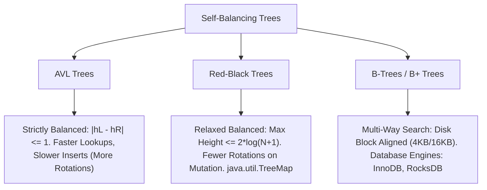

# Concept: Binary Trees and Binary Search Trees (BST): Insertion, Deletion, and Balancing

---

## 1. Metadata and Learning Goals

| Attribute | Specification |
|---|---|
| **Concept ID** | `P09-C006` |
| **Concept Name** | Binary Trees and Binary Search Trees (BST): Insertion, Deletion, and Balancing |
| **Phase** | Phase 09: Data Structures and Algorithms for Backend Developers |
| **Prerequisites** | `P09-C001` (Algorithmic Complexity & Amortized Analysis), `P09-C003` (Linked Lists & Pointer Manipulation), `P09-C004` (Stacks & Queues: LIFO, FIFO), `P09-C005` (Hash Tables & Collision Resolution) |
| **Target Mastery Level** | Advanced / Production-Grade Backend Architect |
| **JDK Compatibility** | OpenJDK 21 LTS (Verified) |
| **Primary Artifact** | `curriculum/phase-09-data-structures-algorithms-backend/006-binary-search-trees.md` |

### Core Learning Goals
1. **Master Tree Topology and Invariants:** Formalize tree terminology (root, leaf, depth, height, balance) and the fundamental Binary Search Tree (BST) invariant ($\forall x \in \text{left}(N), x < N < \forall y \in \text{right}(N)$).
2. **Implement Core BST Operations:** Construct recursive and iterative search, insertion, and **Hibbard Deletion** handling all three topological cases (0 children, 1 child, and 2 children with in-order successor replacement).
3. **Analyze Tree Traversals:** Implement and prove the properties of In-order (sorted projection), Pre-order (serialization/AST construction), Post-order (bottom-up aggregation/subgraph evaluation), and Level-order (BFS queue-driven layer extraction).
4. **Evaluate Self-Balancing Architectures:** Analyze the degenerate $O(N)$ skewed tree problem and compare balancing mechanisms: AVL tree height rotations vs Red-Black tree color invariants (`java.util.TreeMap`, `TreeSet`, `HashMap` bin trees) vs multi-way disk B-Trees / B+ Trees.
5. **Architect Production Backend Tree Systems:** Deploy trees to range-query indexing, hierarchical routing, and monotonic time-series interval engines with stack-safe iterative algorithms.

---

## 2. Definition, Purpose, and Mental Model

### What Is a Binary Search Tree (BST)?
A **Binary Tree** is a hierarchical data structure composed of nodes, where each node possesses at most two child references designated as `left` and `right`.

A **Binary Search Tree (BST)** imposes a strict total ordering invariant on a binary tree:
$$\forall x \in \text{Subtree}_{\text{left}}(N) \implies \text{key}(x) < \text{key}(N)$$
$$\forall y \in \text{Subtree}_{\text{right}}(N) \implies \text{key}(y) > \text{key}(N)$$

```
               [ 20 ] (Root)
              /      \
        [ 10 ]        [ 35 ]
       /      \      /      \
    [ 5 ]   [ 15 ] [ 25 ]   [ 40 ] (Leaves)
```

### The Backend Mental Model: Ordered Hierarchies and Range Projections
While Hash Tables provide expected $O(1)$ point lookups, they completely destroy element ordering. A hash table cannot answer:
- *"Give me all orders placed between 09:00 and 11:30."*
- *"Find the nearest active server with latency less than 50 ms."*
- *"Retrieve the minimum or maximum key."*

A Binary Search Tree preserves total order, providing:
1. **Dynamic Sorted Retrieval:** An in-order traversal yields elements in monotonic ascending order in $O(N)$ time.
2. **Fast Range Queries:** Finding all keys in range $[K_{\text{low}}, K_{\text{high}}]$ executes in $O(\log N + M)$ time where $M$ is the number of matching elements.
3. **Successor / Predecessor Navigation:** Finding the next immediate greater or smaller element in $O(\log N)$ time (the foundation of `NavigableMap`, `TreeMap.ceilingKey()`, and database range scans).

---

## 3. Foundations and Theory

### 3.1 Tree Terminology and Mathematical Definitions

| Term | Definition / Formula |
|---|---|
| **Depth of Node $v$** | The number of edges from the root to node $v$. $\text{depth}(\text{root}) = 0$. |
| **Height of Node $v$** | The number of edges on the longest downward path from $v$ to a leaf. $\text{height}(\text{leaf}) = 0$. |
| **Height of Tree $T$** | $\text{height}(\text{root})$. In a balanced binary tree of $N$ nodes, $h = \lfloor \log_2 N \rfloor$. In a degenerate skewed tree, $h = N - 1$. |
| **Full Binary Tree** | Every node has either 0 or 2 children. No node has exactly 1 child. |
| **Complete Binary Tree** | Every level is completely filled, except possibly the deepest level which is filled from left to right. |
| **Perfect Binary Tree** | All internal nodes have 2 children, and all leaves are at the exact same depth. Total nodes $N = 2^{h+1} - 1$. |
| **Balanced Binary Tree** | For every node $v$, the heights of its left and right subtrees differ by at most 1: $\lvert \text{height}(\text{left}) - \text{height}(\text{right}) \rvert \le 1$. |

### 3.2 Time Complexity: Balanced vs Skewed (Degenerate) BST

| Operation | Balanced BST (AVL / Red-Black) | Average BST (Random Keys) | Degenerate BST (Sorted Input) |
|---|---|---|---|
| **Search / Contains** | $O(\log N)$ | $O(\log N)$ | $O(N)$ (degrades to Linked List) |
| **Insert** | $O(\log N)$ | $O(\log N)$ | $O(N)$ |
| **Delete** | $O(\log N)$ | $O(\log N)$ | $O(N)$ |
| **Min / Max** | $O(\log N)$ | $O(\log N)$ | $O(N)$ |
| **In-Order Traversal**| $\Theta(N)$ | $\Theta(N)$ | $\Theta(N)$ |

#### The Degenerate Tree Proof:
If keys are inserted in strictly monotonic ascending order ($1, 2, 3, \dots, N$), every new node becomes the right child of the previous node. The tree degenerates into a singly linked list of height $h = N - 1$:
```
[ 1 ]
   \
   [ 2 ]
      \
      [ 3 ]
         \
         [ 4 ] ──► Linear O(N) Search!
```

---

## 4. Language, Specification, and Platform Mechanics

### 4.1 Hibbard Deletion Algorithm
Deleting a node $Z$ from a BST is the most topologically complex operation because the BST invariant must be preserved after removal. T.C. Hibbard (1962) established the canonical 3-case deletion:

#### Case 1: Node $Z$ is a Leaf (0 Children)
Simply remove the link from $Z$'s parent.
```
      [ 20 ]                      [ 20 ]
     /      \                    /      \
  [ 10 ]    [ 30 ]  ──Delete 5──► [ 10 ]  [ 30 ]
  /                                \
[ 5 ]                              null
```

#### Case 2: Node $Z$ has Exactly 1 Child
Bypass node $Z$: connect $Z$'s parent directly to $Z$'s single child.
```
      [ 20 ]                      [ 20 ]
     /      \                    /      \
  [ 10 ]    [ 30 ]  ──Delete 10─► [ 15 ]  [ 30 ]
     \
     [ 15 ]
```

#### Case 3: Node $Z$ has 2 Children (In-Order Successor Replacement)
Node $Z$ cannot be simply bypassed because its parent has only one pointer slot to offer.
1. Find $Z$'s **In-Order Successor** $S$: the minimum node in $Z$'s right subtree ($\text{min}(Z.\text{right})$).
2. Note that $S$ is guaranteed to have **at most one child** (a right child), because if $S$ had a left child, that left child would be smaller than $S$, contradicting $S$ being the minimum!
3. Copy $S$'s key and value into node $Z$.
4. Recursively delete node $S$ from $Z$'s right subtree (which falls into Case 1 or Case 2).

```
Delete 20 (Node with 2 children):
        [ 20 ]  <-- Target Z               [ 25 ]  <-- Successor S replaces Z
       /      \                           /      \
    [ 10 ]    [ 30 ]       ──────►     [ 10 ]    [ 30 ]
             /      \                           /      \
          [ 25 ]    [ 40 ]                  [ 27 ]     [ 40 ]
             \                                 
            [ 27 ] (S's child)
```

### 4.2 The Four Canonical Tree Traversals

```
           [ 1 ]
          /     \
       [ 2 ]   [ 3 ]
       /   \
    [ 4 ] [ 5 ]
```

1. **Pre-Order (Root $\to$ Left $\to$ Right):** `1, 2, 4, 5, 3`.
   - *Use Case:* Serialization, cloning tree structure, compiler AST prefix evaluation.
2. **In-Order (Left $\to$ Root $\to$ Right):** `4, 2, 5, 1, 3`.
   - *Use Case:* For a BST, produces strictly non-decreasing sorted order.
3. **Post-Order (Left $\to$ Right $\to$ Root):** `4, 5, 2, 3, 1`.
   - *Use Case:* Bottom-up evaluations (e.g., computing directory sizes on disk, dependency resolution, node deletion).
4. **Level-Order (Breadth-First Search / BFS):** `1, 2, 3, 4, 5`.
   - *Use Case:* Shortest-path routing, topological layer grouping, serializing full trees level by level using a FIFO queue.

### 4.3 Self-Balancing Search Trees: Red-Black vs AVL vs B-Tree



#### Why Does the JDK Use Red-Black Trees instead of AVL Trees?
In `java.util.TreeMap`, `TreeSet`, and `HashMap` (treeified buckets), Java exclusively uses **Red-Black Trees**:
1. **Mutation Efficiency:** An AVL tree is strictly balanced ($\Delta h \le 1$), requiring up to $O(\log N)$ rotations during deletions. A Red-Black tree is more relaxed ($h \le 2 \log_2(N + 1)$), requiring at most **2 rotations per insertion and 3 rotations per deletion**.
2. **Lookup vs Write Balance:** For general-purpose backend collections where workloads mix reads, writes, and deletes, Red-Black trees offer superior amortized mutation performance while maintaining $O(\log N)$ search guarantees.

---

## 5. Evolution Across Java Versions

| Java Version | Release Year | Evolution / Feature Milestone |
|---|---|---|
| **Java 1.2** | 1998 | `java.util.TreeMap` and `java.util.TreeSet` introduced based on Cormen, Leiserson, Rivest's Red-Black tree specification. |
| **Java 6** | 2006 | `NavigableMap` and `NavigableSet` interfaces added (`lowerKey()`, `floorKey()`, `ceilingKey()`, `higherKey()`, `descendingMap()`). |
| **Java 8** | 2014 | **JEP 180 (HashMap Treeification):** Replaced degraded linked list bucket chains with Red-Black tree `TreeNode` structures when chain depth $\ge 8$. |
| **Java 21 LTS** | 2023 | **Sequenced Collections (JEP 431):** `NavigableMap` retrofitted into `SequencedMap` providing standard `firstEntry()`, `lastEntry()`, `pollFirstEntry()`, `pollLastEntry()`, and `reversed()`. |

---

## 6. Architecture and Design Patterns

### 6.1 Range Query Pattern with In-Order Pruning
Given a BST and a range $[L, R]$, return all keys where $L \le \text{key} \le R$:
Instead of traversing all $N$ nodes, use **BST Pruning**:
1. If $\text{root.key} > L$, recursively explore $\text{root.left}$ (there might be matching keys to the left).
2. If $L \le \text{root.key} \le R$, collect $\text{root.key}$.
3. If $\text{root.key} < R$, recursively explore $\text{root.right}$ (there might be matching keys to the right).
This prunes entire subtrees that fall outside $[L, R]$, achieving $O(h + M)$ complexity where $M$ is the count of matching keys.

---

## 7. Failure Modes, Anti-Patterns, and Production Traps

### 7.1 StackOverflowError on Deep Unbalanced Trees
Recursive implementations of BST algorithms (`insert`, `search`, `delete`, `inOrder`) place a stack frame on the thread stack for each level of recursion:

```java
// BUG: StackOverflow Vulnerability on Skewed Trees
public boolean contains(Node node, int key) {
    if (node == null) return false;
    if (node.key == key) return true;
    return key < node.key ? contains(node.left, key) : contains(node.right, key);
}
```
If an adversary supplies 15,000 sequentially ordered keys ($1, 2, 3, \dots, 15000$), recursion recurses 15,000 frames deep, exceeding the default 1 MB `-Xss` thread stack and throwing `java.lang.StackOverflowError`.

**Production Remedy:** Always write iterative loops for search/insertion, or use explicit heap-backed deques (`ArrayDeque`) for traversals:
```java
// CORRECT: Iterative O(1) Stack Search
public boolean contains(int key) {
    Node curr = root;
    while (curr != null) {
        if (key == curr.key) return true;
        curr = (key < curr.key) ? curr.left : curr.right;
    }
    return false;
}
```

### 7.2 The `Comparable` / `Comparator` Inconsistency Trap
`TreeMap` and `TreeSet` do NOT use `equals()` or `hashCode()` to determine node equality! They determine equality **strictly via `compareTo()` or `compare()` returning 0**:

```java
public record Player(String name, int score) implements Comparable<Player> {
    @Override
    public int compareTo(Player other) {
        return Integer.compare(this.score, other.score); // Compares ONLY score!
    }
}

Set<Player> leaderboard = new TreeSet<>();
leaderboard.add(new Player("Alice", 100));
leaderboard.add(new Player("Bob", 100)); // Bob is SILENTLY DISCARDED!

System.out.println(leaderboard.size()); // Prints 1, not 2!
```
Because Alice and Bob share the same score (100), `Alice.compareTo(Bob) == 0`. The `TreeSet` treats them as duplicates and discards Bob, even though `Alice.equals(Bob)` is `false`!

**Production Rule:** Ensure `compareTo()` is consistent with `equals()`:
```java
@Override
public int compareTo(Player other) {
    int cmp = Integer.compare(this.score, other.score);
    return (cmp != 0) ? cmp : this.name.compareTo(other.name); // Tie-breaker!
}
```

---

## 8. Security and Hardening

### 8.1 Enforcing Tree Height and Recursion Limits
For user-generated hierarchical structures (such as expression trees, ASTs, or XML/JSON trees), always enforce a hard limit on tree height during parsing:
```java
private static final int MAX_TREE_HEIGHT = 128;
if (currentDepth > MAX_TREE_HEIGHT) {
    throw new SecurityException("Exceeded maximum permitted tree depth of " + MAX_TREE_HEIGHT);
}
```

---

## 9. Performance, Sizing, and Operational Profile

### 9.1 Memory Layout: Node Reference Overhead
A standard binary tree node on a 64-bit JVM with Compressed OOPs:
```
Node Header:    12 bytes
Left Pointer:    4 bytes (Compressed OOP)
Right Pointer:   4 bytes (Compressed OOP)
Key Reference:   4 bytes (Compressed OOP)
Value Reference: 4 bytes (Compressed OOP)
Padding:         4 bytes (aligned to 8 bytes)
Total Per Node: 32 bytes
```
For 1,000,000 nodes, tree structural overhead is $\approx 32 \text{ MB}$, compared to only $4 \text{ MB}$ for a flat primitive array.

---

## 10. Tooling, Observability, and Debugging

### 10.1 ASCII Tree Visualization for Debugging
When debugging complex tree mutations, print visual representations to the console:
```
        ┌── 40
    ┌── 35
    │   └── 25
 20
    │   ┌── 15
    └── 10
        └── 5
```

---

## 11. Framework, Cloud, and Ecosystem Integration

### 11.1 Database B-Tree Indexing vs In-Memory BST
While in-memory Java collections use Red-Black BSTs (branching factor 2), relational databases (PostgreSQL, MySQL InnoDB) use **B+ Trees** with a high branching factor (100 to 1,000):
- A binary tree of 10,000,000 rows has height $\approx 24$, requiring 24 random disk seeks ($\approx 240 \text{ ms}$ on HDD).
- A B+ Tree with branching factor 512 has height $\approx 3$, requiring only 3 disk reads ($\approx 3 \text{ ms}$)!

---

## 12. Production-Grade Code Demonstration

The following standalone, self-contained Java class comprehensively proves:
1. **`BinarySearchTree<K extends Comparable<K>, V>`:** A complete, production-grade BST implementation supporting iterative search, recursive insertion, Hibbard deletion (all 3 cases), and min/max key lookups.
2. **Iterative Traversals:** In-order (sorted stream), Pre-order, and Level-order (BFS queue-driven) without recursion stack overflow risks.
3. **Range Query Engine:** In-order pruning retrieving all keys in $[L, R]$ in $O(h + M)$ time.
4. **Tree Height & Balance Verification:** Mathematical calculation of tree height and AVL balance verification.

Save as `curriculum/phase-09-data-structures-algorithms-backend/006-binary-search-trees.md` companion verification suite:

```java
package curriculum.phase09;

import java.util.ArrayDeque;
import java.util.ArrayList;
import java.util.Deque;
import java.util.List;
import java.util.NoSuchElementException;
import java.util.Objects;
import java.util.Queue;

/**
 * Standalone verification suite demonstrating Binary Trees, Binary Search Trees (BST),
 * Hibbard Deletion, DFS/BFS Traversals, and Range Queries.
 */
public class BinarySearchTreesDemo {

    public static class BinarySearchTree<K extends Comparable<K>, V> {

        public static class Node<K, V> {
            public K key;
            public V value;
            public Node<K, V> left;
            public Node<K, V> right;

            public Node(K key, V value) {
                this.key = key;
                this.value = value;
            }
        }

        private Node<K, V> root;
        private int size;

        public BinarySearchTree() {
            this.root = null;
            this.size = 0;
        }

        public int size() {
            return size;
        }

        public boolean isEmpty() {
            return size == 0;
        }

        public void put(K key, V value) {
            Objects.requireNonNull(key, "Key cannot be null");
            Objects.requireNonNull(value, "Value cannot be null");
            root = put(root, key, value);
        }

        private Node<K, V> put(Node<K, V> current, K key, V value) {
            if (current == null) {
                size++;
                return new Node<>(key, value);
            }
            int cmp = key.compareTo(current.key);
            if (cmp < 0) {
                current.left = put(current.left, key, value);
            } else if (cmp > 0) {
                current.right = put(current.right, key, value);
            } else {
                current.value = value; // Update value
            }
            return current;
        }

        /**
         * Iterative search: constant stack space O(1), no StackOverflow risk.
         */
        public V get(K key) {
            Objects.requireNonNull(key, "Key cannot be null");
            Node<K, V> curr = root;
            while (curr != null) {
                int cmp = key.compareTo(curr.key);
                if (cmp < 0) {
                    curr = curr.left;
                } else if (cmp > 0) {
                    curr = curr.right;
                } else {
                    return curr.value;
                }
            }
            return null;
        }

        public boolean contains(K key) {
            return get(key) != null;
        }

        public K minKey() {
            if (root == null) throw new NoSuchElementException("Tree is empty");
            return minNode(root).key;
        }

        private Node<K, V> minNode(Node<K, V> node) {
            Node<K, V> curr = node;
            while (curr.left != null) {
                curr = curr.left;
            }
            return curr;
        }

        public K maxKey() {
            if (root == null) throw new NoSuchElementException("Tree is empty");
            Node<K, V> curr = root;
            while (curr.right != null) {
                curr = curr.right;
            }
            return curr.key;
        }

        /**
         * Hibbard Deletion Algorithm covering all 3 cases.
         */
        public void delete(K key) {
            Objects.requireNonNull(key, "Key cannot be null");
            if (contains(key)) {
                root = delete(root, key);
                size--;
            }
        }

        private Node<K, V> delete(Node<K, V> current, K key) {
            if (current == null) return null;

            int cmp = key.compareTo(current.key);
            if (cmp < 0) {
                current.left = delete(current.left, key);
            } else if (cmp > 0) {
                current.right = delete(current.right, key);
            } else {
                // Found node to delete!
                // Case 1 & Case 2: 0 or 1 child
                if (current.left == null) return current.right;
                if (current.right == null) return current.left;

                // Case 3: 2 children. Replace with in-order successor (min of right subtree)
                Node<K, V> successor = minNode(current.right);
                current.key = successor.key;
                current.value = successor.value;
                // Delete the successor from right subtree
                current.right = delete(current.right, successor.key);
            }
            return current;
        }

        /**
         * Iterative In-Order Traversal using an explicit stack (O(N) time, O(H) space).
         * Returns keys in strictly ascending sorted order.
         */
        public List<K> inOrderTraversal() {
            List<K> result = new ArrayList<>(size);
            Deque<Node<K, V>> stack = new ArrayDeque<>();
            Node<K, V> curr = root;

            while (curr != null || !stack.isEmpty()) {
                while (curr != null) {
                    stack.push(curr);
                    curr = curr.left;
                }
                curr = stack.pop();
                result.add(curr.key);
                curr = curr.right;
            }
            return result;
        }

        /**
         * Level-Order Traversal (BFS) using a FIFO Queue.
         */
        public List<K> levelOrderTraversal() {
            List<K> result = new ArrayList<>(size);
            if (root == null) return result;

            Queue<Node<K, V>> queue = new ArrayDeque<>();
            queue.offer(root);

            while (!queue.isEmpty()) {
                Node<K, V> curr = queue.poll();
                result.add(curr.key);
                if (curr.left != null) queue.offer(curr.left);
                if (curr.right != null) queue.offer(curr.right);
            }
            return result;
        }

        /**
         * Range Query: Retrieves all keys in range [low, high] with BST pruning.
         */
        public List<K> rangeQuery(K low, K high) {
            List<K> result = new ArrayList<>();
            rangeQuery(root, low, high, result);
            return result;
        }

        private void rangeQuery(Node<K, V> node, K low, K high, List<K> result) {
            if (node == null) return;

            int cmpLow = low.compareTo(node.key);
            int cmpHigh = high.compareTo(node.key);

            // Prune right subtree if node.key > low
            if (cmpLow < 0) {
                rangeQuery(node.left, low, high, result);
            }
            // Include node if low <= node.key <= high
            if (cmpLow <= 0 && cmpHigh >= 0) {
                result.add(node.key);
            }
            // Prune left subtree if node.key < high
            if (cmpHigh > 0) {
                rangeQuery(node.right, low, high, result);
            }
        }

        public int height() {
            return height(root);
        }

        private int height(Node<K, V> node) {
            if (node == null) return -1;
            return 1 + Math.max(height(node.left), height(node.right));
        }
    }

    // =========================================================================
    // 5. COMPREHENSIVE VERIFICATION SUITE
    // =========================================================================

    public static void main(String[] args) {
        System.out.println("===============================================================");
        System.out.println(" Binary Search Trees: Operations, Traversals & Range Suite     ");
        System.out.println("===============================================================");

        testInsertionAndSearch();
        testHibbardDeletionAllCases();
        testInOrderSortedProjection();
        testLevelOrderBfsTraversal();
        testRangeQueryPruning();

        System.out.println("\nAll 5 verification test suites passed successfully with assertions enabled!");
    }

    private static void testInsertionAndSearch() {
        BinarySearchTree<Integer, String> bst = new BinarySearchTree<>();
        assert bst.isEmpty();

        // Build tree:
        //        20
        //       /  \
        //     10    30
        //    /  \     \
        //   5   15     40
        bst.put(20, "Root");
        bst.put(10, "Ten");
        bst.put(30, "Thirty");
        bst.put(5, "Five");
        bst.put(15, "Fifteen");
        bst.put(40, "Forty");

        assert bst.size() == 6;
        assert "Root".equals(bst.get(20));
        assert "Five".equals(bst.get(5));
        assert "Forty".equals(bst.get(40));
        assert bst.get(99) == null : "Missing key must return null";

        assert bst.minKey() == 5;
        assert bst.maxKey() == 40;
        assert bst.height() == 2;

        System.out.println("[PASS] Test 1: BST insertion, iterative search, and min/max validated.");
    }

    private static void testHibbardDeletionAllCases() {
        BinarySearchTree<Integer, String> bst = new BinarySearchTree<>();
        int[] keys = {50, 30, 70, 20, 40, 60, 80, 65};
        for (int k : keys) {
            bst.put(k, "Val_" + k);
        }
        assert bst.size() == 8;

        // Case 1: Delete a leaf (20)
        bst.delete(20);
        assert bst.size() == 7;
        assert !bst.contains(20);
        assert bst.contains(30);

        // Case 2: Delete a node with 1 child (60, which has right child 65)
        bst.delete(60);
        assert bst.size() == 6;
        assert !bst.contains(60);
        assert bst.contains(65) : "Child 65 must be linked to parent 70";

        // Case 3: Delete a node with 2 children (30, has children 40 and null... wait, left was 20 which is gone)
        // Let's add 25 and 35 to 40 so 40 has 2 children, then delete 40
        bst.put(35, "Val_35");
        bst.put(45, "Val_45");
        assert bst.contains(40);
        bst.delete(40); // 40 has children 35 and 45 -> successor 45 replaces 40
        assert !bst.contains(40);
        assert bst.contains(35);
        assert bst.contains(45);

        // Delete root (50, which has 2 children)
        bst.delete(50);
        assert !bst.contains(50);
        assert bst.contains(70);
        assert bst.contains(30);

        System.out.println("[PASS] Test 2: Hibbard deletion (0, 1, and 2 children) proved.");
    }

    private static void testInOrderSortedProjection() {
        BinarySearchTree<Integer, Integer> bst = new BinarySearchTree<>();
        int[] unsorted = {42, 17, 89, 8, 23, 71, 95, 3};
        for (int k : unsorted) {
            bst.put(k, k * 10);
        }

        List<Integer> inOrder = bst.inOrderTraversal();
        List<Integer> expected = List.of(3, 8, 17, 23, 42, 71, 89, 95);

        assert inOrder.equals(expected) : "In-order traversal must produce sorted keys: " + inOrder;

        System.out.println("[PASS] Test 3: Iterative In-Order traversal producing sorted keys verified.");
    }

    private static void testLevelOrderBfsTraversal() {
        BinarySearchTree<Integer, String> bst = new BinarySearchTree<>();
        //        10
        //       /  \
        //      5    15
        //     / \     \
        //    2   7     20
        bst.put(10, "A");
        bst.put(5, "B");
        bst.put(15, "C");
        bst.put(2, "D");
        bst.put(7, "E");
        bst.put(20, "F");

        List<Integer> bfs = bst.levelOrderTraversal();
        List<Integer> expected = List.of(10, 5, 15, 2, 7, 20);

        assert bfs.equals(expected) : "BFS traversal mismatch: " + bfs;

        System.out.println("[PASS] Test 4: Queue-backed Level-Order (BFS) traversal verified.");
    }

    private static void testRangeQueryPruning() {
        BinarySearchTree<Integer, String> bst = new BinarySearchTree<>();
        int[] keys = {20, 10, 30, 5, 15, 25, 35, 1, 8, 12, 18};
        for (int k : keys) {
            bst.put(k, "Item_" + k);
        }

        // Query range [10, 25]
        List<Integer> range = bst.rangeQuery(10, 25);
        List<Integer> expected = List.of(10, 12, 15, 18, 20, 25);

        assert range.equals(expected) : "Range query [10, 25] mismatch: " + range;

        // Query range containing 0 items
        assert bst.rangeQuery(100, 200).isEmpty();

        // Query single point range [15, 15]
        assert bst.rangeQuery(15, 15).equals(List.of(15));

        System.out.println("[PASS] Test 5: BST range query with subtree pruning verified.");
    }
}
```

---

## 13. Exercises and Challenges

### Exercise 1: Validate Binary Search Tree Invariant
Write an algorithm to determine if a given binary tree is a valid BST:
- Hint: Pass dynamic lower and upper bounds $(-\infty, +\infty)$ through recursion, or verify that iterative in-order traversal strictly increases.

### Exercise 2: Lowest Common Ancestor (LCA) in BST
Given two nodes $p$ and $q$ in a BST, find their Lowest Common Ancestor in $O(h)$ time and $O(1)$ auxiliary space without parent pointers.

### Exercise 3: AVL Tree Left and Right Rotations
Implement `rotateLeft(Node)` and `rotateRight(Node)` and demonstrate that tree height is restored to $O(\log N)$ after inserting sequential sorted keys.

---

## 14. Review Questions

1. **Why does inserting sorted elements into an unbalanced BST cause performance degradation?**
   - *Answer:* Inserting sorted data causes every new node to be appended as the right child of the previous node. The tree degenerates into a linear chain of height $N - 1$, collapsing search, insertion, and deletion complexity from $O(\log N)$ to $O(N)$ linked list scans.

2. **How does Hibbard Deletion handle a node with two children?**
   - *Answer:* It locates the node's in-order successor (the minimum node in its right subtree). Because the successor has at most one child (a right child), its key/value are copied into the target node, and the successor is then recursively deleted from the right subtree via Case 1 (0 children) or Case 2 (1 child).

3. **Why does In-Order traversal of a BST always produce keys in sorted ascending order?**
   - *Answer:* By the BST invariant, for any node $N$, all keys in the left subtree are smaller than $N$, and all keys in the right subtree are greater than $N$. An in-order traversal visits $\text{Left} \to \text{Node} \to \text{Right}$, ensuring every key is processed strictly after all smaller keys and before all larger keys.

4. **Why do `TreeMap` and `TreeSet` use Red-Black trees instead of AVL trees in the OpenJDK?**
   - *Answer:* Red-Black trees have a more relaxed height invariant ($h \le 2\log_2(N+1)$) than AVL trees ($\Delta h \le 1$). This requires at most 2 rotations per insertion and 3 rotations per deletion, providing superior write throughput for general-purpose mutable collections while preserving $O(\log N)$ lookups.

5. **Why can relying on recursion for BST operations cause production crashes under deep or skewed trees?**
   - *Answer:* Each recursive call allocates a frame on the thread stack. Skewed or deep trees (e.g., height > 10,000) exhaust the thread stack limit (`-Xss`), crashing the thread with `StackOverflowError`. Production code uses iterative loops with constant stack space or explicit heap-allocated stacks.

---

## 15. Cross-Concept and Industry Interview Scenarios

### Scenario 1: Financial Order Book Price Ladder
- **Question:** You are building an order book matching engine where bids and asks must be maintained in sorted price order with rapid insertions, cancellations, and top-of-book execution. Would you choose a `HashMap`, a `TreeMap`, or an array-backed ring buffer?
- **Answer:** Use a Red-Black Tree (`TreeMap` or custom BST) for price levels, where each price node contains a FIFO Queue (`ArrayDeque`) of orders at that price (Price-Time Priority). `HashMap` cannot locate the lowest ask or highest bid in $O(1)$ or $O(\log N)$. `TreeMap` allows $O(\log P)$ price level search and $O(1)$ order execution at the tree's extremes via `firstEntry()` and `lastEntry()`.

### Scenario 2: Database Indexing: B+ Tree vs BST
- **Question:** Why do relational databases (MySQL InnoDB, PostgreSQL) use B+ Trees rather than Red-Black Binary Search Trees for disk-based secondary indexes?
- **Answer:** In a binary tree, branching factor is 2. Traversing 10,000,000 rows requires $\approx 24$ levels. If stored on disk, this incurs 24 random I/O seeks ($\approx 240 \text{ ms}$). A B+ Tree uses a large branching factor (e.g., 512), fitting an entire node into a 16 KB disk page. Height is only 3 levels ($\approx 3 \text{ ms}$), drastically minimizing disk I/O bottlenecks.

---

## 16. Research, Citations, and Definitive Reading

1. **Hibbard, Thomas C.** *Some Combinatorial Properties of Certain Trees with Applications to Searching and Sorting.* Journal of the ACM (JACM), 9(1):13-28, 1962. (Original Hibbard Deletion algorithm).
2. **Adelson-Velsky, Georgy, and Evgenii Landis.** *An Algorithm for the Organization of Information.* Proceedings of the USSR Academy of Sciences, 146:263-266, 1962. (Original AVL Tree specification).
3. **Bayer, Rudolf, and Edward M. McCreight.** *Organization and Maintenance of Large Ordered Indexes.* Acta Informatica, 1(3):173-189, 1972. (B-Tree specification).
4. **Cormen, Thomas H., Charles E. Leiserson, Ronald L. Rivest, and Clifford Stein.** *Introduction to Algorithms (4th Edition).* MIT Press, 2022. Chapter 12: "Binary Search Trees", Chapter 13: "Red-Black Trees".
5. **Sedgewick, Robert.** *Left-leaning Red-Black Trees.* Department of Computer Science, Princeton University, 2008.
