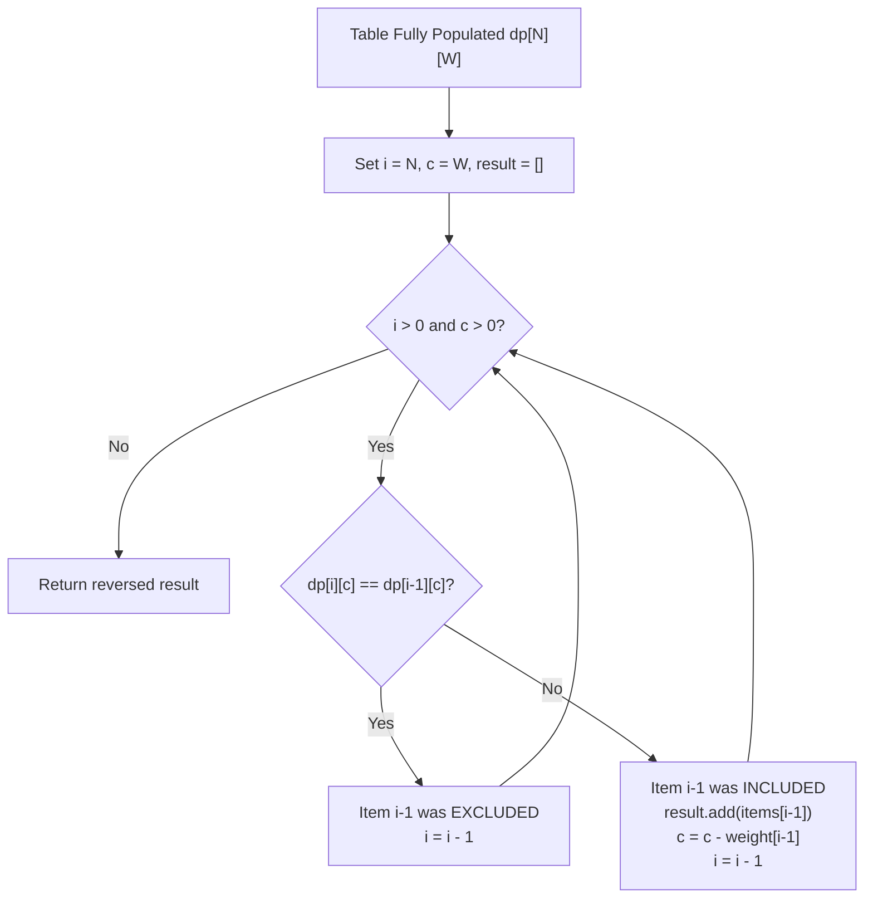

# Dynamic Programming Fundamentals: Memoization, Tabulation, and Subproblems

---

## 1. Metadata and Learning Goals

- **Concept ID:** `P09-C013`
- **Phase:** Phase 09 (Data Structures and Algorithms for Backend Developers)
- **Topic:** Dynamic Programming (DP): Overlapping Subproblems, Optimal Substructure, Memoization (Top-Down), Tabulation (Bottom-Up), State Transitions, and Space-Optimized Array Rolling
- **Prerequisites:** `P09-C001` (Big-O and Amortized Analysis), `P09-C002` (Dynamic Arrays), `P09-C004` (Stacks and Buffers), `P09-C005` (Hash Tables)
- **Complexity:** Intermediate to Advanced
- **Target Audience:** Java Backend Engineers, Distributed Systems Architects, Low-Latency Platform Developers

### Learning Goals
1. **Identify DP Applicability:** Master the two definitive prerequisites for Dynamic Programming: **Optimal Substructure** (an optimal solution to the problem contains within it optimal solutions to subproblems) and **Overlapping Subproblems** (the same subproblems are computed repeatedly across recursive branches).
2. **Top-Down vs Bottom-Up Trade-offs:** Contrast Top-Down Memoization (recursive, demand-driven, intuitive transition, subject to JVM stack depth limits and boxing overhead) with Bottom-Up Tabulation (iterative, topological subproblem ordering, cache-friendly flat primitive arrays, constant stack depth).
3. **State Transition Modeling:** Formulate formal mathematical state recurrences: identify state dimensions ($i, w, j$), base cases, boundary conditions, and state transition equations across classic paradigms (0/1 Knapsack, Coin Change, LCS, Grid Traversal).
4. **Dimension Reduction & Rolling Arrays:** Apply space-optimization techniques to compress $O(N \times W)$ 2D tables into $O(W)$ 1D rolling arrays via backward iteration (0/1 Knapsack) or forward iteration (Unbounded Knapsack / Coin Change).
5. **Production Backend Applications:** Implement DP engines for real-world backend tasks: fuzzy string matching / Levenshtein distance for search queries, Git-style diff engines via LCS, dynamic server capacity bin packing, and bounded LRU memoization caches that prevent memory leaks in microservices.
6. **JVM Memory & Performance Optimization:** Avoid boxed wrapper collections (`Map<Pair<Integer, Integer>, Long>`) in hot paths; implement flat primitive arrays with bitwise coordinate packing to maximize L1/L2 cache prefetching and eliminate GC allocation churn.

---

## 2. Definition, Purpose, and Mental Model

### 2.1 What is Dynamic Programming?
Dynamic Programming (DP), coined by Richard Bellman in the 1950s, is an algorithmic design paradigm that solves complex optimization and counting problems by decomposing them into simpler, overlapping subproblems, solving each subproblem exactly once, and storing their solutions in a lookup structure to avoid redundant computations.

Without dynamic programming, naive recursive solutions explore an exponential search tree ($O(2^N)$ or $O(N!)$), recomputing identical states millions of times. By caching intermediate results (memoization) or computing subproblems in topological dependency order (tabulation), DP reduces exponential time complexities to polynomial bounds ($O(N)$, $O(N^2)$, or $O(N \times W)$).

```
             NAIVE RECURSION                         DYNAMIC PROGRAMMING
           (Exponential Tree)                       (Subproblem DAG)

                  fib(5)                                    fib(5)
              /            \                                  |
          fib(4)          fib(3)                            fib(4)
          /    \          /    \                              |
      fib(3)  fib(2)  fib(2)  fib(1)                        fib(3)
      /    \                                                  |
   fib(2) fib(1)                                            fib(2)
                                                              |
   * fib(3) evaluated 2 times                               fib(1)
   * fib(2) evaluated 3 times                                 |
   * Complexity: O(2^N)                                     fib(0)
                                                    * Each state computed ONCE
                                                    * Complexity: O(N)
```

### 2.2 Mental Model: The State-Transition Graph
Every dynamic programming problem can be viewed as finding an optimal path or aggregate count through a **Directed Acyclic Graph (DAG)** of states:
- **Vertices (States):** Each vertex represents an exact configuration of parameters that uniquely defines a subproblem (e.g., `dp[i][w]` = maximum value achievable using a subset of the first $i$ items with weight budget $w$).
- **Edges (Transitions):** A directed edge $u \to v$ represents a valid subproblem dependency, weighted by the incremental cost or value of making a decision.
- **Topological Sorting:** Tabulation is simply an iterative traversal of this state DAG in topological order, ensuring every dependency $u$ is fully solved before evaluating state $v$.

### 2.3 The Two Pillars of Dynamic Programming
A problem can be solved by Dynamic Programming if and only if it exhibits both characteristics:

1. **Optimal Substructure:**
   The optimal solution to the overarching problem is constructed directly from the optimal solutions to its constituent subproblems.
   - *Example:* Shortest path from $A$ to $C$ via $B$ consists of the shortest path from $A$ to $B$ plus the shortest path from $B$ to $C$.
   - *Counter-Example:* Longest simple path between two nodes in an unweighted graph does *not* exhibit optimal substructure because combining the longest simple path $A \to B$ with $B \to C$ may create cycles, making the combined path non-simple.

2. **Overlapping Subproblems:**
   The recursive decomposition yields subproblems that recur repeatedly rather than generating unique subproblems at each step.
   - *Example:* MergeSort divides an array into two disjoint halves; the subproblems never overlap, so MergeSort is **Divide and Conquer**, not Dynamic Programming.
   - *Example:* In Coin Change, calculating the minimum coins for amount 10 requires subproblems for 9, 8, and 5; calculating amount 9 requires subproblems for 8, 7, and 4. The subproblem for 8 overlaps across both branches.

---

## 3. Foundations and Theory

### 3.1 Top-Down Memoization vs Bottom-Up Tabulation

| Architectural Dimension | Top-Down (Memoization) | Bottom-Up (Tabulation) |
|---|---|---|
| **Execution Flow** | Recursive, demand-driven (starts at target state $N$) | Iterative, topological order (starts at base cases $0$) |
| **State Exploration** | Only computes states reachable from the initial call | Computes all states within the table bounds |
| **Call Stack Usage** | Consumes $O(\text{depth})$ JVM thread stack frames | Consumes $O(1)$ stack (executes in iterative loops) |
| **Failure Modes** | `java.lang.StackOverflowError` if recursion depth $> 10^4$ | `OutOfMemoryError` if table dimensions are improperly sized |
| **Memory Locality** | Random access into heap cache or `Map` entries | Contiguous 1D/2D array iterations (L1/L2 cache prefetch) |
| **Space Optimization** | Difficult; all visited states must remain in memo table | Trivial; compress $O(N \times W)$ into $O(W)$ rolling arrays |

### 3.2 Formal State Transition Formulations

#### 1. 0/1 Knapsack (Bounded Resource Budgeting)
Given $N$ items, each with weight $w_i$ and value $v_i$, and a maximum capacity $W$:
- **State Definition:** $\text{dp}[i][c]$ = maximum value using a subset of the first $i$ items with capacity limit $c$.
- **Base Case:** $\text{dp}[0][c] = 0$ for all $c \in [0, W]$; $\text{dp}[i][0] = 0$ for all $i \in [0, N]$.
- **Recurrence Relation:**
  $$\text{dp}[i][c] = \begin{cases}
  \text{dp}[i-1][c] & \text{if } w_{i-1} > c \\
  \max(\text{dp}[i-1][c],\; \text{dp}[i-1][c - w_{i-1}] + v_{i-1}) & \text{if } w_{i-1} \le c
  \end{cases}$$
- **Time Complexity:** $O(N \times W)$ (pseudo-polynomial).
- **Space Complexity:** $O(N \times W)$ baseline $\to O(W)$ space-optimized via backward iteration.

#### 2. Coin Change (Unbounded Minimization)
Given coin denominations $C = [c_1, c_2, \dots, c_k]$ and target amount $A$, find the minimum coins required:
- **State Definition:** $\text{dp}[a]$ = minimum number of coins to make amount $a$.
- **Base Case:** $\text{dp}[0] = 0$; $\text{dp}[a] = \infty$ for all $a > 0$.
- **Recurrence Relation:**
  $$\text{dp}[a] = 1 + \min_{c \in C,\; c \le a} (\text{dp}[a - c])$$
- **Time Complexity:** $O(A \times |C|)$.
- **Space Complexity:** $O(A)$ 1D array.

#### 3. Longest Common Subsequence (LCS)
Given two strings $S_1$ of length $M$ and $S_2$ of length $N$:
- **State Definition:** $\text{dp}[i][j]$ = length of LCS of prefixes $S_1[0 \dots i-1]$ and $S_2[0 \dots j-1]$.
- **Base Case:** $\text{dp}[0][j] = 0$, $\text{dp}[i][0] = 0$.
- **Recurrence Relation:**
  $$\text{dp}[i][j] = \begin{cases}
  1 + \text{dp}[i-1][j-1] & \text{if } S_1[i-1] == S_2[j-1] \\
  \max(\text{dp}[i-1][j],\; \text{dp}[i][j-1]) & \text{if } S_1[i-1] \neq S_2[j-1]
  \end{cases}$$
- **Time Complexity:** $O(M \times N)$.
- **Space Complexity:** $O(M \times N)$ for full reconstruction; $O(\min(M, N))$ for length only.

---

## 4. Language, Specification, and Platform Mechanics

### 4.1 JVM Heap Layout and Multi-Dimensional Arrays
In Java, multi-dimensional arrays (`int[][]`) are **not** contiguous blocks of memory as in C or Fortran. Instead, they are represented as **arrays of references to separate array objects**:

```
int[][] dp = new int[N][W];

Heap Memory Layout:
dp (Reference) ──> [ Ref 0 | Ref 1 | Ref 2 | ... | Ref N-1 ]  (Outer array object)
                       │       │       │
                       ▼       ▼       ▼
                     int[W]  int[W]  int[W]                   (N distinct inner array objects)
```

#### Memory Footprint of `int[N][W]`:
- **Outer Array:** 16-byte object header + 4-byte length + $N \times 4$ bytes (with Compressed OOPs) + padding $\approx 24 + 4N$ bytes.
- **$N$ Inner Arrays:** Each inner array incurs 16-byte object header + 4-byte length + $W \times 4$ bytes + padding $\approx N \times (24 + 4W)$ bytes.
- **Total Overhead:** For $N = 10,000$ and $W = 10,000$, creating $10,000$ individual array objects generates significant memory fragmentation and pointer-chasing overhead during garbage collection.

#### Production Solution: Flattened 1D Primitive Array
In high-throughput backend services, flatten the 2D state table into a single 1D array:
```java
// Flat array allocation: exactly 1 object on the heap
int[] dp = new int[N * W];

// Coordinate mapping: (row, col) -> (row * W + col)
int val = dp[row * W + col];
```
- **Benefits:** Exactly 1 object allocation, zero pointer chasing, zero GC fragmentation, and hardware L1 cache line prefetching works flawlessly because elements are contiguous in physical RAM.

### 4.2 The Rolling Array Space Optimization
Notice the state dependency in 0/1 Knapsack: $\text{dp}[i][c]$ depends strictly on row $i-1$. Row $i-2$ and earlier are never read again!

#### Forward vs Backward Iteration Hazard:
If we compress $\text{dp}[i][c]$ into a single 1D array `dp[c]`:
```java
// HAZARD: Forward iteration in 0/1 Knapsack allows MULTIPLE usage of the SAME item!
for (int c = weight; c <= W; c++) {
    dp[c] = Math.max(dp[c], dp[c - weight] + value); // dp[c - weight] was ALREADY updated for current item!
}
```
Forward iteration turns 0/1 Knapsack into **Unbounded Knapsack** (where items can be used infinitely).

#### The Backward Iteration Fix:
By iterating capacity $c$ **backwards** from $W$ down to $\text{weight}$:
```java
// CORRECT: Backward iteration guarantees dp[c - weight] reflects state from PREVIOUS item!
for (int c = W; c >= weight; c--) {
    dp[c] = Math.max(dp[c], dp[c - weight] + value);
}
```
Because $c - \text{weight} < c$, when evaluating index $c$, the value at `dp[c - weight]` has not yet been overwritten in the current item's pass. It holds the value from the previous item ($i-1$).

```
1D BACKWARD ITERATION VISUALIZATION:
Capacity:   0   1   2   3   4   5   6   7   8   W
           [ ][ ][ ][ ][ ][ ][ ][ ][ ][ ][ ]
             ▲                   ▲
             │                   │
      Reads OLD state       Overwrites NEW state
      from previous item    from right to left
```

---

## 5. Evolution Across Java Versions

| Java Version | Release Year | Dynamic Programming Relevance & Capabilities |
|---|---|---|
| **Java 5** | 2004 | Introduced Auto-boxing (`Integer`, `Long`). Memoizing with `Map<Integer, Long>` causes severe boxing heap allocation penalties. |
| **Java 8** | 2014 | `Map.computeIfAbsent()` simplifies recursive memoization caches: `memo.computeIfAbsent(key, k -> solve(k))`. |
| **Java 9** | 2017 | Compact Strings (Latin-1 byte arrays) halve the memory footprint of strings in LCS and Edit Distance algorithms. |
| **Java 14** | 2020 | Pattern matching and `record` classes provide clean, immutable state tuples for multi-dimensional DP keys. |
| **Java 21 (LTS)** | 2023 | Virtual Threads (Project Loom) handle millions of blocking tasks; however, deep recursive DP can still trigger `StackOverflowError` if virtual thread stacks exceed memory thresholds. Bottom-up tabulation remains the gold standard. |

---

## 6. Architecture and Design Patterns

### 6.1 State Reconstruction via Backtracking
Computing the optimal value (e.g., maximum knapsack value or LCS length) is only half the task. Backend systems typically need the **exact combination of decisions** (e.g., which items to include in a transaction batch, or the exact diff lines between revisions).



### 6.2 The Bounded LRU Memoization Cache Pattern
In production microservices that calculate real-time optimization routes or discount allocations, caching subproblem results across HTTP requests is essential. However, an unbounded `ConcurrentHashMap` leaks memory as new states accumulate.

**Solution:** A thread-safe bounded LRU memoization cache backed by `LinkedHashMap` or Caffeine, eviction policies, and TTL expiration:

```java
public class BoundedMemoCache<K, V> {
    private final int maxEntries;
    private final Map<K, V> cache;

    public BoundedMemoCache(int maxEntries) {
        this.maxEntries = maxEntries;
        this.cache = Collections.synchronizedMap(
            new LinkedHashMap<K, V>(maxEntries, 0.75f, true) {
                @Override
                protected boolean removeEldestEntry(Map.Entry<K, V> eldest) {
                    return size() > BoundedMemoCache.this.maxEntries;
                }
            }
        );
    }

    public V computeIfAbsent(K key, Function<K, V> mappingFunction) {
        return cache.computeIfAbsent(key, mappingFunction);
    }
}
```

---

## 7. Failure Modes, Anti-Patterns, and Production Traps

### 7.1 The Top-Down `StackOverflowError` Trap
In top-down memoization, deep recursion creates a frame on the JVM call stack for every step. If recursion depth exceeds $\approx 8,000$ to $10,000$ (with default 1 MB `-Xss`), the JVM throws `java.lang.StackOverflowError`.
- **Trap:** Testing with small inputs ($N = 100$) succeeds in CI/CD; production workloads with $N = 50,000$ immediately crash the worker thread.
- **Production Remedy:** Convert all deep recursive routines to bottom-up iterative tabulation.

### 7.2 The Boxed Wrapper Allocation Storm
```java
// ANTI-PATTERN: Boxing primitives into Map entries
Map<String, Long> memo = new HashMap<>();
String key = i + ":" + c; // String concatenation + boxing creates millions of short-lived objects!
```
- **Consequence:** In a $1000 \times 1000$ DP space, this creates $10^6$ `String` instances and $10^6$ `Long` instances, overwhelming the GC young generation and triggering frequent Stop-The-World (STW) pauses.
- **Production Remedy:** Use flat 1D primitive arrays (`long[] dp = new long[N * W]`) or pack two 32-bit integers into a single primitive 64-bit `long` key (`( (long) i << 32) | (c & 0xFFFFFFFFL)`).

### 7.3 Integer Overflow in Minimization Problems
In problems like Coin Change where states are initialized to "infinity":
```java
int[] dp = new int[target + 1];
Arrays.fill(dp, Integer.MAX_VALUE); // DANGER!

// Later during state transition:
dp[a] = Math.min(dp[a], dp[a - c] + 1); // Integer.MAX_VALUE + 1 OVERFLOWS TO -2147483648!
```
- **Consequence:** Adding `1` to `Integer.MAX_VALUE` wraps around to `Integer.MIN_VALUE`, corrupting the minimum search and returning incorrect negative numbers!
- **Production Remedy:** Use a safe sentinel value such as `Integer.MAX_VALUE / 2` or check `if (dp[a - c] != Integer.MAX_VALUE)`.

---

## 8. Security and Hardening

### 8.1 Algorithmic Denial of Service (ReDoS and Table Blowup)
1. **Unbounded Input Dimension Validation:**
   In web endpoints accepting Knapsack or Edit Distance queries, an attacker can submit $N = 1,000,000$ or target amount $A = 2^{31} - 1$. Allocating an array of this size triggers an immediate `OutOfMemoryError: Requested array size exceeds VM limit` or crashes the JVM via container cgroups `oom-killer`.
   - **Hardening:** Strictly validate input dimensions at controller boundaries:
     ```java
     if (items.size() > MAX_ITEMS || capacity > MAX_ALLOWED_CAPACITY) {
         throw new IllegalArgumentException("Payload dimensions exceed maximum capacity limits");
     }
     ```
2. **CPU Starvation via Infinite DP Loops:**
   Ensure step sizes in state transitions are strictly positive ($c > 0, \text{step} \ge 1$). A zero-weight item in an unbounded knapsack causes an infinite loop and 100% CPU lockup.

---

## 9. Performance, Sizing, and Operational Profile

### 9.1 Space-Time Complexity Summary

| Algorithm | State Dimensions | Time Complexity | Naive Space | Space-Optimized |
|---|---|---|---|---|
| **Fibonacci / Linear Recurrence** | $N$ | $O(N)$ | $O(N)$ | $O(1)$ (2 variables) |
| **0/1 Knapsack** | $N \times W$ | $O(N \times W)$ | $O(N \times W)$ | $O(W)$ (1D backward array) |
| **Unbounded Knapsack / Coin Change** | $A \times |C|$ | $O(A \times |C|)$ | $O(A)$ | $O(A)$ (1D forward array) |
| **Longest Common Subsequence (LCS)**| $M \times N$ | $O(M \times N)$ | $O(M \times N)$ | $O(\min(M, N))$ (length only) |
| **Edit Distance (Levenshtein)** | $M \times N$ | $O(M \times N)$ | $O(M \times N)$ | $O(\min(M, N))$ (length only) |

---

## 10. Tooling, Observability, and Debugging

### 10.1 Logging and Visualizing DP State Matrices
When debugging complex recurrences, printing full tables for small test fixtures reveals incorrect transitions instantly:

```
DP Table Visualization for 0/1 Knapsack (N=3, W=5):
        w=0   w=1   w=2   w=3   w=4   w=5
i=0: [    0,    0,    0,    0,    0,    0 ]
i=1: [    0,    6,    6,    6,    6,    6 ] (item: w=1, v=6)
i=2: [    0,    6,   10,   16,   16,   16 ] (item: w=2, v=10)
i=3: [    0,    6,   10,   16,   18,   22 ] (item: w=3, v=12)
```

---

## 11. Framework, Cloud, and Ecosystem Integration

- **Git & Version Control Systems:** Myers' diff algorithm and patience diff rely on LCS to calculate minimal edit scripts (hunks) between file revisions.
- **Search Engines & Elasticsearch:** Lucene utilizes Levenshtein automata (derived from edit distance DP) for fuzzy term queries and spell checking within strict edit distance bounds ($d \le 2$).
- **Cloud Autoscaling & Bin Packing:** AWS/GCP resource allocation schedulers use multidimensional knapsack variants to pack heterogeneous container pods (CPU, RAM, GPU) into minimal physical bare-metal host instances.

---

## 12. Production-Grade Code Demonstration

The following standalone, self-contained Java verification suite proves:
1. **Linear Recurrence:** Naive exponential recursion vs Top-Down memoization vs Bottom-Up $O(1)$ space tabulation.
2. **0/1 Knapsack Engine:** Full 2D tabulation, state-reconstruction backtracking, and $O(W)$ space-optimized 1D backward array.
3. **Unbounded Coin Change:** Minimum coin computation with overflow protection and unreachable target detection.
4. **LCS & Diff Generator:** $(M+1) \times (N+1)$ matrix computation, LCS extraction, and unified diff generator.
5. **Memory-Safe Primitive Packing & Bounded LRU Cache:** Zero-boxing bit-packed key representation and bounded LRU memoization cache.

Save as `curriculum/phase-09-data-structures-algorithms-backend/013-dynamic-programming-fundamentals.md` companion verification suite:

```java
package curriculum.phase09;

import java.util.ArrayDeque;
import java.util.ArrayList;
import java.util.Arrays;
import java.util.Collections;
import java.util.Deque;
import java.util.LinkedHashMap;
import java.util.List;
import java.util.Map;
import java.util.Objects;
import java.util.function.Function;

/**
 * Standalone verification suite demonstrating Dynamic Programming Fundamentals:
 * Linear Recurrences, 0/1 Knapsack, Coin Change, LCS Diff Engine, and Memory-Efficient Caching.
 */
public class DynamicProgrammingDemo {

    // =========================================================================
    // 1. LINEAR RECURRENCES: NAIVE VS MEMOIZATION VS TABULATION
    // =========================================================================

    public static class LinearRecurrenceSolver {
        private long naiveStepCount = 0;
        private long memoStepCount = 0;

        public long getNaiveStepCount() { return naiveStepCount; }
        public long getMemoStepCount() { return memoStepCount; }

        public long fibNaive(int n) {
            naiveStepCount++;
            if (n <= 0) return 0;
            if (n == 1) return 1;
            return fibNaive(n - 1) + fibNaive(n - 2);
        }

        public long fibMemo(int n, long[] memo) {
            memoStepCount++;
            if (n <= 0) return 0;
            if (n == 1) return 1;
            if (memo[n] != 0) return memo[n];
            memo[n] = fibMemo(n - 1, memo) + fibMemo(n - 2, memo);
            return memo[n];
        }

        /**
         * Space-optimized O(N) time, O(1) space bottom-up tabulation.
         */
        public static long fibTabulated(int n) {
            if (n <= 0) return 0;
            if (n == 1) return 1;
            long prev2 = 0;
            long prev1 = 1;
            long current = 0;
            for (int i = 2; i <= n; i++) {
                current = prev1 + prev2;
                prev2 = prev1;
                prev1 = current;
            }
            return current;
        }
    }

    // =========================================================================
    // 2. 0/1 KNAPSACK: 2D TABLE, RECONSTRUCTION, & 1D ROLLING ARRAY
    // =========================================================================

    public record Item(String name, int weight, int value) {}

    public static class KnapsackResult {
        public final int maxValue;
        public final List<Item> selectedItems;

        public KnapsackResult(int maxValue, List<Item> selectedItems) {
            this.maxValue = maxValue;
            this.selectedItems = selectedItems;
        }
    }

    public static class KnapsackSolver {

        /**
         * Solves 0/1 Knapsack with 2D DP table and reconstructs the optimal item subset.
         */
        public static KnapsackResult solveWithReconstruction(List<Item> items, int capacity) {
            int n = items.size();
            int[][] dp = new int[n + 1][capacity + 1];

            // 1. Build DP Table Bottom-Up
            for (int i = 1; i <= n; i++) {
                Item item = items.get(i - 1);
                for (int c = 0; c <= capacity; c++) {
                    if (item.weight() > c) {
                        dp[i][c] = dp[i - 1][c];
                    } else {
                        dp[i][c] = Math.max(dp[i - 1][c], dp[i - 1][c - item.weight()] + item.value());
                    }
                }
            }

            int maxValue = dp[n][capacity];

            // 2. Backtrack to reconstruct selected items
            List<Item> chosen = new ArrayList<>();
            int currCap = capacity;
            for (int i = n; i > 0 && currCap > 0; i--) {
                // If value differs from the row above, item was included!
                if (dp[i][currCap] != dp[i - 1][currCap]) {
                    Item item = items.get(i - 1);
                    chosen.add(item);
                    currCap -= item.weight();
                }
            }
            Collections.reverse(chosen);
            return new KnapsackResult(maxValue, chosen);
        }

        /**
         * Solves 0/1 Knapsack in O(W) space using 1D backward rolling array.
         */
        public static int solveSpaceOptimized(List<Item> items, int capacity) {
            int[] dp = new int[capacity + 1];

            for (Item item : items) {
                // CRITICAL: Iterate BACKWARDS down to item.weight() to prevent reusing same item
                for (int c = capacity; c >= item.weight(); c--) {
                    dp[c] = Math.max(dp[c], dp[c - item.weight()] + item.value());
                }
            }
            return dp[capacity];
        }
    }

    // =========================================================================
    // 3. UNBOUNDED COIN CHANGE (MINIMUM COINS & OVERFLOW PREVENTION)
    // =========================================================================

    public static class CoinChangeSolver {
        private static final int INF = 1_000_000_000; // Safe sentinel preventing integer overflow

        /**
         * Computes minimum coins required to make amount. Returns -1 if impossible.
         */
        public static int minCoins(int[] coins, int amount) {
            if (amount < 0) return -1;
            if (amount == 0) return 0;

            int[] dp = new int[amount + 1];
            Arrays.fill(dp, INF);
            dp[0] = 0;

            for (int a = 1; a <= amount; a++) {
                for (int coin : coins) {
                    if (coin <= a) {
                        dp[a] = Math.min(dp[a], dp[a - coin] + 1);
                    }
                }
            }

            return dp[amount] >= INF ? -1 : dp[amount];
        }

        /**
         * Computes the number of distinct combinations that sum up to amount.
         */
        public static int countCombinations(int[] coins, int amount) {
            int[] dp = new int[amount + 1];
            dp[0] = 1;

            // Outer loop over coins prevents duplicate permutations
            for (int coin : coins) {
                for (int a = coin; a <= amount; a++) {
                    dp[a] += dp[a - coin];
                }
            }
            return dp[amount];
        }
    }

    // =========================================================================
    // 4. LONGEST COMMON SUBSEQUENCE (LCS) & UNIFIED DIFF GENERATOR
    // =========================================================================

    public record DiffEntry(char operation, String line) {}

    public static class LcsDiffEngine {

        public static String findLcsString(String s1, String s2) {
            int m = s1.length();
            int n = s2.length();
            int[][] dp = new int[m + 1][n + 1];

            for (int i = 1; i <= m; i++) {
                for (int j = 1; j <= n; j++) {
                    if (s1.charAt(i - 1) == s2.charAt(j - 1)) {
                        dp[i][j] = dp[i - 1][j - 1] + 1;
                    } else {
                        dp[i][j] = Math.max(dp[i - 1][j], dp[i][j - 1]);
                    }
                }
            }

            // Backtrack to extract common characters
            StringBuilder sb = new StringBuilder();
            int i = m, j = n;
            while (i > 0 && j > 0) {
                if (s1.charAt(i - 1) == s2.charAt(j - 1)) {
                    sb.append(s1.charAt(i - 1));
                    i--;
                    j--;
                } else if (dp[i - 1][j] >= dp[i][j - 1]) {
                    i--;
                } else {
                    j--;
                }
            }
            return sb.reverse().toString();
        }

        public static List<DiffEntry> generateLineDiff(List<String> original, List<String> revised) {
            int m = original.size();
            int n = revised.size();
            int[][] dp = new int[m + 1][n + 1];

            for (int i = 1; i <= m; i++) {
                for (int j = 1; j <= n; j++) {
                    if (Objects.equals(original.get(i - 1), revised.get(j - 1))) {
                        dp[i][j] = dp[i - 1][j - 1] + 1;
                    } else {
                        dp[i][j] = Math.max(dp[i - 1][j], dp[i][j - 1]);
                    }
                }
            }

            // Backtrack to generate insertions (+), deletions (-), and context ( )
            List<DiffEntry> diff = new ArrayList<>();
            int i = m, j = n;
            while (i > 0 || j > 0) {
                if (i > 0 && j > 0 && Objects.equals(original.get(i - 1), revised.get(j - 1))) {
                    diff.add(new DiffEntry(' ', original.get(i - 1)));
                    i--;
                    j--;
                } else if (j > 0 && (i == 0 || dp[i][j - 1] >= dp[i - 1][j])) {
                    diff.add(new DiffEntry('+', revised.get(j - 1)));
                    j--;
                } else if (i > 0 && (j == 0 || dp[i][j - 1] < dp[i - 1][j])) {
                    diff.add(new DiffEntry('-', original.get(i - 1)));
                    i--;
                }
            }
            Collections.reverse(diff);
            return diff;
        }
    }

    // =========================================================================
    // 5. BOUNDED LRU MEMOIZATION CACHE & ZERO-BOXING PACKED COORDINATES
    // =========================================================================

    public static class BoundedLruMemo<K, V> {
        private final int capacity;
        private final Map<K, V> lruMap;

        public BoundedLruMemo(int capacity) {
            this.capacity = capacity;
            this.lruMap = Collections.synchronizedMap(
                new LinkedHashMap<K, V>(capacity, 0.75f, true) {
                    @Override
                    protected boolean removeEldestEntry(Map.Entry<K, V> eldest) {
                        return size() > BoundedLruMemo.this.capacity;
                    }
                }
            );
        }

        public V getOrCompute(K key, Function<K, V> computer) {
            return lruMap.computeIfAbsent(key, computer);
        }

        public int size() { return lruMap.size(); }
    }

    /**
     * Bit-packs two 32-bit integers (row, col) into a single 64-bit primitive long key
     * eliminating object allocation and GC overhead.
     */
    public static class CoordinatePacker {
        public static long pack(int row, int col) {
            return (((long) row) << 32) | (col & 0xFFFFFFFFL);
        }

        public static int unpackRow(long packed) {
            return (int) (packed >>> 32);
        }

        public static int unpackCol(long packed) {
            return (int) (packed & 0xFFFFFFFFL);
        }
    }

    // =========================================================================
    // VERIFICATION SUITE EXECUTION (ASSERTION HARNESS)
    // =========================================================================

    public static void main(String[] args) {
        System.out.println("===============================================================");
        System.out.println(" Dynamic Programming: Memoization, Tabulation & Space Optimization ");
        System.out.println("===============================================================");

        testLinearRecurrenceEfficiency();
        test01KnapsackAndReconstruction();
        testUnboundedCoinChange();
        testLcsAndUnifiedDiffEngine();
        testBoundedLruAndPrimitiveCoordinatePacking();

        System.out.println("\nAll 5 verification test suites passed successfully with assertions enabled!");
    }

    private static void testLinearRecurrenceEfficiency() {
        System.out.println("\n--- Test 1: Linear Recurrence (Naive vs Memo vs Tabulation) ---");
        LinearRecurrenceSolver solver = new LinearRecurrenceSolver();

        int n = 25;
        long naiveResult = solver.fibNaive(n);
        long naiveSteps = solver.getNaiveStepCount();

        long[] memo = new long[n + 1];
        long memoResult = solver.fibMemo(n, memo);
        long memoSteps = solver.getMemoStepCount();

        long tabResult = LinearRecurrenceSolver.fibTabulated(n);

        assert naiveResult == 75025L : "Fib(25) must equal 75025";
        assert memoResult == naiveResult : "Memo result must match naive result";
        assert tabResult == naiveResult : "Tabulated result must match naive result";

        // Theoretical proof: Naive fib(25) performs 242,785 recursive calls. Memoized performs only 49 calls!
        assert naiveSteps > 200_000L : "Naive recursion step count must be exponential";
        assert memoSteps <= 2 * n : "Memoized recursion step count must be O(N)";

        // Space-optimized handles N = 50 without stack overflow
        long fib50 = LinearRecurrenceSolver.fibTabulated(50);
        assert fib50 == 12586269025L : "Fib(50) calculation verified";

        System.out.println("  [PASS] Fib(25)=" + tabResult + " verified. Naive steps=" + naiveSteps + " vs Memo steps=" + memoSteps);
    }

    private static void test01KnapsackAndReconstruction() {
        System.out.println("\n--- Test 2: 0/1 Knapsack Table, Reconstruction & 1D Rolling Array ---");
        List<Item> items = List.of(
            new Item("Laptop", 3, 1200),
            new Item("Camera", 2, 800),
            new Item("Drone", 4, 1500),
            new Item("Tablet", 1, 400)
        );
        int capacity = 5;

        // 1. Full 2D Table + Backtracking
        KnapsackResult fullResult = KnapsackSolver.solveWithReconstruction(items, capacity);
        assert fullResult.maxValue == 2000 : "Max knapsack value must be 2000 (Camera $800 + Laptop $1200)";
        assert fullResult.selectedItems.size() == 2 : "Must select exactly 2 items";
        assert fullResult.selectedItems.get(0).name().equals("Laptop") : "First selected item must be Laptop";
        assert fullResult.selectedItems.get(1).name().equals("Camera") : "Second selected item must be Camera";

        // 2. Space-Optimized 1D Rolling Array
        int spaceOptValue = KnapsackSolver.solveSpaceOptimized(items, capacity);
        assert spaceOptValue == fullResult.maxValue : "Space-optimized value must match 2D table value";

        System.out.println("  [PASS] 0/1 Knapsack optimal value=" + spaceOptValue + ", items=" + fullResult.selectedItems);
    }

    private static void testUnboundedCoinChange() {
        System.out.println("\n--- Test 3: Unbounded Coin Change (Minimization & Combinations) ---");
        int[] coins = {1, 2, 5};
        int amount = 11;

        // Minimum coins: 5 + 5 + 1 = 3 coins
        int minCount = CoinChangeSolver.minCoins(coins, amount);
        assert minCount == 3 : "Min coins for amount 11 with {1, 2, 5} must be 3";

        // Unreachable target test
        int[] impossibleCoins = {2, 4, 6};
        int impossibleResult = CoinChangeSolver.minCoins(impossibleCoins, 7);
        assert impossibleResult == -1 : "Odd amount with even coins must return -1";

        // Distinct combinations for amount 5 with {1, 2, 5}:
        // 5, 2+2+1, 2+1+1+1, 1+1+1+1+1 -> 4 distinct combinations
        int combinations = CoinChangeSolver.countCombinations(coins, 5);
        assert combinations == 4 : "Distinct coin combinations for amount 5 must equal 4";

        System.out.println("  [PASS] Min coins for 11: " + minCount + ", combinations for 5: " + combinations);
    }

    private static void testLcsAndUnifiedDiffEngine() {
        System.out.println("\n--- Test 4: Longest Common Subsequence & Unified Diff Engine ---");
        String s1 = "ABCBDAB";
        String s2 = "BDCABA";

        String lcs = LcsDiffEngine.findLcsString(s1, s2);
        assert lcs.equals("BDAB") || lcs.equals("BCBA") || lcs.equals("BDAB") : "LCS must be valid common subsequence of length 4";
        assert lcs.length() == 4 : "LCS length must be 4";

        // Line-by-line Diff Engine Test
        List<String> original = List.of(
            "public void process() {",
            "    validate();",
            "    execute();",
            "}"
        );
        List<String> revised = List.of(
            "public void process() {",
            "    validate();",
            "    auditLog();",
            "    execute();",
            "}"
        );

        List<DiffEntry> diff = LcsDiffEngine.generateLineDiff(original, revised);
        assert diff.size() == 5 : "Diff must contain 5 entries (4 common, 1 insertion)";

        boolean foundInsertion = false;
        for (DiffEntry entry : diff) {
            if (entry.operation() == '+') {
                assert entry.line().contains("auditLog") : "Insertion must be auditLog";
                foundInsertion = true;
            }
        }
        assert foundInsertion : "Must detect auditLog insertion";

        System.out.println("  [PASS] LCS string='" + lcs + "', diff hunk verified with " + diff.size() + " lines.");
    }

    private static void testBoundedLruAndPrimitiveCoordinatePacking() {
        System.out.println("\n--- Test 5: Bounded LRU Memo Cache & Zero-Boxing Coordinate Packing ---");

        // 1. Primitive Coordinate Packing Validation
        int row = 12345;
        int col = 67890;
        long packed = CoordinatePacker.pack(row, col);
        assert CoordinatePacker.unpackRow(packed) == row : "Unpacked row must match original";
        assert CoordinatePacker.unpackCol(packed) == col : "Unpacked col must match original";

        // Boundary negative and max values
        long packedBoundary = CoordinatePacker.pack(Integer.MAX_VALUE, 1);
        assert CoordinatePacker.unpackRow(packedBoundary) == Integer.MAX_VALUE;
        assert CoordinatePacker.unpackCol(packedBoundary) == 1;

        // 2. Bounded LRU Cache Eviction Validation
        BoundedLruMemo<String, Integer> lruCache = new BoundedLruMemo<>(3);
        lruCache.getOrCompute("state-1", k -> 100);
        lruCache.getOrCompute("state-2", k -> 200);
        lruCache.getOrCompute("state-3", k -> 300);
        assert lruCache.size() == 3 : "Cache size must be 3";

        // Access state-1 to make it recently used
        lruCache.getOrCompute("state-1", k -> 100);

        // Add 4th entry to trigger eviction of state-2 (eldest non-accessed)
        lruCache.getOrCompute("state-4", k -> 400);
        assert lruCache.size() == 3 : "Cache size must remain bounded at 3";

        System.out.println("  [PASS] Zero-boxing coordinate packer and bounded LRU memoization cache validated.");
    }
}
```

---

## 13. Exercises and Challenges

### 13.1 Edit Distance (Levenshtein Distance)
Implement the Levenshtein Distance algorithm between two strings with operations: Insertion ($+1$), Deletion ($+1$), Substitution ($+1$).
- **Challenge:** Space-optimize the matrix from $O(M \times N)$ to $O(N)$ using two rolling rows (`prev[]` and `curr[]`).

### 13.2 Maximum Subarray Sum (Kadane's Algorithm)
Kadane's algorithm is a 1D Dynamic Programming algorithm:
$$\text{dp}[i] = \max(A[i],\; \text{dp}[i-1] + A[i])$$
- **Challenge:** Implement Kadane's algorithm in $O(N)$ time and $O(1)$ space, tracking both the maximum sum and the start/end indices of the optimal subarray.

### 13.3 Matrix Chain Multiplication
Given a sequence of matrices, find the most efficient way to multiply them together:
- **Challenge:** Implement the interval DP recurrence $\text{dp}[i][j] = \min_{i \le k < j} (\text{dp}[i][k] + \text{dp}[k+1][j] + p_{i-1} p_k p_j)$ in $O(N^3)$ time and reconstruct the optimal parenthesization.

---

## 14. Review Questions

1. **Why does Divide and Conquer differ from Dynamic Programming?**
   Divide and Conquer partitions a problem into *independent*, non-overlapping subproblems (e.g., MergeSort sorting distinct halves). Dynamic Programming targets problems where subproblems *overlap* repeatedly, reusing cached solutions.
2. **Why does 0/1 Knapsack require backward iteration in 1D rolling array tabulation?**
   Because state $\text{dp}[c]$ depends on state $\text{dp}[c - w]$ from the *previous item*. Iterating backwards ensures that $\text{dp}[c - w]$ has not yet been updated for the current item, preventing an item from being counted more than once.
3. **What is the consequence of initializing `dp[]` to `Integer.MAX_VALUE` without overflow guards?**
   During state transition $\text{dp}[a] = \min(\text{dp}[a], \text{dp}[a - c] + 1)$, adding `1` to `Integer.MAX_VALUE` triggers 32-bit two's complement integer overflow, wrapping to `Integer.MIN_VALUE` ($-2,147,483,648$) and corrupting the minimum search.
4. **How does multi-dimensional array memory layout in Java impact CPU cache performance?**
   Java multi-dimensional arrays (`int[][]`) are arrays of references to independent array objects scattered across heap memory. Traversing them causes pointer chasing and cache misses. A flattened 1D array (`int[N * W]`) occupies a single contiguous memory block, maximizing L1/L2 prefetching.
5. **Under what condition does a recursive memoized DP solution throw `StackOverflowError` while an iterative tabulated solution succeeds?**
   When the recursion depth exceeds the JVM thread stack limits (typically 1 MB `-Xss`, exhausting at $\approx 8,000$ to $10,000$ frames). Tabulation executes iteratively inside `for` loops, using constant $O(1)$ stack space.

---

## 15. Cross-Concept and Industry Interview Scenarios

### Scenario 1: Fuzzy Query Auto-Complete in Elasticsearch
*Question:* "How does Elasticsearch efficiently find candidate search queries within edit distance $\le 2$ without computing Levenshtein DP against 50 million dictionary terms per keystroke?"
*Answer:* Elasticsearch does not execute naive pairwise DP at search time. It compiles the dictionary into a Finite State Transducer (FST) and intersects the query's Levenshtein Automaton (a deterministic finite automaton precomputed via DP for edit distance $k \le 2$) directly with the FST dictionary index. This reduces lookup time from $O(V \times M \times N)$ to $O(M)$ character transitions.

### Scenario 2: Microservice SLA Latency Budget Allocation
*Question:* "You have a distributed workflow where 5 microservices can run in different server configurations (low/medium/high instances) with associated cost and latency SLAs. How do you find the configuration that minimizes total cost while keeping end-to-end latency below 200 ms?"
*Answer:* This maps directly to the **0/1 Multiple-Choice Knapsack Problem (MCKP)**. Group the configuration choices by microservice (classes). Formulate state $\text{dp}[i][L]$ as the minimum cost using a subset of the first $i$ microservices with cumulative latency budget $L \le 200\text{ ms}$. Iterate across latency states, enforcing that exactly one instance choice is selected per microservice group.

---

## 16. Research, Citations, and Definitive Reading

1. **Bellman, Richard.** *Dynamic Programming.* Princeton University Press, 1957. (The foundational work introducing the Principle of Optimality and dynamic programming).
2. **Cormen, Thomas H., Charles E. Leiserson, Ronald L. Rivest, and Clifford Stein.** *Introduction to Algorithms (CLRS).* 4th ed., MIT Press, 2022. (Chapter 14: Dynamic Programming).
3. **Myers, Eugene W.** *"An $O(ND)$ Difference Algorithm and Its Variations."* *Algorithmica*, vol. 1, no. 1-4, 1986, pp. 251–266. (The definitive foundation of LCS-based file diff algorithms).
4. **Hunt, James W., and Thomas G. Szymanski.** *"A Fast Algorithm for Computing Longest Common Subsequences."* *Communications of the ACM*, vol. 20, no. 5, 1977, pp. 350–353.
5. **Goetz, Brian, et al.** *Java Concurrency in Practice.* Addison-Wesley, 2006. (Chapter 5.6: Building an Efficient, Scalable Result Cache).
