# Phase 09: Data Structures and Algorithms for Backend Developers

---

## 1. Phase Overview and Purpose

### 1.1 Goal
Master algorithmic complexity (Big-O), fundamental data structures, search/sort algorithms, and graph traversal for backend problem-solving.

### 1.2 Context in Backend Engineering
Backend engineers must choose data structures and design algorithms that scale gracefully under load, avoiding accidental O(N^2) query processing or queue bottlenecks.

---

## 2. Prerequisites and Co-requisites

- **Direct Prerequisites:**
  - Phase 01 (Language Fundamentals), Phase 03 (Collections).
- **Downstream Dependent Phases:**
  - Phase 12 (Concurrency), Phase 21 (Distributed Systems), Phase 22 (Performance).

---

## 3. Measurable Phase Learning Outcomes

By completing Phase 09, the learner will independently be able to:
1. Calculate Big-O time and space complexity for operations, understanding amortized cost.
2. Implement and manipulate linear data structures: Dynamic Arrays, Linked Lists, Stacks, Queues.
3. Use hash tables, binary search trees, and heaps for efficient search and priority scheduling.
4. Apply algorithmic patterns: Two-Pointer, Sliding Window, Prefix Sums, Binary Search, BFS/DFS.
5. Recognize how algorithmic choices affect CPU cache locality and database query optimization.

---

## 4. Concept Inventory and Study Order

| Concept ID | Concept Title | File Name | Importance | Status |
|---|---|---|---|---|
| `P09-C001` | Algorithmic Complexity: Big-O, Big-Omega, Big-Theta, and Amortized Analysis | [`001-big-o-complexity-amortized.md`](001-big-o-complexity-amortized.md) | Essential | COMPLETE |
| `P09-C002` | Dynamic Arrays and Resizing Mechanics: Capacity vs Size and Growth Factors | [`002-dynamic-arrays-resizing.md`](002-dynamic-arrays-resizing.md) | Essential | NOT_STARTED |
| `P09-C003` | Linked Lists: Singly, Doubly, Circular Lists, and Pointer Manipulation | [`003-linked-lists-implementation.md`](003-linked-lists-implementation.md) | Essential | NOT_STARTED |
| `P09-C004` | Stacks and Queues: LIFO, FIFO, Monotonic Stacks, and Array-Backed Buffers | [`004-stacks-and-queues.md`](004-stacks-and-queues.md) | Essential | NOT_STARTED |
| `P09-C005` | Hash Tables: Hash Functions, Bucket Arrays, Open Addressing vs Chaining | [`005-hash-tables-collision-resolution.md`](005-hash-tables-collision-resolution.md) | Essential | NOT_STARTED |
| `P09-C006` | Binary Trees and Binary Search Trees (BST): Insertion, Deletion, and Balancing | [`006-binary-search-trees.md`](006-binary-search-trees.md) | Essential | NOT_STARTED |
| `P09-C007` | Heaps and Priority Queues: Binary Heaps, Sift-Up/Sift-Down, and Top-K | [`007-heaps-and-priority-queues.md`](007-heaps-and-priority-queues.md) | Essential | NOT_STARTED |
| `P09-C008` | Graph Representations: Adjacency Matrix vs Adjacency List and Edge Lists | [`008-graph-representations.md`](008-graph-representations.md) | Essential | NOT_STARTED |
| `P09-C009` | Linear Search vs Binary Search and Bisect Techniques | [`009-binary-search-techniques.md`](009-binary-search-techniques.md) | Essential | NOT_STARTED |
| `P09-C010` | Comparison Sorts: QuickSort, MergeSort, TimSort, and Space-Time Trade-offs | [`010-comparison-sorting-algorithms.md`](010-comparison-sorting-algorithms.md) | Essential | NOT_STARTED |
| `P09-C011` | Algorithm Patterns: Two Pointers and Sliding Window for Stream Processing | [`011-two-pointers-sliding-window.md`](011-two-pointers-sliding-window.md) | Essential | NOT_STARTED |
| `P09-C012` | Graph Algorithms: Breadth-First Search (BFS) and Depth-First Search (DFS) | [`012-bfs-dfs-graph-traversal.md`](012-bfs-dfs-graph-traversal.md) | Essential | NOT_STARTED |
| `P09-C013` | Dynamic Programming Fundamentals: Memoization, Tabulation, and Subproblems | [`013-dynamic-programming-fundamentals.md`](013-dynamic-programming-fundamentals.md) | Recommended | NOT_STARTED |

### Recommended Pedagogical Sequence

```mermaid
flowchart LR
    P09C001["P09-C001: Algorithmic Complexity: B..."] --> P09C002["P09-C002: Dynamic Arrays and Resizi..."]
    P09C002["P09-C002: Dynamic Arrays and Resizi..."] --> P09C003["P09-C003: Linked Lists: Singly, Dou..."]
    P09C003["P09-C003: Linked Lists: Singly, Dou..."] --> P09C004["P09-C004: Stacks and Queues: LIFO, ..."]
    P09C004["P09-C004: Stacks and Queues: LIFO, ..."] --> P09C005["P09-C005: Hash Tables: Hash Functio..."]
    P09C005["P09-C005: Hash Tables: Hash Functio..."] --> P09C006["P09-C006: Binary Trees and Binary S..."]
    P09C006["P09-C006: Binary Trees and Binary S..."] --> P09C007["P09-C007: Heaps and Priority Queues..."]
    P09C007["P09-C007: Heaps and Priority Queues..."] --> P09C008["P09-C008: Graph Representations: Ad..."]
    P09C008["P09-C008: Graph Representations: Ad..."] --> P09C009["P09-C009: Linear Search vs Binary S..."]
    P09C009["P09-C009: Linear Search vs Binary S..."] --> P09C010["P09-C010: Comparison Sorts: QuickSo..."]
    P09C010["P09-C010: Comparison Sorts: QuickSo..."] --> P09C011["P09-C011: Algorithm Patterns: Two P..."]
    P09C011["P09-C011: Algorithm Patterns: Two P..."] --> P09C012["P09-C012: Graph Algorithms: Breadth..."]
    P09C012["P09-C012: Graph Algorithms: Breadth..."] --> P09C013["P09-C013: Dynamic Programming Funda..."]

```

---

## 5. Critical Distinctions and Common Misconceptions

| Misconception / Simplification | Technical Reality from First Principles |
|---|---|
| "An O(N) algorithm is always faster than an O(N log N) algorithm." | Big-O measures asymptotic growth as N approaches infinity. For small or medium N, an O(N log N) algorithm with low constant factors and excellent cache locality may outperform an O(N) algorithm with high constant overhead. |
| "Java's Arrays.sort() always uses standard QuickSort." | Java uses Dual-Pivot Quicksort for primitives and an adaptive, stable TimSort (a hybrid of MergeSort and InsertionSort) for object arrays. |

---

## 6. Phase Integration Project / Capstone Exercise

### Scenario Overview
Implement a real-time rate limiter using a sliding-window counter and a priority-queue-based job scheduler that executes delayed background tasks based on their timestamp.

### Requirements and Acceptance Criteria
- [ ] Requirements fully implemented and demonstrated with executable Java code.
- [ ] Zero unhandled exceptions or edge-case crashes.
- [ ] Verification through automated tests and terminal execution.

---

## 7. Phase Completion Gate and Self-Assessment

Before marking Phase 09 as complete:
- [ ] All concept modules in this phase are thoroughly studied and exercises completed.
- [ ] You can explain every concept in the table from memory without AI assistance.
- [ ] The capstone exercise compiles, passes automated tests, and handles edge cases.
- [ ] Common failure modes can be diagnosed and resolved using standard tooling.

---

## 8. Status and Progress Reconciler

- **Phase Status:** `IN_PROGRESS`
- **Total Planned Concepts:** `13`
- **Completed Concepts:** `1`
- **In Progress:** `0`
- **Completion Rate:** `7.7%`
- **Last Verified Date:** `2026-10-30`
