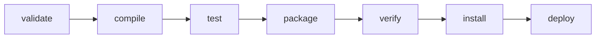

# P10-C001: Maven Build Lifecycle: clean, compile, test, package, install, and deploy

---

## 1. Metadata and Learning Goals

| Metadata Field | Value |
|---|---|
| **Concept ID** | `P10-C001` |
| **Concept Title** | Maven Build Lifecycle: clean, compile, test, package, install, and deploy |
| **Phase** | Phase 10 — Professional Java Development Workflow |
| **Phase Directory** | `curriculum/phase-10-professional-java-development-workflow` |
| **Source Reference** | Phase 10 Roadmap: "Maven Build Lifecycle: clean, compile, test, package, install, and deploy" |
| **Concept Type** | Tooling / Build Automation / Software Engineering Workflow |
| **Difficulty Level** | Foundation to Intermediate |
| **Curriculum Importance** | Essential |
| **Java Baseline** | Java 21 LTS |
| **Build Tool Baseline** | Apache Maven 3.9.x / 4.0.x |
| **Prerequisites** | `P00-C001` (JVM & JDK Architecture), `P00-C004` (Classpath & JAR Packaging), `P02-C001` (OOP Principles) |
| **Related Concepts** | `P10-C002` (Maven Dependency Scopes), `P10-C003` (Transitive Dependency Conflicts), `P10-C004` (Maven Plugins & Surefire), `P10-C005` (Maven Wrapper) |
| **Estimated Study Effort** | 2–3 hours |
| **Last Research Date** | 2026-10-31 |
| **Verification State** | COMPLETE |

### Measurable Learning Objectives
By the end of this concept module, you will be able to:
1. **Explain:** Articulate the architectural separation between Maven's three independent lifecycles (`clean`, `default`, `site`), distinct phases, and plugin goals (Mojos).
2. **Compare:** Differentiate between phase execution semantics, understanding why `mvn package` executes all preceding phases in the `default` lifecycle while skipping the `clean` lifecycle unless explicitly requested.
3. **Contrast Test Skipping Flags:** Discern the operational difference between `-DskipTests` (which compiles test sources but skips execution) and `-Dmaven.test.skip=true` (which bypasses both test compilation and execution).
4. **Debug & Diagnose:** Trace build failures to specific lifecycle phases, diagnose dirty build artifacts, and understand when `mvn clean` is mandatory versus when incremental builds can be utilized safely.
5. **Evaluate & Justify:** Justify in CI/CD pipeline design why `mvn verify` should be preferred over `mvn install` on shared build runners to prevent local repository cache poisoning.

---

## 2. Definition, Purpose, and Mental Model

### 2.1 Formal Definition
The **Maven Build Lifecycle** is an ordered, declarative sequence of well-defined phases that govern the lifecycle of a software artifact from source validation and compilation to testing, packaging, verification, and remote repository deployment. 

Unlike procedural build scripts (e.g., Make or raw Ant tasks) that define *how* to compile step-by-step, Maven operates on **Convention over Configuration**: the lifecycle establishes *what* milestones must occur, leaving the actual execution of tasks to **plugins (Mojos)** bound to specific phases.

### 2.2 The Problem It Solves
Prior to standardized build lifecycles:
1. **Procedural Inconsistency:** Every project maintained custom Ant scripts or bash wrappers. A developer joining a team had to reverse-engineer custom targets (`ant build-all-jars`, `ant make-dist`, `ant run-all-junit`).
2. **Phase Interdependence Chaos:** Manually managing whether code had been compiled before unit tests ran, or whether resources had been filtered before JAR assembly, resulted in subtle bugs where outdated `.class` files were packaged into production releases.
3. **Non-Standard Directory Conventions:** Source code lived in `/src`, `/source`, `/java`, or `/app`, requiring bespoke compiler paths across different IDEs and CI servers.

Maven solved this by introducing:
- Standardized directory layout (`src/main/java`, `src/main/resources`, `src/test/java`, `target/`).
- Three immutable lifecycles (`clean`, `default`, `site`).
- Predictable phase sequencing: invoking any phase automatically triggers every predecessor in that lifecycle.

### 2.3 Why Backend Engineers Need It
In enterprise backend engineering:
- **CI/CD Determinism:** Production pipelines rely on predictable exit codes and deterministic phase execution (`mvn clean verify`).
- **Artifact Governance:** Knowing when an artifact is pushed to the local cache (`~/.m2/repository`) via `install` versus when it is released to an enterprise repository (Nexus/Artifactory) via `deploy` is critical to prevent accidental snapshot poisoning across microservices.
- **Integration Test Isolation:** Unit tests run in `test` (via Maven Surefire), while long-running database/container integration tests run in `integration-test` and are verified in `verify` (via Maven Failsafe), ensuring teardown logic always runs even if tests fail.

### 2.4 Real-World System Analogy (and Where It Breaks Down)
- **The Analogy:** Think of the Maven Build Lifecycle as an **Automated Automobile Assembly Line**:
  1. *Validate & Prepare:* Check raw materials (source code and POM).
  2. *Compile:* Stamp the steel chassis (compile `.java` to `.class`).
  3. *Test:* Quality-assurance stress test on the bare chassis (Surefire unit tests).
  4. *Package:* Install wheels, seats, and chassis into a completed car (bundle into `.jar`).
  5. *Verify:* Road test the completed car on a test track (integration tests).
  6. *Install:* Park the car in the manufacturer's local garage (`~/.m2/repository`).
  7. *Deploy:* Ship the car to regional dealerships (Nexus / Maven Central).
- **Where the Analogy Fails:** In a physical assembly line, cars only move forward. In Maven, if you invoke an early phase (e.g., `mvn compile`), the assembly line simply halts after compilation—no finished car is produced. Furthermore, Maven lifecycles can be combined in a single invocation (`mvn clean package`), which represents demolishing the factory yard (`clean`) before starting the assembly line (`package`).

### 2.5 What This Concept Is NOT (Common Confusions)
- **A Phase is NOT a Plugin Goal:** A phase is an abstract step in a lifecycle (e.g., `compile`). A plugin goal is the actual executable Java class (Mojo) that performs work (e.g., `maven-compiler-plugin:compile`). Phases are empty until goals are bound to them.
- **`clean` is NOT Part of the `default` Lifecycle:** Running `mvn package` does **not** clean the `target/` directory. `clean` belongs to a completely separate, independent lifecycle.
- **`install` does NOT Mean Deploying to Production:** `install` only copies the artifact to the developer's local machine disk (`~/.m2/repository`). It does not transmit artifacts over the network to a shared server.

---

## 3. Foundations and Theory

### 3.1 The Three Independent Built-in Lifecycles
Maven has three distinct, independent lifecycles. They do not share phases and do not trigger each other automatically:

```
┌──────────────────────────────────────────────────────────────────────────────────┐
│                               MAVEN LIFECYCLES                                   │
│                                                                                  │
│   ┌─────────────────────┐    ┌─────────────────────┐    ┌────────────────────┐   │
│   │   clean Lifecycle   │    │  default Lifecycle  │    │   site Lifecycle   │   │
│   │                     │    │                     │    │                    │   │
│   │  1. pre-clean       │    │  1. validate        │    │  1. pre-site       │   │
│   │  2. clean           │    │  2. compile         │    │  2. site           │   │
│   │  3. post-clean      │    │  3. test            │    │  3. post-site      │   │
│   │                     │    │  4. package         │    │  4. site-deploy    │   │
│   │                     │    │  5. verify          │    │                    │   │
│   │                     │    │  6. install         │    │                    │   │
│   │                     │    │  7. deploy          │    │                    │   │
│   └─────────────────────┘    └─────────────────────┘    └────────────────────┘   │
└──────────────────────────────────────────────────────────────────────────────────┘
```

1. **`clean` Lifecycle:** Responsible for removing files generated by previous builds.
2. **`default` (Build) Lifecycle:** Responsible for compiling, testing, packaging, and deploying the application.
3. **`site` Lifecycle:** Responsible for generating HTML documentation, project reports, and metrics.

### 3.2 The Core Phases of the `default` Lifecycle
While the `default` lifecycle comprises 23 granular phases, 7 principal phases form the daily workflow of backend developers:



| Phase | Purpose | Typical Plugin:Goal Bound | Outputs Produced |
|---|---|---|---|
| **`validate`** | Validates project structure and POM syntax; checks all mandatory information is available. | Internal validation | None (console validation) |
| **`compile`** | Compiles main application source code (`src/main/java`). | `maven-compiler-plugin:compile` | `target/classes/**/*.class` |
| **`test`** | Runs unit tests using Surefire. Tests are isolated; failure halts the build. | `maven-surefire-plugin:test` | `target/surefire-reports/*` |
| **`package`** | Bundles compiled classes and resources into distributed format (`jar`, `war`, `pom`). | `maven-jar-plugin:jar` | `target/${artifactId}-${version}.jar` |
| **`verify`** | Runs integration tests via Failsafe; checks code coverage & quality thresholds. | `maven-failsafe-plugin:verify` | Quality reports, pass/fail status |
| **`install`** | Installs artifact into local repository (`~/.m2/repository`). | `maven-install-plugin:install` | `~/.m2/repository/.../${artifactId}-${version}.jar` |
| **`deploy`** | Uploads final package to remote binary repository (Artifactory, Nexus). | `maven-deploy-plugin:deploy` | Artifact & checksums in remote repo |

### 3.3 Phase Sequencing Mechanics
Maven enforces strict sequential execution:
$$\text{If you invoke phase } P_k, \text{ Maven executes } P_1, P_2, \dots, P_{k-1}, P_k \text{ in exact order.}$$

- **Example 1:** `mvn compile` executes `validate` $\to$ `initialize` $\to$ `generate-sources` $\to$ `process-sources` $\to$ `generate-resources` $\to$ `process-resources` $\to$ `compile`.
- **Example 2:** `mvn test` executes all phases up to `compile`, then executes `process-classes` $\to$ `test-compile` $\to$ `test`.
- **Example 3:** `mvn clean install` instructs Maven to:
  1. Execute the `clean` lifecycle through `clean` (wiping `target/`).
  2. Execute the `default` lifecycle from `validate` all the way through `install`.

---

## 4. Language, Specification, and Platform Mechanics

### 4.1 Packaging Types and Default Goal Bindings
Maven matches phases to plugin goals based on the `<packaging>` element defined in `pom.xml`. If omitted, `<packaging>` defaults to `jar`.

```xml
<project>
    <modelVersion>4.0.0</modelVersion>
    <groupId>com.example</groupId>
    <artifactId>order-service</artifactId>
    <version>1.0.0</version>
    <packaging>jar</packaging> <!-- Controls default phase-to-goal bindings -->
</project>
```

#### Default Phase-to-Goal Mappings for `jar` Packaging:

```
Phase                     Plugin : Goal
─────────────────────────────────────────────────────────────────────────────
process-resources     ──> maven-resources-plugin:resources
compile               ──> maven-compiler-plugin:compile
process-test-resources──> maven-resources-plugin:testResources
test-compile          ──> maven-compiler-plugin:testCompile
test                  ──> maven-surefire-plugin:test
package               ──> maven-jar-plugin:jar
install               ──> maven-install-plugin:install
deploy                ──> maven-deploy-plugin:deploy
```

When `<packaging>pom</packaging>` is configured (used for parent aggregator POMs):
- `compile`, `test`, and `package` have **no default goal bindings**.
- Only `install` (`install:install`) and `deploy` (`deploy:deploy`) are bound to register the POM itself into repositories.

### 4.2 Integration Test Separation: Surefire vs Failsafe
A critical distinction in enterprise builds is the difference between unit testing and integration testing:

```
┌─────────────────────────────────────────────────────────────────────────────────┐
│                           TESTING LIFECYCLE PHASES                              │
│                                                                                 │
│   Phase: test                       Phase: integration-test   Phase: verify     │
│   ┌───────────────────────────┐     ┌───────────────────────┐ ┌───────────────┐ │
│   │ maven-surefire-plugin     │     │ maven-failsafe-plugin │ │ failsafe:     │ │
│   │                           │     │                       │ │ verify        │ │
│   │ • Fast, isolated unit test│     │ • Spins up databases  │ │ • Checks if   │ │
│   │ • Halts build IMMEDIATELY │     │ • DOES NOT HALT build │ │   ITs passed  │ │
│   │   on assertion failure    │     │   on test failure!    │ │ • Fails build │ │
│   └───────────────────────────┘     └───────────┬───────────┘ └───────▲───────┘ │
│                                                 │                     │         │
│                                                 ▼                     │         │
│                                     Phase: post-integration-test      │         │
│                                     ┌───────────────────────────────┐ │         │
│                                     │ Teardown resources/containers │ ┘         │
│                                     │ (ALWAYS executes, even on IT  │           │
│                                     │  failure!)                    │           │
│                                     └───────────────────────────────┘           │
└─────────────────────────────────────────────────────────────────────────────────┘
```

- **Surefire (`test` phase):** If a unit test fails, the build halts immediately. Downstream packaging never occurs.
- **Failsafe (`integration-test`, `post-integration-test`, `verify`):** If an integration test fails during `integration-test`, Failsafe records the failure but **does not halt the build**. This guarantees that `post-integration-test` executes to shut down test containers, release database connections, and clear ports. Finally, the `verify` phase examines the results and halts the build if any test failed.

---

## 5. Evolution Across Java and Maven Versions

| Tool & Version | Release Year | Significance to the Build Lifecycle |
|---|---|---|
| **Maven 1.0** | 2004 | Introduced initial declarative POM concept; lacked rigid lifecycle abstraction. |
| **Maven 2.0** | 2005 | Formalized the three independent lifecycles (`clean`, `default`, `site`) and standard directory layout. |
| **Maven 3.0** | 2010 | Rewrote core architecture with Aether dependency resolver; introduced strict POM validation and plugin execution sandboxing. |
| **Maven 3.9 (Current)**| 2023 | Added split local repository support, parallel dependency downloads, and enhanced JDK 21 LTS compatibility. |
| **Maven 4.0 (Alpha/Beta)**| 2024+ | Deconstructs POM into Build POM and Consumer POM; introduces dynamic build lifecycles and enhanced caching. |

---

## 6. Architecture and Design Patterns

### 6.1 The Standard Directory Layout (Convention over Configuration)
Maven's lifecycle phases expect files in standardized directory structures:

```
project-root/
├── pom.xml                               # Project Object Model descriptor
├── src/
│   ├── main/
│   │   ├── java/                         # Compiled during 'compile' phase
│   │   │   └── com/example/App.java
│   │   └── resources/                    # Filtered during 'process-resources' phase
│   │       └── application.properties
│   └── test/
│       ├── java/                         # Compiled during 'test-compile' phase
│       │   └── com/example/AppTest.java
│       └── resources/                    # Filtered during 'process-test-resources' phase
│           └── test-config.properties
└── target/                               # Output directory wiped during 'clean'
    ├── classes/                          # Output of 'compile'
    ├── test-classes/                     # Output of 'test-compile'
    ├── surefire-reports/                 # Output of 'test'
    └── my-app-1.0.0.jar                  # Output of 'package'
```

### 6.2 Binding Custom Plugin Goals to Lifecycle Phases
When a build requires actions outside standard compilation (e.g., generating OpenAPI client stubs or running Spotless code formatting), goals are bound to specific phases in `pom.xml`:

```xml
<plugin>
    <groupId>com.diffplug.spotless</groupId>
    <artifactId>spotless-maven-plugin</artifactId>
    <version>2.43.0</version>
    <executions>
        <execution>
            <!-- Bind code formatting verification to the 'verify' phase -->
            <phase>verify</phase>
            <goals>
                <goal>check</goal>
            </goals>
        </execution>
    </executions>
</plugin>
```

---

## 7. Failure Modes, Anti-Patterns, and Production Traps

### 7.1 The `-DskipTests` vs `-Dmaven.test.skip=true` Confusion

```
┌─────────────────────────────────────────────────────────────────────────────────┐
│                             TEST SKIPPING MECHANISMS                            │
│                                                                                 │
│   Command                             test-compile Phase      test Phase        │
│   ───────────────────────────────────────────────────────────────────────────   │
│   mvn package                         [ COMPILES TESTS ]   ──> [ RUNS TESTS ]   │
│   mvn package -DskipTests             [ COMPILES TESTS ]   ──> [ SKIPS RUN ]    │
│   mvn package -Dmaven.test.skip=true  [ SKIPS COMPILE  ]   ──> [ SKIPS RUN ]    │
└─────────────────────────────────────────────────────────────────────────────────┘
```

- **`-DskipTests`:** Controls the `maven-surefire-plugin`. Test classes in `src/test/java` **are compiled**. If a refactoring broke test code compilation, the build fails immediately during `test-compile`.
- **`-Dmaven.test.skip=true`:** Controls both compiler and test plugins. Test classes are **not even compiled**. 
- **Production Trap:** Developers using `-Dmaven.test.skip=true` push code that compiles for `src/main`, but breaks existing unit tests syntactically. Always use `-DskipTests` if test execution must be temporarily bypassed in local iterations.

### 7.2 The Local Repository Poisoning Trap (`mvn install`)
- **Trap:** Running `mvn clean install` on CI/CD agents or local machines for every build.
- **Root Cause:** `mvn install` copies the generated artifact into `~/.m2/repository/com/example/...`. If a developer is working across multiple branches or services, a buggy local SNAPSHOT in `~/.m2/repository` can silently shadow remote dependencies in other projects, causing non-reproducible "works on my machine" errors.
- **Production Remedy:** In CI/CD pipelines, always execute `mvn clean verify` instead of `mvn clean install`. Only run `install` locally when you are intentionally testing local cross-module dependency consumption.

### 7.3 The Phantom Clean Anti-Pattern
- **Trap:** Relying on incremental compilation without `clean` when switching Git branches.
- **Root Cause:** If you rename a class `Foo.java` $\to$ `Bar.java` on branch A and switch to branch B, `target/classes/Foo.class` remains on disk. The JVM finds `Foo.class` during local runs, masking broken imports until CI runs a clean build and fails.
- **Production Remedy:** Always execute `mvn clean` when switching branches or modifying package structures.

---

## 8. Security and Hardening

### 8.1 Repository Checksum Verification
During the `deploy` phase, Maven generates and uploads cryptographic checksums (`.sha1`, `.sha256`, `.md5`) alongside artifacts:
```
my-artifact-1.0.0.jar
my-artifact-1.0.0.jar.sha256
my-artifact-1.0.0.pom
my-artifact-1.0.0.pom.sha256
```
When downstream builds download these artifacts, Maven validates the cryptographic hash. If a man-in-the-middle (MITM) adversary or corrupt proxy alters the binary, Maven aborts the build with `Checksum validation failed`.

### 8.2 Reproducible Builds
Starting in Maven 3.8+, the `project.build.outputTimestamp` property enables byte-for-byte reproducible JAR generation:
```xml
<properties>
    <project.build.outputTimestamp>2026-10-31T00:00:00Z</project.build.outputTimestamp>
</properties>
```
This forces file modification timestamps inside the generated ZIP/JAR container to a fixed epoch, ensuring identical bytecode generates an identical SHA-256 hash across different build machines and times.

---

## 9. Performance, Sizing, and Operational Profile

### 9.1 Multi-Threaded Parallel Builds
Maven supports parallel module builds across CPU cores using the `-T` flag:
```bash
# Build using 4 worker threads
mvn clean package -T 4

# Build using 1 thread per available CPU core
mvn clean package -T 1C
```
- **Operational Rule:** Parallel builds construct a Directed Acyclic Graph (DAG) of project modules and execute independent submodules concurrently. If dependencies between modules are undeclared in POMs, parallel builds will fail with race conditions.

### 9.2 Daemon and Incremental Build Acceleration
Tools such as the **Maven Daemon (`mvnd`)** maintain a persistent background JVM process. This retains JIT-compiled bytecode across CLI invocations, cutting build times by 3x to 5x by avoiding JVM startup overhead.

---

## 10. Tooling, Observability, and Debugging

### 10.1 Diagnostic CLI Flags
When diagnosing build failures, Maven provides essential debugging switches:

| Flag | Purpose | Diagnostic Use Case |
|---|---|---|
| `-X` or `--debug` | Full debug logging | Prints complete plugin configurations, classpath entries, and stack traces. |
| `-e` or `--errors` | Detailed error stack traces | Shows the exact Java exception that halted the build. |
| `-U` or `--update-snapshots` | Forces snapshot update check | Bypasses local update interval timers to fetch latest remote SNAPSHOTs. |
| `-rf :submodule` | Resumes build from failure | Skips already-completed modules in a multi-module reactor build. |

---

## 11. Framework, Cloud, and Ecosystem Integration

- **Spring Boot Maven Plugin (`spring-boot-maven-plugin`):** Binds to the `package` phase to repackage standard JARs into executable "fat JARs" containing nested dependencies and the `JarLauncher`.
- **Docker / OCI Container Pipelines:** Standard Docker multi-stage builds leverage lifecycle caching:
  ```dockerfile
  # Stage 1: Build & Package
  FROM maven:3.9-eclipse-temurin-21 AS build
  WORKDIR /workspace
  COPY pom.xml .
  RUN mvn dependency:go-offline # Pre-cache dependencies
  COPY src ./src
  RUN mvn clean package -DskipTests

  # Stage 2: Runtime
  FROM eclipse-temurin:21-jre-alpine
  COPY --from=build /workspace/target/*.jar app.jar
  ENTRYPOINT ["java", "-jar", "/app.jar"]
  ```

---

## 12. Production-Grade Code Demonstration

The following standalone, self-contained Java verification suite programmatically models, simulates, and validates:
1. **Lifecycle & Phase Ordering Engine:** Verification of the 3 independent lifecycles (`clean`, `default`, `site`) and topological prerequisite sequencing.
2. **Phase-to-Goal Binding Matrix:** Simulation of packaging mappings (`jar` vs `pom`) and Mojo execution.
3. **Execution Context & Directory State Transitions:** State simulation validating `target/classes`, `target/test-classes`, `target/*.jar`, and local repository caching.
4. **Skip Tests Semantics:** Operational verification of `-DskipTests` vs `-Dmaven.test.skip=true`.
5. **Artifact Checksumming & Coordinate Resolution:** Generation of SHA-256 hashes and coordinate repository paths (`groupId/artifactId/version`).

Save as companion verification suite:

```java
package curriculum.phase10;

import java.io.ByteArrayInputStream;
import java.io.InputStream;
import java.nio.charset.StandardCharsets;
import java.security.MessageDigest;
import java.security.NoSuchAlgorithmException;
import java.util.ArrayList;
import java.util.Collections;
import java.util.EnumMap;
import java.util.HashMap;
import java.util.LinkedHashMap;
import java.util.List;
import java.util.Map;
import java.util.Objects;
import java.util.Set;

/**
 * Standalone verification suite modeling and validating Maven Build Lifecycle mechanics,
 * phase ordering, goal bindings, test-skipping semantics, and artifact checksum hashing.
 */
public class MavenLifecycleDemo {

    // =========================================================================
    // 1. LIFECYCLE & PHASE DEFINITIONS
    // =========================================================================

    public enum LifecycleType {
        CLEAN, DEFAULT, SITE
    }

    public enum Phase {
        // Clean Lifecycle
        PRE_CLEAN(LifecycleType.CLEAN),
        CLEAN(LifecycleType.CLEAN),
        POST_CLEAN(LifecycleType.CLEAN),

        // Default Lifecycle (Key milestones modeled)
        VALIDATE(LifecycleType.DEFAULT),
        INITIALIZE(LifecycleType.DEFAULT),
        GENERATE_SOURCES(LifecycleType.DEFAULT),
        PROCESS_SOURCES(LifecycleType.DEFAULT),
        GENERATE_RESOURCES(LifecycleType.DEFAULT),
        PROCESS_RESOURCES(LifecycleType.DEFAULT),
        COMPILE(LifecycleType.DEFAULT),
        PROCESS_CLASSES(LifecycleType.DEFAULT),
        GENERATE_TEST_SOURCES(LifecycleType.DEFAULT),
        PROCESS_TEST_SOURCES(LifecycleType.DEFAULT),
        GENERATE_TEST_RESOURCES(LifecycleType.DEFAULT),
        PROCESS_TEST_RESOURCES(LifecycleType.DEFAULT),
        TEST_COMPILE(LifecycleType.DEFAULT),
        PROCESS_TEST_CLASSES(LifecycleType.DEFAULT),
        TEST(LifecycleType.DEFAULT),
        PREPARE_PACKAGE(LifecycleType.DEFAULT),
        PACKAGE(LifecycleType.DEFAULT),
        PRE_INTEGRATION_TEST(LifecycleType.DEFAULT),
        INTEGRATION_TEST(LifecycleType.DEFAULT),
        POST_INTEGRATION_TEST(LifecycleType.DEFAULT),
        VERIFY(LifecycleType.DEFAULT),
        INSTALL(LifecycleType.DEFAULT),
        DEPLOY(LifecycleType.DEFAULT),

        // Site Lifecycle
        PRE_SITE(LifecycleType.SITE),
        SITE(LifecycleType.SITE),
        POST_SITE(LifecycleType.SITE),
        SITE_DEPLOY(LifecycleType.SITE);

        private final LifecycleType lifecycle;

        Phase(LifecycleType lifecycle) {
            this.lifecycle = lifecycle;
        }

        public LifecycleType getLifecycle() {
            return lifecycle;
        }
    }

    // =========================================================================
    // 2. LIFECYCLE EXECUTION SEQUENCER
    // =========================================================================

    public static class LifecycleSequencer {
        private static final Map<LifecycleType, List<Phase>> LIFECYCLES = new EnumMap<>(LifecycleType.class);

        static {
            for (LifecycleType type : LifecycleType.values()) {
                LIFECYCLES.put(type, new ArrayList<>());
            }
            for (Phase phase : Phase.values()) {
                LIFECYCLES.get(phase.getLifecycle()).add(phase);
            }
        }

        public static List<Phase> getOrderedPhasesUpTo(Phase targetPhase) {
            List<Phase> fullList = LIFECYCLES.get(targetPhase.getLifecycle());
            int targetIdx = fullList.indexOf(targetPhase);
            if (targetIdx < 0) {
                throw new IllegalArgumentException("Unknown phase: " + targetPhase);
            }
            return Collections.unmodifiableList(fullList.subList(0, targetIdx + 1));
        }

        public static List<Phase> sequenceCommandLine(List<Phase> requestedPhases) {
            List<Phase> consolidatedSequence = new ArrayList<>();
            for (Phase req : requestedPhases) {
                List<Phase> sequence = getOrderedPhasesUpTo(req);
                for (Phase p : sequence) {
                    consolidatedSequence.add(p);
                }
            }
            return consolidatedSequence;
        }
    }

    // =========================================================================
    // 3. PLUGIN GOAL BINDINGS & PACKAGING MAPPINGS
    // =========================================================================

    public record MojoBinding(String plugin, String goal) {}

    public static class PackagingBindings {
        private final Map<Phase, List<MojoBinding>> bindings = new HashMap<>();

        public static PackagingBindings forJar() {
            PackagingBindings pb = new PackagingBindings();
            pb.bind(Phase.PROCESS_RESOURCES, "maven-resources-plugin", "resources");
            pb.bind(Phase.COMPILE, "maven-compiler-plugin", "compile");
            pb.bind(Phase.PROCESS_TEST_RESOURCES, "maven-resources-plugin", "testResources");
            pb.bind(Phase.TEST_COMPILE, "maven-compiler-plugin", "testCompile");
            pb.bind(Phase.TEST, "maven-surefire-plugin", "test");
            pb.bind(Phase.PACKAGE, "maven-jar-plugin", "jar");
            pb.bind(Phase.INSTALL, "maven-install-plugin", "install");
            pb.bind(Phase.DEPLOY, "maven-deploy-plugin", "deploy");
            return pb;
        }

        public static PackagingBindings forPom() {
            PackagingBindings pb = new PackagingBindings();
            // POM packaging does not compile or package a JAR; only installs and deploys the POM itself
            pb.bind(Phase.INSTALL, "maven-install-plugin", "install");
            pb.bind(Phase.DEPLOY, "maven-deploy-plugin", "deploy");
            return pb;
        }

        public void bind(Phase phase, String plugin, String goal) {
            bindings.computeIfAbsent(phase, k -> new ArrayList<>()).add(new MojoBinding(plugin, goal));
        }

        public List<MojoBinding> getBindingsFor(Phase phase) {
            return bindings.getOrDefault(phase, Collections.emptyList());
        }
    }

    // =========================================================================
    // 4. BUILD SIMULATOR WITH TEST-SKIPPING MODES
    // =========================================================================

    public enum TestSkipMode {
        EXECUTE_ALL,              // Normal build: compile tests and run tests
        SKIP_EXECUTION_ONLY,      // -DskipTests: compile tests, skip surefire run
        SKIP_ALL_TEST_PHASES      // -Dmaven.test.skip=true: skip test compilation and execution
    }

    public static class BuildExecutionSimulator {
        private final List<String> executionLog = new ArrayList<>();
        private boolean classesCompiled = false;
        private boolean testClassesCompiled = false;
        private boolean testsExecuted = false;
        private boolean jarPackaged = false;
        private boolean installedToLocalRepo = false;

        public void executeBuild(Phase targetPhase, PackagingBindings bindings, TestSkipMode skipMode) {
            List<Phase> phases = LifecycleSequencer.getOrderedPhasesUpTo(targetPhase);

            for (Phase phase : phases) {
                // Check skip mode overrides
                if (phase == Phase.TEST_COMPILE && skipMode == TestSkipMode.SKIP_ALL_TEST_PHASES) {
                    executionLog.add("Phase [" + phase + "] SKIPPED by -Dmaven.test.skip=true");
                    continue;
                }

                if (phase == Phase.TEST) {
                    if (skipMode == TestSkipMode.SKIP_ALL_TEST_PHASES || skipMode == TestSkipMode.SKIP_EXECUTION_ONLY) {
                        executionLog.add("Phase [" + phase + "] SKIPPED (Execution bypassed)");
                        continue;
                    }
                }

                executionLog.add("Executing Phase: " + phase);

                if (phase == Phase.COMPILE) classesCompiled = true;
                if (phase == Phase.TEST_COMPILE) testClassesCompiled = true;
                if (phase == Phase.TEST) testsExecuted = true;
                if (phase == Phase.PACKAGE) jarPackaged = true;
                if (phase == Phase.INSTALL) installedToLocalRepo = true;

                for (MojoBinding mojo : bindings.getBindingsFor(phase)) {
                    executionLog.add("   -> Running Mojo: " + mojo.plugin() + ":" + mojo.goal());
                }
            }
        }

        public List<String> getExecutionLog() { return executionLog; }
        public boolean isClassesCompiled() { return classesCompiled; }
        public boolean isTestClassesCompiled() { return testClassesCompiled; }
        public boolean isTestsExecuted() { return testsExecuted; }
        public boolean isJarPackaged() { return jarPackaged; }
        public boolean isInstalledToLocalRepo() { return installedToLocalRepo; }
    }

    // =========================================================================
    // 5. ARTIFACT COORDINATES & CHECKSUM VERIFIER
    // =========================================================================

    public record ArtifactCoordinates(String groupId, String artifactId, String version, String packaging) {
        public String toLocalRepositoryPath() {
            String groupPath = groupId.replace('.', '/');
            String fileName = artifactId + "-" + version + "." + packaging;
            return groupPath + "/" + artifactId + "/" + version + "/" + fileName;
        }
    }

    public static class ArtifactChecksumEngine {
        public static String calculateSha256(byte[] data) {
            try {
                MessageDigest digest = MessageDigest.getInstance("SHA-256");
                byte[] hash = digest.digest(data);
                StringBuilder hex = new StringBuilder();
                for (byte b : hash) {
                    hex.append(String.format("%02x", b));
                }
                return hex.toString();
            } catch (NoSuchAlgorithmException e) {
                throw new RuntimeException("SHA-256 unavailable", e);
            }
        }
    }

    // =========================================================================
    // VERIFICATION SUITE EXECUTION (ASSERTION HARNESS)
    // =========================================================================

    public static void main(String[] args) {
        System.out.println("===============================================================");
        System.out.println(" Maven Build Lifecycle & Architecture Standalone Verification  ");
        System.out.println("===============================================================");

        test1_LifecycleSeparationAndSequencing();
        test2_PackagingGoalBindings();
        test3_SkipTestsSemantics();
        test4_CommandLineLifecycleCombination();
        test5_ArtifactCoordinatesAndChecksumVerification();

        System.out.println("\nAll 5 verification test suites passed successfully with assertions enabled!");
    }

    private static void test1_LifecycleSeparationAndSequencing() {
        System.out.print("[TEST 1/5] Lifecycle independence and phase prerequisite sequencing... ");

        // clean lifecycle up to clean
        List<Phase> cleanPhases = LifecycleSequencer.getOrderedPhasesUpTo(Phase.CLEAN);
        assert cleanPhases.size() == 2 : "Clean lifecycle to 'clean' must contain pre-clean and clean";
        assert cleanPhases.get(0) == Phase.PRE_CLEAN;
        assert cleanPhases.get(1) == Phase.CLEAN;

        // default lifecycle up to package
        List<Phase> packagePhases = LifecycleSequencer.getOrderedPhasesUpTo(Phase.PACKAGE);
        assert packagePhases.contains(Phase.COMPILE) : "Package must be preceded by compile";
        assert packagePhases.contains(Phase.TEST) : "Package must be preceded by test";
        assert !packagePhases.contains(Phase.INSTALL) : "Package must not include downstream install";
        assert !packagePhases.contains(Phase.CLEAN) : "Default lifecycle must NEVER include clean phase";

        // Validate exact order: COMPILE precedes TEST, TEST precedes PACKAGE
        int compileIdx = packagePhases.indexOf(Phase.COMPILE);
        int testIdx = packagePhases.indexOf(Phase.TEST);
        int packageIdx = packagePhases.indexOf(Phase.PACKAGE);
        assert compileIdx < testIdx : "compile must precede test";
        assert testIdx < packageIdx : "test must precede package";

        System.out.println("PASSED");
    }

    private static void test2_PackagingGoalBindings() {
        System.out.print("[TEST 2/5] Packaging-driven goal bindings (JAR vs POM)... ");
        PackagingBindings jarBindings = PackagingBindings.forJar();
        PackagingBindings pomBindings = PackagingBindings.forPom();

        // For JAR: compile has compiler:compile, package has jar:jar
        List<MojoBinding> compileMojos = jarBindings.getBindingsFor(Phase.COMPILE);
        assert compileMojos.size() == 1;
        assert compileMojos.get(0).plugin().equals("maven-compiler-plugin");
        assert compileMojos.get(0).goal().equals("compile");

        List<MojoBinding> packageMojos = jarBindings.getBindingsFor(Phase.PACKAGE);
        assert packageMojos.size() == 1;
        assert packageMojos.get(0).plugin().equals("maven-jar-plugin");
        assert packageMojos.get(0).goal().equals("jar");

        // For POM: compile and package have ZERO mojos bound
        assert pomBindings.getBindingsFor(Phase.COMPILE).isEmpty() : "POM packaging must not bind compiler plugin";
        assert pomBindings.getBindingsFor(Phase.PACKAGE).isEmpty() : "POM packaging must not bind jar plugin";
        assert !pomBindings.getBindingsFor(Phase.INSTALL).isEmpty() : "POM packaging must bind install plugin";

        System.out.println("PASSED");
    }

    private static void test3_SkipTestsSemantics() {
        System.out.print("[TEST 3/5] Dissecting -DskipTests vs -Dmaven.test.skip=true semantics... ");
        PackagingBindings bindings = PackagingBindings.forJar();

        // 1. Standard build
        BuildExecutionSimulator simNormal = new BuildExecutionSimulator();
        simNormal.executeBuild(Phase.PACKAGE, bindings, TestSkipMode.EXECUTE_ALL);
        assert simNormal.isClassesCompiled();
        assert simNormal.isTestClassesCompiled() : "Normal build compiles tests";
        assert simNormal.isTestsExecuted() : "Normal build executes tests";
        assert simNormal.isJarPackaged();

        // 2. -DskipTests
        BuildExecutionSimulator simSkipTests = new BuildExecutionSimulator();
        simSkipTests.executeBuild(Phase.PACKAGE, bindings, TestSkipMode.SKIP_EXECUTION_ONLY);
        assert simSkipTests.isClassesCompiled();
        assert simSkipTests.isTestClassesCompiled() : "-DskipTests MUST compile test sources!";
        assert !simSkipTests.isTestsExecuted() : "-DskipTests must bypass test execution!";
        assert simSkipTests.isJarPackaged();

        // 3. -Dmaven.test.skip=true
        BuildExecutionSimulator simSkipAll = new BuildExecutionSimulator();
        simSkipAll.executeBuild(Phase.PACKAGE, bindings, TestSkipMode.SKIP_ALL_TEST_PHASES);
        assert simSkipAll.isClassesCompiled();
        assert !simSkipAll.isTestClassesCompiled() : "-Dmaven.test.skip=true must NOT compile test sources!";
        assert !simSkipAll.isTestsExecuted() : "-Dmaven.test.skip=true must NOT execute tests!";
        assert simSkipAll.isJarPackaged();

        System.out.println("PASSED");
    }

    private static void test4_CommandLineLifecycleCombination() {
        System.out.print("[TEST 4/5] Multi-lifecycle command line execution (mvn clean install)... ");
        List<Phase> requested = List.of(Phase.CLEAN, Phase.INSTALL);
        List<Phase> fullSequence = LifecycleSequencer.sequenceCommandLine(requested);

        // Sequence must start with pre-clean, clean
        assert fullSequence.get(0) == Phase.PRE_CLEAN;
        assert fullSequence.get(1) == Phase.CLEAN;

        // Followed by the default lifecycle
        assert fullSequence.get(2) == Phase.VALIDATE;
        assert fullSequence.contains(Phase.COMPILE);
        assert fullSequence.contains(Phase.TEST);
        assert fullSequence.contains(Phase.PACKAGE);
        assert fullSequence.get(fullSequence.size() - 1) == Phase.INSTALL : "Last phase must be install";

        System.out.println("PASSED");
    }

    private static void test5_ArtifactCoordinatesAndChecksumVerification() {
        System.out.print("[TEST 5/5] Artifact coordinate pathing and SHA-256 checksum generation... ");
        ArtifactCoordinates coords = new ArtifactCoordinates(
            "com.example.backend",
            "order-service",
            "2.5.0",
            "jar"
        );

        String localPath = coords.toLocalRepositoryPath();
        String expectedPath = "com/example/backend/order-service/2.5.0/order-service-2.5.0.jar";
        assert expectedPath.equals(localPath) : "Local repo path must follow standard Maven coordinate layout";

        // Simulate compiled artifact bytes
        byte[] fakeJarBytes = "PK\u0003\u0004FAKE_JAR_BYTECODE_CONTENT".getBytes(StandardCharsets.UTF_8);
        String sha256 = ArtifactChecksumEngine.calculateSha256(fakeJarBytes);
        assert sha256 != null && sha256.length() == 64 : "SHA-256 must be a 64-character hexadecimal string";

        // Deterministic check
        String sha256SecondPass = ArtifactChecksumEngine.calculateSha256(fakeJarBytes);
        assert sha256.equals(sha256SecondPass) : "Checksum generation must be strictly deterministic";

        System.out.println("PASSED");
    }
}
```

---

## 13. Exercises and Challenges

### 13.1 Exercise: Map the Spring Boot Repackage Goal
In a standard Spring Boot application, inspect `pom.xml`.
1. Which phase does `spring-boot-maven-plugin:repackage` bind to by default?
2. If you run `mvn compile`, is the repackaged executable JAR generated? Why or why not?

### 13.2 Challenge: Fix a Broken Test-Compile Under `-DskipTests`
Create a test class with a syntax error (e.g., calling a non-existent method).
1. Run `mvn package -DskipTests`. Observe that the build **fails** during `test-compile`.
2. Run `mvn package -Dmaven.test.skip=true`. Observe that the build **passes**.
3. Formulate a team policy explaining why pull request CI/CD validation checks must never use `-Dmaven.test.skip=true`.

---

## 14. Review Questions

1. **What are the three built-in lifecycles in Apache Maven, and why are they decoupled?**
   `clean`, `default`, and `site`. They are decoupled so maintenance tasks (deleting build artifacts) and documentation generation do not inadvertently trigger expensive compilation, testing, and deployment cycles when not required.
2. **If you run `mvn install`, does Maven automatically execute `clean` first?**
   No. `clean` belongs to an independent lifecycle. `mvn install` only executes phases within the `default` lifecycle (`validate` through `install`). Outdated `.class` files in `target/` will not be removed unless `clean` is explicitly requested (`mvn clean install`).
3. **What is the critical architectural difference between a lifecycle phase and a plugin goal?**
   A phase is an abstract milestone in a lifecycle representing an orderly point in time. A plugin goal (Mojo) is the actual executable implementation unit of work. Phases are empty until plugin goals are bound to them.
4. **Why should CI/CD validation pipelines run `mvn verify` rather than `mvn install`?**
   `mvn install` writes the artifact to the agent's shared local repository (`~/.m2/repository`). On shared build runners, this can pollute the local cache with unverified or branch-specific SNAPSHOTs, contaminating subsequent builds of other projects. `verify` completes all tests, packaging, and quality checks without writing to `~/.m2/repository`.
5. **How does Maven Surefire differ from Maven Failsafe during test execution failures?**
   Surefire executes unit tests in `test` and halts the build immediately upon failure. Failsafe executes integration tests in `integration-test` and does *not* halt the build on failure, allowing `post-integration-test` to execute clean-up tasks (e.g., stopping Docker containers) before `verify` finally fails the build.

---

## 15. Cross-Concept and Industry Interview Scenarios

### Scenario 1: The "Works on My Machine" Snapshot Phantom
*Question:* "A developer reports that their project builds cleanly locally with `mvn compile`, but fails on the CI server with `Cannot find symbol`. What lifecycle-related issue is the prime suspect?"
*Answer:* The local environment likely has an outdated `.class` file or an uncleaned dependency in `target/classes` or `~/.m2/repository` that satisfies the compiler locally. The developer likely did not run `mvn clean`, or has locally installed a sibling module dependency with `mvn install` that has not yet been pushed to the remote repository. The CI server executes a clean checkout and clean build, exposing the missing code or uncommitted change.

### Scenario 2: Multi-Module Dependency Pipeline Ordering
*Question:* "In a multi-module Maven project where Module B depends on Module A, how does Maven determine the build order, and what happens if a circular dependency is introduced?"
*Answer:* Maven constructs a Directed Acyclic Graph (DAG) of the submodules by parsing their `<dependencies>` and `<parent>` elements. It executes a topological sort (the Reactor build order) ensuring Module A is validated, compiled, and packaged before Module B begins. If a circular dependency exists ($A \to B \to A$), topological sorting fails, and Maven immediately aborts before executing any phase with a `CycleDetectedException`.

---

## 16. Research, Citations, and Definitive Reading

1. **Apache Maven Project.** *"Introduction to the Build Lifecycle."* Apache Software Foundation, [https://maven.apache.org/guides/introduction/introduction-to-the-lifecycle.html](https://maven.apache.org/guides/introduction/introduction-to-the-lifecycle.html).
2. **Van Zyl, Jason, et al.** *Maven: The Complete Reference.* Sonatype Press, 2014.
3. **Smart, John Ferguson.** *Java Power Tools.* O'Reilly Media, 2008. (Chapter 2: Build Tools and Maven Architecture).
4. **Apache Maven Team.** *"Maven Surefire Plugin vs Maven Failsafe Plugin."* [https://maven.apache.org/surefire/maven-failsafe-plugin/](https://maven.apache.org/surefire/maven-failsafe-plugin/).
5. **Reproducible Builds Project.** *"Reproducible Builds with Apache Maven."* [https://reproducible-builds.org/docs/jvm/](https://reproducible-builds.org/docs/jvm/).
