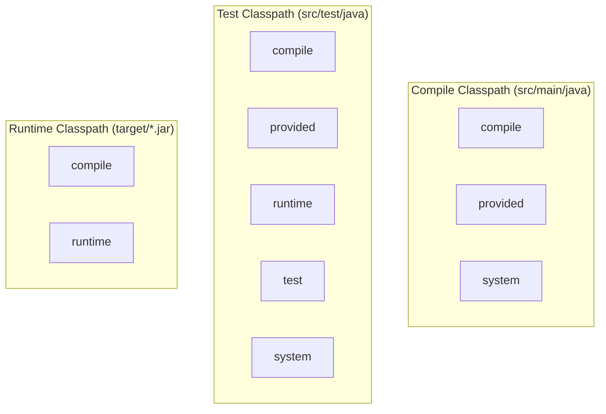

# P10-C002: Maven Dependency Management: Coordinates, Scopes (compile, test, provided, runtime)

---

## 1. Metadata and Learning Goals

| Metadata Field | Value |
|---|---|
| **Concept ID** | `P10-C002` |
| **Concept Title** | Maven Dependency Management: Coordinates, Scopes (compile, test, provided, runtime) |
| **Phase** | Phase 10 — Professional Java Development Workflow |
| **Phase Directory** | `curriculum/phase-10-professional-java-development-workflow` |
| **Source Reference** | Phase 10 Roadmap: "Maven Dependency Management: Coordinates, Scopes (compile, test, provided, runtime)" |
| **Concept Type** | Tooling / Build Automation / Architecture |
| **Difficulty Level** | Intermediate |
| **Curriculum Importance** | Essential |
| **Java Baseline** | Java 21 LTS |
| **Build Tool Baseline** | Apache Maven 3.9.x / 4.0.x |
| **Prerequisites** | `P00-C004` (Classpath and JAR Packaging), `P10-C001` (Maven Build Lifecycle) |
| **Related Concepts** | `P10-C003` (Transitive Dependency Conflicts), `P10-C004` (Maven Plugins & Surefire), `P17-C001` (Spring Dependency Injection) |
| **Estimated Study Effort** | 2–3 hours |
| **Last Research Date** | 2026-10-31 |
| **Verification State** | COMPLETE |

### Measurable Learning Objectives
By the end of this concept module, you will be able to:
1. **Explain:** Deconstruct Maven's GAV coordinates (`groupId`, `artifactId`, `version`, `packaging`, `classifier`) and explain how Maven uses them to resolve remote and local disk paths.
2. **Compare:** Contrast the three distinct classpaths managed by Maven (Compile, Test, Runtime) and map how the six dependency scopes (`compile`, `provided`, `runtime`, `test`, `system`, `import`) populate each classpath.
3. **Architect:** Differentiate between `<dependencyManagement>` and `<dependencies>`, utilizing the Bill of Materials (BOM) pattern (`<scope>import</scope>`) to enforce coordinated dependency versioning across multi-module microservice fleets.
4. **Debug & Diagnose:** Identify and prevent production classpath pollution, such as test frameworks leaking into production fat JARs or compile-time coupling to runtime implementation classes (e.g., concrete JDBC drivers).
5. **Evaluate & Justify:** Articulate why dependencies like Lombok or Servlet APIs must be scoped as `provided` to avoid container classloader collisions and image bloat.

---

## 2. Definition, Purpose, and Mental Model

### 2.1 Formal Definition
**Maven Dependency Management** is a declarative mechanism for locating, downloading, and isolating external software libraries across distinct phases of the software construction process. 

It relies on two fundamental concepts:
1. **Coordinates (GAV):** An address space uniquely identifying an artifact in a repository hierarchy.
2. **Scopes:** Metadata that constrains the visibility of an artifact across Maven's three internal classpaths: **Compile Classpath**, **Test Classpath**, and **Runtime Classpath**.

### 2.2 The Problem It Solves
Before declarative dependency scopes:
1. **Fat Runtime Bloat:** Developers manually placed all `.jar` files into a single `lib/` directory. Test libraries (JUnit, Mockito) were packaged into production WAR/JAR files, expanding attack surfaces and container image sizes.
2. **Architectural Coupling:** If a PostgreSQL JDBC driver was placed on the compile classpath, developers could inadvertently write code that imported vendor-specific classes (`org.postgresql.PGConnection`) instead of standard JDBC interfaces (`java.sql.Connection`). When migrating to MySQL or Oracle, the application broke.
3. **Container Collisions:** Application servers (Tomcat, WildFly) provide native implementations of Servlet and Jakarta APIs. Packaging duplicate versions of `servlet-api.jar` in `WEB-INF/lib` caused `ClassCastException` and `LinkageError` at startup.

### 2.3 Why Backend Engineers Need It
- **Lean Production Containers:** Scoping prevents test dependencies (which can exceed hundreds of megabytes in large codebases) from ever entering production deployment images.
- **Contract Enforcement:** By declaring implementation drivers as `runtime`, the compiler strictly prevents engineers from importing non-standard driver classes, guaranteeing vendor portability.
- **Enterprise Version Harmonization:** In enterprise architectures with dozens of microservices, the BOM pattern ensures every service uses identical, vulnerability-patched versions of Jackson, Netty, and Spring without manual version maintenance.

### 2.4 Real-World System Analogy (and Where It Breaks Down)
- **The Analogy:** Think of dependency scopes like **Tools in a High-Tech Cleanroom Facility**:
  - `compile`: A safety suit worn during construction, testing, and operational production.
  - `provided`: The cleanroom air filter provided by the facility building itself; you rely on it while working, but you don't pack the air filter into your luggage when shipping your final product.
  - `runtime`: The electricity powering the facility machines; your blueprint doesn't need to specify every wire, but the plant won't run without it plugged into the wall.
  - `test`: A microscope used strictly by quality assurance inspectors; it is never boxed with the customer order.
- **Where the Analogy Fails:** In physical cleanrooms, tools are physical objects. In Maven, dependencies are bytecode references. If you compile against a `provided` dependency that differs slightly in bytecode from the container's version at runtime, the application compiles cleanly but crashes with `NoSuchMethodError` in production.

---

## 3. Foundations and Theory

### 3.1 Maven GAV Coordinates Deconstructed

Every artifact in the Maven ecosystem is uniquely identified by coordinate tuples:

$$\text{Coordinate} = (\text{groupId}, \text{artifactId}, \text{version}, [\text{packaging}], [\text{classifier}])$$

```xml
<dependency>
    <groupId>org.postgresql</groupId>
    <artifactId>postgresql</artifactId>
    <version>42.7.3</version>
    <type>jar</type>                     <!-- Optional: defaults to 'jar' -->
    <classifier>jre8</classifier>        <!-- Optional: secondary variant -->
    <scope>runtime</scope>
</dependency>
```

| Coordinate Field | Purpose | Repository Layout Mapping |
|---|---|---|
| **`groupId`** | Reverse domain notation identifying the publishing organization or project namespace. | Dots convert to directories: `org.postgresql` $\to$ `/org/postgresql` |
| **`artifactId`** | Unique base name of the artifact within the group. | Becomes submodule directory: `postgresql` $\to$ `/org/postgresql/postgresql` |
| **`version`** | Version identifier (`1.0.0`, `2.4.0-SNAPSHOT`). | Becomes version directory: `42.7.3` $\to$ `.../postgresql/42.7.3/` |
| **`packaging` (`type`)** | Defines format (`jar`, `war`, `pom`, `tar.gz`). | Becomes file extension: `.jar` |
| **`classifier`** | Distinguishes secondary artifacts built from the same POM (e.g. `sources`, `javadoc`, OS natives). | Appended to filename: `${artifactId}-${version}-${classifier}.${packaging}` |

#### Resulting Storage Path:
`~/.m2/repository/org/postgresql/postgresql/42.7.3/postgresql-42.7.3.jar`

### 3.2 The Three Maven Classpaths and the Scope Matrix

Maven manages three separate classpaths during the build lifecycle:
1. **Compile Classpath:** Used when compiling `src/main/java`.
2. **Test Classpath:** Used when compiling and executing `src/test/java`.
3. **Runtime Classpath:** Used when packaging `target/*.jar` or running the application in production.

```
┌──────────────────────────────────────────────────────────────────────────────────────────────────┐
│                                   MAVEN SCOPE CLASSPATH MATRIX                                   │
│                                                                                                  │
│   Scope        Compile Classpath       Test Classpath       Runtime Classpath      Transitive?   │
│   ────────────────────────────────────────────────────────────────────────────────────────────   │
│   compile            YES                    YES                    YES                 YES       │
│   provided           YES                    YES                     NO                  NO       │
│   runtime             NO                    YES                    YES                 YES       │
│   test                NO                    YES                     NO                  NO       │
│   system             YES                    YES                     NO                  NO       │
│   import          N/A (POM only)         N/A (POM only)         N/A (POM only)          NO       │
└──────────────────────────────────────────────────────────────────────────────────────────────────┘
```



### 3.3 Semantic Deep-Dive into Each Scope

#### 1. `compile` (Default)
- **Behavior:** Present on all three classpaths.
- **Transitivity:** Propagates downstream to dependent projects.
- **Typical Use Cases:** Framework core APIs, utilities used directly in application business logic (e.g., Apache Commons, Guava, Jackson Core).

#### 2. `provided`
- **Behavior:** Present on Compile and Test classpaths; **excluded from Runtime package**.
- **Transitivity:** Non-transitive. If Project A depends on B (`compile`), and B depends on C (`provided`), A will **not** inherit C.
- **Typical Use Cases:**
  - Libraries provided by the execution platform (e.g. `jakarta.servlet-api`, `jakarta.annotation-api`).
  - Compile-time-only code generators and annotation processors (e.g. Project Lombok).

#### 3. `runtime`
- **Behavior:** Excluded from Compile classpath; **present on Test and Runtime classpaths**.
- **Transitivity:** Propagates downstream at runtime.
- **Typical Use Cases:**
  - Database JDBC driver implementations (e.g., `org.postgresql:postgresql`, `com.mysql:mysql-connector-j`).
  - Logging backend implementations (e.g., `ch.qos.logback:logback-classic` backing the SLF4J API).
  - Cryptographic providers or transport implementations (e.g., `io.netty:netty-transport-native-epoll`).

#### 4. `test`
- **Behavior:** Excluded from Compile and Runtime classpaths; **present only on Test classpath**.
- **Transitivity:** Non-transitive.
- **Typical Use Cases:** Testing frameworks and assertion suites (JUnit Jupiter, Mockito, AssertJ, WireMock, Testcontainers).

#### 5. `system`
- **Behavior:** Similar to `provided`, but requires an explicit `<systemPath>` pointing to a specific file on the host machine.
- **Warning:** **Anti-pattern in professional engineering.** Breaks build portability across OS environments and containerized CI runners.

#### 6. `import` (The BOM Pattern)
- **Behavior:** Permitted **only** within `<dependencyManagement>` on dependencies of `<type>pom</type>`.
- **Purpose:** Replaces inherited parent POM constraints by importing a centralized catalog of version declarations (Bill of Materials).

---

## 4. Language, Specification, and Platform Mechanics

### 4.1 `<dependencyManagement>` vs `<dependencies>`

A major source of confusion in enterprise builds is the difference between `<dependencyManagement>` and `<dependencies>`:

```
┌─────────────────────────────────────────────────────────────────────────────────┐
│                        DEPENDENCY CONFIGURATION ARCHITECTURE                    │
│                                                                                 │
│   <dependencyManagement>                      <dependencies>                    │
│   ┌─────────────────────────────────────┐     ┌─────────────────────────────┐   │
│   │ • LOOKUP TABLE / CATALOG ONLY       │     │ • ACTIVE INCLUSION          │   │
│   │ • DOES NOT add JARs to classpath    │     │ • Actually adds JARs to     │   │
│   │ • Defines canonical version,        │     │   project classpath         │   │
│   │   default scope, and exclusions     │     │ • Inherits version from     │   │
│   │ • Can be inherited or imported (BOM)│     │   dependencyManagement      │   │
│   └──────────────────┬──────────────────┘     └──────────────▲──────────────┘   │
│                      │                                       │                  │
│                      └─────── Specifies version for ─────────┘                  │
└─────────────────────────────────────────────────────────────────────────────────┘
```

#### Example: Parent POM or Multi-Module Root:
```xml
<!-- In root pom.xml: Define the catalog -->
<dependencyManagement>
    <dependencies>
        <dependency>
            <groupId>com.fasterxml.jackson.core</groupId>
            <artifactId>jackson-databind</artifactId>
            <version>2.17.1</version>
        </dependency>
    </dependencies>
</dependencyManagement>
```

#### In Submodule `pom.xml`:
```xml
<!-- In order-service/pom.xml: Consume the library without specifying version -->
<dependencies>
    <dependency>
        <groupId>com.fasterxml.jackson.core</groupId>
        <artifactId>jackson-databind</artifactId>
        <!-- NO <version> TAG NEEDED: Resolved from root dependencyManagement! -->
    </dependency>
</dependencies>
```

### 4.2 The Bill of Materials (BOM) Pattern
When consuming large frameworks like Spring Boot or Cloud SDKs, managing individual version tags across 50+ artifacts guarantees version mismatch bugs. The BOM pattern standardizes this:

```xml
<dependencyManagement>
    <dependencies>
        <!-- Import the Spring Boot BOM -->
        <dependency>
            <groupId>org.springframework.boot</groupId>
            <artifactId>spring-boot-dependencies</artifactId>
            <version>3.3.0</version>
            <type>pom</type>
            <scope>import</scope>
        </dependency>
    </dependencies>
</dependencyManagement>

<dependencies>
    <!-- Version automatically resolved from spring-boot-dependencies BOM -->
    <dependency>
        <groupId>org.springframework.boot</groupId>
        <artifactId>spring-boot-starter-web</artifactId>
    </dependency>
    <dependency>
        <groupId>org.springframework.boot</groupId>
        <artifactId>spring-boot-starter-data-jpa</artifactId>
    </dependency>
</dependencies>
```

---

## 5. Evolution Across Java and Maven Versions

| Tool & Version | Release Year | Dependency Management Advancement |
|---|---|---|
| **Maven 2.0** | 2005 | Introduced the 6 dependency scopes and standard transitivity rules. |
| **Maven 2.0.9** | 2008 | Added `<scope>import</scope>` to support Bill of Materials (BOM) patterns in `<dependencyManagement>`. |
| **Maven 3.0** | 2010 | Replaced internal resolver with Eclipse Aether, ensuring deterministic classpath ordering and graph conflict pruning. |
| **Java 9** | 2017 | Introduced Java Platform Module System (JPMS, `module-info.java`). Maven scopes map to `--module-path` vs `--class-path`. |
| **Maven 3.9** | 2023 | Added split local repository feature to isolate remote repositories and improve download throughput. |

---

## 6. Architecture and Design Patterns

### 6.1 Architectural Boundary Isolation via `runtime` Scope
A golden design pattern in backend architecture is **Strict Interface-Implementation Decoupling**:

```
Compile-Time Domain Layer                  Runtime Deployment Bundle
┌───────────────────────────────┐          ┌───────────────────────────────┐
│ import java.sql.Connection;   │          │ java.sql.Connection (JDK)     │
│ import java.sql.PreparedStatement;       │ org.postgresql.Driver (JAR)   │
│                               │          └───────────────────────────────┘
│  CANNOT import:               │
│  import org.postgresql.Driver;│ ◄── Compile Error if driver is scoped 'runtime'!
└───────────────────────────────┘
```

By scoping the database driver as `<scope>runtime</scope>`, the compiler fails immediately if an engineer attempts to import internal driver classes. This ensures the service adheres strictly to the standard JDBC specification.

---

## 7. Failure Modes, Anti-Patterns, and Production Traps

### 7.1 Leaking Test Frameworks into Production Fat JARs
- **Anti-Pattern:** Omitting `<scope>test</scope>` from test dependencies (e.g. Mockito, JUnit, AssertJ):
  ```xml
  <!-- DANGEROUS: Defaults to compile scope! -->
  <dependency>
      <groupId>org.mockito</groupId>
      <artifactId>mockito-core</artifactId>
      <version>5.11.0</version>
  </dependency>
  ```
- **Consequence:** Mockito, ByteBuddy, and Objenesis are packaged into the production Docker image. This inflates container download times, wastes RAM, and introduces high CVE scanning alerts in production security audits.
- **Remedy:** Always declare `<scope>test</scope>` on all test libraries.

### 7.2 The Omitted `provided` Scope on Lombok
- **Anti-Pattern:** Omitting `<scope>provided</scope>` on Project Lombok:
  ```xml
  <dependency>
      <groupId>org.projectlombok</groupId>
      <artifactId>lombok</artifactId>
      <version>1.18.32</version>
  </dependency>
  ```
- **Consequence:** Lombok is an annotation processor; its bytecode modifications occur during compilation. The 2 MB Lombok JAR is completely unneeded at runtime, yet ends up packaged in production distributions.

### 7.3 Snapshot Contamination in Release Builds
- **Anti-Pattern:** Declaring a `-SNAPSHOT` dependency in a production release POM:
  ```xml
  <dependency>
      <groupId>com.example.common</groupId>
      <artifactId>auth-library</artifactId>
      <version>1.2.0-SNAPSHOT</version> <!-- UNSTABLE! -->
  </dependency>
  ```
- **Consequence:** Maven re-checks SNAPSHOTs periodically. A build executed today may succeed, while a build executed tomorrow downloads a newer, broken SNAPSHOT uploaded by another developer. Release builds must strictly depend on immutable release versions.

---

## 8. Security and Hardening

### 8.1 Dependency Scope Auditing via Plugins
Modern CI/CD pipelines use the `maven-dependency-plugin` to analyze classpath hygiene:

```bash
# Analyzes used undeclared and unused declared dependencies
mvn dependency:analyze -DignoreNonCompile=true
```

- **`Used undeclared dependencies`:** Code relies on a class from a transitive dependency without declaring it directly. If the parent library upgrades and drops that transitive dependency, your build breaks.
- **`Unused declared dependencies`:** Libraries declared in `pom.xml` that are never referenced by code, causing dead weight.

---

## 9. Performance, Sizing, and Operational Profile

### 9.1 Sizing Impact of Dependency Scopes

In an enterprise microservice:
- **Baseline Application Code:** ~5 MB JAR.
- **Compile & Runtime Dependencies (Spring, Jackson, Netty, Drivers):** ~35 MB.
- **Test Dependencies (JUnit 5, Mockito, Testcontainers, WireMock):** ~120 MB.

By properly scoping test libraries with `<scope>test</scope>`, the deployable production image shrinks from **160 MB to 40 MB**—a **75% reduction in artifact size**, drastically reducing Docker pull times and cold-start latencies in Kubernetes autoscaling.

---

## 10. Tooling, Observability, and Debugging

### 10.1 Diagnostic CLI Commands for Dependency Inspection

```bash
# 1. Print visual tree of dependencies and their resolved scopes
mvn dependency:tree

# 2. Filter dependency tree to a specific artifact
mvn dependency:tree -Dincludes=org.postgresql:postgresql

# 3. Print the active compile classpath
mvn dependency:build-classpath -DincludeScope=compile

# 4. Print the active runtime classpath
mvn dependency:build-classpath -DincludeScope=runtime
```

---

## 11. Framework, Cloud, and Ecosystem Integration

- **Spring Boot Starters:** Starters (e.g. `spring-boot-starter-web`) are essentially metadata POMs that aggregate dozens of `compile` and `runtime` dependencies with pre-verified version compatibility.
- **Cloud Run / AWS Fargate Container Optimization:** Staged Dockerfiles utilize scope separation so only `compile` and `runtime` artifacts are transferred to the minimal runtime image.

---

## 12. Production-Grade Code Demonstration

The following standalone, self-contained Java verification suite programmatically models, simulates, and validates:
1. **Maven GAV Coordinate Parsing & Repository Layout:** Validates group, artifact, version, type, and classifier parsing into standard repository storage paths.
2. **The 3-Way Classpath Filter Engine:** Implements the exact specification matrix for Compile, Test, and Runtime classpaths across all 6 dependency scopes.
3. **Runtime Scope Architectural Isolation:** Proves compile-time class rejection for implementation-only dependencies (e.g. JDBC drivers).
4. **Provided Scope Artifact Stripping:** Proves that compile-time and platform-provided dependencies are stripped during final packaging.
5. **Bill of Materials (BOM) & DependencyManagement Resolver:** Models hierarchical version resolution where child submodules omit version tags and inherit managed coordinates from parent BOMs.

Save as companion verification suite:

```java
package curriculum.phase10;

import java.util.ArrayList;
import java.util.Collections;
import java.util.EnumSet;
import java.util.HashMap;
import java.util.List;
import java.util.Map;
import java.util.Objects;
import java.util.Set;

/**
 * Standalone verification suite modeling and validating Maven Dependency Management,
 * GAV Coordinates, the 3-Way Classpath Scope Matrix, and BOM DependencyManagement resolution.
 */
public class MavenDependencyScopesDemo {

    // =========================================================================
    // 1. COORDINATE MODEL (GAV) & REPOSITORY RESOLUTION
    // =========================================================================

    public record MavenCoordinate(
        String groupId,
        String artifactId,
        String version,
        String packaging,
        String classifier
    ) {
        public MavenCoordinate {
            Objects.requireNonNull(groupId, "groupId required");
            Objects.requireNonNull(artifactId, "artifactId required");
            Objects.requireNonNull(version, "version required");
            if (packaging == null || packaging.isBlank()) {
                packaging = "jar";
            }
        }

        public static MavenCoordinate parse(String coordinateStr) {
            String[] parts = coordinateStr.split(":");
            if (parts.length < 3) {
                throw new IllegalArgumentException("Coordinate must have at least groupId:artifactId:version");
            }
            String g = parts[0];
            String a = parts[1];
            String v = parts[2];
            String p = parts.length > 3 ? parts[3] : "jar";
            String c = parts.length > 4 ? parts[4] : null;
            return new MavenCoordinate(g, a, v, p, c);
        }

        public String toRepositoryPath() {
            String groupDir = groupId.replace('.', '/');
            StringBuilder fileName = new StringBuilder(artifactId).append('-').append(version);
            if (classifier != null && !classifier.isBlank()) {
                fileName.append('-').append(classifier);
            }
            fileName.append('.').append(packaging);
            return groupDir + "/" + artifactId + "/" + version + "/" + fileName;
        }

        public boolean isSnapshot() {
            return version.endsWith("-SNAPSHOT");
        }
    }

    // =========================================================================
    // 2. DEPENDENCY SCOPES & CLASSPATH MATRIX
    // =========================================================================

    public enum Scope {
        COMPILE,
        PROVIDED,
        RUNTIME,
        TEST,
        SYSTEM,
        IMPORT
    }

    public enum ClasspathType {
        COMPILE,
        TEST,
        RUNTIME
    }

    public record Dependency(MavenCoordinate coordinate, Scope scope) {}

    public static class ClasspathMatrixFilter {

        public static boolean isVisibleOnClasspath(Scope scope, ClasspathType classpath) {
            return switch (classpath) {
                case COMPILE -> scope == Scope.COMPILE || scope == Scope.PROVIDED || scope == Scope.SYSTEM;
                case TEST -> scope == Scope.COMPILE || scope == Scope.PROVIDED || scope == Scope.RUNTIME || scope == Scope.TEST || scope == Scope.SYSTEM;
                case RUNTIME -> scope == Scope.COMPILE || scope == Scope.RUNTIME;
            };
        }

        public static List<Dependency> filterClasspath(List<Dependency> dependencies, ClasspathType classpath) {
            List<Dependency> filtered = new ArrayList<>();
            for (Dependency dep : dependencies) {
                if (isVisibleOnClasspath(dep.scope(), classpath)) {
                    filtered.add(dep);
                }
            }
            return Collections.unmodifiableList(filtered);
        }
    }

    // =========================================================================
    // 3. DEPENDENCY MANAGEMENT & BOM RESOLUTION ENGINE
    // =========================================================================

    public static class DependencyManagementResolver {
        private final Map<String, MavenCoordinate> managedVersions = new HashMap<>();

        private static String makeKey(String groupId, String artifactId) {
            return groupId + ":" + artifactId;
        }

        public void registerManagedDependency(MavenCoordinate coord) {
            managedVersions.put(makeKey(coord.groupId(), coord.artifactId()), coord);
        }

        /**
         * Simulates importing a Bill of Materials (BOM) POM.
         */
        public void importBom(List<MavenCoordinate> bomEntries) {
            for (MavenCoordinate entry : bomEntries) {
                registerManagedDependency(entry);
            }
        }

        /**
         * Resolves a dependency declaration that may lack an explicit version tag.
         */
        public Dependency resolveDependency(String groupId, String artifactId, String explicitVersion, Scope scope) {
            String finalVersion = explicitVersion;
            if (finalVersion == null || finalVersion.isBlank()) {
                MavenCoordinate managed = managedVersions.get(makeKey(groupId, artifactId));
                if (managed == null) {
                    throw new IllegalStateException("Missing version for dependency " + groupId + ":" + artifactId + " (not in dependencyManagement)");
                }
                finalVersion = managed.version();
            }
            return new Dependency(new MavenCoordinate(groupId, artifactId, finalVersion, "jar", null), scope);
        }
    }

    // =========================================================================
    // VERIFICATION SUITE EXECUTION (ASSERTION HARNESS)
    // =========================================================================

    public static void main(String[] args) {
        System.out.println("===============================================================");
        System.out.println(" Maven Dependency Scopes & Coordinates Standalone Verification ");
        System.out.println("===============================================================");

        test1_CoordinateParsingAndRepositoryPaths();
        test2_ClasspathScopeMatrixFiltering();
        test3_RuntimeScopeArchitecturalIsolation();
        test4_ProvidedScopePackagingExclusion();
        test5_BomDependencyManagementResolution();

        System.out.println("\nAll 5 verification test suites passed successfully with assertions enabled!");
    }

    private static void test1_CoordinateParsingAndRepositoryPaths() {
        System.out.print("[TEST 1/5] GAV coordinate parsing and repository path formatting... ");

        // 1. Standard GAV
        MavenCoordinate c1 = MavenCoordinate.parse("org.springframework.boot:spring-boot-starter-web:3.3.0");
        assert c1.groupId().equals("org.springframework.boot");
        assert c1.artifactId().equals("spring-boot-starter-web");
        assert c1.version().equals("3.3.0");
        assert c1.packaging().equals("jar");
        assert c1.classifier() == null;
        assert !c1.isSnapshot();

        String path1 = c1.toRepositoryPath();
        assert path1.equals("org/springframework/boot/spring-boot-starter-web/3.3.0/spring-boot-starter-web-3.3.0.jar");

        // 2. GAV with classifier and packaging
        MavenCoordinate c2 = MavenCoordinate.parse("io.netty:netty-transport-native-epoll:4.1.100.Final:jar:linux-x86_64");
        assert c2.classifier().equals("linux-x86_64");
        assert c2.packaging().equals("jar");
        assert c2.toRepositoryPath().equals("io/netty/netty-transport-native-epoll/4.1.100.Final/netty-transport-native-epoll-4.1.100.Final-linux-x86_64.jar");

        // 3. Snapshot detection
        MavenCoordinate snap = MavenCoordinate.parse("com.example:core-lib:1.0.0-SNAPSHOT");
        assert snap.isSnapshot() : "1.0.0-SNAPSHOT must be identified as snapshot";

        System.out.println("PASSED");
    }

    private static void test2_ClasspathScopeMatrixFiltering() {
        System.out.print("[TEST 2/5] Full 3-way classpath scope matrix resolution... ");

        List<Dependency> projectDependencies = List.of(
            new Dependency(MavenCoordinate.parse("com.google.guava:guava:33.0.0-jre"), Scope.COMPILE),
            new Dependency(MavenCoordinate.parse("org.projectlombok:lombok:1.18.32"), Scope.PROVIDED),
            new Dependency(MavenCoordinate.parse("org.postgresql:postgresql:42.7.3"), Scope.RUNTIME),
            new Dependency(MavenCoordinate.parse("org.junit.jupiter:junit-jupiter:5.10.2"), Scope.TEST)
        );

        // 1. Compile Classpath -> guava (compile), lombok (provided)
        List<Dependency> compileCp = ClasspathMatrixFilter.filterClasspath(projectDependencies, ClasspathType.COMPILE);
        assert compileCp.size() == 2 : "Compile classpath must contain exactly 2 dependencies";
        assert compileCp.stream().anyMatch(d -> d.coordinate().artifactId().equals("guava"));
        assert compileCp.stream().anyMatch(d -> d.coordinate().artifactId().equals("lombok"));
        assert compileCp.stream().noneMatch(d -> d.coordinate().artifactId().equals("postgresql")) : "Runtime postgresql must not be on compile classpath";
        assert compileCp.stream().noneMatch(d -> d.coordinate().artifactId().equals("junit-jupiter")) : "Test junit must not be on compile classpath";

        // 2. Test Classpath -> ALL 4 dependencies must be present
        List<Dependency> testCp = ClasspathMatrixFilter.filterClasspath(projectDependencies, ClasspathType.TEST);
        assert testCp.size() == 4 : "Test classpath must contain all 4 dependencies";

        // 3. Runtime Classpath -> guava (compile), postgresql (runtime)
        List<Dependency> runtimeCp = ClasspathMatrixFilter.filterClasspath(projectDependencies, ClasspathType.RUNTIME);
        assert runtimeCp.size() == 2 : "Runtime classpath must contain exactly 2 dependencies";
        assert runtimeCp.stream().anyMatch(d -> d.coordinate().artifactId().equals("guava"));
        assert runtimeCp.stream().anyMatch(d -> d.coordinate().artifactId().equals("postgresql"));
        assert runtimeCp.stream().noneMatch(d -> d.coordinate().artifactId().equals("lombok")) : "Provided lombok must be stripped from runtime!";
        assert runtimeCp.stream().noneMatch(d -> d.coordinate().artifactId().equals("junit-jupiter")) : "Test junit must be stripped from runtime!";

        System.out.println("PASSED");
    }

    private static void test3_RuntimeScopeArchitecturalIsolation() {
        System.out.print("[TEST 3/5] Verification of runtime-scoped implementation decoupling... ");

        Dependency pgDriver = new Dependency(
            MavenCoordinate.parse("org.postgresql:postgresql:42.7.3"),
            Scope.RUNTIME
        );

        // In a properly designed system, compile classpath rejects runtime dependencies
        boolean allowedAtCompileTime = ClasspathMatrixFilter.isVisibleOnClasspath(pgDriver.scope(), ClasspathType.COMPILE);
        assert !allowedAtCompileTime : "Runtime-scoped driver must be strictly prohibited from compile classpath";

        boolean allowedAtRuntime = ClasspathMatrixFilter.isVisibleOnClasspath(pgDriver.scope(), ClasspathType.RUNTIME);
        assert allowedAtRuntime : "Runtime-scoped driver must be present at runtime execution";

        System.out.println("PASSED");
    }

    private static void test4_ProvidedScopePackagingExclusion() {
        System.out.print("[TEST 4/5] Verification of provided-scope packaging exclusion... ");

        Dependency servletApi = new Dependency(
            MavenCoordinate.parse("jakarta.servlet:jakarta.servlet-api:6.0.0"),
            Scope.PROVIDED
        );

        // Provided scope is visible when compiling main code
        assert ClasspathMatrixFilter.isVisibleOnClasspath(servletApi.scope(), ClasspathType.COMPILE);
        // Provided scope is visible when running unit tests
        assert ClasspathMatrixFilter.isVisibleOnClasspath(servletApi.scope(), ClasspathType.TEST);
        // CRITICAL: Excluded from final runtime package to prevent server collision
        assert !ClasspathMatrixFilter.isVisibleOnClasspath(servletApi.scope(), ClasspathType.RUNTIME);

        System.out.println("PASSED");
    }

    private static void test5_BomDependencyManagementResolution() {
        System.out.print("[TEST 5/5] BOM import & dependencyManagement catalog version resolution... ");

        DependencyManagementResolver resolver = new DependencyManagementResolver();

        // 1. Simulate importing Jackson BOM (2.17.1)
        List<MavenCoordinate> jacksonBom = List.of(
            new MavenCoordinate("com.fasterxml.jackson.core", "jackson-core", "2.17.1", "jar", null),
            new MavenCoordinate("com.fasterxml.jackson.core", "jackson-databind", "2.17.1", "jar", null),
            new MavenCoordinate("com.fasterxml.jackson.datatype", "jackson-datatype-jsr310", "2.17.1", "jar", null)
        );
        resolver.importBom(jacksonBom);

        // 2. Child module declares dependency WITHOUT explicit version
        Dependency resolved = resolver.resolveDependency(
            "com.fasterxml.jackson.core",
            "jackson-databind",
            null, // No version declared in submodule POM
            Scope.COMPILE
        );

        assert "2.17.1".equals(resolved.coordinate().version()) : "Version must be inherited from BOM";
        assert resolved.scope() == Scope.COMPILE;

        // 3. Child module with explicit version overrides BOM
        Dependency overridden = resolver.resolveDependency(
            "com.fasterxml.jackson.core",
            "jackson-databind",
            "2.17.2", // Explicit override
            Scope.COMPILE
        );
        assert "2.17.2".equals(overridden.coordinate().version()) : "Explicit version must override BOM declaration";

        // 4. Missing dependency without version must throw
        try {
            resolver.resolveDependency("org.unknown", "unknown-lib", null, Scope.COMPILE);
            assert false : "Must fail when dependency is not managed and version is omitted";
        } catch (IllegalStateException expected) {
            // Success
        }

        System.out.println("PASSED");
    }
}
```

---

## 13. Exercises and Challenges

### 13.1 Exercise: Investigate Spring Boot's BOM
1. Inspect the effective POM of any Spring Boot application (`mvn help:effective-pom`).
2. Search for `<dependencyManagement>`.
3. Locate where `jackson-bom` and `micrometer-bom` are imported into `spring-boot-dependencies`.

### 13.2 Challenge: Fix a Leaked Test Library
Suppose a legacy project includes `assertj-core` without a scope tag.
1. Run `mvn dependency:build-classpath -DincludeScope=runtime`.
2. Observe that `assertj-core` appears on the runtime classpath.
3. Add `<scope>test</scope>` and re-run the command. Verify `assertj-core` disappears from the runtime output.

---

## 14. Review Questions

1. **What are the three distinct classpaths managed by Maven, and why are they separated?**
   Compile, Test, and Runtime. They are separated so dependencies can be selectively included or excluded based on build phase, preventing test code or build-time tools from bloating production deployments.
2. **Why should database drivers (such as `postgresql` or `mysql-connector-j`) be declared with `<scope>runtime</scope>` instead of `compile`?**
   Because application code should program against the standard `java.sql` JDBC interfaces. Marking the driver as `runtime` prevents developers from inadvertently importing vendor-specific driver classes at compile time, guaranteeing vendor portability.
3. **What is the difference between `<dependencyManagement>` and `<dependencies>`?**
   `<dependencyManagement>` is a lookup catalog defining canonical versions, scopes, and exclusions without adding JARs to the project classpath. `<dependencies>` actively includes artifacts on the project's build classpaths.
4. **How does `<scope>provided</scope>` prevent `ClassCastException` in servlet containers?**
   Containers like Tomcat bundle their own `servlet-api.jar` in their system classloader. If an application also packages `servlet-api.jar` in `WEB-INF/lib`, two distinct classloaders load the same classes, triggering `ClassCastException`. Scoping as `provided` excludes the JAR from the application bundle.
5. **How does the BOM (Bill of Materials) pattern work with `<scope>import</scope>`?**
   A BOM is a POM-packaged artifact containing a `<dependencyManagement>` section. Using `<scope>import</scope>` and `<type>pom</type>`, a project can import the BOM's dependency versions as if they were written directly in the local `<dependencyManagement>`, eliminating repetitive version declarations.

---

## 15. Cross-Concept and Industry Interview Scenarios

### Scenario 1: The Docker Image Bloat Investigation
*Question:* "Your microservice Docker image is 350 MB, but the team's service layer is only 15,000 lines of code. What build configuration checks should you execute first?"
*Answer:* Run `mvn dependency:tree` and check for missing `<scope>test</scope>` tags on test libraries (Testcontainers, WireMock, Mockito). In many legacy POMs, test dependencies default to `compile`, resulting in dozens of megabytes of testing infrastructure being bundled into the production fat JAR. Also check for missing `<scope>provided</scope>` on compile-time tools like Lombok.

### Scenario 2: Transitive Scope Narrowing
*Question:* "If Project A depends on Library B with scope `compile`, and Library B depends on Library C with scope `runtime`, what scope does Library C have in Project A?"
*Answer:* Library C will have scope `runtime` in Project A. According to Maven's scope transitivity rules, when a `compile` dependency introduces a `runtime` transitive dependency, the resulting effective scope remains `runtime`. It will be absent from Project A's compile classpath, but present on its test and runtime classpaths.

---

## 16. Research, Citations, and Definitive Reading

1. **Apache Maven Project.** *"Dependency Mechanism: Dependency Scope."* Apache Software Foundation, [https://maven.apache.org/guides/introduction/introduction-to-dependency-mechanism.html](https://maven.apache.org/guides/introduction/introduction-to-dependency-mechanism.html).
2. **Van Zyl, Jason, et al.** *Maven: The Complete Reference.* Sonatype Press, 2014. (Chapter 3: Project Object Model).
3. **Walls, Craig.** *Spring in Action.* 6th ed., Manning Publications, 2022. (Chapter 1: Spring Boot Dependency Management and Starters).
4. **Eclipse Aether Project.** *"Aether: The Java Dependency Management Engine."* Eclipse Foundation.
5. **Apache Maven Team.** *"Maven Dependency Plugin: analyze."* [https://maven.apache.org/plugins/maven-dependency-plugin/analyze-mojo.html](https://maven.apache.org/plugins/maven-dependency-plugin/analyze-mojo.html).
