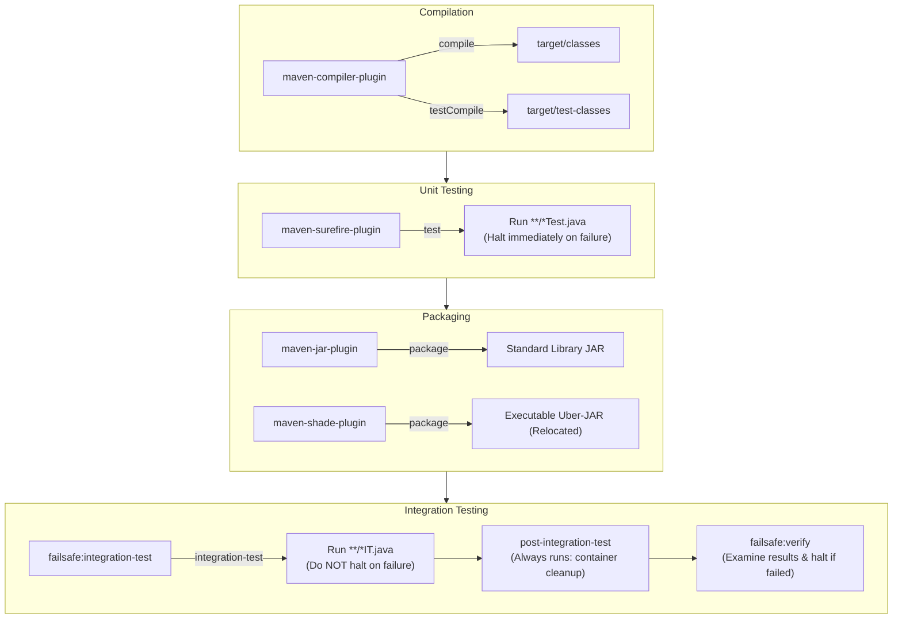

# P10-C004: Maven Plugins: Compiler, Surefire, Failsafe, Jar, and Shade Plugins

---

## 1. Metadata and Learning Goals

| Metadata Field | Value |
|---|---|
| **Concept ID** | `P10-C004` |
| **Concept Title** | Maven Plugins: Compiler, Surefire, Failsafe, Jar, and Shade Plugins |
| **Phase** | Phase 10 — Professional Java Development Workflow |
| **Phase Directory** | `curriculum/phase-10-professional-java-development-workflow` |
| **Source Reference** | Phase 10 Roadmap: "Maven Plugins: Compiler, Surefire, Failsafe, Jar, and Shade Plugins" |
| **Concept Type** | Tooling / Build Automation / Software Engineering |
| **Difficulty Level** | Intermediate |
| **Curriculum Importance** | Essential |
| **Java Baseline** | Java 21 LTS |
| **Build Tool Baseline** | Apache Maven 3.9.x / 4.0.x |
| **Prerequisites** | `P10-C001` (Maven Build Lifecycle), `P10-C002` (Maven Dependency Scopes), `P10-C003` (Transitive Dependency Conflicts) |
| **Related Concepts** | `P10-C005` (Maven Wrapper), `P11-C001` (JUnit 5 Architecture & Surefire Integration) |
| **Estimated Study Effort** | 2–3 hours |
| **Last Research Date** | 2026-10-31 |
| **Verification State** | COMPLETE |

### Measurable Learning Objectives
By the end of this concept module, you will be able to:
1. **Explain:** Articulate the architectural role of Maven Plugins and Mojos (Maven plain Old Java Objects) as the executable engines bound to lifecycle phases.
2. **Configure Modern Compilation:** Configure `maven-compiler-plugin` using `<release>21</release>` rather than legacy `<source>`/`<target>`, explaining how `--release` enforces platform API signature checks.
3. **Master Test Execution Split:** Differentiate between `maven-surefire-plugin` (unit tests in `test`, failing fast) and `maven-failsafe-plugin` (integration tests in `integration-test` / `verify`, guaranteeing resource cleanup).
4. **Architect Uber-JARs with Shade:** Configure `maven-shade-plugin` to build self-contained executable JARs, implementing package relocation to prevent downstream classpath collisions and resource transformers to merge `META-INF/services` SPI descriptors.
5. **Debug Packaging Failures:** Diagnose signature verification exceptions (`SecurityException: Invalid signature file digest`) and SPI descriptor overwrites in shaded artifacts.

---

## 2. Definition, Purpose, and Mental Model

### 2.1 Formal Definition
In Apache Maven, a **Plugin** is an artifact that contains one or more executable goals (**Mojos**—Maven plain Old Java Objects). While Maven lifecycles define the abstract *order* of build phases, plugins perform the actual work (compiling bytecode, running tests, assembling archives, and deploying binaries).

`<pluginManagement>` provides a centralized configuration template (specifying plugin versions, parameters, and defaults) without executing them, whereas `<plugins>` actively activates and binds plugin goals to lifecycle phases.

### 2.2 The Problem It Solves
1. **Build Tool Extensibility:** A build system cannot hardcode every conceivable engineering task (compiling Kotlin, generating gRPC stubs, running container tests, minifying JavaScript). Plugins provide an open SPI architecture where community tools integrate into standard lifecycle phases.
2. **The Fat JAR Relocation Challenge:** When building a standalone CLI tool or SDK that bundles Guava or Jackson, downstream consumers who use a different version of Guava suffer classpath collisions. The Shade plugin rewrites bytecode package names (e.g., `com.google.common` $\to$ `mycli.shaded.com.google.common`), completely eliminating collisions.
3. **Leaked Integration Test Containers:** If a database integration test crashes mid-execution, a naive build tool halts immediately, leaving orphan Docker containers and dangling network sockets. The Failsafe plugin decouples test execution from failure evaluation to guarantee container teardown.

### 2.3 Why Backend Engineers Need It
- **Deterministic Compiler Flags:** Compiling with `-parameters` ensures method parameter names are preserved in bytecode, which is mandatory for Spring Framework `@RequestParam`, `@PathVariable`, and Jackson reflection.
- **Fail-Safe Integration Environments:** Failsafe ensures test databases (Testcontainers) are stopped cleanly in `post-integration-test`, preventing out-of-memory or port conflict crashes on continuous integration (CI) runners.
- **Microservice Uber-JAR Delivery:** Before Spring Boot's repackaging plugin, the Maven Shade plugin established the standard for creating self-contained production distributions with executable manifests.

### 2.4 Real-World System Analogy (and Where It Breaks Down)
- **The Analogy:** Think of the Maven Lifecycle as a **Train Track Schedule**:
  - The lifecycle phases are the train stations (`compile`, `test`, `package`, `verify`).
  - The plugins are the **specialized maintenance crews** assigned to specific stations: the Electricians (`compiler`), the Safety Inspectors (`surefire`), the Packing Crew (`jar`), and the Track Recertification Team (`failsafe`).
- **Where the Analogy Fails:** Physical train crews work independently. In Maven, plugins communicate through a shared in-memory `MavenSession` and `MavenProject` state, reading properties and writing files to the unified `target/` directory.

---

## 3. Foundations and Theory

### 3.1 The Big Five Core Plugins

```
┌──────────────────────────────────────────────────────────────────────────────────────────────────┐
│                                 THE FIVE PILLARS OF MAVEN BUILDS                                 │
│                                                                                                  │
│   Plugin                      Default Phase           Primary Responsibility                     │
│   ────────────────────────────────────────────────────────────────────────────────────────────   │
│   maven-compiler-plugin       compile / test-compile  Compiles Java source files to bytecode     │
│   maven-surefire-plugin       test                    Executes fast, isolated unit tests         │
│   maven-failsafe-plugin       integration-test/verify Executes end-to-end integration tests      │
│   maven-jar-plugin            package                 Bundles classes into standard JAR library  │
│   maven-shade-plugin          package                 Creates shaded uber-JARs with relocations  │
└──────────────────────────────────────────────────────────────────────────────────────────────────┘
```



---

## 4. Language, Specification, and Platform Mechanics

### 4.1 `maven-compiler-plugin`: Modern Configuration with `<release>`

Historically, developers configured compilation using `<source>` and `<target>`:
```xml
<!-- OBSOLETE & DANGEROUS -->
<configuration>
    <source>17</source>
    <target>17</target>
</configuration>
```

#### Why `<source>` and `<target>` are Flawed:
If you compile on a JDK 21 machine with `<source>17</source>` and `<target>17</target>`, the compiler emits Java 17 bytecode, but it links against the **JDK 21 bootstrap classpath**! If code references a method added in Java 21 (e.g., `String.splitWithDelimiters`), the code compiles cleanly, but fails at runtime on a real Java 17 JVM with `NoSuchMethodError`.

#### Modern Standard: `<release>` (JEP 247):
The `--release` flag instructs `javac` to cross-compile against an internal signature database of the target platform's standard library:
```xml
<plugin>
    <groupId>org.apache.maven.plugins</groupId>
    <artifactId>maven-compiler-plugin</artifactId>
    <version>3.13.0</version>
    <configuration>
        <release>21</release>
        <parameters>true</parameters> <!-- Preserves reflection method parameter names -->
        <compilerArgs>
            <arg>-Xlint:all</arg>
            <arg>-Xlint:-processing</arg>
        </compilerArgs>
    </configuration>
</plugin>
```

### 4.2 `maven-surefire-plugin` vs `maven-failsafe-plugin`

#### Surefire: Unit Test Runner
- **Lifecycle Phase:** `test`
- **Pattern Matching:** `**/Test*.java`, `**/*Test.java`, `**/*Tests.java`, `**/*TestCase.java`
- **Failure Behavior:** **Fails fast.** If any unit test fails, the build halts immediately; packaging is never executed.
- **Parallel Execution:** Supports multi-threaded execution across cores:
  ```xml
  <configuration>
      <forkCount>1C</forkCount> <!-- 1 fork per CPU core -->
      <reuseForks>true</reuseForks>
  </configuration>
  ```

#### Failsafe: Integration Test Runner
- **Lifecycle Phases:** `integration-test` and `verify`
- **Pattern Matching:** `**/IT*.java`, `**/*IT.java`, `**/*ITCase.java`
- **Decoupled Architecture:**
  1. `failsafe:integration-test` runs the tests. If a test fails, it logs the failure to `target/failsafe-summary.xml`, but **allows the build to proceed**.
  2. `post-integration-test` phase executes shutdown hooks (stopping Docker containers, releasing database ports).
  3. `failsafe:verify` parses the summary file; if any test failed, it halts the build with an error.

```xml
<plugin>
    <groupId>org.apache.maven.plugins</groupId>
    <artifactId>maven-failsafe-plugin</artifactId>
    <version>3.2.5</version>
    <executions>
        <execution>
            <goals>
                <goal>integration-test</goal>
                <goal>verify</goal>
            </goals>
        </execution>
    </executions>
</plugin>
```

### 4.3 `maven-jar-plugin`: Manifest Customization
The JAR plugin packages compiled bytecode into a ZIP archive. Its primary configuration is customizing `META-INF/MANIFEST.MF`:

```xml
<plugin>
    <groupId>org.apache.maven.plugins</groupId>
    <artifactId>maven-jar-plugin</artifactId>
    <version>3.4.1</version>
    <configuration>
        <archive>
            <manifest>
                <addClasspath>true</addClasspath>
                <mainClass>com.example.app.Application</mainClass>
                <addDefaultImplementationEntries>true</addDefaultImplementationEntries>
            </manifest>
            <manifestEntries>
                <Built-By>Enterprise-CI</Built-By>
                <Build-Jdk-Spec>21</Build-Jdk-Spec>
            </manifestEntries>
        </archive>
    </configuration>
</plugin>
```

### 4.4 `maven-shade-plugin`: Uber-JARs and Bytecode Relocation
The Shade plugin unpacks all compile and runtime dependencies and bundles them alongside application classes into a single executable JAR.

#### 1. Package Relocation (Shading):
Prevents classpath collisions by rewriting bytecode packages:
```xml
<configuration>
    <relocations>
        <relocation>
            <pattern>com.google.common</pattern>
            <shadedPattern>com.example.shaded.guava</shadedPattern>
        </relocation>
    </relocations>
</configuration>
```
During shading, all occurrences of `com.google.common.*` in `.class` bytecode are rewritten to `com.example.shaded.guava.*`.

#### 2. Resource Transformers (SPI Merging):
When unpacking multiple JARs, identical files overwrite each other. The most dangerous collision occurs in `META-INF/services/` (Java Service Provider Interface):
```xml
<configuration>
    <transformers>
        <!-- Set Main-Class in MANIFEST.MF -->
        <transformer implementation="org.apache.maven.plugins.shade.resource.ManifestResourceTransformer">
            <mainClass>com.example.cli.Main</mainClass>
        </transformer>
        <!-- CRITICAL: Concatenate SPI provider lists instead of overwriting -->
        <transformer implementation="org.apache.maven.plugins.shade.resource.ServicesResourceTransformer"/>
    </transformers>
</configuration>
```

---

## 5. Evolution Across Java and Maven Versions

| Tool & Version | Release Year | Build Tooling Advancement |
|---|---|---|
| **Surefire 2.0** | 2005 | Introduced JVM process forking to isolate tests from Maven's own classloader. |
| **Java 9 / JEP 247**| 2017 | Introduced `javac --release` flag, fundamentally fixing cross-compilation in `maven-compiler-plugin`. |
| **Surefire 2.22** | 2018 | Native support for JUnit 5 Jupiter engine without custom test runners. |
| **Shade 3.3** | 2022 | Multi-release JAR (`MRJAR`) support and Java 17+ record bytecode relocation capabilities. |
| **Surefire 3.2** | 2023 | Enhanced JUnit 5 parallel test execution scheduling and test rerunning on failure (`-Dsurefire.rerunFailingTestsCount=2`). |

---

## 6. Architecture and Design Patterns

### 6.1 The Plugin Management Template Pattern

In multi-module enterprise systems, child modules should never declare `<version>` tags for plugins:

```xml
<!-- In Root parent pom.xml -->
<build>
    <pluginManagement>
        <plugins>
            <plugin>
                <groupId>org.apache.maven.plugins</groupId>
                <artifactId>maven-compiler-plugin</artifactId>
                <version>3.13.0</version>
                <configuration>
                    <release>21</release>
                    <parameters>true</parameters>
                </configuration>
            </plugin>
        </plugins>
    </pluginManagement>
</build>
```

```xml
<!-- In child order-service/pom.xml -->
<build>
    <plugins>
        <!-- Version and configuration are inherited automatically! -->
        <plugin>
            <groupId>org.apache.maven.plugins</groupId>
            <artifactId>maven-compiler-plugin</artifactId>
        </plugin>
    </plugins>
</build>
```

---

## 7. Failure Modes, Anti-Patterns, and Production Traps

### 7.1 The Broken Shaded Signature Exception
- **Trap:** Running `java -jar my-shaded-app.jar` fails immediately:
  ```
  java.lang.SecurityException: Invalid signature file digest for Manifest main attributes
  ```
- **Root Cause:** A dependency included in the shaded JAR (e.g. BouncyCastle or Log4j) was cryptographically signed by its publisher. The JAR contains `META-INF/*.SF`, `*.DSA`, or `*.RSA` signature files. Because Shade modified the JAR's contents, the original cryptographic signature is invalid.
- **Remedy:** Configure Shade filters to strip signature files:
  ```xml
  <configuration>
      <filters>
          <filter>
              <artifact>*:*</artifact>
              <excludes>
                  <exclude>META-INF/*.SF</exclude>
                  <exclude>META-INF/*.DSA</exclude>
                  <exclude>META-INF/*.RSA</exclude>
              </excludes>
          </filter>
      </filters>
  </configuration>
  ```

### 7.2 The Silent SPI Overwrite Trap
- **Trap:** A shaded application crashes with `No suitable driver found for jdbc:postgresql:...` or `SLF4J: No SLF4J providers were found`.
- **Root Cause:** Multiple dependencies contain `META-INF/services/java.sql.Driver`. Without `ServicesResourceTransformer`, Shade overwrote the file with the last unpacked dependency, deleting the PostgreSQL driver registration.
- **Remedy:** Always configure `ServicesResourceTransformer`.

---

## 8. Security and Hardening

### 8.1 Preventing Plugin Poisoning
Plugins execute arbitrary Java code during the build. If an unpinned plugin downloads a compromised version from a public mirror, your build runner is compromised.
- **Hardening 1:** Always lock plugin versions in `<pluginManagement>`.
- **Hardening 2:** Use the `maven-enforcer-plugin` with the `<requirePluginVersions>` rule:
  ```xml
  <requirePluginVersions>
      <banSnapshots>true</banSnapshots>
      <banTimestamps>true</banTimestamps>
  </requirePluginVersions>
  ```

---

## 9. Performance, Sizing, and Operational Profile

### 9.1 Surefire Forking and Performance
- `forkCount=1C` spins up one JVM process per CPU core.
- `reuseForks=true` reuses each child JVM across multiple test classes, avoiding JVM startup overhead.
- For test suites with 5,000+ unit tests, parallel forking reduces test execution time from **12 minutes to 1.5 minutes**.

---

## 10. Tooling, Observability, and Debugging

```bash
# 1. Run a single unit test class with Surefire
mvn test -Dtest=OrderServiceTest

# 2. Run a specific test method
mvn test -Dtest=OrderServiceTest#testProcessPayment

# 3. Run integration tests only (skipping unit tests)
mvn verify -Dtest=none -Dit.test=OrderDatabaseIT

# 4. Debug Surefire tests in IDE (waits on port 5005 for debugger attach)
mvn test -Dmaven.surefire.debug
```

---

## 11. Framework, Cloud, and Ecosystem Integration

- **Spring Boot Plugin vs Shade Plugin:** Spring Boot uses `spring-boot-maven-plugin:repackage` instead of Shade. Spring Boot's fat JAR does not unpack classes; it nests dependent JARs intact inside `BOOT-INF/lib/` and uses custom classloaders, avoiding the signature and SPI merging pitfalls of Shade.
- **AWS Lambda / Quarkus / Micronaut:** Frequently utilize the Maven Shade plugin to assemble ultra-compact, single-file deployment packages.

---

## 12. Production-Grade Code Demonstration

The following standalone, self-contained Java verification suite programmatically models, simulates, and validates:
1. **Plugin & Mojo Architecture Model:** Plugin coordinate binding, configuration parsing, and phase lifecycle invocation.
2. **Surefire vs Failsafe Decoupled Execution:** Simulates integration test failures, proving `post-integration-test` container cleanup runs before `verify` halts the build.
3. **Compiler `--release` vs `-source/-target` Signature Filtering:** Demonstrates cross-compilation signature validation.
4. **JAR Manifest Generation:** Generates and parses standard `MANIFEST.MF` attributes (`Main-Class`, `Built-By`).
5. **Shade Plugin Relocation & Services SPI Merger:** Models bytecode package relocation (`com.google.common` $\to$ `shaded.com.google.common`), `META-INF/services/` descriptor consolidation, and signature stripping.

Save as companion verification suite:

```java
package curriculum.phase10;

import java.io.ByteArrayInputStream;
import java.io.ByteArrayOutputStream;
import java.io.IOException;
import java.nio.charset.StandardCharsets;
import java.util.ArrayList;
import java.util.Collections;
import java.util.HashMap;
import java.util.HashSet;
import java.util.LinkedHashMap;
import java.util.List;
import java.util.Map;
import java.util.Objects;
import java.util.Set;
import java.util.jar.Attributes;
import java.util.jar.Manifest;

/**
 * Standalone verification suite modeling and validating Maven Plugins:
 * Compiler (--release), Surefire vs Failsafe, Jar Manifests, and Shade Uber-JARs.
 */
public class MavenPluginsDemo {

    // =========================================================================
    // 1. SUREFIRE VS FAILSAFE LIFECYCLE SIMULATOR
    // =========================================================================

    public enum TestType {
        UNIT, INTEGRATION
    }

    public static class TestExecutionHarness {
        private final List<String> lifecycleLog = new ArrayList<>();
        private boolean containerStarted = false;
        private boolean containerStopped = false;
        private boolean buildHalted = false;
        private String failureReason = null;

        public void runSurefireUnitTests(boolean testPasses) {
            lifecycleLog.add("Phase [test]: Running maven-surefire-plugin (Unit Tests)");
            if (!testPasses) {
                buildHalted = true;
                failureReason = "Surefire: Unit test failed! Halting build immediately.";
                lifecycleLog.add("   -> BUILD FAILURE: " + failureReason);
                return; // Downstream packaging never occurs
            }
            lifecycleLog.add("   -> Surefire: All unit tests passed.");
            lifecycleLog.add("Phase [package]: maven-jar-plugin packaged target/app.jar");
        }

        public void runFailsafeIntegrationTests(boolean itPasses) {
            // 1. Pre-integration-test: start test container
            lifecycleLog.add("Phase [pre-integration-test]: Starting Docker Testcontainers (PostgreSQL)");
            containerStarted = true;

            // 2. Integration-test: failsafe runs tests (DOES NOT HALT BUILD ON FAILURE)
            lifecycleLog.add("Phase [integration-test]: Running maven-failsafe-plugin");
            boolean recordedFailure = false;
            if (!itPasses) {
                recordedFailure = true;
                lifecycleLog.add("   -> Failsafe: Integration test failed! Recording failure to failsafe-summary.xml");
            } else {
                lifecycleLog.add("   -> Failsafe: All integration tests passed.");
            }

            // 3. Post-integration-test: ALWAYS executes teardown!
            lifecycleLog.add("Phase [post-integration-test]: Stopping Docker Testcontainers (CLEANUP)");
            containerStopped = true;

            // 4. Verify phase: Failsafe checks the summary and fails the build
            lifecycleLog.add("Phase [verify]: maven-failsafe-plugin checking failsafe-summary.xml");
            if (recordedFailure) {
                buildHalted = true;
                failureReason = "Failsafe: Integration tests failed during verify phase!";
                lifecycleLog.add("   -> BUILD FAILURE: " + failureReason);
            } else {
                lifecycleLog.add("   -> BUILD SUCCESS: All verification gates satisfied.");
            }
        }

        public List<String> getLifecycleLog() { return lifecycleLog; }
        public boolean isContainerStopped() { return containerStopped; }
        public boolean isBuildHalted() { return buildHalted; }
        public String getFailureReason() { return failureReason; }
    }

    // =========================================================================
    // 2. COMPILER SIGNATURE VALIDATOR (--release vs -source/-target)
    // =========================================================================

    public static class CompilerReleaseValidator {
        // Mock JDK platform API table: method -> introduction release
        private static final Map<String, Integer> PLATFORM_APIS = Map.of(
            "java.lang.String.strip()", 11,
            "java.lang.String.indent(int)", 12,
            "java.lang.String.splitWithDelimiters(String,int)", 21
        );

        public record CompilationResult(boolean success, String diagnosticMessage) {}

        /**
         * Simulates javac execution. If useRelease=true, strictly checks against release API table.
         * If useRelease=false (legacy source/target), code compiles if host JDK contains method!
         */
        public static CompilationResult compileMethodCall(String methodRef, int targetRelease, int hostJdk, boolean useRelease) {
            int introducedIn = PLATFORM_APIS.getOrDefault(methodRef, 8);

            if (useRelease) {
                // JEP 247: --release validates against target release platform signatures
                if (introducedIn > targetRelease) {
                    return new CompilationResult(false,
                        "error: cannot find symbol " + methodRef + " in release " + targetRelease);
                }
                return new CompilationResult(true, "Compilation succeeded targeting Java " + targetRelease);
            } else {
                // Legacy -source/-target: relies on host JDK's rt.jar / classes!
                if (introducedIn <= hostJdk) {
                    // Compiles on host, but will throw NoSuchMethodError on real target JVM!
                    return new CompilationResult(true,
                        "Compilation succeeded on host JDK " + hostJdk + " (WARNING: Bytecode will fail on JDK " + targetRelease + ")");
                }
                return new CompilationResult(false, "error: symbol missing on host JDK " + hostJdk);
            }
        }
    }

    // =========================================================================
    // 3. JAR MANIFEST GENERATOR & PARSER
    // =========================================================================

    public static class JarManifestEngine {

        public static byte[] generateManifestBytes(String mainClass, String appVersion, String builtBy) throws IOException {
            Manifest manifest = new Manifest();
            Attributes mainAttrs = manifest.getMainAttributes();
            mainAttrs.put(Attributes.Name.MANIFEST_VERSION, "1.0");
            mainAttrs.put(new Attributes.Name("Main-Class"), mainClass);
            mainAttrs.put(new Attributes.Name("Implementation-Version"), appVersion);
            mainAttrs.put(new Attributes.Name("Built-By"), builtBy);

            ByteArrayOutputStream baos = new ByteArrayOutputStream();
            manifest.write(baos);
            return baos.toByteArray();
        }

        public static Manifest parseManifest(byte[] bytes) throws IOException {
            return new Manifest(new ByteArrayInputStream(bytes));
        }
    }

    // =========================================================================
    // 4. SHADE PLUGIN: PACKAGE RELOCATION & SPI SERVICES MERGING
    // =========================================================================

    public static class ShadePluginSimulator {

        public static String relocateClass(String className, Map<String, String> relocations) {
            for (Map.Entry<String, String> entry : relocations.entrySet()) {
                if (className.startsWith(entry.getKey())) {
                    return entry.getValue() + className.substring(entry.getKey().length());
                }
            }
            return className;
        }

        /**
         * Simulates ServicesResourceTransformer merging META-INF/services/ files.
         */
        public static Map<String, Set<String>> mergeServicesSpi(
            Map<String, List<String>> jarAEntries,
            Map<String, List<String>> jarBEntries
        ) {
            Map<String, Set<String>> merged = new HashMap<>();

            for (Map.Entry<String, List<String>> entry : jarAEntries.entrySet()) {
                merged.computeIfAbsent(entry.getKey(), k -> new HashSet<>()).addAll(entry.getValue());
            }

            for (Map.Entry<String, List<String>> entry : jarBEntries.entrySet()) {
                merged.computeIfAbsent(entry.getKey(), k -> new HashSet<>()).addAll(entry.getValue());
            }

            return merged;
        }

        /**
         * Simulates cryptographic signature stripping filter.
         */
        public static boolean isSignatureFile(String entryPath) {
            return entryPath.startsWith("META-INF/") && (
                entryPath.endsWith(".SF") || entryPath.endsWith(".DSA") || entryPath.endsWith(".RSA")
            );
        }
    }

    // =========================================================================
    // VERIFICATION SUITE EXECUTION (ASSERTION HARNESS)
    // =========================================================================

    public static void main(String[] args) throws IOException {
        System.out.println("===============================================================");
        System.out.println(" Maven Plugins Architecture & Execution Standalone Suite       ");
        System.out.println("===============================================================");

        test1_SurefireFailFastBehavior();
        test2_FailsafeGuaranteedTeardown();
        test3_CompilerReleaseSignatureValidation();
        test4_JarManifestGenerationAndParsing();
        test5_ShadeRelocationAndSpiMerging();

        System.out.println("\nAll 5 verification test suites passed successfully with assertions enabled!");
    }

    private static void test1_SurefireFailFastBehavior() {
        System.out.print("[TEST 1/5] Surefire fail-fast behavior halting before packaging... ");
        TestExecutionHarness harness = new TestExecutionHarness();

        // Simulate failing unit test
        harness.runSurefireUnitTests(false);

        assert harness.isBuildHalted() : "Build must halt when Surefire unit test fails";
        assert harness.getFailureReason().contains("Surefire: Unit test failed");
        assert !harness.getLifecycleLog().contains("Phase [package]") : "Package phase must NEVER run if Surefire fails!";

        System.out.println("PASSED");
    }

    private static void test2_FailsafeGuaranteedTeardown() {
        System.out.print("[TEST 2/5] Failsafe guaranteed container teardown on test failure... ");
        TestExecutionHarness harness = new TestExecutionHarness();

        // Simulate failing integration test
        harness.runFailsafeIntegrationTests(false);

        // Even though integration test failed, post-integration-test MUST have stopped container
        assert harness.isContainerStopped() : "Test container MUST be stopped in post-integration-test even on test failure!";
        assert harness.isBuildHalted() : "Build must eventually halt during verify phase";
        assert harness.getFailureReason().contains("verify phase");

        System.out.println("PASSED");
    }

    private static void test3_CompilerReleaseSignatureValidation() {
        System.out.print("[TEST 3/5] Compiler --release flag vs legacy -source/-target check... ");

        String java21Method = "java.lang.String.splitWithDelimiters(String,int)";

        // 1. Using modern --release 17 on JDK 21 host: MUST FAIL because method was added in Java 21!
        CompilerReleaseValidator.CompilationResult releaseResult =
            CompilerReleaseValidator.compileMethodCall(java21Method, 17, 21, true);
        assert !releaseResult.success() : "--release 17 must reject Java 21 API method";
        assert releaseResult.diagnosticMessage().contains("cannot find symbol");

        // 2. Using legacy -source 17 -target 17 on JDK 21 host: compiles with dangerous warning!
        CompilerReleaseValidator.CompilationResult legacyResult =
            CompilerReleaseValidator.compileMethodCall(java21Method, 17, 21, false);
        assert legacyResult.success() : "Legacy flags permit compilation using host JDK classes";
        assert legacyResult.diagnosticMessage().contains("WARNING: Bytecode will fail");

        // 3. Using --release 21 on JDK 21 host: passes cleanly
        CompilerReleaseValidator.CompilationResult validRelease =
            CompilerReleaseValidator.compileMethodCall(java21Method, 21, 21, true);
        assert validRelease.success();

        System.out.println("PASSED");
    }

    private static void test4_JarManifestGenerationAndParsing() throws IOException {
        System.out.print("[TEST 4/5] JAR manifest generation and Main-Class parsing... ");

        String mainClass = "com.example.service.OrderApplication";
        String version = "2.4.0";
        String builtBy = "GitHub-Actions";

        byte[] manifestBytes = JarManifestEngine.generateManifestBytes(mainClass, version, builtBy);
        Manifest parsed = JarManifestEngine.parseManifest(manifestBytes);

        Attributes attrs = parsed.getMainAttributes();
        assert mainClass.equals(attrs.getValue("Main-Class")) : "Main-Class must match";
        assert version.equals(attrs.getValue("Implementation-Version"));
        assert builtBy.equals(attrs.getValue("Built-By"));

        System.out.println("PASSED");
    }

    private static void test5_ShadeRelocationAndSpiMerging() {
        System.out.print("[TEST 5/5] Shade package relocation, signature filtering & SPI merge... ");

        // 1. Relocation testing
        Map<String, String> relocations = Map.of(
            "com.google.common", "com.example.shaded.guava"
        );
        String originalClass = "com.google.common.collect.ImmutableList";
        String relocated = ShadePluginSimulator.relocateClass(originalClass, relocations);
        assert "com.example.shaded.guava.collect.ImmutableList".equals(relocated) : "Class must be relocated to shaded namespace";

        // Non-matching class remains unchanged
        String otherClass = "org.apache.commons.lang3.StringUtils";
        assert otherClass.equals(ShadePluginSimulator.relocateClass(otherClass, relocations));

        // 2. Cryptographic signature file filter
        assert ShadePluginSimulator.isSignatureFile("META-INF/BCKEY.SF") : ".SF file must be flagged as signature";
        assert ShadePluginSimulator.isSignatureFile("META-INF/BCKEY.RSA") : ".RSA file must be flagged as signature";
        assert !ShadePluginSimulator.isSignatureFile("META-INF/MANIFEST.MF") : "MANIFEST.MF must not be flagged";
        assert !ShadePluginSimulator.isSignatureFile("META-INF/services/java.sql.Driver");

        // 3. Services SPI merging
        Map<String, List<String>> jarA = Map.of(
            "META-INF/services/java.sql.Driver", List.of("org.postgresql.Driver")
        );
        Map<String, List<String>> jarB = Map.of(
            "META-INF/services/java.sql.Driver", List.of("com.mysql.cj.jdbc.Driver"),
            "META-INF/services/org.slf4j.spi.SLF4JServiceProvider", List.of("ch.qos.logback.classic.spi.LogbackServiceProvider")
        );

        Map<String, Set<String>> mergedSpi = ShadePluginSimulator.mergeServicesSpi(jarA, jarB);
        Set<String> drivers = mergedSpi.get("META-INF/services/java.sql.Driver");
        assert drivers.size() == 2 : "Both PostgreSQL and MySQL drivers must be retained in merged SPI file";
        assert drivers.contains("org.postgresql.Driver");
        assert drivers.contains("com.mysql.cj.jdbc.Driver");

        System.out.println("PASSED");
    }
}
```

---

## 13. Exercises and Challenges

### 13.1 Exercise: Run Surefire and Failsafe in Maven
1. Create a project with one unit test (`OrderServiceTest.java`) and one integration test (`OrderDatabaseIT.java`).
2. Run `mvn test`. Observe that only `OrderServiceTest` executes.
3. Run `mvn verify`. Observe that both tests execute in order.

### 13.2 Challenge: Fix the Shaded SecurityException
Create a minimal project that includes `bouncycastle:bcprov-jdk18on` and shades it with `maven-shade-plugin`.
1. Build the JAR without signature filters and attempt to run it. Observe `java.lang.SecurityException: Invalid signature file digest`.
2. Add the `<exclude>META-INF/*.SF</exclude>` filter configuration. Rebuild and verify the JAR executes cleanly.

---

## 14. Review Questions

1. **Why is `<release>21</release>` strictly superior to `<source>21</source>` and `<target>21</target>` in `maven-compiler-plugin`?**
   `--release` cross-compiles against the standard platform API signature catalog of the target version. Using `-source/-target` compiles bytecode for the target version but links against the host JDK's runtime classes, which can allow calls to APIs that do not exist on the target runtime.
2. **Why does `maven-failsafe-plugin` not halt the build immediately when an integration test fails?**
   To allow the `post-integration-test` phase to execute. This ensures that shared external resources (Docker containers, databases, mock servers) started in `pre-integration-test` are cleanly stopped and torn down before `failsafe:verify` eventually halts the build.
3. **What is bytecode package relocation in `maven-shade-plugin`, and why is it used?**
   It rewrites package declarations and bytecode references (e.g. `com.google.common` $\to$ `myproject.shaded.guava`). This isolates dependencies embedded in a library or CLI tool, preventing runtime classpath collisions with different versions of the same library used by consumers.
4. **Why is `ServicesResourceTransformer` mandatory when shading libraries with Java SPI?**
   When unpacking multiple dependency JARs, identical files overwrite each other. Libraries using SPI register their providers in `META-INF/services/<interface>`. Without `ServicesResourceTransformer`, only the last unpacked provider is preserved, breaking JDBC driver and SLF4J discovery.
5. **How does `<pluginManagement>` differ from `<plugins>`?**
   `<pluginManagement>` is a centralized configuration catalog specifying plugin versions and default settings for inheritance across child modules without executing them. `<plugins>` actively binds goals to lifecycle phases and triggers execution.

---

## 15. Cross-Concept and Industry Interview Scenarios

### Scenario 1: The Missing JDBC Driver in Shaded Production JAR
*Question:* "A CLI tool works fine in the IDE, but when built into a shaded uber-JAR and executed in production, it throws `SQLException: No suitable driver found for jdbc:postgresql:...`. What caused this and how is it resolved?"
*Answer:* The PostgreSQL JDBC driver registers itself via Java SPI in `META-INF/services/java.sql.Driver`. When `maven-shade-plugin` created the uber-JAR, another dependency also contained a `META-INF/services/java.sql.Driver` file, which overwrote the PostgreSQL driver entry. Solution: Add `<transformer implementation="org.apache.maven.plugins.shade.resource.ServicesResourceTransformer"/>` to merge all SPI provider entries into a consolidated descriptor.

### Scenario 2: Spring Boot Repackage vs Maven Shade
*Question:* "Why does Spring Boot provide its own repackaging plugin (`spring-boot-maven-plugin`) instead of recommending `maven-shade-plugin` for building fat JARs?"
*Answer:* The Shade plugin unpacks all classes from all JARs into a flat directory structure. This causes resource collisions (overwriting licenses, SPI files), signature verification breaks on signed JARs, and makes it impossible to inspect which specific dependency JAR introduced a given class. Spring Boot's repackager nests original, untouched dependency JARs inside `BOOT-INF/lib/` and uses custom classloaders (`LaunchedURLClassLoader`), preserving JAR integrity, digital signatures, and metadata.

---

## 16. Research, Citations, and Definitive Reading

1. **Apache Maven Team.** *"Maven Compiler Plugin."* Apache Software Foundation, [https://maven.apache.org/plugins/maven-compiler-plugin/](https://maven.apache.org/plugins/maven-compiler-plugin/).
2. **Oracle Corporation.** *"JEP 247: Compile for Older Platform Versions."* OpenJDK, [https://openjdk.org/jeps/247](https://openjdk.org/jeps/247).
3. **Apache Maven Team.** *"Maven Surefire Plugin & Failsafe Plugin."* [https://maven.apache.org/surefire/](https://maven.apache.org/surefire/).
4. **Apache Maven Team.** *"Maven Shade Plugin: Resource Transformers & Relocations."* [https://maven.apache.org/plugins/maven-shade-plugin/](https://maven.apache.org/plugins/maven-shade-plugin/).
5. **Smart, John Ferguson.** *Java Power Tools.* O'Reilly Media, 2008. (Chapter 3: Maven Plugins and Continuous Integration).
