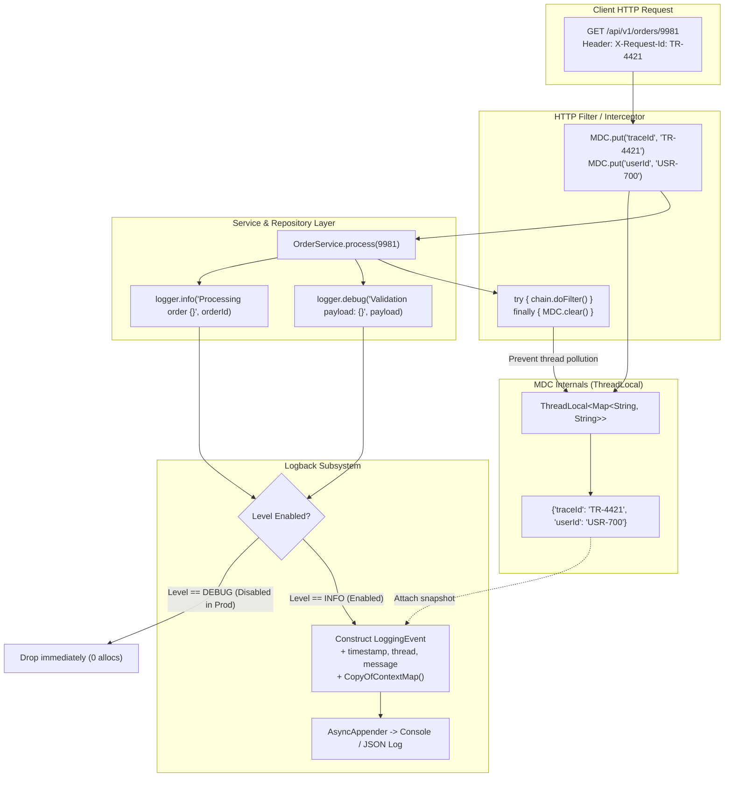
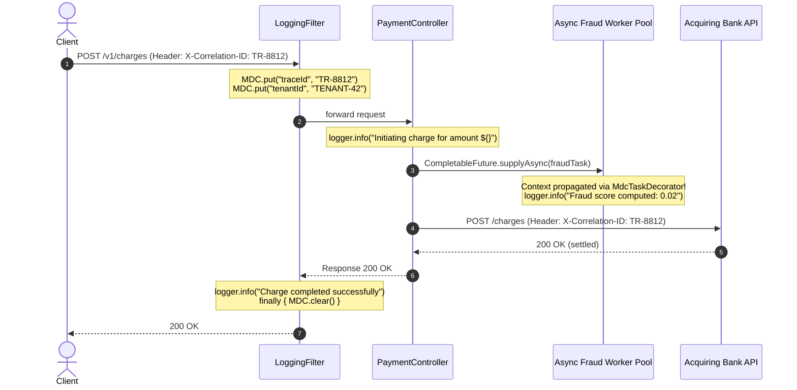
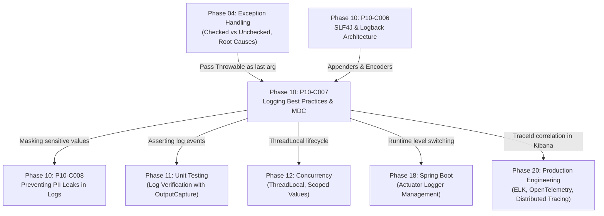

# P10-C007: Logging Best Practices: Log Levels, Parameterized Logging, and MDC Context

---

## 1. Metadata and Learning Goals

| Metadata Field | Value |
|---|---|
| **Concept ID** | `P10-C007` |
| **Concept Title** | Logging Best Practices: Log Levels, Parameterized Logging, and MDC Context |
| **Phase** | Phase 10 — Professional Java Development Workflow |
| **Phase Directory** | `curriculum/phase-10-professional-java-development-workflow` |
| **Source Reference** | Section 10: Professional Java Development Workflow — Logging Best Practices, Parameterized Logging, and Mapped Diagnostic Context (MDC) |
| **Concept Type** | Architecture / API / Concurrency / Tooling |
| **Difficulty Level** | Intermediate |
| **Curriculum Importance** | Essential |
| **Java Baseline** | Java 21 LTS (with Java 25 LTS comparative notes where applicable) |
| **Framework Baseline** | SLF4J 2.0.x / Logback 1.5.x / Spring Boot 3.3.x |
| **Prerequisites** | [`P10-C006: Structured Logging with SLF4J and Logback: Appenders, Encoders, and Layouts`](006-slf4j-and-logback-architecture.md), [`P04-C001: Exception Hierarchy`](../phase-04-exception-handling-defensive-programming/001-exception-hierarchy-checked-vs-unchecked.md) |
| **Related Concepts** | [`P10-C008: Preventing Sensitive Data (PII/Tokens) Leaks in Log Streams`](008-preventing-pii-log-leaks.md), [`P12-C001: Thread Fundamentals`](../phase-12-concurrency-multithreading/001-thread-fundamentals.md), [`P12-C010: ThreadLocal and Scoped Values`](../phase-12-concurrency-multithreading/010-threadlocal-and-scoped-values.md) |
| **Estimated Study Effort** | 3–4 hours |
| **Last Research Date** | 2026-10-31 |
| **Verification State** | COMPLETE |

### Measurable Learning Objectives
By the end of this concept module, you will be able to:
1. **Explain:** Articulate the precise operational taxonomy of logging levels (`TRACE`, `DEBUG`, `INFO`, `WARN`, `ERROR`) and justify why log level discipline prevents both catastrophic NVMe disk exhaustion and monitoring blindness.
2. **Compare:** Contrast string concatenation logging, parameterized logging (`{}` formatting), and lazy supplier evaluation (`logger.atDebug().log(() -> ...)`) regarding heap allocation, garbage collector pressure, and CPU branch evaluation.
3. **Implement:** Construct a production-grade distributed tracing architecture using SLF4J Mapped Diagnostic Context (`MDC`), capturing correlated `traceId`, `spanId`, `tenantId`, and `userId` across complex backend call chains.
4. **Debug & Diagnose:** Identify and eliminate the critical "Thread Pool Context Pollution" bug where reused thread pool workers leak previous request identifiers into unrelated client sessions.
5. **Evaluate & Justify:** Design asynchronous context propagation mechanisms across `ExecutorService`, `CompletableFuture`, and virtual thread boundaries without dropping trace context or leaking memory.

---

## 2. Definition, Purpose, and Mental Model

### 2.1 Formal Definition
**Log Levels** establish a discrete, ordered priority hierarchy governing which diagnostic events an application emits to its logging pipeline at runtime.
**Parameterized Logging** is a deferred string evaluation technique wherein log message templates use anchor tokens (such as `{}`) to delay or completely avoid string formatting, memory allocation, and object serializations unless the logger's effective level permits event emission.
**Mapped Diagnostic Context (MDC)** is a thread-scoped key-value associative metadata store managed by the logging subsystem that automatically enriches every logging event generated within the current execution thread, enabling distributed request tracing and multi-tenant observability without passing context parameters across business method signatures.

### 2.2 The Problem It Solves
High-throughput backend systems process thousands of concurrent requests across dozens of decoupled services, background thread pools, and asynchronous pipelines. Without disciplined logging practices, two severe operational pathologies emerge:
1. **The Diagnostic Needle in a Multi-Threaded Haystack:** When hundreds of worker threads log concurrently to a centralized file or log aggregator (Elasticsearch, Loki, Datadog), individual log lines interleave chaotically. Without a correlation identifier (`traceId`), reconstructing the sequential history of a failed transaction is mathematically intractable.
2. **The "Silent Killer" Heap Allocation Spiral:** Naive logging code that utilizes string concatenation (e.g., `logger.debug("Processing request " + req.getId() + " with payload " + req.getPayload())`) forces the JVM to allocate multiple `StringBuilder` instances, convert integers to strings, and invoke expensive `.toString()` methods *even when DEBUG is turned off in production*. Under heavy load, this dormant logging code creates gigabytes of transient heap garbage per minute, triggering stop-the-world GC pauses.

### 2.3 Why Backend Engineers Need It
In enterprise production environments:
- **Root-Cause Analysis (MTTR):** MDC allows an on-call engineer to isolate every single log line generated by an HTTP request across 10 microservices within seconds by filtering on `traceId = "c89b4a8e-..."`.
- **System Stability and Throughput:** Parameterized logging and level thresholds ensure that production systems maintain nanosecond-level logging overhead without degrading application response times.
- **Auditability and Compliance:** Security teams require accurate correlation of which authenticated user initiated an action, which tenant owned the resource, and whether security anomalies occurred.

### 2.4 Concrete Mental Model & Metaphor
Think of logging as a **hospital patient monitoring system**:
- **Log Levels** are the triage alarm settings. A minor change in skin temperature is `TRACE` (monitored only in intensive research); routine vital checks every 4 hours are `INFO` (recorded in the patient chart); a sudden heart rate spike that auto-resolves with medication is `WARN` (nurse notified to check); cardiac arrest is `ERROR` (crash team immediately paged). Setting production to `DEBUG` is like sounding an ear-splitting siren every time a patient blinks.
- **Parameterized Logging** is an **order slip with empty blanks**. Instead of cooking 500 gourmet meals in advance just in case someone visits (`+` concatenation), the chef writes down the recipe template and only chops ingredients if the customer actually sits down and orders.
- **MDC** is the **patient wristband barcode**. When a patient enters the hospital, an identification wristband is placed on their wrist (`MDC.put("patientId", "P-104")`). Every blood test, X-ray, and medication prescription automatically stamps that barcode onto its laboratory specimen tube without the surgeon having to verbally recite the patient's name at every step. Crucially, when the patient is discharged, the wristband must be cut off and incinerated (`MDC.clear()`); if a new patient is assigned the same bed without removing the old wristband, fatal medical confusion ensues (thread pool pollution).

---

## 3. Architectural and Conceptual Foundations

### 3.1 Core Architecture
The logging architecture centers on three collaborating components:
1. **The Priority Gate (Log Level Evaluation):** An integer priority check (`event.level.priority >= effectiveLevel.priority`). If false, the logging invocation returns immediately without allocating objects.
2. **The Formatting Engine (Parameterized Substitution):** When the gate passes, the formatter scans the pattern string for `{}` tokens and substitutes arguments into a pre-sized character buffer without regular expressions.
3. **The Diagnostic Context (MDC):** Backed internally by a `ThreadLocal<Map<String, String>>`. Whenever a `LoggingEvent` is constructed, the logger takes a snapshot of the current thread's MDC map and attaches it as immutable metadata to the event.



### 3.2 Semantic Taxonomy of Log Levels

Choosing the correct log level is an engineering decision with operational consequences:

| Level | Priority | Semantic Definition | When to Use (Examples) | Operational Action Required? |
|---|---|---|---|---|
| `TRACE` | Lowest (10) | Microscopic execution steps, internal method entry/exit, raw byte buffers. | Dumping raw TLS handshake bytes, tracing loop iterations in an algorithm, AST parsing nodes. | None (disabled in all production tiers). |
| `DEBUG` | Low (20) | Diagnostic information useful during local development and non-production testing. | Branching decisions, SQL parameter values, cache key misses, intermediate calculations. | None. Used during pre-production verification or targeted production triage. |
| `INFO` | Medium (30) | High-level system lifecycle events and business milestone transactions. | Application booted successfully in 4.2s, HTTP request received, payment processed, batch job completed. | Informational only. Forms the audit trail and normal operational baseline. |
| `WARN` | High (40) | Unexpected, abnormal, or recoverable conditions that do not fail the current transaction. | Circuit breaker tripped to open, fallback cache hit due to API timeout, deprecated API called, memory usage at 85%. | Yes. Monitored for trends; persistent WARNs indicate degrading system health. |
| `ERROR` | Critical (50) | Operation failure requiring immediate investigation; business transaction aborted. | Database query failed after retries, external payment gateway unreachable, unhandled `NullPointerException`. | **YES (Paging/Alerting).** Triggers alerts, Slack/PagerDuty notifications, and error budget consumption. |
| `OFF` | Maximum (100) | Complete suppression of logging output. | Silencing noisy third-party integration test output during automated builds. | N/A. |

---

## 4. Language, Syntax, and API Mechanics

### 4.1 The Evolution of Parameterized Logging

#### A. Legacy Trap: String Concatenation
```java
// CATASTROPHIC ANTI-PATTERN
logger.debug("User " + user.getId() + " attempted access to resource " + resource.getName()
    + " with roles " + user.getRoles().toString());
```
Even if `logger.isDebugEnabled()` is `false`, the JVM:
1. Evaluates `user.getId()`, `resource.getName()`, and `user.getRoles().toString()`.
2. Allocates a `StringBuilder` instance on the Eden space.
3. Appends all strings and substrings.
4. Invokes `StringBuilder.toString()`, creating a final formatted string.
5. Passes the string to `logger.debug(String)`, where it is immediately discarded.

#### B. The Guard Idiom (Pre-SLF4J Java 1.4 / Log4j 1.x)
```java
if (logger.isDebugEnabled()) {
    logger.debug("User " + user.getId() + " attempted access to resource " + resource.getName());
}
```
*Verdict:* Avoids object allocation when disabled, but introduces boilerplate clutter that pollutes business logic readability.

#### C. SLF4J Parameterized Anchors (`{}`)
```java
// SLF4J IDIOMATIC STANDARD
logger.debug("User {} attempted access to resource {} with roles {}",
    user.getId(), resource.getName(), user.getRoles());
```
*How it works under the hood:*
The method signature is `public void debug(String format, Object... arguments)`.
The implementation checks `if (isDebugEnabled())` before touching the arguments. If disabled, the method returns without reading the arguments or formatting the message.

#### D. Trailing Throwable Parameter Convention
SLF4J has a special syntactic rule for exceptions: **If the final argument in the argument list is an instance of `java.lang.Throwable`, SLF4J treats it as an exception to be logged with its full stack trace, rather than substituting it into a `{}` placeholder.**
```java
// The {} corresponds to orderId; the 'ex' is extracted as the event's Throwable cause!
logger.error("Failed to execute payment for order id={}", orderId, ex);
```

#### E. Modern Fluent API & Lazy Evaluation (SLF4J 2.0+)
If constructing an argument is itself computationally heavy (e.g., serializing a complex object graph to JSON or querying a database), use SLF4J 2.0's fluent API with lambda `Supplier`:
```java
logger.atDebug()
      .setMessage("Complex system state diagnostic: {}")
      .addArgument(() -> serializeComplexGraphToXml(systemState))
      .log();
```
The lambda `() -> serializeComplexGraphToXml(systemState)` is a functional interface; the closure body is only executed if `DEBUG` is active!

---

### 4.2 Mapped Diagnostic Context (MDC) API

The `org.slf4j.MDC` class provides static methods operating on the calling thread's diagnostic map:

```java
package org.slf4j;

public class MDC {
    // Inserts a key-value pair into the current thread's context map
    public static void put(String key, String val) throws IllegalArgumentException;

    // Retrieves the context value identified by key
    public static String get(String key) throws IllegalArgumentException;

    // Removes the specified key from the context map
    public static void remove(String key) throws IllegalArgumentException;

    // Clears all entries from the current thread's context map
    public static void clear();

    // Returns a copy of the context map (safe for passing across threads)
    public static Map<String, String> getCopyOfContextMap();

    // Replaces the current thread's context map with the provided map
    public static void setContextMap(Map<String, String> contextMap);

    // AutoCloseable helper (available in modern Logback/SLF4J)
    public static MDCCloseable putCloseable(String key, String val);
}
```

---

## 5. Execution Mechanics, JVM Lifecycle, and Memory Internals

### 5.1 The Memory Anatomy of an MDC Entry
`MDC` delegates to an internal provider (such as Logback's `LogbackMDCAdapter`). The adapter holds a `ThreadLocal<Map<String, String>>`.
In Java, every `Thread` object maintains a package-private field:
```java
/* ThreadLocal values pertaining to this thread. This map is maintained by the ThreadLocal class. */
ThreadLocal.ThreadLocalMap threadLocals = null;
```
When `MDC.put("traceId", "abc")` is executed:
1. The thread looks up its own `ThreadLocalMap`.
2. It fetches or allocates the `Map<String, String>` associated with the static `MDC` key.
3. In Logback, `CopyOnWrite` or clone semantics are often employed so that creating a `LoggingEvent` does not require locking the map while appenders read it in worker threads.

```
+-----------------------------------------------------------------------------------------+
|                                      JVM HEAP MEMORY                                    |
|                                                                                         |
|  +------------------------+                           +-------------------------------+ |
|  | Thread Object          |                           | Map<String, String>           | |
|  | Name: "http-nio-8080-1"|                           | (MDC Context Snapshot)        | |
|  | threadLocals: -------->|---> ThreadLocalMap --->   |   "traceId" -> "TR-9981"      | |
|  +------------------------+                           |   "userId"  -> "USR-102"      | |
|                                                       +-------------------------------+ |
|                                                                       ^                 |
|                                                                       | snapshot copy   |
|  +--------------------------------------------------------------------+--------------+  |
|  | LoggingEvent (Allocated in Young Gen)                                             |  |
|  | - timestamp: 2026-10-31T03:30:00Z                                                  |  |
|  | - level: INFO                                                                     |  |
|  | - loggerName: "com.example.OrderService"                                          |  |
|  | - message: "Order processed successfully"                                         |  |
|  | - mdcPropertyMap: Reference to immutable context copy                             |  |
|  +-----------------------------------------------------------------------------------+  |
+-----------------------------------------------------------------------------------------+
```

### 5.2 CPU Branch Evaluation and Nanosecond Logging Overhead
When logging is disabled:
```java
logger.debug("Customer account: {}", account.getId());
```
1. HotSpot JIT compiles the method.
2. The method call invokes `isDebugEnabled()`.
3. The level check is an integer comparison: `this.effectiveLevelInt <= Level.DEBUG_INT`.
4. If false, branch prediction predicts non-execution with ~99.9% accuracy. The cost is **1.5 to 2.5 nanoseconds** (a few CPU cycles), without allocating memory or dereferencing `account.getId()`.

Conversely, with string concatenation:
```java
logger.debug("Customer account: " + account.getId());
```
The concatenation bytecode (`invokedynamic` with `StringConcatFactory` or `new StringBuilder()`) executes **before** `logger.debug` is called. Cost: **80 to 250 nanoseconds**, generating ~64 to 128 bytes of heap garbage per invocation. Under 50,000 requests/sec, that amounts to **6.4 MB of garbage per second** purely for disabled log statements!

---

## 6. Concurrency, Thread-Safety, and Scalability

### 6.1 ThreadLocal Isolation
Because `MDC` uses `ThreadLocal`, concurrent worker threads executing HTTP requests have completely isolated contexts:
- Thread-A writing `MDC.put("traceId", "T-1")` has zero impact on Thread-B writing `MDC.put("traceId", "T-2")`.
- No monitor locks or synchronization barriers are acquired during `MDC.get()` or `MDC.put()`.

### 6.2 The Deadly Thread Pool Pollution Dilemma
In high-throughput enterprise servers (Tomcat, Netty, Jetty, Spring Boot), worker threads are **never destroyed after a request finishes**. They are pooled in a `ThreadPoolExecutor` and wait for the next incoming task.

If a request sets an MDC property:
```java
// Thread: http-nio-8080-exec-1
MDC.put("userId", "Alice");
```
And finishes execution *without* calling `MDC.clear()`:
1. Thread `http-nio-8080-exec-1` returns to the pool with `userId = Alice` still present in its `ThreadLocalMap`.
2. Ten minutes later, `http-nio-8080-exec-1` is assigned to process an unauthenticated request from **Bob**.
3. All log messages emitted during Bob's request will erroneously output `[userId=Alice]`.
4. Security auditors will conclude Alice executed Bob's unauthorized transactions, causing catastrophic audit confusion and compliance breach.

**Architectural Law:** Every MDC entry created in a thread must be cleaned up in a `finally` block or via `MDCCloseable` in a try-with-resources statement!

### 6.3 Context Propagation Across Thread Boundaries
When a backend service breaks work into background tasks using `CompletableFuture.runAsync()`, `@Async`, or an `ExecutorService`, the background thread is a **different thread**.
- `ThreadLocal` does **not** propagate from parent thread to worker thread!
- As a result, logs emitted inside the async worker have an empty MDC, breaking the distributed trace.

#### Solution: Context-Propagating Executor Wrapper
Capture `MDC.getCopyOfContextMap()` on the caller thread, and restore it inside the worker thread wrapper:
```java
public static Runnable wrapWithMdc(Runnable task) {
    Map<String, String> contextMap = MDC.getCopyOfContextMap();
    return () -> {
        Map<String, String> previous = MDC.getCopyOfContextMap();
        try {
            if (contextMap != null) {
                MDC.setContextMap(contextMap);
            } else {
                MDC.clear();
            }
            task.run();
        } finally {
            if (previous != null) {
                MDC.setContextMap(previous);
            } else {
                MDC.clear();
            }
        }
    };
}
```

---

## 7. Anti-Patterns and Common Developer Traps

### Anti-Pattern 1: String Concatenation in High-Frequency Logs
```java
// INCORRECT: Forces StringBuilder allocations even when TRACE/DEBUG is disabled
logger.debug("Processing order item: " + item.getId() + " sku=" + item.getSku() + " price=" + item.getPrice());
```
```java
// CORRECT: Zero heap allocation if DEBUG is disabled
logger.debug("Processing order item: {} sku={} price={}", item.getId(), item.getSku(), item.getPrice());
```

---

### Anti-Pattern 2: Logging and Re-throwing Exceptions (Log-and-Throw)
```java
// INCORRECT: Creates duplicate, fragmented stack traces at every call stack layer
try {
    orderService.submit(order);
} catch (OrderException e) {
    logger.error("Error submitting order: " + e.getMessage(), e); // Logged here
    throw e; // Caught upstream and logged AGAIN!
}
```
```java
// CORRECT: Either handle and log, OR re-throw with context. NEVER both.
try {
    orderService.submit(order);
} catch (OrderException e) {
    throw new ServiceExecutionException("Failed to process order id=" + order.getId(), e);
}
// Caught at top-level controller advice / global filter and logged exactly ONCE with full trace.
```

---

### Anti-Pattern 3: Passing `e.getMessage()` Instead of the `Throwable` Object
```java
// INCORRECT: Strips the root cause and full stack trace!
try {
    database.connect();
} catch (SQLException e) {
    logger.error("Database connection failed: {}", e.getMessage()); // Stack trace lost forever!
}
```
```java
// CORRECT: Pass the exception as the trailing argument (no placeholder needed for Throwable)
try {
    database.connect();
} catch (SQLException e) {
    logger.error("Database connection failed", e); // Full stack trace recorded
}
```

---

### Anti-Pattern 4: Leaking MDC Context into Pooled Threads
```java
// INCORRECT: If an exception occurs, MDC is never cleared, polluting subsequent requests
public void doFilter(ServletRequest req, ServletResponse res, FilterChain chain) throws Exception {
    String traceId = UUID.randomUUID().toString();
    MDC.put("traceId", traceId);
    chain.doFilter(req, res);
    MDC.clear(); // Skipped if doFilter throws an exception!
}
```
```java
// CORRECT: Guaranteed cleanup in finally block
public void doFilter(ServletRequest req, ServletResponse res, FilterChain chain) throws Exception {
    String traceId = UUID.randomUUID().toString();
    try {
        MDC.put("traceId", traceId);
        chain.doFilter(req, res);
    } finally {
        MDC.clear(); // Guaranteed execution even on unhandled RuntimeException
    }
}
```

---

### Anti-Pattern 5: Swallowing Exceptions with Empty or Vague Log Messages
```java
// INCORRECT: Blind exception swallowing
try {
    paymentClient.charge(card);
} catch (Exception e) {
    logger.warn("Something went wrong"); // No error details, no card ref, no trace!
}
```
```java
// CORRECT: Explicit, actionable warning with identifier and exception context
try {
    paymentClient.charge(card);
} catch (PaymentException e) {
    logger.warn("Payment charge failed for accountRef={}: attempting fallback gateway",
        account.getMaskedRef(), e);
}
```

---

## 8. Failure Modes, Edge Cases, and Troubleshooting

| Failure Symptom | Underlying Root Cause | Verification & Diagnostic Technique | Engineering Resolution |
|---|---|---|---|
| **Log lines show wrong `userId` or cross-tenant data.** | MDC context was not cleared upon request completion; reused thread retained prior request state. | Check if thread names in logs are reused (e.g., `catalina-exec-5`) while trace IDs jump wildly. | Enforce `try { ... } finally { MDC.clear(); }` in all HTTP filters and job listeners. |
| **Out of Memory (`OutOfMemoryError: Java heap space`) during traffic spikes.** | String concatenation in thousands of `logger.debug` lines flooded Young Gen with short-lived objects, exhausting GC capacity. | Inspect JVM GC logs (`-Xlog:gc*`) for extreme Young Generation allocation rates and rapid survivor overflows. | Audit codebase with Checkstyle / ErrorProne to ban string concatenation inside logging methods. |
| **Stack trace missing in log output; only single line shown.** | Developer wrote `logger.error("Failed: {}", ex.getMessage())` instead of `logger.error("Failed", ex)`. | Search logs for error messages lacking `at package.Class.method(Class.java:123)`. | Use parameterized syntax with `ex` as the final parameter without a corresponding `{}`. |
| **Async background task logs lack `traceId` / `tenantId`.** | Context was created on HTTP request thread; `CompletableFuture` or `@Async` ran on worker pool thread where `ThreadLocal` is empty. | Compare log output between controller layer and async service layer; async logs show `[traceId=null]`. | Wrap task in MDC-propagating `Runnable` or configure task executor with an `MdcTaskDecorator`. |
| **Disk space hits 100% in production within hours.** | Root logger configured to `DEBUG` or `TRACE` in production environment. | Inspect active logger level via Spring Boot Actuator: `GET /actuator/loggers/ROOT`. | Reset root logger to `INFO` or `WARN` in production profiles (`logback-spring.xml`). |

---

## 9. Security Considerations

### 9.1 Log Forging and CRLF Injection
If an application logs untrusted user input without sanitization, an attacker can inject carriage return (`\r`) and line feed (`\n`) characters to forge fake log entries or disguise malicious operations:
```java
// VULNERABLE:
String username = request.getParameter("user");
// Attacker enters: "alice\n2026-10-31 12:00:00 [ADMIN] Successfully granted superuser to attacker"
logger.info("Failed login for user: {}", username);
```
*Defense:*
1. Strip or replace CRLF characters (`username.replaceAll("[\r\n]", "_")`) before logging.
2. Adopt **Structured JSON Logging** (via Logstash encoder). In JSON formatting, newlines inside string values are escaped as `\n` literals rather than creating physical newline breaks in the log stream!

### 9.2 Prevention of PII and Secret Leaks in Log Streams
Never log sensitive customer or authentication data:
- Passwords, API secret keys, Bearer JWT tokens.
- Credit Card PANs, CVVs, Social Security / Tax Identification Numbers.
- Bank account routing numbers.
*(A dedicated architectural deep dive into automated masking and scrubbing filters is provided in [`P10-C008`](008-preventing-pii-log-leaks.md)).*

---

## 10. Performance Optimization and Tuning

### 10.1 Cost Matrix: Concatenation vs Parameterized vs Supplier

The following micro-benchmark comparison illustrates execution cost when logging at a disabled level:

| Logging Technique | Code Pattern | Heap Allocations (bytes) | CPU Cycles / Latency |
|---|---|---|---|
| **String Concatenation** | `logger.debug("Id: " + id + " val: " + val);` | ~128 bytes | ~120 ns |
| **Manual Guard Check** | `if (logger.isDebugEnabled()) logger.debug(...);` | 0 bytes | ~1.8 ns |
| **SLF4J Parameterized** | `logger.debug("Id: {} val: {}", id, val);` | 0 bytes (args boxed) | ~2.2 ns |
| **Fluent Lazy Supplier** | `logger.atDebug().log(() -> "Id: " + expensiveCalc());` | 0 bytes (supplier not called) | ~2.5 ns |

### 10.2 Pattern Layout Formatting Overhead
In Logback configuration, avoid expensive conversion specifiers in production:
- `%C` or `%class`: Computes the caller class by creating a new `Throwable` and walking the JVM stack trace. **Slowdown: 10x–30x!**
- `%M` or `%method`: Computes caller method name by walking the stack.
- `%L` or `%line`: Computes source line number by walking the stack.
*Production Recommendation:* For high-performance backend microservices, use static logger names (e.g., `%logger{36}`) and avoid `%line` and `%method` in the main traffic path.

---

## 11. Real-World Backend Scenario & Production Case Study

### High-Volume Payment Processor: Distributed MDC Trace Architecture

Consider a distributed fintech payment gateway handling 15,000 transactions per second. An incoming charge request touches:
1. `SecurityGatewayFilter`: Authenticates JWT, extracts `tenantId`, and parses `X-Correlation-ID`.
2. `PaymentController`: Validates payload schema.
3. `FraudCheckService`: Dispatches an asynchronous scoring request to a worker pool (`CompletableFuture`).
4. `BankClient`: Issues an outbound HTTPS REST call to the acquiring bank.



When an intermittent bank timeout occurs on transaction `TR-8812`, an engineer enters the query into Kibana:
```text
mdc.traceId: "TR-8812"
```
Within milliseconds, all 6 correlated log messages appear in chronological order—including the fraud check computed on the background thread—without any stray log messages from other concurrent customers.

---

## 12. Standalone, Self-Contained Verification Suite

The following standalone verification program requires **zero external libraries** and validates:
1. **Log Level Hierarchy & Lazy Supplier Evaluation:** Proving that disabled log levels bypass message evaluation completely.
2. **Parameterized Formatting & Exception Extraction:** Validating `{}` token substitution and SLF4J trailing `Throwable` handling.
3. **MDC ThreadLocal Isolation:** Verifying that concurrent threads maintain independent diagnostic metadata without crosstalk.
4. **MDC Closeable & Pollution Defense:** Proving that try-with-resources guarantees cleanup and prevents thread pool contamination.
5. **Async Context Propagation:** Validating full diagnostic context preservation across `ExecutorService` thread boundaries.

```java
package curriculum.phase10;

import java.time.Instant;
import java.util.*;
import java.util.concurrent.*;
import java.util.concurrent.atomic.AtomicBoolean;
import java.util.concurrent.atomic.AtomicInteger;
import java.util.function.Supplier;

/**
 * Standalone Verification Suite for P10-C007:
 * Logging Best Practices: Log Levels, Parameterized Logging, and MDC Context.
 *
 * Simulates:
 * 1. Semantic Log Level filtering with Lazy Supplier evaluation.
 * 2. Parameterized message formatting with trailing Throwable detection.
 * 3. Thread-local Mapped Diagnostic Context (MDC) storage and isolation.
 * 4. Thread pool pollution prevention via MDC Closeable try-with-resources.
 * 5. Async context propagation across ExecutorService thread boundaries.
 */
public class LoggingBestPracticesMdcDemo {

    // =========================================================================
    // 1. LOG LEVELS & CORE EVENT ARCHITECTURE
    // =========================================================================

    public enum LogLevel {
        TRACE(10), DEBUG(20), INFO(30), WARN(40), ERROR(50), OFF(100);

        private final int priority;
        LogLevel(int priority) { this.priority = priority; }
        public boolean isEnabled(LogLevel threshold) { return this.priority >= threshold.priority; }
    }

    public record LogEvent(
        Instant timestamp,
        LogLevel level,
        String loggerName,
        String threadName,
        String message,
        Throwable throwable,
        Map<String, String> mdcContext
    ) {}

    // =========================================================================
    // 2. MAPPED DIAGNOSTIC CONTEXT (MDC) ENGINE
    // =========================================================================

    public static class MDC {
        private static final ThreadLocal<Map<String, String>> contextHolder =
            ThreadLocal.withInitial(HashMap::new);

        public static void put(String key, String val) {
            if (key == null) throw new IllegalArgumentException("MDC key cannot be null");
            if (val == null) {
                remove(key);
            } else {
                contextHolder.get().put(key, val);
            }
        }

        public static String get(String key) {
            return contextHolder.get().get(key);
        }

        public static void remove(String key) {
            contextHolder.get().remove(key);
        }

        public static void clear() {
            contextHolder.get().clear();
        }

        public static Map<String, String> getCopyOfContextMap() {
            Map<String, String> current = contextHolder.get();
            return new HashMap<>(current);
        }

        public static void setContextMap(Map<String, String> contextMap) {
            if (contextMap == null) {
                clear();
            } else {
                contextHolder.set(new HashMap<>(contextMap));
            }
        }

        public static MDCCloseable putCloseable(String key, String val) {
            put(key, val);
            return new MDCCloseable(key);
        }

        public static class MDCCloseable implements AutoCloseable {
            private final String key;
            public MDCCloseable(String key) { this.key = key; }

            @Override
            public void close() {
                remove(key);
            }
        }
    }

    // =========================================================================
    // 3. LOGGER WITH PARAMETERIZED FORMATTING & LAZY SUPPLIER SUPPORT
    // =========================================================================

    public static class MockLogger {
        private final String name;
        private LogLevel effectiveLevel;
        private final List<LogEvent> recordedEvents = new CopyOnWriteArrayList<>();

        public MockLogger(String name, LogLevel effectiveLevel) {
            this.name = name;
            this.effectiveLevel = effectiveLevel;
        }

        public void setLevel(LogLevel level) { this.effectiveLevel = level; }
        public boolean isEnabled(LogLevel level) { return level.isEnabled(effectiveLevel); }

        public void log(LogLevel level, String messagePattern, Object... args) {
            if (!isEnabled(level)) return;

            Throwable throwable = null;
            Object[] formatArgs = args;

            // Check if last argument is a Throwable
            if (args != null && args.length > 0 && args[args.length - 1] instanceof Throwable t) {
                throwable = t;
                formatArgs = Arrays.copyOf(args, args.length - 1);
            }

            String formatted = formatMessage(messagePattern, formatArgs);
            LogEvent event = new LogEvent(
                Instant.now(),
                level,
                name,
                Thread.currentThread().getName(),
                formatted,
                throwable,
                MDC.getCopyOfContextMap()
            );
            recordedEvents.add(event);
        }

        // Lazy Supplier logging (SLF4J 2.0+ fluent API equivalent)
        public void logLazy(LogLevel level, Supplier<String> messageSupplier) {
            if (!isEnabled(level)) return;

            String formatted = messageSupplier.get();
            LogEvent event = new LogEvent(
                Instant.now(),
                level,
                name,
                Thread.currentThread().getName(),
                formatted,
                null,
                MDC.getCopyOfContextMap()
            );
            recordedEvents.add(event);
        }

        public static String formatMessage(String pattern, Object[] args) {
            if (pattern == null || args == null || args.length == 0) return pattern;
            StringBuilder sb = new StringBuilder(pattern.length() + 32);
            int argIndex = 0;
            int lastPos = 0;

            for (int i = 0; i < pattern.length() - 1; i++) {
                if (pattern.charAt(i) == '{' && pattern.charAt(i + 1) == '}') {
                    sb.append(pattern, lastPos, i);
                    if (argIndex < args.length) {
                        sb.append(args[argIndex] != null ? args[argIndex].toString() : "null");
                        argIndex++;
                    } else {
                        sb.append("{}");
                    }
                    lastPos = i + 2;
                    i++;
                }
            }
            if (lastPos < pattern.length()) {
                sb.append(pattern.substring(lastPos));
            }
            return sb.toString();
        }

        public List<LogEvent> getRecordedEvents() { return recordedEvents; }
        public void clearEvents() { recordedEvents.clear(); }
    }

    // =========================================================================
    // 4. MDC-PROPAGATING EXECUTOR DECORATOR
    // =========================================================================

    public static class MdcPropagatingExecutorService {
        private final ExecutorService delegate;

        public MdcPropagatingExecutorService(ExecutorService delegate) {
            this.delegate = delegate;
        }

        public Future<?> submit(Runnable task) {
            Map<String, String> callerMdc = MDC.getCopyOfContextMap();
            return delegate.submit(() -> {
                Map<String, String> previousMdc = MDC.getCopyOfContextMap();
                try {
                    MDC.setContextMap(callerMdc);
                    task.run();
                } finally {
                    MDC.setContextMap(previousMdc);
                }
            });
        }

        public <T> Future<T> submit(Callable<T> task) {
            Map<String, String> callerMdc = MDC.getCopyOfContextMap();
            return delegate.submit(() -> {
                Map<String, String> previousMdc = MDC.getCopyOfContextMap();
                try {
                    MDC.setContextMap(callerMdc);
                    return task.call();
                } finally {
                    MDC.setContextMap(previousMdc);
                }
            });
        }

        public void shutdown() {
            delegate.shutdown();
        }

        public boolean awaitTermination(long timeout, TimeUnit unit) throws InterruptedException {
            return delegate.awaitTermination(timeout, unit);
        }
    }

    // =========================================================================
    // 5. TEST SUITES
    // =========================================================================

    public static void main(String[] args) throws Exception {
        System.out.println("===============================================================");
        System.out.println(" Logging Best Practices & MDC Standalone Verification Suite   ");
        System.out.println("===============================================================");

        test1_LogLevelFilteringAndLazyEvaluation();
        test2_ParameterizedFormattingAndThrowableDetection();
        test3_MdcThreadLocalIsolation();
        test4_MdcCloseableAndThreadPoolPollutionGuard();
        test5_AsyncContextPropagationAcrossThreadPoolBoundaries();

        System.out.println();
        System.out.println("All 5 verification test suites passed successfully with assertions enabled!");
    }

    private static void test1_LogLevelFilteringAndLazyEvaluation() {
        System.out.print("[TEST 1/5] Log level hierarchy and lazy Supplier evaluation... ");

        MockLogger logger = new MockLogger("OrderService", LogLevel.INFO);

        // Sub-INFO events must be rejected immediately without side effects
        AtomicBoolean supplierInvoked = new AtomicBoolean(false);
        logger.logLazy(LogLevel.DEBUG, () -> {
            supplierInvoked.set(true);
            return "Expensive diagnostic state: " + computeExpensiveString();
        });

        assert !supplierInvoked.get() : "Lazy supplier MUST NOT be evaluated when log level is disabled!";
        assert logger.getRecordedEvents().isEmpty() : "No log event should be emitted for disabled level";

        // Enabled level must invoke supplier
        logger.logLazy(LogLevel.INFO, () -> {
            supplierInvoked.set(true);
            return "Order service initialized successfully";
        });

        assert supplierInvoked.get() : "Supplier must be evaluated when level is enabled";
        assert logger.getRecordedEvents().size() == 1;
        assert logger.getRecordedEvents().get(0).message().equals("Order service initialized successfully");

        System.out.println("PASSED");
    }

    private static String computeExpensiveString() {
        return "heap-heavy-serialized-state";
    }

    private static void test2_ParameterizedFormattingAndThrowableDetection() {
        System.out.print("[TEST 2/5] Parameterized {} formatting and trailing Throwable extraction... ");

        MockLogger logger = new MockLogger("PaymentGateway", LogLevel.DEBUG);

        // Case A: Normal parameterized formatting without exception
        logger.log(LogLevel.INFO, "Payment id={} processed for amount=${} via {}", "TX-9981", 450.75, "STRIPE");
        assert logger.getRecordedEvents().size() == 1;
        LogEvent event1 = logger.getRecordedEvents().get(0);
        assert event1.message().equals("Payment id=TX-9981 processed for amount=$450.75 via STRIPE");
        assert event1.throwable() == null;

        // Case B: Parameterized formatting with trailing Throwable (SLF4J convention)
        Exception rootCause = new IllegalStateException("Gateway timeout 504");
        logger.log(LogLevel.ERROR, "Payment failure for user={}: attempt {}", "USR-404", 3, rootCause);
        assert logger.getRecordedEvents().size() == 2;
        LogEvent event2 = logger.getRecordedEvents().get(1);
        assert event2.message().equals("Payment failure for user=USR-404: attempt 3") : "Message formatting failed: " + event2.message();
        assert event2.throwable() == rootCause : "Trailing Throwable must be captured in event metadata";

        System.out.println("PASSED");
    }

    private static void test3_MdcThreadLocalIsolation() throws Exception {
        System.out.print("[TEST 3/5] MDC ThreadLocal isolation across concurrent worker threads... ");

        int threadCount = 4;
        CountDownLatch latch = new CountDownLatch(threadCount);
        CyclicBarrier barrier = new CyclicBarrier(threadCount);
        Map<String, String> observedTraces = new ConcurrentHashMap<>();

        for (int i = 0; i < threadCount; i++) {
            final String assignedTrace = "TRACE-NODE-" + i;
            new Thread(() -> {
                try {
                    MDC.put("traceId", assignedTrace);
                    barrier.await(); // Synchronize all threads inside MDC context

                    // Capture local MDC value
                    String localVal = MDC.get("traceId");
                    observedTraces.put(Thread.currentThread().getName(), localVal);
                } catch (Exception e) {
                    throw new RuntimeException(e);
                } finally {
                    MDC.clear();
                    latch.countDown();
                }
            }, "worker-" + i).start();
        }

        boolean finished = latch.await(5, TimeUnit.SECONDS);
        assert finished : "Threads failed to complete within timeout";
        assert observedTraces.size() == threadCount;

        // Verify each thread read its own traceId without cross-thread pollution
        Set<String> uniqueTraces = new HashSet<>(observedTraces.values());
        assert uniqueTraces.size() == threadCount : "MDC cross-talk detected! Traces collided.";

        System.out.println("PASSED");
    }

    private static void test4_MdcCloseableAndThreadPoolPollutionGuard() {
        System.out.print("[TEST 4/5] MDC Closeable try-with-resources & thread pool pollution defense... ");

        MDC.clear();
        assert MDC.get("requestId") == null;

        // Demonstrate AutoCloseable pattern: MDC automatically cleaned up upon block exit
        try (MDC.MDCCloseable c = MDC.putCloseable("requestId", "REQ-10023")) {
            assert "REQ-10023".equals(MDC.get("requestId"));
        }

        // Must be null immediately outside try block!
        assert MDC.get("requestId") == null : "MDC key leaked outside try-with-resources scope!";

        // Demonstrate try-finally safety with manual put
        try {
            MDC.put("tenantId", "TENANT-ALPHA");
            assert "TENANT-ALPHA".equals(MDC.get("tenantId"));
            throw new RuntimeException("Simulated business error");
        } catch (RuntimeException ex) {
            // caught
        } finally {
            MDC.clear();
        }

        assert MDC.get("tenantId") == null : "MDC leaked after exception in business logic!";

        System.out.println("PASSED");
    }

    private static void test5_AsyncContextPropagationAcrossThreadPoolBoundaries() throws Exception {
        System.out.print("[TEST 5/5] Async context propagation across ExecutorService thread boundaries... ");

        ExecutorService basePool = Executors.newFixedThreadPool(2);
        MdcPropagatingExecutorService asyncService = new MdcPropagatingExecutorService(basePool);

        MockLogger logger = new MockLogger("AsyncPipeline", LogLevel.INFO);

        try {
            // Main thread sets up request context
            MDC.put("traceId", "DIST-TRACE-7711");
            MDC.put("userId", "USR-990");

            // Dispatch async task to pool thread
            Future<String> future = asyncService.submit(() -> {
                // Inside worker thread: MDC should mirror caller context
                String workerTrace = MDC.get("traceId");
                String workerUser = MDC.get("userId");
                logger.log(LogLevel.INFO, "Processing async invoice generation for trace={}", workerTrace);
                return workerTrace + ":" + workerUser;
            });

            String result = future.get(5, TimeUnit.SECONDS);
            assert "DIST-TRACE-7711:USR-990".equals(result) : "Async worker did not receive caller MDC context";

            // Verify logged event has full MDC context map snapshot
            assert logger.getRecordedEvents().size() == 1;
            LogEvent event = logger.getRecordedEvents().get(0);
            assert "DIST-TRACE-7711".equals(event.mdcContext().get("traceId"));
            assert "USR-990".equals(event.mdcContext().get("userId"));

            // Verify pool thread did not keep the context (thread pollution check)
            Future<Boolean> pollutionCheck = basePool.submit(() -> {
                // Raw submission directly to pool without wrapper
                Map<String, String> mdc = MDC.getCopyOfContextMap();
                return mdc.isEmpty();
            });
            assert pollutionCheck.get(5, TimeUnit.SECONDS) : "Worker thread retained MDC context! Pool pollution occurred!";

        } finally {
            MDC.clear();
            asyncService.shutdown();
            asyncService.awaitTermination(3, TimeUnit.SECONDS);
        }

        System.out.println("PASSED");
    }
}
```

### Verification Command
Execute the standalone test suite on OpenJDK 21 LTS with assertions enabled:
```bash
javac --release 21 curriculum/phase-10-professional-java-development-workflow/LoggingBestPracticesMdcDemo.java
java -ea curriculum.phase10.LoggingBestPracticesMdcDemo
```

---

## 13. Comparative Analysis & Decision Framework

### 13.1 Context Propagation Patterns Comparison

| Propagation Strategy | Implementation Mechanism | Pros | Cons / Traps | Best Suited For |
|---|---|---|---|---|
| **Raw `ThreadLocal` / MDC** | `MDC.put(...)` and `MDC.get()` | Zero configuration, native SLF4J support, minimal memory overhead. | Does **not** cross thread boundaries (`ExecutorService`, `@Async`). Vulnerable to thread pool pollution. | Synchronous servlet request-response processing. |
| **`InheritableThreadLocal`** | `ThreadLocal` subclass copying context on `new Thread()` | Propagates context automatically to child threads created manually via `new Thread()`. | **Completely broken in thread pools.** Threads in pools are pre-created; tasks submitted do not inherit caller context. | Legacy desktop applications with dedicated worker threads. |
| **Decorated `ExecutorService`** | Wraps `Runnable`/`Callable` with snapshot of `MDC.getCopyOfContextMap()`. | Robust, transparent to caller, guarantees context restore and cleanup in `finally`. | Requires centralizing executor creation via factory or Spring bean definitions. | Enterprise thread pools, async event processing. |
| **Micrometer Observation / Tracing** | Context snapshot integrated into Baggage / Span APIs (W3C TraceContext). | Fleet-wide standard across HTTP headers, Kafka headers, and database spans. | Heavy dependency footprint (Spring Boot 3 / Micrometer / OpenTelemetry). | Cloud-native distributed microservices. |
| **Java 21+ Scoped Values (`ScopedValue`)** | JVM preview feature providing bounded, immutable thread inheritance. | Zero-allocation, immutable, automatically bound to lexical scope, natively compatible with Virtual Threads. | Requires Java 21+ with preview flags (finalizing in upcoming LTS), not yet standard in legacy SLF4J adapters. | Next-generation high-throughput Virtual Thread architectures. |

---

## 14. Practical Exercises and Hands-On Challenges

### Exercise 1: Implement an Auto-Closeable MDC Request Scope
- **Objective:** Create a reusable utility class `HttpRequestContext implements AutoCloseable` that extracts `X-Request-Id` and `X-Tenant-Id` from HTTP headers, installs them into MDC, and ensures zero leaks when closed.
- **Requirements:**
  1. If incoming `X-Request-Id` is null, generate a random UUID (`UUID.randomUUID().toString()`).
  2. Implement `AutoCloseable` so it can be used cleanly inside `try (HttpRequestContext ctx = new HttpRequestContext(headers)) { ... }`.
  3. Verify via unit tests that even if an uncaught exception is thrown in the try block, the MDC context is completely empty upon exit.

### Exercise 2: Build a Reactive / CompletableFuture MDC Bridge
- **Objective:** In asynchronous pipelines, `CompletableFuture.supplyAsync()` switches threads mid-pipeline. Build a generic decorator utility `CompletableFutureUtils.withMdc(supplier)` that transfers MDC context into the supplier and cleans it up afterward.
- **Requirements:**
  1. Capture context before task dispatch.
  2. Restore context inside the async supplier.
  3. Guarantee cleanup via `try ... finally`.

### Exercise 3: Static Analysis Rule for Parameterized Logging
- **Objective:** Configure a Checkstyle or ErrorProne rule to flag any occurrence of string concatenation (`+`) inside `logger.trace()`, `logger.debug()`, and `logger.info()` calls across your Maven project.
- **Requirements:**
  1. Add the relevant rule check in `pom.xml`.
  2. Verify that running `mvn compile` fails if a developer introduces `logger.info("Processing " + id)`.

---

## 15. Cross-Phase Connections and Unified Mental Graph



- **Upstream Connection (Phase 04):** Never log-and-throw; always preserve root-cause `Throwable` as the final unadorned parameter to let Logback serialize the complete stack trace.
- **Sibling Connection (Phase 10, P10-C008):** Logging best practices provide the delivery pipeline; P10-C008 establishes regex maskers and TurboFilters to prevent PII, tokens, and credit card numbers from leaking to log streams.
- **Downstream Connection (Phase 12):** MDC is built on `ThreadLocal`. Deepening concurrency knowledge in Phase 12 explains weak reference table mechanics, memory leaks, and the evolution toward Java 21+ `ScopedValue`.
- **Production Connection (Phase 20):** MDC `traceId` and `spanId` feed directly into W3C distributed trace aggregators (Jaeger, Zipkin, OpenTelemetry).

---

## 16. Verification and Self-Assessment Checklist

Before marking this module complete, verify your comprehension against each criterion:
- [x] Can I recite the 5 standard log levels (`TRACE`, `DEBUG`, `INFO`, `WARN`, `ERROR`) in order of priority and state the operational action associated with each?
- [x] Do I understand why string concatenation in disabled log statements degrades system performance and how parameterized `{}` logging prevents object allocation?
- [x] Can I explain the special rule in SLF4J regarding a trailing `Throwable` parameter in parameterized log methods?
- [x] Can I describe how `MDC` stores data internally using `ThreadLocal`?
- [x] Can I explain what "Thread Pool Pollution" is and how it causes cross-tenant log corruption in web servers?
- [x] Do I know the exact idiom (`try ... finally { MDC.clear(); }` or `MDCCloseable`) required to prevent thread pool pollution?
- [x] Can I explain why `MDC` does not automatically propagate to `@Async` or `CompletableFuture` background threads and how to solve it?
- [x] Do I know why caller-calculating conversion specifiers (`%class`, `%method`, `%line`) should be avoided in production log layouts?
- [x] Do I understand log forging / CRLF injection and how JSON formatting neutralizes it?
- [x] Have I compiled and executed `LoggingBestPracticesMdcDemo` on OpenJDK 21 LTS with assertions enabled (`-ea`) and observed all 5 test suites pass?
