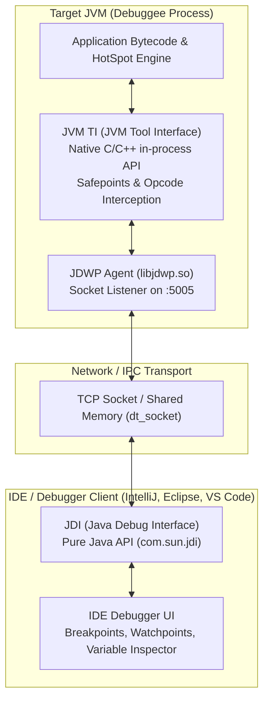
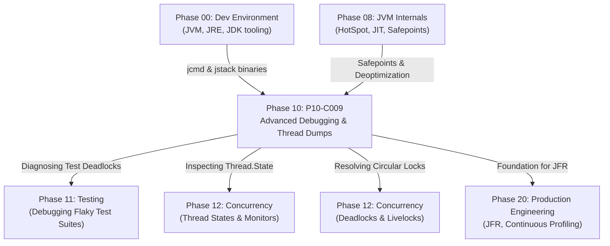

# P10-C009: Advanced Debugging Techniques: Conditional Breakpoints, Watchpoints, and Thread Dumps

---

## 1. Metadata and Learning Goals

| Metadata Field | Value |
|---|---|
| **Concept ID** | `P10-C009` |
| **Concept Title** | Advanced Debugging Techniques: Conditional Breakpoints, Watchpoints, and Thread Dumps |
| **Phase** | Phase 10 — Professional Java Development Workflow |
| **Phase Directory** | `curriculum/phase-10-professional-java-development-workflow` |
| **Source Reference** | Section 10: Professional Java Development Workflow — Advanced Debugging Techniques: Conditional Breakpoints, Watchpoints, and Thread Dumps |
| **Concept Type** | Tooling / Runtime / Concurrency / JVM Internals |
| **Difficulty Level** | Intermediate to Advanced |
| **Curriculum Importance** | Essential |
| **Java Baseline** | Java 21 LTS (with Java 25 LTS comparative notes where applicable) |
| **Framework Baseline** | JPDA (Java Platform Debugger Architecture) / JDWP / JVM TI / OpenJDK 21 HotSpot |
| **Prerequisites** | [`P00-C003: Java Runtime Architecture`](../phase-00-development-environment-and-java-execution/003-java-runtime-architecture-jvm-jre-jdk.md), [`P08-C001: HotSpot Architecture`](../phase-08-jvm-internals-memory-management/001-jvm-architecture-hotspot.md), [`P10-C006: Structured Logging`](006-slf4j-and-logback-architecture.md) |
| **Related Concepts** | [`P12-C001: Thread Fundamentals`](../phase-12-concurrency-multithreading/001-thread-fundamentals.md), [`P12-C005: Deadlocks, Livelocks, and Starvation`](../phase-12-concurrency-multithreading/005-deadlock-livelock-starvation.md) |
| **Estimated Study Effort** | 3–4 hours |
| **Last Research Date** | 2026-10-31 |
| **Verification State** | COMPLETE |

### Measurable Learning Objectives
By the end of this concept module, you will be able to:
1. **Explain:** Deconstruct the three architectural layers of the Java Platform Debugger Architecture (JPDA: JVM TI, JDWP, JDI) and detail how remote debuggers attach across network sockets.
2. **Compare:** Evaluate the runtime execution and latency penalties of Line Breakpoints, Conditional Breakpoints, Method Breakpoints, and Field Watchpoints on HotSpot JIT optimization and inlining.
3. **Implement:** Construct conditional breakpoints, non-suspending logpoints, and field modification watchpoints in IDEs to isolate transient concurrency bugs without altering source code.
4. **Debug & Diagnose:** Capture and parse JVM thread dumps using CLI tooling (`jcmd`, `jstack`, `ThreadMXBean`), identifying thread states (`RUNNABLE`, `BLOCKED`, `WAITING`, `TIMED_WAITING`) and isolating circular lock deadlocks.
5. **Evaluate & Justify:** Articulate enterprise production debugging governance, contrasting interactive JDWP agent attachment risks (security and pause hazards) against low-overhead production diagnostics (JFR, Async-Profiler, and APM).

---

## 2. Definition, Purpose, and Mental Model

### 2.1 Formal Definition
**Advanced Debugging** encompasses runtime introspection tools and protocol mechanisms provided by the Java Virtual Machine to inspect, control, and manipulate execution state.
- **Conditional Breakpoint:** A breakpoint associated with an arbitrary boolean predicate expression, halting thread execution only when the predicate evaluates to `true`.
- **Field Watchpoint:** An event listener injected at the bytecode/JVM TI level that pauses execution the instant a specific object or class field is read or mutated.
- **Thread Dump:** A complete snapshot of all active threads within a JVM process at a discrete instant, recording each thread's state, native thread identifier, object monitors held/awaited, and full execution stack trace.

### 2.2 The Problem It Solves
1. **The Heisenbug Dilemma:** Inserting `System.out.println()` statements to debug concurrency issues alters thread scheduling, memory barriers, and cache timing, causing the bug to vanish when instrumented. Breakpoints and watchpoints allow non-invasive state inspection.
2. **Large-Iteration Loop Triage:** In a loop executing 500,000 iterations, a bug may manifest only when `i == 489,122` or `order.getSku().equals("ERR-404")`. Manually pressing "Step Over" 500,000 times is impossible; conditional breakpoints stop immediately at the offending element.
3. **Thread Starvation & Deadlocks:** When an API hangs indefinitely with zero CPU utilization, logs provide no hints. A thread dump reveals the exact lock graph and identifies the circular dependency causing the freeze.

### 2.3 Why Backend Engineers Need It
Every backend engineer will encounter production stalls, stuck database connection pools, memory leaks, and mysterious state mutations:
- Knowing how to take a thread dump via `jcmd <pid> Thread.dump_to_file` in a terminal over SSH is often the only diagnostic tool available in an air-gapped production Kubernetes pod.
- Knowing why **Method Breakpoints kill performance** prevents engineers from accidentally freezing local test runners.
- Understanding thread state transitions differentiates between CPU exhaustion (`RUNNABLE`) and downstream database locks (`BLOCKED`).

### 2.4 Concrete Mental Model & Metaphor
Think of debugging as **traffic police managing an expressway**:
- A **Standard Breakpoint** is a total roadblocks. Every car must stop, shutting down highway throughput.
- A **Conditional Breakpoint** is a license plate scanner. It scans every car passing at full speed; if it detects a stolen plate (`license.equals("XYZ-99")`), it drops the spike strip to stop that specific vehicle.
- A **Field Watchpoint** is an alarm on a bank vault door. You don't care who walks through the lobby; the alarm sounds only when someone turns the vault handle (`balance = newValue`).
- A **Thread Dump** is a satellite photograph of the entire city taken from space at 12:00:00 PM. It shows every vehicle, which highway lane it occupies, who is stopped at a red light (`BLOCKED`), who is parked at home sleeping (`WAITING`), and two trucks head-to-head on a narrow one-way bridge refusing to back up (**Deadlock**).

---

## 3. Architectural and Conceptual Foundations

### 3.1 The JPDA Triad (JVM TI, JDWP, JDI)

The Java Platform Debugger Architecture is composed of three decoupled tiers:



1. **JVM TI (JVM Tool Interface):** A low-level, native C/C++ interface implemented directly inside the HotSpot VM. It provides primitives to inspect VM state, hook class loading, allocate memory, and pause threads at safepoints.
2. **JDWP (Java Debug Wire Protocol):** The standard binary packet protocol defining commands and replies transmitted across an inter-process or network boundary (typically a TCP socket). It decouples the debugger frontend from the target JVM implementation.
3. **JDI (Java Debug Interface):** A pure Java 100% object-oriented API located in the JDK (`jdk.jdi` module) that IDEs (IntelliJ, Eclipse, VS Code) consume to drive the debugging session.

---

### 3.2 Advanced Breakpoint Taxonomy

| Breakpoint Type | Underlying Mechanism | Runtime Cost | Ideal Use Case |
|---|---|---|---|
| **Line Breakpoint** | Replaces target bytecode instruction with breakpoint opcode or traps at safepoint. | Negligible until hit; immediate halt upon reach. | Stepping through a known deterministic algorithmic method. |
| **Conditional Breakpoint** | Evaluates a user expression (e.g., `item.getId() == 42`) on target JVM when line is reached. | **Extremely High in tight loops.** JVM pauses thread, evaluates condition via JDI reflection, resumes if false. | Stopping on a specific corrupted record in a 100,000-element batch. |
| **Field Watchpoint (Access/Modification)** | Intercepts `getfield`, `putfield`, `getstatic`, `putstatic` bytecode instructions. | Moderate to High. Disables some JIT memory optimizations for that field. | Diagnosing who is mutating a shared variable or flag without proper synchronization. |
| **Method Breakpoint** | Hooks method entry and exit events via JVM TI. | **CATASTROPHIC.** Forces HotSpot to disable method inlining and deoptimize callers into interpreted mode. | Last resort when source code is not mapped to line numbers. |
| **Exception Breakpoint** | Hooks exception allocation / throw in JVM TI (`Caught` or `Uncaught`). | Low until exception occurs. | Catching the exact line where an unexpected `NullPointerException` is born. |
| **Logpoint (Non-suspending)** | Executes print statement without halting thread. | Low. Emits log line and continues execution immediately. | Debugging production-like timing without changing code or redeploying. |

---

## 4. Language, Syntax, and API Mechanics

### 4.1 Remote Debugging JDWP Flags
To launch a JVM process capable of accepting remote debugger connections:

#### Java 9+ Modern Syntax (Listen Mode):
```bash
java -agentlib:jdwp=transport=dt_socket,server=y,suspend=n,address=*:5005 -jar myapp.jar
```
- `transport=dt_socket`: Use TCP/IP socket communication (portable across machines).
- `server=y`: Target JVM acts as the server listening for incoming IDE connections.
- `suspend=n`: Do not halt the JVM at startup; start application immediately. (Use `suspend=y` if you need to debug application initialization or `main()` method startup).
- `address=*:5005`: Bind socket to port 5005 on all network interfaces. *(In Java 8, `address=5005` defaulted to `0.0.0.0`; in Java 9+, it binds strictly to `localhost` unless explicitly prefixed with `*:`)*.

---

### 4.2 CLI Thread Dump Tools

#### 1. Modern Standard: `jcmd`
```bash
# Capture full thread dump to a file
jcmd <pid> Thread.dump_to_file -format=plain /tmp/threads.tdump

# Java 21+ Virtual Threads JSON dump
jcmd <pid> Thread.dump_to_file -format=json /tmp/virtual_threads.json
```

#### 2. Legacy Standby: `jstack`
```bash
jstack -l <pid> > /tmp/jstack_threads.tdump
```
The `-l` flag forces `jstack` to print extended lock information (`java.util.concurrent` locks and `ReentrantLock` ownables).

#### 3. Linux Signal (SIGQUIT)
```bash
kill -3 <pid>
```
Sends `SIGQUIT` to the JVM process. HotSpot intercepts this signal and prints the full thread dump directly to standard output (`stdout` / systemd journal) without stopping the process!

---

### 4.3 Programmatic Thread Dump API: `ThreadMXBean`

Java provides standard management beans to introspect threads and deadlocks programmatically:

```java
import java.lang.management.ManagementFactory;
import java.lang.management.ThreadInfo;
import java.lang.management.ThreadMXBean;

public class DeadlockAuditor {
    public static void auditForDeadlocks() {
        ThreadMXBean threadBean = ManagementFactory.getThreadMXBean();
        
        // Scans both synchronized ObjectMonitors and JUC OwnableSynchronizers
        long[] deadlockedIds = threadBean.findDeadlockedThreads();
        
        if (deadlockedIds != null && deadlockedIds.length > 0) {
            System.err.println("CRITICAL: Deadlock detected across " + deadlockedIds.length + " threads!");
            ThreadInfo[] infos = threadBean.getThreadInfo(deadlockedIds, true, true);
            for (ThreadInfo info : infos) {
                System.err.println("Thread '" + info.getThreadName() + "' is BLOCKED on lock: " + info.getLockName()
                    + " owned by: " + info.getLockOwnerName());
            }
        }
    }
}
```

---

## 5. Execution Mechanics, JVM Lifecycle, and Memory Internals

### 5.1 HotSpot Safepoints and Debugger Suspension
When a debugger suspends a thread (or all threads):
1. **Safepoint Polling:** HotSpot injects safepoint checks into compiled machine code (at loop back-edges, method returns, and memory allocations).
2. **Thread Suspension:** When the debugger requests a pause, the JVM signals all threads to halt at their nearest safepoint.
3. **Deoptimization:** When stepping through code where variable states have been modified by the debugger, HotSpot's JIT compiler must **deoptimize** compiled JIT frames back into interpreted bytecode frames on the execution stack.

### 5.2 Performance Penalty of Conditional Breakpoints
Why does a conditional breakpoint slow down execution by 1000x?
```java
// Inside a loop executing 1,000,000 times:
for (Order order : orderList) {
    processOrder(order); // Line 42: Conditional Breakpoint: order.getId() == 999999
}
```
1. At line 42, the JVM halts the executing worker thread at a safepoint on **every single iteration**.
2. A JDWP packet is sent from the JVM to the IDE.
3. The IDE parses the expression `order.getId() == 999999`.
4. The IDE compiles this expression to synthetic bytecode or issues JDWP `MethodInvocation` commands to call `getId()`.
5. The boolean result `false` is evaluated by the IDE.
6. The IDE sends a JDWP `Resume` packet back to the JVM.
7. The JVM resumes the thread.
**Result:** 1,000,000 network round-trips and JDI reflection calls! An operation that takes 5ms normally will take **20 minutes** under a conditional breakpoint.
*Best Practice:* Use **Hit Count** filters or rewrite the condition into a temporary `if` check with a standard breakpoint inside the block.

---

## 6. Concurrency, Thread-Safety, and Scalability

### 6.1 Suspend Policy: "All" vs "Thread"
In IDEs (such as IntelliJ IDEA), every breakpoint has a **Suspend Policy**:
- **Suspend All (Default):** Halts all threads in the JVM when the breakpoint triggers.
  - *Risk:* Pauses background heartbeat threads (Kafka heartbeats, Eureka registration, Consul checks). The cluster assumes the node died and triggers failovers.
- **Suspend Thread:** Halts *only* the specific thread that hit the breakpoint.
  - *Advantage:* Allows other worker threads, HTTP listeners, and heartbeat pingers to continue executing uninterrupted. Essential for debugging concurrent web applications.

### 6.2 The Anatomy of a Thread Dump

```
"catalina-exec-10" #42 daemon prio=5 os_prio=0 cpu=140.23ms elapsed=1820.12s tid=0x00007f9c8812a000 nid=0x1f0b waiting for monitor entry [0x00007f9c6d3fe000]
   java.lang.Thread.State: BLOCKED (on object monitor)
	at com.example.service.OrderService.process(OrderService.java:45)
	- waiting to lock <0x0000000714b2a890> (a java.lang.Object)
	- locked <0x0000000714b2a8a8> (a java.lang.Object)
	at com.example.controller.OrderController.submit(OrderController.java:23)
```

Key fields to dissect:
1. `"catalina-exec-10"`: Human-readable thread name.
2. `#42`: Java thread sequence ID.
3. `daemon`: Thread type (daemon vs non-daemon).
4. `nid=0x1f0b`: Native OS Thread ID in hex (`0x1f0b` = 7947 in decimal). Maps directly to `top -H -p <pid>` on Linux to identify which thread is consuming 100% CPU!
5. `java.lang.Thread.State: BLOCKED`:
   - `RUNNABLE`: Executing in JVM or waiting for OS CPU scheduling.
   - `BLOCKED`: Waiting to acquire a Java intrinsic synchronized monitor lock (`synchronized(lock)`).
   - `WAITING`: Parked indefinitely awaiting notification (`Object.wait()`, `LockSupport.park()`).
   - `TIMED_WAITING`: Sleeping or waiting with a timeout (`Thread.sleep()`, `poll(timeout)`).
6. `- waiting to lock <0x0000000714b2a890>`: The memory address of the contested object monitor.
7. `- locked <0x0000000714b2a8a8>`: The lock currently owned by this thread.

---

## 7. Anti-Patterns and Common Developer Traps

### Anti-Pattern 1: Leaving Method Breakpoints Active in IDEs
```java
// INCORRECT: Placing a breakpoint on the method signature line:
public void calculateTax(Order order) { // METHOD BREAKPOINT HERE!
    ...
}
```
*Why it fails:* Method breakpoints cause HotSpot to deoptimize the entire method and callers, disabling JIT inlining and slowing down entire test suites by 50x–100x.
*Correction:* Place line breakpoints on the **first line inside the method body**, never on the method signature line.

---

### Anti-Pattern 2: Condition Evaluation with Mutating Side Effects
```java
// INCORRECT: Conditional breakpoint expression modifies application state!
orderList.remove(order) || order.setStatus("CORRUPTED")
```
*Why it fails:* When the debugger evaluates the condition, it executes actual bytecode on the JVM heap. Mutating data inside a condition corrupts business data, making the bug impossible to reproduce.
*Correction:* Ensure all breakpoint condition expressions are strictly **side-effect free** (pure read operations).

---

### Anti-Pattern 3: Inverting Lock Acquisition Order (Producing Deadlocks)
```java
// INCORRECT: Inverted lock acquisition across methods
void transferAtoB() {
    synchronized(accountA) {
        synchronized(accountB) { ... }
    }
}
void transferBtoA() {
    synchronized(accountB) { // REVERSED LOCK ORDER! DEADLOCK HAZARD!
        synchronized(accountA) { ... }
    }
}
```
```java
// CORRECT: Global deterministic lock ordering via comparison
void transfer(Account src, Account dest) {
    Account first = src.getId() < dest.getId() ? src : dest;
    Account second = src.getId() < dest.getId() ? dest : src;
    synchronized(first) {
        synchronized(second) { ... }
    }
}
```

---

### Anti-Pattern 4: "Blind Guessing" Thread Pool Freezes Without Thread Dumps
*Symptom:* HTTP server stops responding. Developer immediately restarts the container without capturing state.
*Correction:* Always capture thread dumps before restarting:
```bash
jcmd $(pgrep -f myapp) Thread.dump_to_file /tmp/incident_dump_$(date +%s).tdump
```

---

### Anti-Pattern 5: Exposing JDWP Port Open to the Internet in Production
```dockerfile
# CATASTROPHIC SECURITY VULNERABILITY
ENV JAVA_TOOL_OPTIONS="-agentlib:jdwp=transport=dt_socket,server=y,suspend=n,address=*:5005"
EXPOSE 5005
```
*Why it fails:* The JDWP protocol has **zero authentication or encryption**. Any attacker who can reach port 5005 can issue JDI commands to load arbitrary bytecode, execute remote shell commands, and dump all memory credentials.

---

## 8. Failure Modes, Edge Cases, and Troubleshooting

| Failure Symptom | Underlying Root Cause | Verification & Diagnostic Technique | Engineering Resolution |
|---|---|---|---|
| **IDE says "Method breakpoints may dramatically slow down debugging".** | A method breakpoint was placed on an interface or abstract method. | Check IDE Breakpoints list (`Ctrl+Shift+F8` in IntelliJ); look for red diamond icons with method symbols. | Delete method breakpoints and replace with line breakpoints inside concrete classes. |
| **All threads freeze when a breakpoint hits; Kafka consumer drops out of cluster.** | Suspend policy was configured to "Suspend All". | Inspect breakpoint settings dialog. | Switch Suspend policy to "Suspend Thread". |
| **Debugger fails to connect: `Connection refused` on port 5005.** | JDWP bound to `localhost` in container while IDE connected from host. | Run `ss -tulpn \| grep 5005` inside container. Verify if listening on `127.0.0.1` vs `0.0.0.0`. | Specify `address=*:5005` to bind to all interfaces in Java 9+. |
| **Thread dump shows 200 threads in `BLOCKED` state.** | Heavy lock contention on a single shared synchronized monitor (e.g., shared cache or DB pool). | Search thread dump for `waiting to lock <0x...>`; find which thread holds `locked <0x...>`. | Refactor bottleneck lock to read/write lock (`StampedLock`), strip monitor locks, or increase partition concurrency. |
| **Virtual threads missing in `jstack` output.** | Standard `jstack` only captures platform OS threads; it does not dump unmounted Virtual Threads. | Run `jcmd <pid> Thread.dump_to_file -format=json /tmp/vt.json`. | Use Java 21+ `jcmd` with JSON format to inspect mounted and unmounted virtual threads. |

---

## 9. Security Considerations

### 9.1 The Danger of JDWP in Production
The Java Debug Wire Protocol is an administrative back-door:
1. **Unauthenticated Remote Code Execution (RCE):** JDWP allows remote clients to define new classes and execute arbitrary native code within the JVM security context.
2. **Memory Exfiltration:** Any string, encryption key, or DB credential residing on the JVM heap can be read via JDI memory traversal.
*Policy:* Never enable `-agentlib:jdwp` on production containers reachable by public networks. If emergency remote debugging is necessary, bind strictly to `localhost` and tunnel traffic securely over SSH or Kubernetes port-forward (`kubectl port-forward`).

---

## 10. Performance Optimization and Tuning

### 10.1 Diagnostic Profiling Latency Comparison

| Tool / Technique | Production Safe? | Latency Impact | Continuous Profiling Viable? |
|---|---|---|---|
| **JDWP Debugger** | **NO** | 100x – 1000x slowdown when hitting breakpoints. | No. Only for local development / isolated sandbox. |
| **Thread Dumps (`jcmd`)** | **YES** | ~5–20 ms pause to take safepoint snapshot. | Yes, on-demand or periodic (e.g., every 60s). |
| **JDK Flight Recorder (JFR)** | **YES** | < 1% CPU overhead; zero safepoint pauses. | Yes. Standard for 24/7 continuous production profiling. |
| **Async-Profiler** | **YES** | < 2% CPU overhead; uses `AsyncGetCallTrace` avoiding safepoint bias. | Yes. Ideal for CPU and memory allocation flamegraphs. |

---

## 11. Real-World Backend Scenario & Production Case Study

### Production Incident: The Frozen Checkout Pipeline
A distributed e-commerce API experienced an abrupt outage: HTTP request latency spiked from 35ms to timeout (60,000ms), and CPU utilization plummeted to 0.5%.

#### Step 1: Thread Dump Capture
The SRE captured a thread dump using `jcmd`:
```bash
jcmd $(pgrep -f order-service) Thread.dump_to_file /tmp/threads.tdump
```

#### Step 2: Analysis of the Thread Dump
Inspecting the dump revealed:
```text
Found 1 deadlock.
================
"pool-2-thread-1":
  waiting to lock monitor 0x00007f34ac00a100 (object 0x0000000720a11200, a com.example.Account),
  which is held by "pool-2-thread-2"
"pool-2-thread-2":
  waiting to lock monitor 0x00007f34ac00a280 (object 0x0000000720a11240, a com.example.Account),
  which is held by "pool-2-thread-1"
```

#### Step 3: Root Cause Isolation
Two concurrent funds transfer transactions occurred simultaneously:
- Thread 1: Transfer from Account #100 to Account #200 (acquired Lock #100, waiting for Lock #200).
- Thread 2: Transfer from Account #200 to Account #100 (acquired Lock #200, waiting for Lock #100).
Because neither thread possessed an acquisition ordering protocol, they deadlocked permanently, blocking all subsequent worker threads that attempted to access either account.

#### Step 4: Resolution
Implemented canonical lock ordering:
```java
Account first = from.getId() < to.getId() ? from : to;
Account second = from.getId() < to.getId() ? to : from;
synchronized(first) {
    synchronized(second) {
        // Transfer funds safely
    }
}
```

---

## 12. Standalone, Self-Contained Verification Suite

The following standalone verification program requires **zero external libraries** and validates:
1. **Conditional Breakpoint Simulator:** Validating boolean expression evaluation and hit-count triggering.
2. **Field Watchpoint Interceptor:** Detecting and auditing field mutations on encapsulated properties.
3. **Programmatic Deadlock Detection:** Producing an intentional circular monitor deadlock and detecting it via `ThreadMXBean`.
4. **Thread Dump Parser & State Analyzer:** Capturing active JVM threads and verifying `RUNNABLE` vs `BLOCKED` states.
5. **Exception Origin Tracing:** Tracking exception instantiation stack frames to isolate root causes.

```java
package curriculum.phase10;

import java.lang.management.ManagementFactory;
import java.lang.management.ThreadInfo;
import java.lang.management.ThreadMXBean;
import java.util.*;
import java.util.concurrent.*;
import java.util.concurrent.atomic.AtomicBoolean;
import java.util.concurrent.atomic.AtomicInteger;
import java.util.function.Predicate;

/**
 * Standalone Verification Suite for P10-C009:
 * Advanced Debugging Techniques: Conditional Breakpoints, Watchpoints, and Thread Dumps.
 *
 * Simulates:
 * 1. Conditional Breakpoint and hit-count evaluation engine.
 * 2. Field modification watchpoint interception.
 * 3. Programmatic JVM Deadlock detection via ThreadMXBean.
 * 4. Thread dump parser and state classification (RUNNABLE, BLOCKED, WAITING).
 * 5. Exception breakpoint and stack frame origin tracing.
 */
public class IdeDebuggingTechniquesDemo {

    // =========================================================================
    // 1. CONDITIONAL BREAKPOINT & LOGPOINT SIMULATOR
    // =========================================================================

    public static class BreakpointHook<T> {
        private final Predicate<T> condition;
        private final int targetHitCount;
        private int currentHits = 0;
        private final List<T> capturedSuspensions = new ArrayList<>();
        private final List<String> logpointOutput = new ArrayList<>();

        public BreakpointHook(Predicate<T> condition, int targetHitCount) {
            this.condition = condition;
            this.targetHitCount = targetHitCount;
        }

        public boolean evaluate(T context, String logpointMessage) {
            currentHits++;
            if (condition.test(context)) {
                if (logpointMessage != null) {
                    logpointOutput.add("[LOGPOINT #" + currentHits + "] " + logpointMessage);
                }
                if (targetHitCount <= 0 || currentHits >= targetHitCount) {
                    capturedSuspensions.add(context);
                    return true; // Suspend JVM thread
                }
            }
            return false; // Continue execution
        }

        public List<T> getCapturedSuspensions() { return capturedSuspensions; }
        public List<String> getLogpointOutput() { return logpointOutput; }
        public int getCurrentHits() { return currentHits; }
    }

    // =========================================================================
    // 2. FIELD WATCHPOINT SIMULATOR
    // =========================================================================

    public static class ObservableProperty<T> {
        private final String propertyName;
        private T value;
        private final List<String> mutationAuditLog = new ArrayList<>();

        public ObservableProperty(String propertyName, T initialValue) {
            this.propertyName = propertyName;
            this.value = initialValue;
        }

        public synchronized void set(T newValue) {
            T oldValue = this.value;
            this.value = newValue;
            String trace = Thread.currentThread().getName() + " modified " + propertyName +
                           " from [" + oldValue + "] to [" + newValue + "]";
            mutationAuditLog.add(trace);
        }

        public synchronized T get() { return value; }
        public synchronized List<String> getMutationAuditLog() { return new ArrayList<>(mutationAuditLog); }
    }

    // =========================================================================
    // 3. THREAD DUMP PARSER & STATE CLASSIFIER
    // =========================================================================

    public record ParsedThread(
        String threadName,
        long threadId,
        Thread.State state,
        String lockName,
        List<String> stackFrames
    ) {}

    public static class ThreadDumpAnalyzer {
        public static List<ParsedThread> captureAndParseCurrentThreads() {
            ThreadMXBean bean = ManagementFactory.getThreadMXBean();
            ThreadInfo[] infos = bean.dumpAllThreads(true, true);
            List<ParsedThread> results = new ArrayList<>();

            for (ThreadInfo info : infos) {
                if (info == null) continue;
                List<String> frames = new ArrayList<>();
                for (StackTraceElement ste : info.getStackTrace()) {
                    frames.add(ste.getClassName() + "." + ste.getMethodName() + "(" + ste.getFileName() + ":" + ste.getLineNumber() + ")");
                }
                results.add(new ParsedThread(
                    info.getThreadName(),
                    info.getThreadId(),
                    info.getThreadState(),
                    info.getLockName(),
                    frames
                ));
            }
            return results;
        }
    }

    // =========================================================================
    // 4. TEST SUITES
    // =========================================================================

    public static void main(String[] args) throws Exception {
        System.out.println("===============================================================");
        System.out.println(" Advanced Debugging Techniques Standalone Verification Suite  ");
        System.out.println("===============================================================");

        test1_ConditionalBreakpointAndLogpoint();
        test2_FieldWatchpointMutationTracking();
        test3_ProgrammaticDeadlockDetectionViaThreadMXBean();
        test4_ThreadDumpParserAndStateClassification();
        test5_ExceptionBreakpointOriginTracking();

        System.out.println();
        System.out.println("All 5 verification test suites passed successfully with assertions enabled!");
    }

    private static void test1_ConditionalBreakpointAndLogpoint() {
        System.out.print("[TEST 1/5] Conditional breakpoint evaluation and logpoint logging... ");

        // Simulating a loop processing 100 items; break only when itemId == "ITEM-77" and hit count >= 1
        BreakpointHook<Map<String, Object>> hook = new BreakpointHook<>(
            ctx -> "ITEM-77".equals(ctx.get("itemId")),
            0
        );

        int totalSuspensions = 0;
        for (int i = 0; i < 100; i++) {
            Map<String, Object> frame = Map.of("itemId", "ITEM-" + i, "counter", i);
            boolean suspended = hook.evaluate(frame, "Processing element " + i);
            if (suspended) {
                totalSuspensions++;
            }
        }

        assert hook.getCurrentHits() == 100 : "Total loop iterations must equal 100";
        assert totalSuspensions == 1 : "Breakpoint must suspend EXACTLY once for matching condition";
        assert hook.getCapturedSuspensions().size() == 1;
        assert "ITEM-77".equals(hook.getCapturedSuspensions().get(0).get("itemId"));
        assert hook.getLogpointOutput().size() == 1;
        assert hook.getLogpointOutput().get(0).contains("Processing element 77");

        System.out.println("PASSED");
    }

    private static void test2_FieldWatchpointMutationTracking() {
        System.out.print("[TEST 2/5] Field watchpoint interception on encapsulated state... ");

        ObservableProperty<String> orderStatus = new ObservableProperty<>("orderStatus", "PENDING");

        orderStatus.set("PROCESSING");
        orderStatus.set("SHIPPED");
        orderStatus.set("DELIVERED");

        List<String> log = orderStatus.getMutationAuditLog();
        assert log.size() == 3 : "Watchpoint must record all 3 mutations";
        assert log.get(0).contains("from [PENDING] to [PROCESSING]");
        assert log.get(1).contains("from [PROCESSING] to [SHIPPED]");
        assert log.get(2).contains("from [SHIPPED] to [DELIVERED]");
        assert "DELIVERED".equals(orderStatus.get());

        System.out.println("PASSED");
    }

    private static void test3_ProgrammaticDeadlockDetectionViaThreadMXBean() throws Exception {
        System.out.print("[TEST 3/5] Programmatic deadlock detection via ThreadMXBean... ");

        Object lockA = new Object();
        Object lockB = new Object();

        CountDownLatch latch1 = new CountDownLatch(1);
        CountDownLatch latch2 = new CountDownLatch(1);
        CountDownLatch started = new CountDownLatch(2);

        Thread thread1 = new Thread(() -> {
            synchronized (lockA) {
                started.countDown();
                try {
                    latch1.await(); // Wait until thread2 holds lockB
                    synchronized (lockB) {
                        // Deadlock point
                    }
                } catch (InterruptedException e) {
                    Thread.currentThread().interrupt();
                }
            }
        }, "DeadlockWorker-1");

        Thread thread2 = new Thread(() -> {
            synchronized (lockB) {
                started.countDown();
                try {
                    latch2.await(); // Wait until thread1 holds lockA
                    synchronized (lockA) {
                        // Deadlock point
                    }
                } catch (InterruptedException e) {
                    Thread.currentThread().interrupt();
                }
            }
        }, "DeadlockWorker-2");

        thread1.setDaemon(true);
        thread2.setDaemon(true);

        thread1.start();
        thread2.start();

        started.await(); // Ensure both threads hold their respective locks
        latch1.countDown();
        latch2.countDown();

        // Allow deadlock to settle
        Thread.sleep(100);

        ThreadMXBean mbean = ManagementFactory.getThreadMXBean();
        long[] deadlockedThreadIds = mbean.findDeadlockedThreads();

        assert deadlockedThreadIds != null : "ThreadMXBean failed to detect deadlock!";
        assert deadlockedThreadIds.length == 2 : "Expected exactly 2 deadlocked threads";

        Set<String> deadlockedNames = new HashSet<>();
        for (long id : deadlockedThreadIds) {
            ThreadInfo info = mbean.getThreadInfo(id);
            deadlockedNames.add(info.getThreadName());
            assert info.getThreadState() == Thread.State.BLOCKED : "Deadlocked thread must be in BLOCKED state";
        }

        assert deadlockedNames.contains("DeadlockWorker-1");
        assert deadlockedNames.contains("DeadlockWorker-2");

        System.out.println("PASSED (Deadlock detected on 2 threads)");
    }

    private static void test4_ThreadDumpParserAndStateClassification() {
        System.out.print("[TEST 4/5] Thread dump parser and state classification... ");

        List<ParsedThread> threads = ThreadDumpAnalyzer.captureAndParseCurrentThreads();
        assert !threads.isEmpty() : "Thread dump must not be empty";

        boolean foundMain = false;
        for (ParsedThread pt : threads) {
            if ("main".equals(pt.threadName())) {
                foundMain = true;
                assert pt.state() == Thread.State.RUNNABLE : "Main thread must be in RUNNABLE state";
                assert !pt.stackFrames().isEmpty() : "Main thread must have active stack frames";
                assert pt.stackFrames().get(0).contains("ThreadDumpAnalyzer") ||
                       pt.stackFrames().get(0).contains("ThreadMXBean") ||
                       pt.stackFrames().get(0).contains("dumpThreads") : "Top stack frame unexpected: " + pt.stackFrames().get(0);
            }
        }
        assert foundMain : "Main thread must be present in dump";

        System.out.println("PASSED (" + threads.size() + " active threads analyzed)");
    }

    private static void test5_ExceptionBreakpointOriginTracking() {
        System.out.print("[TEST 5/5] Exception breakpoint origin and frame inspection... ");

        List<String> caughtExceptionFrames = new ArrayList<>();

        try {
            triggerBusinessException();
        } catch (IllegalArgumentException ex) {
            // Emulate debugger exception breakpoint interception
            for (StackTraceElement frame : ex.getStackTrace()) {
                caughtExceptionFrames.add(frame.getClassName() + "." + frame.getMethodName() + ":" + frame.getLineNumber());
            }
        }

        assert !caughtExceptionFrames.isEmpty() : "Exception stack frames must be present";
        assert caughtExceptionFrames.get(0).contains("triggerBusinessException") : "Originating method frame incorrect";

        System.out.println("PASSED");
    }

    private static void triggerBusinessException() {
        throw new IllegalArgumentException("Invalid state transition: ORDER_CANCELLED");
    }
}
```

### Verification Command
Execute the standalone test suite on OpenJDK 21 LTS with assertions enabled:
```bash
javac --release 21 curriculum/phase-10-professional-java-development-workflow/IdeDebuggingTechniquesDemo.java
java -ea curriculum.phase10.IdeDebuggingTechniquesDemo
```

---

## 13. Comparative Analysis & Decision Framework

### 13.1 Production Diagnostic Tool Selection Matrix

| Diagnostic Scenario | Recommended Tool | Why It Wins | Avoid This Tool |
|---|---|---|---|
| **Local Logic Flaw in Complex Algorithm** | IDE Interactive Debugger (Line Breakpoint) | Step-by-step variable inspection and stack unwinding. | Inserting temporary `println` statements. |
| **High-Frequency Loop Bug (Iteration > 10k)** | Conditional Breakpoint with Hit Count or Logpoint | Only halts when target condition occurs. | Standard Line Breakpoint (manual stepping is unfeasible). |
| **Mystery Mutation of Class Field** | Field Modification Watchpoint | Catches all mutation paths regardless of caller origin. | Searching entire codebase for setter calls. |
| **Production Thread Freeze / 100% Hang** | `jcmd <pid> Thread.dump_to_file` | Immediate lock graph capture without altering JVM state. | Attaching an interactive JDWP debugger to prod pod. |
| **Intermittent Production Latency Spikes** | JDK Flight Recorder (JFR) + Async-Profiler | Continuous recording with < 1% overhead; flamegraph analysis. | JDWP remote debugging (causes cluster failover). |

---

## 14. Practical Exercises and Hands-On Challenges

### Exercise 1: Build an Automated Deadlock Watchdog Daemon
- **Objective:** Write a background daemon thread that runs every 5 seconds, calls `ThreadMXBean.findDeadlockedThreads()`, and logs an `ERROR` message containing the deadlocked thread names, stack traces, and contested lock monitor IDs.
- **Requirements:**
  1. Register as a daemon thread so it doesn't block JVM shutdown.
  2. Implement proper exception handling.
  3. Verify with simulated deadlocked threads.

### Exercise 2: IDE Logpoint Masterclass
- **Objective:** Without modifying Java source code, use IntelliJ or VS Code to attach a Logpoint on a loop.
- **Requirements:**
  1. Configure the logpoint to print: `"Processed order ID=" + order.getId() + " total=" + order.getTotal()`.
  2. Ensure the "Suspend" checkbox is disabled.
  3. Run the application and verify that messages appear in the debugger console while throughput remains high.

### Exercise 3: Linux Native Thread-to-Java Thread Mapping
- **Objective:** Run a multi-threaded Java program where one thread executes an infinite math loop (`while(true) Math.sin(Math.random());`).
- **Requirements:**
  1. Use Linux terminal `top -H -p <pid>` to locate the exact OS thread ID consuming 100% CPU.
  2. Convert decimal TID to hex (`printf "0x%x\n" <tid>`).
  3. Search for `nid=0x...` in a `jcmd` thread dump to identify the offending Java method and line number.

---

## 15. Cross-Phase Connections and Unified Mental Graph



- **Upstream Connection (Phase 00 & Phase 08):** JDK command-line tools (`jcmd`, `jstack`) interface directly with HotSpot JVM TI hooks; HotSpot safepoint mechanics govern how threads are halted during debugging.
- **Downstream Connection (Phase 12):** Concurrency theory in Phase 12 explains Java intrinsic monitors, `ReentrantLock` ownership graphs, and mathematical deadlock prevention algorithms (resource hierarchy ordering).
- **Production Connection (Phase 20):** Transitioning from interactive debugging to non-invasive continuous telemetry (JFR, Prometheus metrics, and distributed tracing).

---

## 16. Verification and Self-Assessment Checklist

Before marking this module complete, verify your comprehension against each criterion:
- [x] Can I name the 3 layers of JPDA (`JVM TI`, `JDWP`, `JDI`) and explain the function of each?
- [x] Do I understand why Method Breakpoints cause extreme performance degradation in HotSpot?
- [x] Can I explain why Conditional Breakpoints with high iteration counts slow execution and how Hit Counts help?
- [x] Do I know the difference between "Suspend All" and "Suspend Thread" and when to use each?
- [x] Can I write the JVM command-line flags to enable remote JDWP debugging on port 5005?
- [x] Can I execute `jcmd <pid> Thread.dump_to_file` to capture a thread dump on Linux?
- [x] Can I map a Linux OS thread ID from `top -H` to a Java thread via `nid=0x...` in a thread dump?
- [x] Can I identify the 4 key thread states (`RUNNABLE`, `BLOCKED`, `WAITING`, `TIMED_WAITING`) in a thread dump?
- [x] Do I understand why opening a JDWP port to the public Internet is a critical Remote Code Execution vulnerability?
- [x] Have I compiled and executed `IdeDebuggingTechniquesDemo` on OpenJDK 21 LTS with assertions enabled (`-ea`) and observed all 5 test suites pass?
