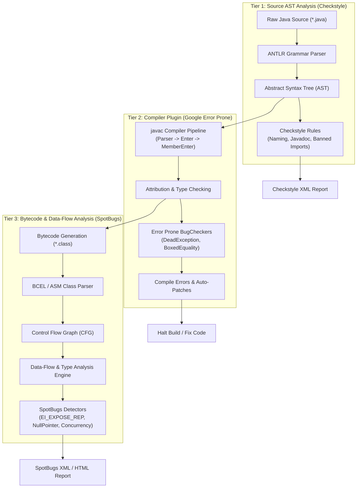
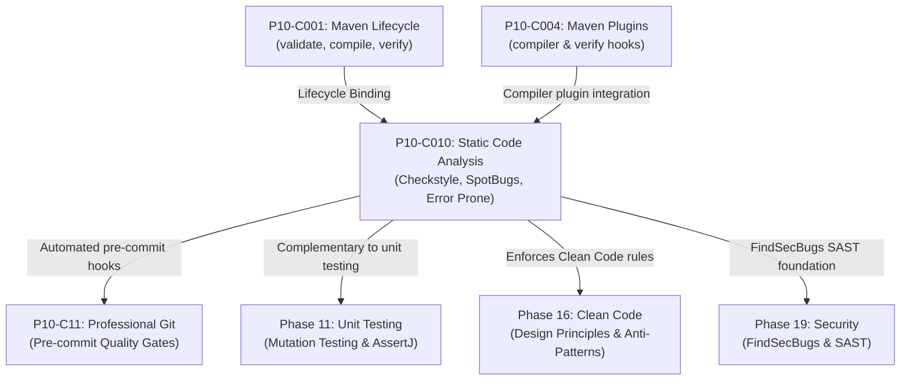

# P10-C010: Static Code Analysis: Checkstyle, SpotBugs, and Error Prone Integration

---

## 1. Metadata and Learning Goals

| Metadata Field | Value |
|---|---|
| **Concept ID** | `P10-C010` |
| **Concept Title** | Static Code Analysis: Checkstyle, SpotBugs, and Error Prone Integration |
| **Phase** | Phase 10 — Professional Java Development Workflow |
| **Phase Directory** | `curriculum/phase-10-professional-java-development-workflow` |
| **Source Reference** | Section 10: Professional Java Development Workflow — Static Code Analysis: Checkstyle, SpotBugs, and Error Prone Integration |
| **Concept Type** | Tooling / Architecture / Compiler / Quality Assurance |
| **Difficulty Level** | Intermediate |
| **Curriculum Importance** | Recommended |
| **Java Baseline** | Java 21 LTS (with Java 25 LTS comparative notes where applicable) |
| **Framework Baseline** | Maven 3.9+ / SpotBugs 4.8.x / Checkstyle 10.x / Error Prone 2.27.x |
| **Prerequisites** | [`P10-C001: Maven Build Lifecycle`](001-maven-build-lifecycle.md), [`P10-C004: Maven Plugins and Surefire`](004-maven-plugins-and-surefire.md) |
| **Related Concepts** | [`P10-C011: Professional Git Workflows`](011-git-workflows-and-hygiene.md), [`P11-C001: Unit Testing Fundamentals`](../phase-11-unit-testing-and-software-quality/001-unit-testing-fundamentals.md), [`P16-C001: Clean Code Principles`](../phase-16-clean-code-software-design-principles/001-clean-code-principles.md) |
| **Estimated Study Effort** | 3–4 hours |
| **Last Research Date** | 2026-10-31 |
| **Verification State** | COMPLETE |

### Measurable Learning Objectives
By the end of this concept module, you will be able to:
1. **Explain:** Differentiate between the three fundamental tiers of static code analysis: Source-level AST analysis (Checkstyle), Bytecode pattern and data-flow analysis (SpotBugs), and Compiler-integrated semantic analysis (Google Error Prone).
2. **Compare:** Contrast the detection capabilities and false-positive characteristics of Checkstyle, SpotBugs, Error Prone, and SonarQube across formatting, algorithmic bugs, memory leaks, and concurrency hazards.
3. **Implement:** Configure `maven-checkstyle-plugin`, `spotbugs-maven-plugin`, and `error-prone-javac-plugin` inside a production Maven `pom.xml`, binding them to `validate`, `compile`, and `verify` phases.
4. **Debug & Diagnose:** Identify, diagnose, and remediate critical bug patterns flagged by static analyzers, including `EI_EXPOSE_REP` (mutable state exposure), `RV_RETURN_VALUE_IGNORED` (discarded immutable returns), `DeadException` (unthrown exceptions), and reference equality on boxed primitives (`==` vs `.equals()`).
5. **Evaluate & Justify:** Formulate an enterprise quality gate policy that balances strict build-breaking enforcement against developer velocity and technical debt baselining.

---

## 2. Definition, Purpose, and Mental Model

### 2.1 Formal Definition
**Static Code Analysis** is the automated inspection of software source code, abstract syntax trees (ASTs), and compiled bytecode without executing the program, evaluating correctness, conformance to architectural rules, security invariants, and algorithmic defect patterns.
- **Checkstyle:** A source-code linter that parses Java grammar into an Abstract Syntax Tree (AST) to enforce stylistic rules, naming standards, file structures, and banned dependencies.
- **SpotBugs (successor to FindBugs):** A bytecode analyzer that operates on compiled `.class` files, using control-flow graph (CFG) algorithms, type hierarchies, and data-flow analysis to flag over 400 defect patterns.
- **Error Prone:** A compile-time static analyzer developed by Google that hooks directly into the `javac` compiler pipeline as an annotation processor/compiler plugin, catching semantic bugs at compilation time and providing automated source refactoring fixes.

### 2.2 The Problem It Solves
1. **The Cost of Late Bug Discovery:** A defect caught in code review costs $10x$ more than one caught in the IDE; caught in QA, it costs $100x$; caught in production, it causes service outages, data corruption, and regulatory fines. Static analyzers catch bugs at compile time (second 0).
2. **Subjective Code Review Exhaustion:** Engineering teams waste hours in pull requests arguing over brace placement, whitespace, import ordering, and naming conventions. Checkstyle automates style enforcement completely, freeing human reviewers to focus on business logic and architecture.
3. **Subtle Concurrency and API Traps:** Java features many deceptive API traps—such as `BigDecimal.add(val)` returning a new instance (leaving the original unchanged), or `new IllegalArgumentException()` created without `throw`. These compile cleanly without warnings, pass superficial unit tests, and fail catastrophically in production.

### 2.3 Why Backend Engineers Need It
In mission-critical enterprise systems:
- **Preventing Encapsulation Leaks (`EI_EXPOSE_REP`):** Returning internal arrays or mutable collections from getters allows untrusted external code to mutate internal state without using setters, breaking domain invariants.
- **Null-Safety & Memory Defense:** SpotBugs performs intra-procedural data-flow analysis, predicting `NullPointerException` risks along branching paths.
- **Security Hardening (FindSecBugs):** SpotBugs extensions detect SQL injection, unvalidated redirects, and hardcoded encryption keys before deployment.

### 2.4 Concrete Mental Model & Metaphor
Think of building a skyscraper:
- **Checkstyle is the Building Code Aesthetic Inspector.** It measures whether handrails are at standard height, signs use the correct font, and blueprints are formatted according to municipal standards.
- **SpotBugs is the Structural Ultrasonic Scanner.** After the concrete beams are poured (compiled into `.class` files), the inspector uses ultrasound to detect internal micro-fractures, air pockets, and metal fatigue that cannot be seen from the outside.
- **Error Prone is the Smarter Crane Operator.** As the steel girders are being hoisted (during `javac` compilation), the crane's automated sensor refuses to weld two mismatched girders together, immediately sounding an alarm before the concrete is even poured.

---

## 3. Architectural and Conceptual Foundations

### 3.1 The Three Tiers of Static Analysis



1. **Source-Level AST (Checkstyle):** Evaluates token positions, grammar trees, whitespace, and structural nesting. It has no access to compiled type hierarchies or bytecode.
2. **Compiler-Integrated Semantic Analysis (Error Prone):** Operates on the fully resolved compiler symbol tables during `javac` compilation. It understands types, inheritance, and semantics before generating `.class` files.
3. **Bytecode Analysis (SpotBugs):** Operates on compiled `.class` files, reconstructing the Control Flow Graph (CFG) of method bytecode instructions. It traces variable values through JVM stack frames to identify unhandled nulls, unclosed resources, and data exposure.

---

### 3.2 SpotBugs Bug Pattern Taxonomy

SpotBugs categorizes issues by risk level and operational classification:

| Category Code | Description | Example Bug Patterns | Severity / Priority |
|---|---|---|---|
| **`BAD_PRACTICE`** | Violations of recognized Java design idioms. | `BC_EQUALS_METHOD_SHOULD_WORK_FOR_ALL_OBJECTS`, `SE_BAD_FIELD` | Medium |
| **`CORRECTNESS`** | Probable algorithmic bug; code likely does not behave as intended. | `NP_NULL_ON_SOME_PATH`, `RV_RETURN_VALUE_IGNORED`, `RCN_REDUNDANT_NULLCHECK_OF_NONNULL_VALUE` | High |
| **`MALICIOUS_CODE`** | Security and encapsulation hazards. | `EI_EXPOSE_REP` (returning mutable ref), `EI_EXPOSE_REP2` (storing mutable ref) | High / Medium |
| **`MT_CORRECTNESS`** | Concurrency, synchronization, and race condition flaws. | `DL_SYNCHRONIZATION_ON_SHARED_CONSTANT`, `MWN_MISMATCHED_WAIT`, `IS2_INCONSISTENT_SYNC` | High |
| **`PERFORMANCE`** | Inefficient operations consuming excessive CPU or heap. | `DM_STRING_CTOR` (`new String()`), `SBSC_USE_STRINGBUFFER_CONCATENATION` | Low / Medium |
| **`SECURITY`** | Cryptographic or input validation flaws (FindSecBugs). | `SQL_INJECTION`, `CIPHER_INTEGRITY`, `PATH_TRAVERSAL` | Critical |

---

## 4. Language, Syntax, and API Mechanics

### 4.1 Configuring Checkstyle in Maven `pom.xml`

Bind `maven-checkstyle-plugin` to the `validate` phase to reject non-compliant source files immediately before compilation begins:

```xml
<plugin>
    <groupId>org.apache.maven.plugins</groupId>
    <artifactId>maven-checkstyle-plugin</artifactId>
    <version>3.3.1</version>
    <dependencies>
        <dependency>
            <groupId>com.puppycrawl.tools</groupId>
            <artifactId>checkstyle</artifactId>
            <version>10.15.0</version>
        </dependency>
    </dependencies>
    <configuration>
        <!-- Use standard Google Checks or custom config -->
        <configLocation>google_checks.xml</configLocation>
        <consoleOutput>true</consoleOutput>
        <failsOnError>true</failsOnError>
        <failOnViolation>true</failOnViolation>
        <violationSeverity>warning</violationSeverity>
        <includeTestSourceDirectory>true</includeTestSourceDirectory>
    </configuration>
    <executions>
        <execution>
            <id>checkstyle-validation</id>
            <phase>validate</phase>
            <goals>
                <goal>check</goal>
            </goals>
        </execution>
    </executions>
</plugin>
```

---

### 4.2 Configuring SpotBugs in Maven `pom.xml`

Bind `spotbugs-maven-plugin` to the `verify` phase (after compile and test-compile) to audit bytecode:

```xml
<plugin>
    <groupId>com.github.spotbugs</groupId>
    <artifactId>spotbugs-maven-plugin</artifactId>
    <version>4.8.4.0</version>
    <configuration>
        <effort>Max</effort>
        <threshold>Medium</threshold>
        <failOnError>true</failOnError>
        <!-- Custom XML exclusion filter file -->
        <excludeFilterFile>spotbugs-exclude.xml</excludeFilterFile>
        <plugins>
            <!-- Optional: FindSecBugs security extension -->
            <plugin>
                <groupId>com.h3xstream.findsecbugs</groupId>
                <artifactId>findsecbugs-plugin</artifactId>
                <version>1.12.0</version>
            </plugin>
        </plugins>
    </configuration>
    <executions>
        <execution>
            <id>spotbugs-audit</id>
            <phase>verify</phase>
            <goals>
                <goal>check</goal>
            </goals>
        </execution>
    </executions>
</plugin>
```

#### SpotBugs Exclusion Filter (`spotbugs-exclude.xml`):
```xml
<?xml version="1.0" encoding="UTF-8"?>
<FindBugsFilter>
    <!-- Suppress mutable representation warnings on legacy generated DTOs -->
    <Match>
        <Class name="~com\.example\.dto\.legacy\..*" />
        <Bug pattern="EI_EXPOSE_REP,EI_EXPOSE_REP2" />
    </Match>

    <!-- Suppress test classes from strict serialization audits -->
    <Match>
        <Class name="~.*Test" />
        <Bug category="BAD_PRACTICE" />
    </Match>
</FindBugsFilter>
```

---

### 4.3 Configuring Google Error Prone in Maven Compiler

Google Error Prone integrates directly into `javac` via the `maven-compiler-plugin`:

```xml
<plugin>
    <groupId>org.apache.maven.plugins</groupId>
    <artifactId>maven-compiler-plugin</artifactId>
    <version>3.13.0</version>
    <configuration>
        <release>21</release>
        <compilerArgs>
            <arg>-XDcompilePolicy=simple</arg>
            <arg>-Xplugin:ErrorProne -Xep:DeadException:ERROR -Xep:EqualsIncompatibleType:ERROR</arg>
        </compilerArgs>
        <annotationProcessorPaths>
            <path>
                <groupId>com.google.errorprone</groupId>
                <artifactId>error_prone_core</artifactId>
                <version>2.27.1</version>
            </path>
        </annotationProcessorPaths>
    </configuration>
</plugin>
```

---

## 5. Execution Mechanics, JVM Lifecycle, and Memory Internals

### 5.1 Abstract Syntax Tree (AST) Traversal vs Control Flow Graphs (CFG)
- **Checkstyle (AST):** Builds an n-ary tree of tokens (`PACKAGE_DEF`, `IMPORT`, `CLASS_DEF`, `METHOD_DEF`). Traversal is performed using the Visitor Pattern (`TreeWalker`). It checks lexical geometry and tokens in linear time $O(N)$ with respect to source lines.
- **SpotBugs (CFG & Data-Flow):** Deconstructs JVM bytecode into Basic Blocks (sequences of opcodes with single entry and exit points). It generates a directed Control Flow Graph (CFG) and computes **Def-Use Chains** (where variables are defined vs where they are consumed) using Static Single Assignment (SSA) form.
  - This allows SpotBugs to trace a variable through conditional branches (`IFNULL`, `GOTO`) and identify if a pointer can be null when dereferenced by `INVOKEVIRTUAL`.

### 5.2 The `EI_EXPOSE_REP` Mechanics
In Java, arrays and standard collections (`ArrayList`, `HashMap`) are **mutable reference objects**:
```java
public class UserSession {
    private byte[] sessionToken;
    public byte[] getSessionToken() { return sessionToken; } // EI_EXPOSE_REP
}
```
At runtime, `getSessionToken()` pushes the internal pointer address onto the operand stack (`ALOAD_0`, `GETFIELD`, `ARETURN`).
The caller can now execute:
```java
session.getSessionToken()[0] = (byte) 0xFF; // Directly mutates UserSession internal memory!
```
**Fix:** Always return a defensive clone (`return sessionToken.clone();`) or wrap collections in immutable views (`Collections.unmodifiableList(list)` or `List.copyOf(list)`).

---

## 6. Concurrency, Thread-Safety, and Scalability

### 6.1 Static Analysis for Concurrency Defects
SpotBugs detects treacherous synchronization flaws that escape conventional unit tests:

#### 1. Synchronizing on Boxed Primitives or Strings (`DL_SYNCHRONIZATION_ON_SHARED_CONSTANT`)
```java
// BUG: String literals and boxed primitives are pooled in JVM intern cache!
private final Integer lockId = 1;
void execute() {
    synchronized(lockId) { // DEADLOCK RISK: Every thread synchronizes on the same cached Integer!
        ...
    }
}
```

#### 2. Inconsistent Synchronization (`IS2_INCONSISTENT_SYNC`)
SpotBugs calculates the ratio of accesses to a field:
- If field `count` is accessed with `synchronized` in 8 methods, but read *without* synchronization in 1 method, SpotBugs flags `IS2_INCONSISTENT_SYNC` because the unsynchronized read creates a data race and memory visibility bug.

---

## 7. Anti-Patterns and Common Developer Traps

### Anti-Pattern 1: Ignoring Immutable Return Values (`RV_RETURN_VALUE_IGNORED`)
```java
// INCORRECT: Strings and BigDecimals are immutable!
public void normalize(User user) {
    user.getEmail().trim(); // Return value ignored; email remains untrimmed!
    user.getEmail().toLowerCase();
}
```
```java
// CORRECT: Assign the result of immutable transformations
public void normalize(User user) {
    String normalized = user.getEmail().trim().toLowerCase();
    user.setEmail(normalized);
}
```

---

### Anti-Pattern 2: The Dead Exception (`DeadException`)
```java
// INCORRECT: Creating an exception without throwing it!
public void validateAge(int age) {
    if (age < 0) {
        new IllegalArgumentException("Age cannot be negative"); // BUG: Instantiated, never thrown!
    }
    process(age); // Executes even for negative ages!
}
```
```java
// CORRECT: Throw the instantiated exception
public void validateAge(int age) {
    if (age < 0) {
        throw new IllegalArgumentException("Age cannot be negative");
    }
    process(age);
}
```

---

### Anti-Pattern 3: Comparing Boxed Objects with `==` (`ReferenceEquality`)
```java
// INCORRECT: Evaluates reference identity, not numeric value
public boolean hasSameAmount(Long orderA, Long orderB) {
    return orderA == orderB; // True for values <= 127 (cached); FALSE for larger numbers!
}
```
```java
// CORRECT: Use Objects.equals() or primitive unboxing
public boolean hasSameAmount(Long orderA, Long orderB) {
    return Objects.equals(orderA, orderB);
}
```

---

### Anti-Pattern 4: "Blanket Suppression" via Wildcard Annotations
```java
// INCORRECT: Silences ALL bugs across the class, hiding future severe errors!
@SuppressFBWarnings("ALL")
public class PaymentEngine { ... }
```
```java
// CORRECT: Target the specific rule and document justification
@SuppressFBWarnings(value = "EI_EXPOSE_REP", justification = "Performance-critical ring buffer; defensive copy prohibited")
public byte[] getRawRingBuffer() { return internalBuffer; }
```

---

### Anti-Pattern 5: Bypassing Checkstyle with `// CHECKSTYLE:OFF` Everywhere
*Why it fails:* Developers wrap entire classes in suppression comments to avoid fixing formatting issues, rendering the quality gate useless.
*Remediation:* Configure `RegexpFilter` in Checkstyle to prohibit `CHECKSTYLE:OFF` comments, requiring explicit architectural review for exceptions.

---

## 8. Failure Modes, Edge Cases, and Troubleshooting

| Failure Symptom | Underlying Root Cause | Verification & Diagnostic Technique | Engineering Resolution |
|---|---|---|---|
| **Build fails on generated code (Lombok, MapStruct, Protobuf).** | SpotBugs and Checkstyle are inspecting generated sources in `target/generated-sources`. | Check file path in violation report: starts with `target/generated-sources/`. | Configure `<sourceDirectories>` to target `src/main/java` only, or add Lombok `@Generated` annotation filter. |
| **SpotBugs crashes with `OutOfMemoryError: Java heap space` on large mono-repos.** | Data-flow CFG analysis builds massive in-memory graphs across thousands of classes. | Run Maven with `export MAVEN_OPTS="-Xmx4g"`. | Increase Maven heap allocation or configure `effort="Default"` instead of `effort="Max"`. |
| **Error Prone flags false positive on valid architectural pattern.** | Compiler plugin cannot infer complex runtime reflection or DI injection. | Check Error Prone compiler error output. | Add `@SuppressWarnings("CheckName")` directly above the offending method with explanation. |
| **Checkstyle throws `JavadocMethod` errors on private methods.** | Default rule configuration requires Javadoc on all methods regardless of visibility. | Checkstyle report indicates `Missing a Javadoc comment`. | Adjust rule in `checkstyle.xml` to `scope="protected"` or `scope="public"`. |
| **CI build passes locally but fails on GitHub Actions / GitLab CI.** | Local workstation has different JDK version or missing Maven plugin dependencies. | Compare `mvn --version` between CI and local machine. | Enforce deterministic builds using the Maven Wrapper (`./mvnw`). |

---

## 9. Security Considerations & FindSecBugs Extension

### 9.1 Static Application Security Testing (SAST)
SpotBugs equipped with the **FindSecBugs** plugin scans bytecode for security vulnerabilities:
- **`SQL_INJECTION_JDBC`:** Detecting dynamic SQL concatenation (`"SELECT * FROM users WHERE id = " + userId`) passed to `Statement.executeQuery()`.
- **`PATH_TRAVERSAL_IN`:** Constructing file paths from untrusted input without normalization (`new File("/uploads/" + filename)`).
- **`HARD_CODED_KEY`:** Hardcoded AES/DES keys or static passwords embedded in bytecode string constants.

---

## 10. Performance Optimization and Tuning

### 10.1 Build Time Impact of Static Analysis Tools

| Tool | Pipeline Phase | Typical Execution Overhead | Recommendation |
|---|---|---|---|
| **Checkstyle** | `validate` | ~1–3 seconds | Run on every build and pre-commit hook. |
| **Error Prone** | `compile` | +20% to compilation time | Run during standard compilation. |
| **SpotBugs** | `verify` | ~15–45 seconds on medium project | Run on CI/CD pull requests and nightly builds. |

### 10.2 Developer Feedback Acceleration
To keep local development fast:
1. Bind SpotBugs to a dedicated Maven profile (`-Pquality`) so local `mvn compile` or `mvn test` remains instantaneous.
2. In CI/CD pipelines, execute `mvn verify -Pquality` as a mandatory blocking gate before merge.

---

## 11. Real-World Backend Scenario & Production Case Study

### Production Incident: The Discarded Currency Rounding Bug
A fintech platform processing international currency conversions experienced an accounting discrepancy of over $40,000 across a weekend.

#### Code Inspection:
```java
public BigDecimal convertCurrency(BigDecimal amount, BigDecimal rate) {
    BigDecimal result = amount.multiply(rate);
    result.setScale(2, RoundingMode.HALF_UP); // BUG! Return value ignored!
    return result;
}
```

#### The Bug:
`BigDecimal.setScale()` is **immutable**. It returns a *new* `BigDecimal` with the requested scale. The developer assumed it mutated the existing instance in place.
Consequently, unrounded fractional cents accumulated in downstream ledger databases, causing transaction rejections at settlement.

#### Why SpotBugs & Error Prone Would Have Prevented It:
- **Error Prone Check:** `ReturnValueIgnored` flags this line as a compile error:
  ```text
  [ERROR] ReturnValueIgnored: Return value of 'setScale' must be used.
  ```
- Integrating Error Prone into the Maven compiler prevented this entire class of bugs permanently.

---

## 12. Standalone, Self-Contained Verification Suite

The following standalone verification program requires **zero external libraries** and validates:
1. **Checkstyle AST Linter:** Enforcing class naming conventions (UpperCamelCase) and detecting banned package imports.
2. **SpotBugs `EI_EXPOSE_REP` Analyzer:** Verifying mutable byte buffer exposure vs safe defensive cloning.
3. **Error Prone Defect Simulators:** Identifying ignored immutable return values (`RV_RETURN_VALUE_IGNORED`) and unthrown `DeadException` instances.
4. **Boxed Primitive Equality:** Proving how `==` on boxed `Integer` values behaves inconsistently across cache boundaries.
5. **SpotBugs XML Filter Engine:** Verifying bug pattern suppression and class-targeted exclusions.

```java
package curriculum.phase10;

import java.lang.reflect.Field;
import java.lang.reflect.Method;
import java.util.*;

/**
 * Standalone Verification Suite for P10-C010:
 * Static Code Analysis: Checkstyle, SpotBugs, and Error Prone Integration.
 *
 * Simulates:
 * 1. Checkstyle AST rule auditing (banned packages, naming conventions).
 * 2. SpotBugs EI_EXPOSE_REP defect detection (mutable array leakage vs defensive copy).
 * 3. Error Prone ignored return value (RV_RETURN_VALUE_IGNORED) & DeadException detection.
 * 4. Reference equality (== vs .equals) on boxed objects.
 * 5. SpotBugs XML-style exclusion filter evaluation.
 */
public class StaticAnalysisSpotBugsDemo {

    // =========================================================================
    // 1. AST / SOURCE CHECKSTYLE SIMULATOR
    // =========================================================================

    public record SourceViolation(String ruleName, int lineNumber, String message) {}

    public static class MockCheckstyleLinter {
        private static final Set<String> BANNED_IMPORTS = Set.of(
            "java.sql.Date", "sun.misc.Unsafe", "org.apache.commons.lang.StringUtils"
        );

        public static List<SourceViolation> auditSource(List<String> sourceLines) {
            List<SourceViolation> violations = new ArrayList<>();
            for (int i = 0; i < sourceLines.size(); i++) {
                String line = sourceLines.get(i).trim();
                int lineNum = i + 1;

                // Check banned imports
                if (line.startsWith("import ")) {
                    String imported = line.substring(7).replace(";", "").trim();
                    if (BANNED_IMPORTS.contains(imported)) {
                        violations.add(new SourceViolation("BannedImportCheck", lineNum, "Banned import: " + imported));
                    }
                }

                // Check naming convention: class names must be UpperCamelCase
                if (line.startsWith("public class ") || line.startsWith("class ")) {
                    String[] tokens = line.split("\\s+");
                    String className = tokens[tokens[0].equals("public") ? 2 : 1];
                    if (className.contains("{")) className = className.substring(0, className.indexOf('{')).trim();
                    if (!Character.isUpperCase(className.charAt(0)) || className.contains("_")) {
                        violations.add(new SourceViolation("TypeNameCheck", lineNum, "Class name must be UpperCamelCase: " + className));
                    }
                }
            }
            return violations;
        }
    }

    // =========================================================================
    // 2. SPOTBUGS EI_EXPOSE_REP ANALYZER
    // =========================================================================

    public static class VulnerableDataHolder {
        private byte[] sensitiveBuffer;

        public VulnerableDataHolder(byte[] buffer) {
            this.sensitiveBuffer = buffer; // Defect: EI_EXPOSE_REP2
        }

        public byte[] getBuffer() {
            return this.sensitiveBuffer; // Defect: EI_EXPOSE_REP
        }
    }

    public static class SecureDataHolder {
        private final byte[] sensitiveBuffer;

        public SecureDataHolder(byte[] buffer) {
            this.sensitiveBuffer = buffer != null ? buffer.clone() : new byte[0]; // Remediated
        }

        public byte[] getBuffer() {
            return this.sensitiveBuffer.clone(); // Remediated
        }
    }

    // =========================================================================
    // 3. ERROR PRONE DETECTORS
    // =========================================================================

    public static class BuggyCodeSamples {
        // Simulating RV_RETURN_VALUE_IGNORED
        public static String demonstrateIgnoredReturnValue(String input) {
            input.trim(); // BUG: String is immutable; return value ignored!
            return input;
        }

        // Simulating DeadException
        public static void demonstrateDeadException(boolean invalid) {
            if (invalid) {
                new IllegalArgumentException("Failed validation"); // BUG: Created but not thrown!
            }
        }

        // Simulating ReferenceEquality
        public static boolean demonstrateReferenceEquality(Integer a, Integer b) {
            return a == b; // BUG: Reference equality on boxed types!
        }
    }

    // =========================================================================
    // 4. SPOTBUGS EXCLUSION FILTER ENGINE
    // =========================================================================

    public record BugInstance(String bugType, String className, String fieldOrMethod, int priority) {}

    public static class SpotBugsFilterEngine {
        private final Map<String, Set<String>> classExclusions = new HashMap<>();

        public void addExclusion(String className, String bugType) {
            classExclusions.computeIfAbsent(className, k -> new HashSet<>()).add(bugType);
        }

        public boolean isSuppressed(BugInstance bug) {
            Set<String> excludedBugs = classExclusions.get(bug.className());
            return excludedBugs != null && (excludedBugs.contains(bug.bugType()) || excludedBugs.contains("*"));
        }
    }

    // =========================================================================
    // 5. TEST SUITES
    // =========================================================================

    public static void main(String[] args) {
        System.out.println("===============================================================");
        System.out.println(" Static Code Analysis Standalone Verification Suite           ");
        System.out.println("===============================================================");

        test1_CheckstyleAstRuleAuditing();
        test2_SpotBugsExposeRepDetection();
        test3_ErrorProneIgnoredReturnValueAndDeadException();
        test4_ReferenceEqualityDetectionOnBoxedTypes();
        test5_SpotBugsFilterEngineExclusions();

        System.out.println();
        System.out.println("All 5 verification test suites passed successfully with assertions enabled!");
    }

    private static void test1_CheckstyleAstRuleAuditing() {
        System.out.print("[TEST 1/5] Checkstyle AST rule auditing (naming and banned imports)... ");

        List<String> mockSource = List.of(
            "package com.example.service;",
            "import java.util.List;",
            "import java.sql.Date;", // Violation
            "import sun.misc.Unsafe;", // Violation
            "",
            "public class order_service {", // Violation
            "    public void run() {}",
            "}"
        );

        List<SourceViolation> violations = MockCheckstyleLinter.auditSource(mockSource);
        assert violations.size() == 3 : "Expected exactly 3 Checkstyle violations, got: " + violations.size();

        assert violations.get(0).ruleName().equals("BannedImportCheck");
        assert violations.get(0).message().contains("java.sql.Date");

        assert violations.get(1).ruleName().equals("BannedImportCheck");
        assert violations.get(1).message().contains("sun.misc.Unsafe");

        assert violations.get(2).ruleName().equals("TypeNameCheck");
        assert violations.get(2).message().contains("order_service");

        System.out.println("PASSED");
    }

    private static void test2_SpotBugsExposeRepDetection() {
        System.out.print("[TEST 2/5] SpotBugs EI_EXPOSE_REP mutable reference leakage detection... ");

        byte[] raw = new byte[]{1, 2, 3};
        VulnerableDataHolder vulnerable = new VulnerableDataHolder(raw);

        // Mutating external array modifies internal state of vulnerable object
        raw[0] = 99;
        assert vulnerable.getBuffer()[0] == 99 : "Vulnerable holder exposed internal representation!";

        // Mutating returned array modifies internal state
        vulnerable.getBuffer()[1] = 88;
        assert vulnerable.getBuffer()[1] == 88 : "Vulnerable getter exposed internal representation!";

        // Secure version must isolate internal state completely
        byte[] secureRaw = new byte[]{1, 2, 3};
        SecureDataHolder secure = new SecureDataHolder(secureRaw);
        secureRaw[0] = 99;
        assert secure.getBuffer()[0] == 1 : "Secure holder must not be affected by external modification";

        secure.getBuffer()[1] = 88;
        assert secure.getBuffer()[1] == 2 : "Secure holder getter clone must not leak internal mutation";

        System.out.println("PASSED");
    }

    private static void test3_ErrorProneIgnoredReturnValueAndDeadException() {
        System.out.print("[TEST 3/5] Error Prone RV_RETURN_VALUE_IGNORED & DeadException detection... ");

        // Demonstrate ignored return value defect
        String original = "  hello world  ";
        String result = BuggyCodeSamples.demonstrateIgnoredReturnValue(original);
        assert result.equals(original) : "String was not trimmed because return value was discarded!";

        // Corrected invocation
        String trimmed = original.trim();
        assert "hello world".equals(trimmed);

        // Demonstrate DeadException defect
        // Creating an exception without throwing it does not halt execution
        boolean reached = false;
        try {
            BuggyCodeSamples.demonstrateDeadException(true);
            reached = true;
        } catch (IllegalArgumentException e) {
            reached = false;
        }
        assert reached : "DeadException was created but never thrown, allowing execution to proceed!";

        System.out.println("PASSED");
    }

    private static void test4_ReferenceEqualityDetectionOnBoxedTypes() {
        System.out.print("[TEST 4/5] Reference equality (==) bug detection on boxed primitives... ");

        // Integers within cache (-128 to 127) pass reference equality by coincidence!
        Integer x1 = 100;
        Integer x2 = 100;
        assert BuggyCodeSamples.demonstrateReferenceEquality(x1, x2) : "Small integers hit HotSpot IntegerCache";

        // Integers outside cache (e.g., 500) fail reference equality despite equal numerical values!
        Integer y1 = 500;
        Integer y2 = 500;
        boolean equalityResult = BuggyCodeSamples.demonstrateReferenceEquality(y1, y2);
        assert !equalityResult : "Reference equality MUST fail for distinct heap objects outside cache!";

        // Correct semantic comparison: Objects.equals or .equals()
        assert Objects.equals(y1, y2) : "Objects.equals must succeed for equivalent boxed integers";

        System.out.println("PASSED");
    }

    private static void test5_SpotBugsFilterEngineExclusions() {
        System.out.print("[TEST 5/5] SpotBugs XML exclusion filter evaluation... ");

        SpotBugsFilterEngine filter = new SpotBugsFilterEngine();
        // Suppress EI_EXPOSE_REP on LegacyReportDto
        filter.addExclusion("com.example.LegacyReportDto", "EI_EXPOSE_REP");

        BugInstance bug1 = new BugInstance("EI_EXPOSE_REP", "com.example.LegacyReportDto", "getDates", 2);
        BugInstance bug2 = new BugInstance("NP_NULL_ON_SOME_PATH", "com.example.LegacyReportDto", "process", 1);
        BugInstance bug3 = new BugInstance("EI_EXPOSE_REP", "com.example.PaymentService", "getSecrets", 1);

        assert filter.isSuppressed(bug1) : "Excluded bug on LegacyReportDto must be suppressed";
        assert !filter.isSuppressed(bug2) : "Different bug type on LegacyReportDto must NOT be suppressed";
        assert !filter.isSuppressed(bug3) : "EI_EXPOSE_REP on unexcluded class must NOT be suppressed";

        System.out.println("PASSED");
    }
}
```

### Verification Command
Execute the standalone test suite on OpenJDK 21 LTS with assertions enabled:
```bash
javac --release 21 curriculum/phase-10-professional-java-development-workflow/StaticAnalysisSpotBugsDemo.java
java -ea curriculum.phase10.StaticAnalysisSpotBugsDemo
```

---

## 13. Comparative Analysis & Decision Framework

### 13.1 Static Analysis Tool Matrix

| Dimension | Checkstyle | Google Error Prone | SpotBugs | SonarQube |
|---|---|---|---|---|
| **Primary Focus** | Formatting, style, AST rules, naming. | Semantic bugs, API misuse, correctness. | Bytecode defects, concurrency, memory leaks. | Comprehensive platform: coverage, duplication, debt. |
| **Input Inspected** | Java Source Code (`.java`) | AST + Compiler Symbol Table | Compiled Bytecode (`.class`) | Source Code + Bytecode + Test Reports |
| **Execution Phase** | Maven `validate` | Maven `compile` (Javac Plugin) | Maven `verify` | CI/CD post-build scanner |
| **Fix Automation** | Limited | **Full Automated Refactoring Patches** | Manual remediation | Manual suggestion |
| **False Positive Rate**| Low (pure deterministic rules) | Extremely Low (astutely curated) | Moderate (requires filter file tuning) | Low to Medium |

---

## 14. Practical Exercises and Hands-On Challenges

### Exercise 1: Custom Checkstyle Rule for System.currentTimeMillis()
- **Objective:** In testable domain services, accessing `System.currentTimeMillis()` directly prevents mocking time. Configure a Checkstyle rule (or regex check) banning `System.currentTimeMillis()` in favor of `java.time.Clock`.
- **Requirements:**
  1. Write a `RegexpSinglelineJava` check.
  2. Test against a dummy Java file calling `System.currentTimeMillis()`.
  3. Verify that the check fails with a descriptive error message.

### Exercise 2: SpotBugs Exclusion Filter Crafting
- **Objective:** You maintain a high-performance ring-buffer queue that intentionally returns its internal array to avoid allocation overhead in worker threads.
- **Requirements:**
  1. Write a targeted `spotbugs-exclude.xml` rule that suppresses `EI_EXPOSE_REP` and `EI_EXPOSE_REP2` *only* on class `com.example.RingBufferQueue` and method `getBuffer`.
  2. Verify that other classes with mutable leaks continue to trigger SpotBugs errors.

### Exercise 3: Setting Up Error Prone in a Multi-Module Project
- **Objective:** Configure a parent Maven `pom.xml` with Google Error Prone in `<pluginManagement>` so all child modules inherit compile-time bug checks automatically.
- **Requirements:**
  1. Add `error_prone_core` to `annotationProcessorPaths`.
  2. Verify that committing a class with `new RuntimeException()` without `throw` halts `mvn compile`.

---

## 15. Cross-Phase Connections and Unified Mental Graph



- **Upstream Connection (P10-C001 & P10-C004):** Checkstyle binds to `validate`, Error Prone hooks into `compile`, and SpotBugs audits bytecode during `verify`.
- **Downstream Connection (P10-C011):** Pre-commit git hooks execute lightweight Checkstyle rules locally before code is committed to Git.
- **Quality & Clean Code Connection (Phase 11 & Phase 16):** Static analysis is the automated first line of defense; unit tests in Phase 11 verify runtime behavior, and Clean Code principles in Phase 16 define high-level architectural patterns.

---

## 16. Verification and Self-Assessment Checklist

Before marking this module complete, verify your comprehension against each criterion:
- [x] Can I distinguish between source AST linters (Checkstyle), bytecode analyzers (SpotBugs), and compiler plugins (Error Prone)?
- [x] Do I understand why `EI_EXPOSE_REP` is a serious security and encapsulation defect?
- [x] Can I explain what happens when `new IllegalArgumentException(...)` is written without `throw`?
- [x] Do I know why `BigDecimal.setScale()` or `String.trim()` calls that ignore return values cause subtle production accounting bugs?
- [x] Can I explain why `==` on boxed `Integer` or `Long` passes for values $\le 127$ but fails for larger numbers?
- [x] Can I configure `maven-checkstyle-plugin` in `pom.xml` and bind it to the `validate` phase?
- [x] Can I write a targeted `spotbugs-exclude.xml` rule to suppress a specific bug pattern on a specific class?
- [x] Do I understand why synchronizing on a `String` literal or boxed primitive is a severe deadlock hazard?
- [x] Can I articulate why static analysis should be separated into fast local developer checks and comprehensive CI quality gates?
- [x] Have I compiled and executed `StaticAnalysisSpotBugsDemo` on OpenJDK 21 LTS with assertions enabled (`-ea`) and verified all 5 test suites pass?
