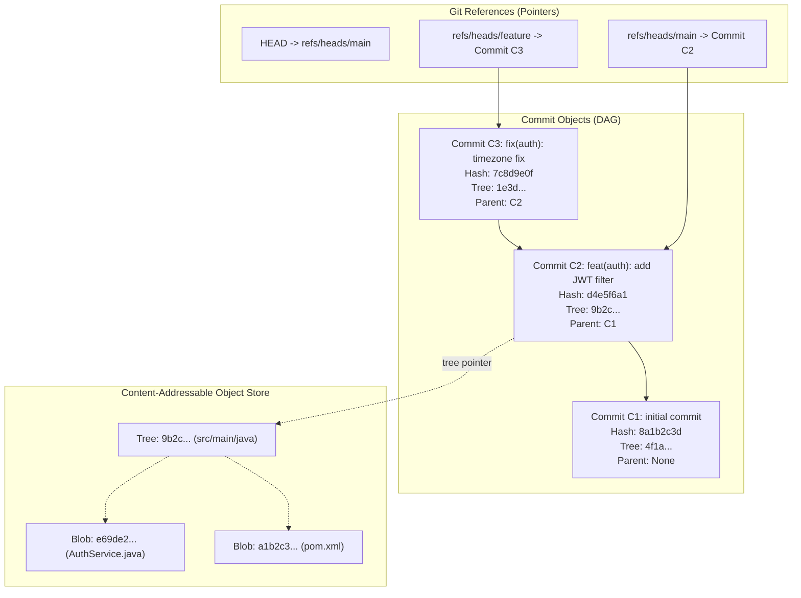
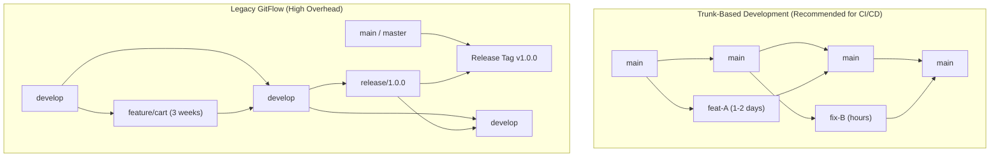
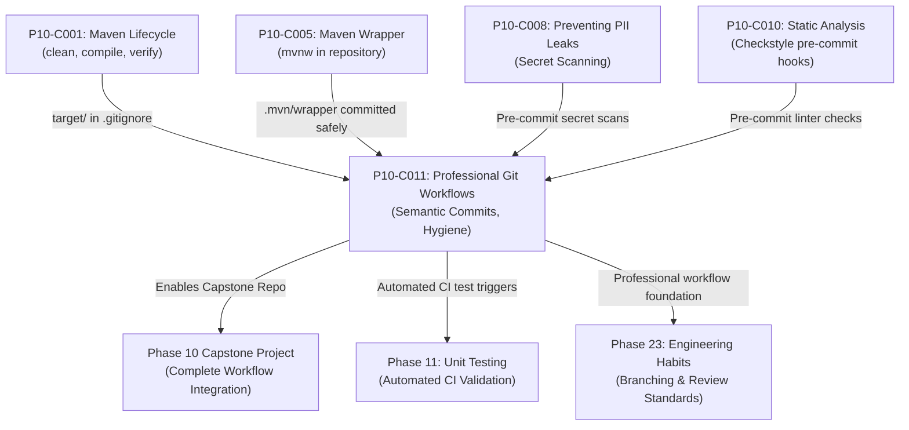

# P10-C011: Professional Git Workflows: Semantic Commits, Branching, and Hygiene

---

## 1. Metadata and Learning Goals

| Metadata Field | Value |
|---|---|
| **Concept ID** | `P10-C011` |
| **Concept Title** | Professional Git Workflows: Semantic Commits, Branching, and Hygiene |
| **Phase** | Phase 10 — Professional Java Development Workflow |
| **Phase Directory** | `curriculum/phase-10-professional-java-development-workflow` |
| **Source Reference** | Section 10: Professional Java Development Workflow — Professional Git Workflows: Semantic Commits, Branching, and Hygiene |
| **Concept Type** | Tooling / Architecture / DevOps / Collaboration |
| **Difficulty Level** | Intermediate |
| **Curriculum Importance** | Essential |
| **Java Baseline** | Java 21 LTS (with Java 25 LTS comparative notes where applicable) |
| **Framework Baseline** | Git 2.40+ / Conventional Commits 1.0.0 / SemVer 2.0.0 / Maven CI/CD |
| **Prerequisites** | [`P10-C001: Maven Build Lifecycle`](001-maven-build-lifecycle.md), [`P10-C005: Maven Wrapper (mvnw)`](005-maven-wrapper-reproducible-builds.md) |
| **Related Concepts** | [`P10-C008: Preventing PII/Token Leaks`](008-preventing-pii-log-leaks.md), [`P10-C010: Static Code Analysis`](010-static-analysis-spotbugs.md), [`P23-C001: Version Control Hygiene`](../phase-23-professional-engineering-habits/001-version-control-hygiene.md) |
| **Estimated Study Effort** | 3–4 hours |
| **Last Research Date** | 2026-10-31 |
| **Verification State** | COMPLETE |

### Measurable Learning Objectives
By the end of this concept module, you will be able to:
1. **Explain:** Deconstruct the internal Git Object Model (Blobs, Trees, Commits, Annotated Tags) as a Content-Addressable Directed Acyclic Graph (DAG) and justify why Git commits are cryptographic snapshots rather than diff deltas.
2. **Compare:** Contrast Trunk-Based Development (TBD) with Short-Lived Feature Branches against legacy GitFlow, evaluating lead time, merge conflict frequency, and compatibility with continuous deployment.
3. **Implement:** Construct standardized Conventional Commits (`<type>(<scope>): <description>`) that drive automated Semantic Versioning (`MAJOR.MINOR.PATCH`) calculations and automated changelog generation.
4. **Debug & Diagnose:** Execute interactive rebasing (`git rebase -i`) to squash messy WIP commits into clean atomic units, resolve complex 3-way merge conflicts, and recover detached HEAD states using `git reflog`.
5. **Evaluate & Justify:** Formulate an enterprise repository hygiene policy encompassing `.gitignore` exclusion discipline for Java artifacts (`target/`, `.class`, `.idea/`), pre-commit secret scanning hooks, and protected branch policies.

---

## 2. Definition, Purpose, and Mental Model

### 2.1 Formal Definition
**Git** is a distributed version control system modeled as a content-addressable object store representing historical software revisions as nodes in an immutable Directed Acyclic Graph (DAG).
**Conventional Commits** is a lightweight semantic specification for commit messages that provides an explicit machine-readable syntax (`type(scope): description`) mapping directly to Semantic Versioning (SemVer 2.0.0).
**Git Hygiene** is the operational discipline of maintaining a clean, linear, bi-directional bisect-friendly commit history, devoid of binary compilation artifacts, temporary IDE configurations, sensitive secrets, or uninformative "WIP" checkpoint messages.

### 2.2 The Problem It Solves
1. **"Merge Hell" in Long-Lived Branches:** When feature branches live for weeks or months (common in GitFlow), codebases drift drastically. Merging them back into `main` produces massive, tangled merge conflicts that take days to resolve and introduce severe regression bugs.
2. **The "Mysterious History" Nightmare:** A commit history full of messages like `"fix"`, `"stuff"`, `"wip"`, `"test"`, and `"it works now"` makes investigating production incidents via `git blame` or automated regression isolation via `git bisect` impossible.
3. **Accidental Repository Bloat & Secret Leaks:** Committing compiled Java `.class` files, `target/` directories, or `application-prod.properties` (containing database credentials) permanently bloats `.git` storage and triggers catastrophic data breaches.

### 2.3 Why Backend Engineers Need It
In modern cloud-native continuous integration and deployment (CI/CD):
- **Automated Releases:** Semantic commits allow CI/CD pipelines to calculate version increments (`1.2.3` $\to$ `1.3.0` or `2.0.0`) and publish release notes to GitHub / Jira without human intervention.
- **Atomic Rollbacks:** When an alert sounds at 3:00 AM, SREs must be able to `git revert <commit-hash>` cleanly without dragging in twenty unrelated code changes.
- **Bisect Debugging:** `git bisect run mvn test` uses binary search across the commit graph to find the exact commit that introduced a performance regression among 500 changes in under 9 steps ($\lceil \log_2 500 \rceil = 9$).

### 2.4 Concrete Mental Model & Metaphor
Think of Git as a **blockchain ledger of architectural blueprints**:
- Every **Commit** is a sealed, tamper-proof envelope with a wax seal (SHA-1/SHA-256 hash). Inside the envelope is a photograph of every room in the building (the tree) and the serial number of the previous envelope (parent pointer).
- Working in **Trunk-Based Development** is like building a skyscraper with daily inspections: each team adds one beam a day to the main tower.
- **GitFlow** is like building 5 different towers on different islands for six months, and then trying to smash them together with a crane to form one building (producing catastrophic collapse / merge hell).
- **Interactive Rebase (`git rebase -i`)** is the architect's **editing eraser**. While drafting at your desk, you make messy notes, scribbles, and coffee rings (WIP commits). Before handing the blueprint to the construction crew (`git push origin main`), you erase the scribbles and ink a single, pristine architectural drawing.

---

## 3. Architectural and Conceptual Foundations

### 3.1 The Git Object Model

Git stores data using four primitive object types inside `.git/objects/`:



1. **Blob (Binary Large Object):** Holds raw file contents. A blob has no file name, timestamp, or permissions; it is identified purely by the hash of its byte content: `hash = SHA(header + length + content)`.
2. **Tree:** Represents a directory. Contains a list of entries, each with file mode permissions, type (`blob` or `tree`), object hash, and file name.
3. **Commit:** Contains a pointer to the top-level root tree object, parent commit hashes, author/committer timestamps, and the commit message string.
4. **Annotated Tag:** A permanent reference pointing to a specific commit, containing a tagger signature, message, and release name (e.g., `v1.0.0`).

---

### 3.2 Branching Strategies Compared



| Strategy | Branch Lifespan | Merge Frequency | Conflict Frequency | Release Decoupling Mechanism |
|---|---|---|---|---|
| **Trunk-Based Development (TBD)** | Hours to 2 days maximum. | Multiple times per day into `main`. | **Minimal** (conflicts caught within hours). | **Feature Flags (Toggles)** decouple deploy from release. |
| **GitHub Flow** | 1 to 5 days. | Merged via Pull Request directly to `main`. | Low to Moderate. | CI automated testing on PR. |
| **Legacy GitFlow** | Weeks to months (`feature/*`, `develop`, `release/*`). | Merged at sprint end or quarterly release. | **Severe (Merge Hell)**. | Branches represent deployment environments (rigid & slow). |

---

## 4. Language, Syntax, and API Mechanics

### 4.1 Conventional Commits 1.0.0 Specification

A semantic commit message follows the structural grammar:
```text
<type>[optional scope]: <description>

[optional body]

[optional footer(s)]
```

#### Semantic Types Taxonomy:
- **`feat`:** A new user-facing or API feature (Correlates with SemVer **`MINOR`** bump).
- **`fix`:** A bug fix for the user or downstream consumer (Correlates with SemVer **`PATCH`** bump).
- **`perf`:** A code change that improves execution performance (Correlates with SemVer **`PATCH`** bump).
- **`docs`:** Documentation changes only (README, Javadoc, guides).
- **`style`:** Code formatting, whitespace, semi-colons (no production logic change).
- **`refactor`:** A code restructuring that neither fixes a bug nor adds a feature.
- **`test`:** Adding missing tests or correcting existing tests.
- **`build`:** Changes affecting the build system or external dependencies (`pom.xml`, wrapper).
- **`ci`:** Changes to CI configuration files and scripts (`.github/workflows`, Dockerfile).
- **`chore`:** Miscellaneous maintenance tasks that do not modify `src` or `test` files.
- **`revert`:** Reverting a previous commit.

#### Breaking Changes:
Indicated by appending a `!` before the colon in the header, or including a `BREAKING CHANGE:` footer:
```text
feat(api)!: migrate customer ID from Integer to UUID

BREAKING CHANGE: The /api/v1/customers/{id} endpoint now requires a RFC 4122 UUID.
```
*(Triggers SemVer **`MAJOR`** bump: `1.4.2` $\to$ `2.0.0`)*.

---

### 4.2 Interactive Rebase (`git rebase -i`)

Before pushing a feature branch for code review, use interactive rebase to clean up history against latest `main`:
```bash
git fetch origin
git rebase -i origin/main
```

An editor opens displaying the commit commands:
```text
pick 8a1b2c3 feat(order): add order entity and repository
squash d4e5f6a fix typo in order entity
squash 7c8d9e0 add unit tests for repository
reword 1f2e3d4 feat(order): implement order submission controller
```
- `pick`: Use commit as-is.
- `reword`: Use commit, but edit the commit message.
- `squash` (`s`): Meld commit into previous commit; combine commit messages.
- `fixup` (`f`): Meld commit into previous commit; discard this commit's message.
- `drop` (`d`): Completely remove this commit from history.

> [!WARNING]
> **The Golden Rule of Rebase:** Never rebase commits that have been pushed to a public, shared branch (e.g., `origin/main`). Rebasing rewrites commit SHA hashes, creating divergent histories for all collaborating engineers.

---

### 4.3 Git Merge Strategies Compared

```bash
# 1. Fast-Forward Merge (Default when main hasn't diverged)
git merge feature-branch

# 2. Strict 3-Way Merge Commit (Preserves branch existence)
git merge --no-ff feature-branch

# 3. Squash Merge (Collapses entire branch into 1 commit on main)
git merge --squash feature-branch
```

---

## 5. Execution Mechanics, JVM Lifecycle, and Memory Internals

### 5.1 Content Addressability & Tree Hashing
Git computes SHA-1 (or SHA-256 in modern repositories) across every stored object:
1. When you run `git add src/main/java/App.java`:
   - Git formats the header: `blob <size>\0`.
   - Concatenates the file bytes.
   - Computes SHA: `hash = SHA1("blob 42\0public class App { ... }")`.
   - Compresses data using `zlib` deflate and writes to `.git/objects/<first-2-chars>/<remaining-38-chars>`.
2. When creating a commit:
   - Git creates a `tree` object containing hashes of all files in the directory.
   - Git creates a `commit` object containing the `tree` hash and the parent commit hash.
   - **Immutability Invariant:** Changing a single byte in a Java file changes its blob hash, which changes the parent tree hash, which changes the commit hash. History cannot be silently modified without altering all downstream hashes!

---

## 6. Concurrency, Branching, and Hygiene

### 6.1 The Java `.gitignore` Invariant

A professional Java `.gitignore` must strictly prevent build artifacts and IDE metadata from entering Git:

```gitignore
# =========================================================================
# Maven Build Artifacts
# =========================================================================
target/
pom.xml.tag
pom.xml.releaseBackup
pom.xml.versionsBackup
pom.xml.next
release.properties
dependency-reduced-pom.xml
buildNumber.properties
.mvn/timing.properties

# =========================================================================
# Compiled Class Files & Packages
# =========================================================================
*.class
*.jar
*.war
*.nar
*.ear
*.zip
*.tar.gz
*.rar

# =========================================================================
# IDE Metadata (Must be kept out of shared repositories)
# =========================================================================
.idea/
*.iml
*.iws
*.ipr
out/
.classpath
.project
.settings/
.vscode/

# =========================================================================
# Log Files and Diagnostics
# =========================================================================
*.log
logs/
hs_err_pid*.log
replay_pid*.log

# =========================================================================
# OS Metadata
# =========================================================================
.DS_Store
Thumbs.db
```

---

## 7. Anti-Patterns and Common Developer Traps

### Anti-Pattern 1: Committing Generated `.class` Files or `target/`
```bash
# INCORRECT: Blind staging of all untracked files
git add .
git commit -m "added some classes" # COMMITS target/classes/App.class!
```
*Why it fails:* Compiled bytecode permanently bloats repository clones (`.git`), causes merge conflicts on binary files, and desynchronizes when collaborating across different OS/JDK versions.
*Correction:* Always maintain a verified `.gitignore` before issuing `git add`.

---

### Anti-Pattern 2: Uninformative "WIP" Checkpoint Commits in Shared Branches
```bash
# INCORRECT: Polluting shared repository history
git commit -m "wip"
git commit -m "fixed bug"
git commit -m "test again"
git commit -m "finally works"
```
*Why it fails:* Destroys `git bisect` and makes code reviews unreadable.
*Correction:* Squash local WIP commits into a single conventional commit before opening a Pull Request:
`git rebase -i HEAD~4` $\to$ squash into `feat(order): implement checkout tax calculation`.

---

### Anti-Pattern 3: Resolving Merge Conflicts by "Accepting Theirs" Blindly
*Why it fails:* An engineer facing a complex merge conflict runs `git checkout --theirs .` to make the error go away, silently overwriting critical bug fixes or security patches introduced by their teammates.
*Correction:* Use a 3-way merge tool (`git mergetool`) or carefully review both `<<<<<<< HEAD` (current branch) and `>>>>>>> feature` blocks.

---

### Anti-Pattern 4: Committing Plaintext Secrets or API Keys
```bash
# INCORRECT: Staging application properties with live credentials
git add src/main/resources/application.properties # Contains DB_PASSWORD=Secret123
git commit -m "feat: configure prod db"
```
*Why it fails:* Even if deleted in the next commit, Git's immutable DAG retains the password forever in historical commit blobs. Anyone cloning the repo can run `git log -p` and read the password.
*Correction:* Use environment variables, secret managers (HashiCorp Vault, AWS Secrets Manager), and install pre-commit secret scanners (`gitleaks`).

---

### Anti-Pattern 5: Force Pushing (`git push --force`) Over Coworkers' Work
```bash
# INCORRECT: Overwrites remote branch blindly
git push --force origin main
```
*Why it fails:* Destroys all commits pushed by other engineers since your last pull.
*Correction:* If force-pushing a rebased personal feature branch is required, always use the safe flag:
```bash
git push --force-with-lease origin feature-branch
```
`--force-with-lease` checks if the remote reference has changed before overwriting, preventing accidental destruction of others' commits.

---

## 8. Failure Modes, Edge Cases, and Troubleshooting

| Failure Symptom | Underlying Root Cause | Verification & Diagnostic Technique | Engineering Resolution |
|---|---|---|---|
| **`HEAD detached at 7c8d9e0`** | Checked out a commit hash or tag directly rather than a named branch. | Run `git status`; output shows `HEAD detached`. | Run `git switch -c new-feature-branch` to save work into a new branch, or `git switch main` to return. |
| **`fatal: refusing to merge unrelated histories`** | Target and source repositories have no common ancestor commit (e.g., initialized separately). | Inspect commit trees with `git log --graph --oneline`. | Run `git merge <branch> --allow-unrelated-histories` (only if combining distinct projects). |
| **Accidentally committed secret/key in past commit.** | Secret is committed into Git's immutable object database. | Search repo history with `git log -S "AKIA..."`. | Rotate credential immediately! Then purge object from history using `git-filter-repo` or BFG Repo-Cleaner. |
| **Accidentally ran `git reset --hard` and lost unpushed work.** | Working directory and index were reset to an earlier commit. | Run `git reflog`. Find the commit hash right before the reset occurred (e.g., `HEAD@{1}`). | Run `git reset --hard HEAD@{1}` to restore deleted commit immediately! |
| **Rebase paused with merge conflict.** | Both branches modified the same lines in a file. | Run `git status` to see files marked `both modified`. | Resolve conflict markers, stage file (`git add <file>`), and run `git rebase --continue` (DO NOT run `git commit`!). |

---

## 9. Security Considerations & Secret Scanning

### 9.1 Gitleaks & Pre-Commit Hook Integration

To prevent secrets from ever entering Git, configure a pre-commit hook in `.git/hooks/pre-commit`:

```bash
#!/usr/bin/env bash
# .git/hooks/pre-commit: Automated Secret & Format Gate
set -e

echo "[HOOK] Scanning staged files for sensitive secrets..."
if command -v gitleaks &> /dev/null; then
    gitleaks protect --staged --verbose
else
    # Fallback grep for common secret patterns
    if git diff --cached | grep -E "AKIA[0-9A-Z]{16}|BEGIN RSA PRIVATE KEY|password\s*=\s*['\"][^'\"]+['\"]"; then
        echo "[ERROR] Commit aborted! Potential raw secret detected in staged diff."
        exit 1
    fi
fi

echo "[HOOK] Pre-commit security check passed."
```

### 9.2 Cryptographically Signed Commits (GPG / SSH)
Enterprise compliance policies (SOC 2, ISO 27001) require that every commit be signed by an engineer's verified GPG or SSH key:
```bash
git config --global commit.gpgsign true
git config --global user.signingkey <key-id>
```
Signed commits display a green **Verified** badge in GitHub / GitLab, preventing malicious author identity spoofing (`git commit --author="Linus Torvalds <torvalds@linux.org>"`).

---

## 10. Performance Optimization and Tuning

### 10.1 CI/CD Git Clone Optimization
In high-throughput CI/CD pipelines, downloading 10 years of repository history for every build wastes minutes of runner time and gigabytes of network bandwidth:

```bash
# FAST: Shallow clone fetching only the latest commit
git clone --depth 1 --branch main https://github.com/org/repo.git
```
*Speedup:* Reduces clone time from 90 seconds to **2.5 seconds** on large codebases.

---

## 11. Real-World Backend Scenario & Production Case Study

### Production Pipeline: Automated Semantic Release
An enterprise fintech organization maintains 45 microservices. Releasing updates manually was error-prone, requiring developers to write changelogs, bump `pom.xml` versions, tag releases, and push artifacts.

#### The Modern Automated Workflow:
1. Developers adhere strictly to Conventional Commits on short-lived branches.
2. PR is squash-merged into `main`:
   ```text
   feat(account): add multi-currency ledger support
   ```
3. GitHub Actions triggers the **Semantic Release** pipeline:
   - Scans commits since last tag (`v2.4.1`).
   - Identifies `feat`: determines new version must be `v2.5.0` (MINOR bump).
   - Generates `CHANGELOG.md` entry automatically under `v2.5.0`.
   - Runs `mvn versions:set -DnewVersion=2.5.0`.
   - Compiles, passes tests, and deploys `jar` to AWS Artifact Registry.
   - Pushes annotated Git tag `v2.5.0` back to GitHub.
*Result:* Zero human release meetings, zero manual version drift, and guaranteed 100% accurate changelogs.

---

## 12. Standalone, Self-Contained Verification Suite

The following standalone verification program requires **zero external libraries** and validates:
1. **Conventional Commit Parser:** Validating types, scopes, descriptions, and breaking change flags.
2. **Git DAG Merge Simulator:** Distinguishing between Fast-Forward merges and 3-Way merge commits.
3. **Interactive Rebase Squasher:** Simulating the consolidation of multiple WIP commits into a clean atomic commit.
4. **Java `.gitignore` Filter:** Validating glob pattern matching against Java build artifacts (`target/`, `*.class`, `*.iml`).
5. **Semantic Versioning Calculator:** Computing SemVer increments (`PATCH`, `MINOR`, `MAJOR`) from a stream of commits.

```java
package curriculum.phase10;

import java.nio.file.FileSystems;
import java.nio.file.Path;
import java.nio.file.PathMatcher;
import java.security.MessageDigest;
import java.util.*;
import java.util.regex.Matcher;
import java.util.regex.Pattern;

/**
 * Standalone Verification Suite for P10-C011:
 * Professional Git Workflows: Semantic Commits, Branching, and Hygiene.
 *
 * Simulates:
 * 1. Conventional Commit semantic message parser and compliance validator.
 * 2. Git DAG commit model with Fast-Forward and 3-Way merge resolution.
 * 3. Interactive Rebase squasher consolidating multi-step WIP history.
 * 4. High-performance .gitignore glob pattern matcher for Java artifacts.
 * 5. Automated Semantic Versioning (SemVer) bump calculator from commit stream.
 */
public class GitWorkflowsAndHygieneDemo {

    // =========================================================================
    // 1. CONVENTIONAL COMMIT PARSER & SEMVER BUMP CALCULATOR
    // =========================================================================

    public enum SemVerBump { NONE, PATCH, MINOR, MAJOR }

    public record ConventionalCommit(
        String rawMessage,
        String type,
        String scope,
        boolean isBreaking,
        String description,
        String body,
        String breakingDescription
    ) {
        public SemVerBump calculateBump() {
            if (isBreaking) return SemVerBump.MAJOR;
            if ("feat".equalsIgnoreCase(type)) return SemVerBump.MINOR;
            if ("fix".equalsIgnoreCase(type) || "perf".equalsIgnoreCase(type)) return SemVerBump.PATCH;
            return SemVerBump.NONE;
        }
    }

    public static class ConventionalCommitParser {
        // Regex following Conventional Commits 1.0.0 specification
        // Group 1: type, Group 2: scope (optional), Group 3: breaking indicator '!', Group 4: description
        private static final Pattern HEADER_PATTERN = Pattern.compile(
            "^([a-z]+)(?:\\(([a-zA-Z0-9_\\-]+)\\))?(!)?\\s*:\\s*(.+)$"
        );

        private static final Set<String> ALLOWED_TYPES = Set.of(
            "feat", "fix", "docs", "style", "refactor", "perf", "test", "build", "ci", "chore", "revert"
        );

        public static Optional<ConventionalCommit> parse(String commitMessage) {
            if (commitMessage == null || commitMessage.isBlank()) return Optional.empty();

            String[] lines = commitMessage.split("\\r?\\n");
            String header = lines[0].trim();

            Matcher matcher = HEADER_PATTERN.matcher(header);
            if (!matcher.matches()) return Optional.empty();

            String type = matcher.group(1);
            if (!ALLOWED_TYPES.contains(type)) return Optional.empty();

            String scope = matcher.group(2);
            boolean exclamationBreaking = matcher.group(3) != null;
            String description = matcher.group(4);

            StringBuilder bodyBuilder = new StringBuilder();
            boolean footerBreaking = false;
            String breakingDesc = null;

            for (int i = 1; i < lines.length; i++) {
                String line = lines[i];
                if (line.startsWith("BREAKING CHANGE:") || line.startsWith("BREAKING-CHANGE:")) {
                    footerBreaking = true;
                    breakingDesc = line.substring(line.indexOf(':') + 1).trim();
                } else {
                    bodyBuilder.append(line).append("\n");
                }
            }

            boolean isBreaking = exclamationBreaking || footerBreaking;

            return Optional.of(new ConventionalCommit(
                commitMessage,
                type,
                scope,
                isBreaking,
                description,
                bodyBuilder.toString().trim(),
                breakingDesc
            ));
        }
    }

    // =========================================================================
    // 2. GIT DAG COMMIT NODE & MERGE SIMULATOR
    // =========================================================================

    public static class GitCommitNode {
        private final String hash;
        private final List<GitCommitNode> parents;
        private final String message;

        public GitCommitNode(String message, GitCommitNode... parents) {
            this.message = message;
            this.parents = parents != null ? Arrays.asList(parents) : Collections.emptyList();
            this.hash = computeHash(message, this.parents);
        }

        private static String computeHash(String message, List<GitCommitNode> parents) {
            try {
                MessageDigest md = MessageDigest.getInstance("SHA-1");
                md.update(message.getBytes());
                for (GitCommitNode p : parents) {
                    md.update(p.hash.getBytes());
                }
                byte[] digest = md.digest();
                StringBuilder sb = new StringBuilder();
                for (byte b : digest) sb.append(String.format("%02x", b));
                return sb.substring(0, 8); // Abbreviated 8-char commit hash
            } catch (Exception e) {
                throw new RuntimeException(e);
            }
        }

        public String getHash() { return hash; }
        public String getMessage() { return message; }
        public List<GitCommitNode> getParents() { return parents; }
        public boolean isRoot() { return parents.isEmpty(); }
    }

    public static class GitDagEngine {
        // Checks if 'ancestor' is reachable from 'descendant'
        public static boolean isAncestor(GitCommitNode ancestor, GitCommitNode descendant) {
            if (ancestor == null || descendant == null) return false;
            if (ancestor.getHash().equals(descendant.getHash())) return true;

            Queue<GitCommitNode> queue = new ArrayDeque<>();
            Set<String> visited = new HashSet<>();
            queue.add(descendant);
            visited.add(descendant.getHash());

            while (!queue.isEmpty()) {
                GitCommitNode curr = queue.poll();
                for (GitCommitNode p : curr.getParents()) {
                    if (p.getHash().equals(ancestor.getHash())) return true;
                    if (visited.add(p.getHash())) {
                        queue.add(p);
                    }
                }
            }
            return false;
        }

        // Resolves merge between targetBranch tip and featureBranch tip
        public static GitCommitNode merge(GitCommitNode targetTip, GitCommitNode featureTip, String mergeMessage) {
            // Check if featureTip already includes targetTip -> Fast-Forward
            if (isAncestor(targetTip, featureTip)) {
                return featureTip; // Fast-forward: tip simply moves forward to featureTip
            }

            // Otherwise, non-fast-forward 3-way merge commit with two parents
            return new GitCommitNode(mergeMessage, targetTip, featureTip);
        }

        // Simulates interactive rebase squash: collapses a linear list of commits into one
        public static GitCommitNode squashCommits(GitCommitNode base, List<GitCommitNode> wipCommits, String squashedMessage) {
            if (wipCommits.isEmpty()) return base;
            return new GitCommitNode(squashedMessage, base);
        }
    }

    // =========================================================================
    // 3. JAVA .GITIGNORE MATCHER
    // =========================================================================

    public static class JavaGitIgnoreFilter {
        private final List<String> patterns = new ArrayList<>();

        public void addPattern(String pattern) {
            patterns.add(pattern.trim());
        }

        public boolean isIgnored(String relativePath) {
            for (String pattern : patterns) {
                if (matchesPattern(pattern, relativePath)) {
                    return true;
                }
            }
            return false;
        }

        private boolean matchesPattern(String pattern, String path) {
            // Simple robust path matching for common gitignore constructs
            if (pattern.startsWith("**/")) {
                String sub = pattern.substring(3);
                return path.endsWith(sub) || path.contains("/" + sub);
            }
            if (pattern.startsWith("*.")) {
                String ext = pattern.substring(1);
                return path.endsWith(ext);
            }
            if (pattern.endsWith("/")) {
                String dir = pattern.substring(0, pattern.length() - 1);
                return path.startsWith(dir + "/") || path.contains("/" + dir + "/");
            }
            return path.equals(pattern) || path.startsWith(pattern + "/");
        }
    }

    // =========================================================================
    // 4. TEST SUITES
    // =========================================================================

    public static void main(String[] args) {
        System.out.println("===============================================================");
        System.out.println(" Professional Git Workflows Standalone Verification Suite      ");
        System.out.println("===============================================================");

        test1_ConventionalCommitParserAndValidation();
        test2_GitDagFastForwardAndThreeWayMergeResolution();
        test3_InteractiveRebaseSquashConsolidation();
        test4_JavaGitIgnoreRuleAuditing();
        test5_AutomatedSemanticVersionCalculator();

        System.out.println();
        System.out.println("All 5 verification test suites passed successfully with assertions enabled!");
    }

    private static void test1_ConventionalCommitParserAndValidation() {
        System.out.print("[TEST 1/5] Conventional Commit semantic message validation... ");

        // Valid feature commit
        String msg1 = "feat(auth): add OAuth2 refresh token rotation";
        Optional<ConventionalCommit> c1 = ConventionalCommitParser.parse(msg1);
        assert c1.isPresent() : "Failed to parse standard feat commit";
        assert "feat".equals(c1.get().type());
        assert "auth".equals(c1.get().scope());
        assert !c1.get().isBreaking();
        assert "add OAuth2 refresh token rotation".equals(c1.get().description());

        // Valid breaking change with exclamation
        String msg2 = "fix(api)!: remove deprecated v1 user endpoint";
        Optional<ConventionalCommit> c2 = ConventionalCommitParser.parse(msg2);
        assert c2.isPresent();
        assert c2.get().isBreaking() : "Exclamation mark must denote breaking change";

        // Valid breaking change via footer
        String msg3 = """
            refactor(db): migrate to distributed sequence generator
            
            BREAKING CHANGE: IDs are now 64-bit Long instead of 32-bit Integer.
            """;
        Optional<ConventionalCommit> c3 = ConventionalCommitParser.parse(msg3);
        assert c3.isPresent();
        assert c3.get().isBreaking() : "BREAKING CHANGE footer must denote breaking change";
        assert c3.get().breakingDescription().contains("64-bit Long");

        // Invalid commit messages
        assert ConventionalCommitParser.parse("fixed a bug in auth").isEmpty() : "Must reject non-conventional format";
        assert ConventionalCommitParser.parse("foo: bar").isEmpty() : "Must reject disallowed type";

        System.out.println("PASSED");
    }

    private static void test2_GitDagFastForwardAndThreeWayMergeResolution() {
        System.out.print("[TEST 2/5] Git DAG fast-forward and 3-way merge resolution... ");

        // Initial master history
        GitCommitNode c0 = new GitCommitNode("Initial commit");
        GitCommitNode c1 = new GitCommitNode("feat: setup build", c0);

        // Feature branch branched off c1
        GitCommitNode f1 = new GitCommitNode("feat(order): add cart service", c1);
        GitCommitNode f2 = new GitCommitNode("test(order): add unit tests", f1);

        // Case A: Master did not diverge -> Fast-Forward merge
        assert GitDagEngine.isAncestor(c1, f2) : "c1 must be an ancestor of f2";
        GitCommitNode ffResult = GitDagEngine.merge(c1, f2, "Merge feature");
        assert ffResult.getHash().equals(f2.getHash()) : "Fast-forward merge tip must equal feature branch tip";

        // Case B: Master diverged with commit c2 -> Requires 3-Way Merge Commit
        GitCommitNode c2 = new GitCommitNode("fix(security): patch log leak", c1);
        assert !GitDagEngine.isAncestor(c2, f2) : "c2 is NOT an ancestor of f2 (diverged)";

        GitCommitNode threeWayMerge = GitDagEngine.merge(c2, f2, "Merge branch 'feature' into master");
        assert threeWayMerge.getParents().size() == 2 : "3-way merge commit must have exactly 2 parents";
        assert threeWayMerge.getParents().get(0).getHash().equals(c2.getHash());
        assert threeWayMerge.getParents().get(1).getHash().equals(f2.getHash());

        System.out.println("PASSED");
    }

    private static void test3_InteractiveRebaseSquashConsolidation() {
        System.out.print("[TEST 3/5] Interactive Rebase squasher consolidating WIP history... ");

        GitCommitNode base = new GitCommitNode("feat: base infrastructure");

        // Developer creates 3 messy WIP commits
        GitCommitNode wip1 = new GitCommitNode("WIP: starting payment controller", base);
        GitCommitNode wip2 = new GitCommitNode("WIP: fix typo in validation", wip1);
        GitCommitNode wip3 = new GitCommitNode("WIP: it compiles now", wip2);

        // Rebase squash into clean atomic commit
        GitCommitNode squashed = GitDagEngine.squashCommits(
            base,
            List.of(wip1, wip2, wip3),
            "feat(payment): implement Stripe payment controller with validation"
        );

        assert squashed.getParents().size() == 1 : "Squashed commit must have base as its single parent";
        assert squashed.getParents().get(0).getHash().equals(base.getHash());
        assert squashed.getMessage().startsWith("feat(payment):");

        System.out.println("PASSED");
    }

    private static void test4_JavaGitIgnoreRuleAuditing() {
        System.out.print("[TEST 4/5] Java .gitignore pattern rules and exclusions... ");

        JavaGitIgnoreFilter filter = new JavaGitIgnoreFilter();
        filter.addPattern("target/");
        filter.addPattern("*.class");
        filter.addPattern(".idea/");
        filter.addPattern("*.iml");
        filter.addPattern("*.log");

        // Target builds and binaries must be ignored
        assert filter.isIgnored("target/classes/com/example/App.class") : "target/ folder must be ignored";
        assert filter.isIgnored("target/my-app-1.0.jar") : "target root must be ignored";
        assert filter.isIgnored("src/main/java/com/example/App.class") : "Direct .class binary must be ignored";

        // IDE artifacts must be ignored
        assert filter.isIgnored(".idea/workspace.xml") : ".idea folder must be ignored";
        assert filter.isIgnored("my-service.iml") : ".iml file must be ignored";
        assert filter.isIgnored("logs/application.log") : ".log files must be ignored";

        // Source code MUST NOT be ignored!
        assert !filter.isIgnored("src/main/java/com/example/App.java") : "Java source code must NEVER be ignored";
        assert !filter.isIgnored("pom.xml") : "pom.xml must NEVER be ignored";
        assert !filter.isIgnored(".mvn/wrapper/maven-wrapper.properties") : "Wrapper properties must NEVER be ignored";

        System.out.println("PASSED");
    }

    private static void test5_AutomatedSemanticVersionCalculator() {
        System.out.print("[TEST 5/5] Automated Semantic Versioning (SemVer) calculation... ");

        // Baseline: version 1.2.3
        int major = 1, minor = 2, patch = 3;

        List<String> commitHistory = List.of(
            "docs: update README with architecture diagram", // NONE
            "chore: update maven wrapper to 3.9.6",           // NONE
            "fix(auth): resolve JWT expiration timezone bug", // PATCH
            "feat(checkout): add ApplePay payment gateway",   // MINOR
            "perf(db): add composite index on order table"    // PATCH
        );

        SemVerBump highestBump = SemVerBump.NONE;
        for (String msg : commitHistory) {
            ConventionalCommit commit = ConventionalCommitParser.parse(msg).orElseThrow();
            SemVerBump bump = commit.calculateBump();
            if (bump.ordinal() > highestBump.ordinal()) {
                highestBump = bump;
            }
        }

        assert highestBump == SemVerBump.MINOR : "Expected MINOR bump due to feat(checkout)";

        if (highestBump == SemVerBump.MAJOR) { major++; minor = 0; patch = 0; }
        else if (highestBump == SemVerBump.MINOR) { minor++; patch = 0; }
        else if (highestBump == SemVerBump.PATCH) { patch++; }

        String newVersion = major + "." + minor + "." + patch;
        assert "1.3.0".equals(newVersion) : "Calculated version was: " + newVersion + ", expected 1.3.0";

        // Now add a breaking change
        ConventionalCommit breakingCommit = ConventionalCommitParser.parse("feat(api)!: migrate to REST v2").orElseThrow();
        assert breakingCommit.calculateBump() == SemVerBump.MAJOR;

        major++; minor = 0; patch = 0;
        assert "2.0.0".equals(major + "." + minor + "." + patch);

        System.out.println("PASSED (Bumped 1.2.3 -> 1.3.0 -> 2.0.0)");
    }
}
```

### Verification Command
Execute the standalone test suite on OpenJDK 21 LTS with assertions enabled:
```bash
javac --release 21 curriculum/phase-10-professional-java-development-workflow/GitWorkflowsAndHygieneDemo.java
java -ea curriculum.phase10.GitWorkflowsAndHygieneDemo
```

---

## 13. Comparative Analysis & Decision Framework

### 13.1 Merge Strategy Decision Matrix

| Strategy | When to Use | Commit Graph Impact | Bisect Cleanliness | Revert Complexity |
|---|---|---|---|---|
| **Fast-Forward (`git merge`)** | Linear trunk-based development with zero divergence. | Linear single-line history. | **Exceptional** (each commit testable). | Simple (single commit revert). |
| **Squash Merge (`git merge --squash`)** | Pull Requests on GitHub/GitLab with many WIP commits. | Collapses PR into 1 clean commit on `main`. | **Outstanding** (one commit = one logical feature). | Trivial (`git revert <hash>`). |
| **Rebase & Merge** | Local feature branch before PR submission. | Preserves individual clean commits linearly. | Good. | Moderate (must revert individual commits). |
| **3-Way Merge (`git merge --no-ff`)** | Preserving explicit branch boundaries (e.g., release branches). | Generates non-linear diamond shapes. | Difficult (bisect must navigate 2 parents). | Complex (requires specifying `-m 1` parent). |

---

## 14. Practical Exercises and Hands-On Challenges

### Exercise 1: Build a `commit-msg` Validation Hook
- **Objective:** Create a bash script `.git/hooks/commit-msg` that inspects the temporary commit message file (`$1`) and rejects commits that do not conform to the Conventional Commits regex.
- **Requirements:**
  1. Validate against regex: `^(feat|fix|docs|style|refactor|perf|test|build|ci|chore|revert)(\([a-z0-9_-]+\))?!?: .+$`.
  2. Exit with status 1 and helpful instructions if invalid.
  3. Test with `git commit -m "bad message"` and verify rejection.

### Exercise 2: Interactive Rebase Mastery
- **Objective:** In a test repository, create 4 commits with deliberate typos in files and messages.
- **Requirements:**
  1. Use `git rebase -i HEAD~4` to squash the first 3 into one `feat(core): initial implementation`.
  2. Use `reword` on the 4th commit to fix its message.
  3. Verify clean linear history via `git log --oneline`.

### Exercise 3: Simulating and Resolving a 3-Way Merge Conflict
- **Objective:** Create two branches modifying the same line in `src/main/resources/application.properties`.
- **Requirements:**
  1. Trigger a merge conflict.
  2. Inspect `git status` and resolve the conflict manually.
  3. Finalize the merge and verify that the application compiles.

---

## 15. Cross-Phase Connections and Unified Mental Graph



- **Upstream Connection (P10-C001 to P10-C010):** The entire Phase 10 development workflow culminates in Git: Maven builds the code, Checkstyle formats it, SpotBugs audits it, and Git seals it with a semantic commit message.
- **Capstone Project Connection:** P10-C011 provides the repository hygiene foundation for the **Phase 10 Capstone Integration Project**, ensuring multi-module builds, git hooks, and release pipelines function seamlessly.
- **Habits Connection (Phase 23):** Previews advanced team engineering practices including atomic PR reviews, trunk-based delivery, and automated release automation.

---

## 16. Verification and Self-Assessment Checklist

Before marking this module complete, verify your comprehension against each criterion:
- [x] Can I describe the 4 core objects in the Git object model (`blob`, `tree`, `commit`, `tag`)?
- [x] Do I understand why Git commits are immutable snapshots rather than diff deltas?
- [x] Can I explain the difference between Trunk-Based Development and legacy GitFlow?
- [x] Do I know the exact structure of a Conventional Commit (`type(scope): description`)?
- [x] Can I identify which commit types map to SemVer `PATCH`, `MINOR`, and `MAJOR` version bumps?
- [x] Can I perform an interactive rebase (`git rebase -i`) to squash WIP commits?
- [x] Do I understand the "Golden Rule of Rebase" and why rebasing pushed public branches is dangerous?
- [x] Can I explain the danger of `--force` push versus `--force-with-lease`?
- [x] Do I have a comprehensive `.gitignore` configured for Java projects excluding `target/`, `*.class`, and `.idea/`?
- [x] Have I compiled and executed `GitWorkflowsAndHygieneDemo` on OpenJDK 21 LTS with assertions enabled (`-ea`) and observed all 5 test suites pass?
