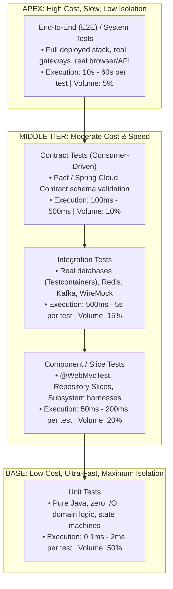
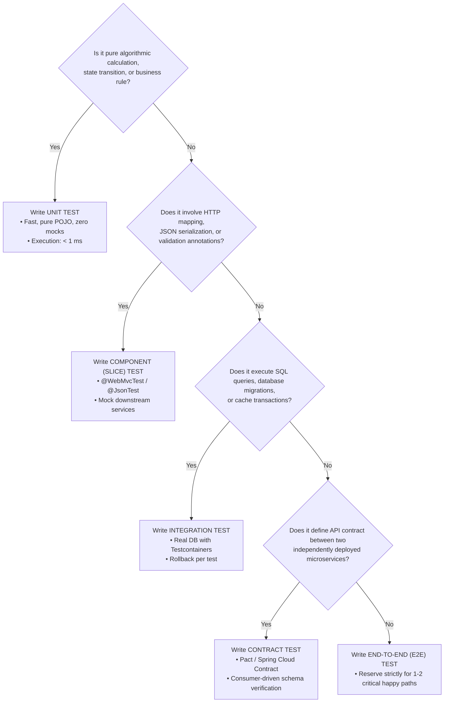
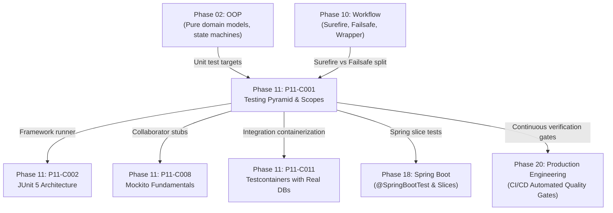

# P11-C001: Testing Pyramid: Unit, Component, Integration, Contract, and E2E Tests

---

## 1. Metadata and Learning Goals

| Metadata Field | Value |
|---|---|
| **Concept ID** | `P11-C001` |
| **Concept Title** | Testing Pyramid: Unit, Component, Integration, Contract, and E2E Tests |
| **Phase** | Phase 11 — Unit Testing and Software Quality |
| **Phase Directory** | `curriculum/phase-11-unit-testing-software-quality` |
| **Source Reference** | Section 11: Unit Testing and Software Quality — Testing Pyramid, Test Scopes, and Taxonomy |
| **Concept Type** | Architecture / Quality Assurance / Methodology / DevOps |
| **Difficulty Level** | Foundation to Intermediate |
| **Curriculum Importance** | Essential |
| **Java Baseline** | Java 21 LTS (with Java 25 LTS comparative notes where applicable) |
| **Framework Baseline** | JUnit 5.10.x / AssertJ 3.25.x / Spring Test 6.1.x / Maven Surefire & Failsafe |
| **Prerequisites** | [`P02-C001: Classes, Objects, and Encapsulation`](../phase-02-object-oriented-programming/001-classes-objects-encapsulation.md), [`P10-C001: Maven Build Lifecycle`](../phase-10-professional-java-development-workflow/001-maven-build-lifecycle.md), [`P10-C004: Maven Plugins and Surefire`](../phase-10-professional-java-development-workflow/004-maven-plugins-and-surefire.md) |
| **Related Concepts** | [`P11-C002: JUnit 5 Architecture`](002-junit-5-architecture.md), [`P11-C008: Mockito Fundamentals`](008-mockito-fundamentals.md), [`P11-C011: Testcontainers Fundamentals`](011-testcontainers-fundamentals.md) |
| **Estimated Study Effort** | 3–4 hours |
| **Last Research Date** | 2026-10-31 |
| **Verification State** | COMPLETE |

### Measurable Learning Objectives
By the end of this concept module, you will be able to:
1. **Explain:** Articulate the five distinct tiers of the modern testing pyramid (Unit, Component, Integration, Contract, and End-to-End) and evaluate their respective cost, execution speed, blast radius, and failure isolation fidelity.
2. **Compare:** Contrast the "Ice Cream Cone" (Inverted Pyramid) and "Testing Hourglass" anti-patterns against the balanced testing pyramid, analyzing their impact on continuous delivery cycle time and CI flakiness.
3. **Implement:** Structure a Java backend application's test suites to execute fast in-memory Unit tests during Maven `test` (via Surefire) and heavy out-of-process Integration tests during `integration-test`/`verify` (via Failsafe).
4. **Debug & Diagnose:** Identify and eliminate non-deterministic test failures (flaky tests) caused by unmanaged shared static state, out-of-order test dependencies, uncleaned database persistence, and port collisions.
5. **Evaluate & Justify:** Formulate an enterprise testing strategy determining when to mock external collaborators versus when to mandate containerized real dependencies (Testcontainers) or Consumer-Driven Contract testing (Pact/Spring Cloud Contract).

---

## 2. Definition, Purpose, and Mental Model

### 2.1 Formal Definition
The **Testing Pyramid** is an architectural heuristic and portfolio model governing the proportional distribution of automated software tests across different scopes of abstraction. It dictates that an engineering organization should maintain a broad base of fast, deterministic, in-memory **Unit Tests**, a middle tier of **Component**, **Integration**, and **Contract Tests**, and a minimal, focused apex of **End-to-End (E2E) System Tests**.

### 2.2 The Problem It Solves
Without a disciplined testing taxonomy, backend development teams inevitably fall victim to two destructive failure modes:
1. **The Ice Cream Cone Anti-Pattern:** A team relies predominantly on UI or End-to-End tests deployed to a staging environment because they "test the real system." E2E tests take 45 to 90 minutes to run in CI, fail intermittently due to network jitter or browser timing (flakiness), and provide zero line-level failure localization when they break.
2. **The Testing Hourglass Anti-Pattern:** A team possesses thousands of unit tests and hundreds of E2E tests, but completely lacks middle-tier integration and contract tests. While units calculate correctly in isolation and E2E tests are too slow to run on every commit, changes to database SQL schemas or microservice REST API contracts slip undetected into production, causing runtime integration crashes.

### 2.3 Why Backend Engineers Need It
In enterprise production engineering:
- **Rapid Developer Feedback Loops:** Unit tests execute in under 1 millisecond. When an engineer breaks an algorithm or edge-case null check, `mvn test` notifies them in 2 seconds right in their local terminal before committing.
- **Microservice Boundary Integrity:** Consumer-driven contract tests allow backend teams to deploy microservices independently hundreds of times a day without coordinating costly cross-team staging environment regressions.
- **Cost and Resource Efficiency:** Running 10,000 unit tests on a CI runner consumes negligible CPU and RAM; spinning up 50 containerized microservices for every single pull request exhausts cloud infrastructure budgets.

### 2.4 Concrete Mental Model & Metaphor
Think of testing as **building an automobile**:
- **Unit Testing** is inspecting the individual spark plugs, pistons, and brake pads in the factory before assembly. You hook up the spark plug to a voltmeter on a workbench and ensure it sparks. If it fails, you discard it instantly for $0.05.
- **Component Testing** is placing the assembled engine onto a dynamometer test rig. You test that the pistons, crankshaft, and fuel injectors work together without mounting the engine into a car.
- **Integration Testing** is bolting the engine to the transmission and driveshaft, checking that turning the engine shaft turns the wheels.
- **Contract Testing** is measuring the bolt holes and wiring harness connectors on the engine block against the vehicle chassis specifications to guarantee that when the chassis arrives from a different factory, the bolts will align perfectly.
- **End-to-End Testing** is driving the fully assembled car around a 10-mile test track in the rain. It confirms the entire car operates as a cohesive unit, but if the car stutters at mile 7, finding out *which* wire loose took hours of disassembly.

---

## 3. Architectural and Conceptual Foundations

### 3.1 The Five-Tier Testing Pyramid



### 3.2 Granular Breakdown of the Five Testing Tiers

| Testing Tier | System Under Test (SUT) | Collaborators & Dependencies | Execution Environment | Typical Latency | Primary Value |
|---|---|---|---|---|---|
| **Unit** | Single class, method, or pure function (Domain Model, Calculator, State Machine). | Mocked, stubbed, or instantiated in-memory test doubles. Zero I/O. | In-memory JVM heap (JUnit 5 + Mockito). | **< 1 ms** | Pinpoint boundary correctness, exhaustive branch coverage, instant feedback. |
| **Component (Slice)** | Cohesive architectural slice (e.g., REST Controller + Validator, or Repository + Mapper). | Spring Context slice (`@WebMvcTest`, `@JsonTest`), stubbed service layer. | Spring TestContext Framework in JVM. | **50 – 200 ms** | Verifies HTTP status codes, JSON serialization, bean validation, security filters. |
| **Integration** | Service interacting with out-of-process resources (Database, Cache, Message Broker). | Real containerized dependencies via **Testcontainers** (PostgreSQL, Kafka, Redis). | Docker containers managed by Testcontainers. | **500 ms – 5 s** | Verifies JPA SQL queries, transaction rollbacks, schema migrations (Flyway/Liquibase). |
| **Contract** | API interface contracts between microservice Consumer and Provider. | In-memory mock server replay (Pact, WireMock stub runner). | Standalone JVM test or CI pipeline. | **100 – 500 ms** | Guarantees consumer schema compatibility without cross-service integration coupling. |
| **End-to-End (E2E)** | Entire interconnected distributed system or complete user transaction journey. | All real services, API gateways, database clusters, identity providers. | Deployed staging / ephemeral Kubernetes cluster. | **10 – 60 s** | Black-box verification of business-critical user journeys across network boundaries. |

---

## 4. Language, Syntax, and API Mechanics

### 4.1 Build Pipeline Separation: Surefire vs Failsafe

In standard Maven workflows, the Testing Pyramid is mechanically enforced by separating fast unit tests from slow integration tests:

```
src/
├── test/
│   └── java/
│       ├── com/example/service/OrderServiceTest.java     # Surefire: Unit Test (*Test.java)
│       └── com/example/repository/OrderRepositoryIT.java # Failsafe: Integration Test (*IT.java)
```

#### Maven `pom.xml` Configuration:
```xml
<build>
    <plugins>
        <!-- Unit Testing: Executes during 'test' phase -->
        <plugin>
            <groupId>org.apache.maven.plugins</groupId>
            <artifactId>maven-surefire-plugin</artifactId>
            <version>3.2.5</version>
            <configuration>
                <includes>
                    <include>**/*Test.java</include>
                </includes>
                <excludes>
                    <exclude>**/*IT.java</exclude>
                </excludes>
            </configuration>
        </plugin>

        <!-- Integration Testing: Executes during 'integration-test' and 'verify' phases -->
        <plugin>
            <groupId>org.apache.maven.plugins</groupId>
            <artifactId>maven-failsafe-plugin</artifactId>
            <version>3.2.5</version>
            <executions>
                <execution>
                    <goals>
                        <goal>integration-test</goal>
                        <goal>verify</goal>
                    </goals>
                </execution>
            </executions>
        </plugin>
    </plugins>
</build>
```

#### Execution Semantics:
- `mvn test`: Runs only `*Test.java` (Unit tests). Finishes in 3–5 seconds. Developers run this continually during TDD.
- `mvn verify`: Compiles, runs unit tests, packages the JAR, starts Testcontainers, runs `*IT.java`, shuts down containers, and validates overall quality gates. CI runners execute this on PR branches.

---

### 4.2 JUnit 5 Tagging for Test Scopes

JUnit 5 provides the `@Tag` annotation to group tests by scope, enabling selective execution via Maven command-line flags:

```java
@Tag("unit")
class PricingCalculatorTest { ... }

@Tag("integration")
class OrderPersistenceIT { ... }

@Tag("contract")
class PaymentProviderContractTest { ... }
```

#### Executing Specific Scopes via Maven:
```bash
# Run only fast unit tests
mvn test -Dgroups=unit

# Run integration tests excluding heavy E2E suites
mvn verify -Dgroups="integration" -DexcludedGroups="e2e"
```

---

## 5. Execution Mechanics, JVM Lifecycle, and Memory Internals

### 5.1 Latency Budget and ClassLoader Mechanics
The performance disparity across test scopes is governed by JVM mechanics:
1. **Unit Test Execution:** A unit test instantiates pure objects on the existing JVM heap. Bytecode execution is direct; HotSpot JIT optimizes loops, and memory is reclaimed in Young Gen minor GCs. Cost: **Microseconds**.
2. **Spring Context Bootstrapping (Component/Integration):** When `@SpringBootTest` boots:
   - The Spring `TestContextManager` initializes an `ApplicationContext`.
   - Reflection scans annotations (`@Service`, `@Repository`, `@Bean`).
   - CGLIB bytecode proxies are generated for transactions and security.
   - Database connection pools (`HikariCP`) establish TCP handshakes.
   - Initial boot penalty: **3 to 15 seconds**.
3. **Spring TestContext Caching Invariant:**
   - Spring caches the `ApplicationContext` across test classes sharing the same configuration.
   - If a test class uses `@DirtiesContext`, Spring marks the context as poisoned, tears it down, and rebuilds it from scratch for the next test class! Using `@DirtiesContext` on 20 test classes adds **2 to 5 minutes** to build times.

```
+-----------------------------------------------------------------------------------------+
|                                    LATENCY SPECTRUM                                     |
|                                                                                         |
|  [Unit Test] 0.5 ms                                                                     |
|  ======================================>                                                |
|                                                                                         |
|  [Component Slice Test] 120 ms                                                          |
|  ===============================================================>                       |
|                                                                                         |
|  [Integration Test (Testcontainers)] 2,400 ms                                           |
|  =====================================================================================> |
|                                                                                         |
|  [End-to-End System Test] 25,000 ms                                                     |
|  ======================================================================================>|
+-----------------------------------------------------------------------------------------+
```

---

## 6. Concurrency, Thread-Safety, and Scalability

### 6.1 Parallel Test Execution Mechanics
To accelerate test suites, modern build tools execute test classes concurrently:
- **JUnit 5 Parallel Execution:** Controlled via `junit.jupiter.execution.parallel.enabled = true`.
- **Surefire Forking:** Controlled via `<forkCount>2C</forkCount>` (forking 2 JVM processes per CPU core).

#### The Concurrency Trap: Shared Static State
If a test relies on shared static fields, system properties, or unisolated database tables:
```java
// CATASTROPHIC ANTI-PATTERN: Shared static state across concurrent tests
public class AppConfigTest {
    @Test
    void testFeatureA() {
        System.setProperty("feature.toggle", "true"); // POLLUTES OTHER PARALLEL TESTS!
        ...
    }
}
```
In parallel execution, Thread-1 sets `feature.toggle=true` while Thread-2 expects it to be `false`. The test fails randomly depending on OS thread scheduling—introducing the dreaded **Flaky Test**.

#### Golden Rules for Concurrency-Safe Tests:
1. **Zero Shared Static Mutables:** Never store state in static fields across tests.
2. **Isolated Database Transactions:** Each integration test should run within a transaction and roll back at completion, or use randomized database schemas per test thread (`test_db_${random}`).
3. **Randomized Port Allocation:** Always use dynamic ephemeral ports (e.g., `webEnvironment = RANDOM_PORT` in Spring) to avoid `BindException: Address already in use`.

---

## 7. Anti-Patterns and Common Developer Traps

### Anti-Pattern 1: The "Ice Cream Cone" (Heavy E2E, Light Unit)
```
          \    E2E Tests (Hundreds)   /  <-- Slow, flaky, 2-hour CI runs
           \  Integration Tests (Few) /
            \  Unit Tests (Minimal)  /
```
*Why it fails:* When an E2E test fails with `HTTP 500`, the stack trace is buried in an external container log. Developers spend hours triaging environment failures rather than code bugs.
*Correction:* Push verification down the pyramid. If an E2E test tests order tax calculation for 5 tax brackets, replace with 5 unit tests (< 2ms) and keep only 1 basic E2E happy-path test.

---

### Anti-Pattern 2: Booting Full `@SpringBootTest` for Pure Unit Testing
```java
// INCORRECT: Booting entire Spring container to test a simple math formula
@SpringBootTest
class DiscountCalculatorTest {
    @Autowired
    DiscountCalculator calculator; // Takes 8 seconds to boot Spring just to test 10% discount!
    ...
}
```
```java
// CORRECT: Pure POJO Unit Test with zero framework overhead
class DiscountCalculatorTest {
    DiscountCalculator calculator = new DiscountCalculator(); // Instantiates in 0.01 ms!
    
    @Test
    void shouldApplyTenPercentDiscount() {
        assertEquals(90, calculator.applyDiscount(100, 10));
    }
}
```

---

### Anti-Pattern 3: Mocking Value Objects and Domain Entities
```java
// INCORRECT: Mocking simple POJOs, Records, and Collections
User mockUser = Mockito.mock(User.class);
Mockito.when(mockUser.getId()).thenReturn(100L);
Mockito.when(mockUser.getEmail()).thenReturn("alice@example.com");
```
*Why it fails:* Value objects have no external side effects and execute in nanoseconds. Mocking them results in verbose, brittle boilerplate that tests mock setup rather than real business behavior.
*Correction:* Instantiate real domain records and entities: `User user = new User(100L, "alice@example.com");`.

---

### Anti-Pattern 4: The Poisoned Database (Test Order Dependency)
```java
// INCORRECT: Test A leaves data in DB that Test B depends on
@Test
@Order(1)
void testCreateUser() {
    userRepo.save(new User("bob")); // Leaves row in DB
}

@Test
@Order(2)
void testGetAllUsers() {
    List<User> users = userRepo.findAll();
    assertEquals(1, users.size()); // Fails if run independently or in different order!
}
```
```java
// CORRECT: Complete test self-sufficiency and cleanup
@Test
void testGetAllUsers() {
    userRepo.deleteAll(); // Clean baseline
    userRepo.save(new User("bob"));
    List<User> users = userRepo.findAll();
    assertEquals(1, users.size());
}
```

---

### Anti-Pattern 5: Testing Mock Implementation Rather Than Real Code
```java
// INCORRECT: Tautological test testing Mockito itself
when(paymentService.pay(any())).thenReturn(true);
boolean result = paymentService.pay(dummy); // Calls the mock directly!
assertTrue(result); // Proves nothing about real application logic!
```
```java
// CORRECT: Inject mock into real Class Under Test (SUT)
when(paymentGatewayClient.charge(any())).thenReturn(true);
OrderService service = new OrderService(paymentGatewayClient, repository); // SUT
Order result = service.processOrder(cart); // Exercises real service orchestration logic
assertTrue(result.isPaid());
```

---

## 8. Failure Modes, Edge Cases, and Troubleshooting

| Failure Symptom | Underlying Root Cause | Verification & Diagnostic Technique | Engineering Resolution |
|---|---|---|---|
| **Test passes when run alone, but fails when entire suite runs.** | Test pollution: a preceding test mutated shared static state, system properties, or database tables. | Run failing test class together with preceding classes in deterministic order. | Enforce cleanup in `@AfterEach`; wrap DB tests in `@Transactional` rollback; eliminate static state. |
| **`BindException: Address already in use: 8080` in CI.** | Hardcoded server port conflicts with another parallel test process. | Check stack trace for socket bind errors. | Use dynamic port allocation (`server.port=0` or `webEnvironment = RANDOM_PORT`). |
| **CI build takes 45 minutes; 80% of time spent in `@SpringBootTest`.** | Excessive `@DirtiesContext` or unique test configurations causing repeated Spring context reboots. | Inspect build logs for `Initializing Spring TestContext Framework` repetitions. | Consolidate test profiles; remove unnecessary `@DirtiesContext`; prefer slice tests (`@WebMvcTest`). |
| **Integration tests fail on developer machine: `Docker not available`.** | Testcontainers requires a running Docker daemon on the local workstation. | Run `docker info` in terminal. | Ensure Docker or Podman Desktop is running before launching integration test phase. |
| **Contract tests pass, but production deployment fails with missing JSON field.** | Consumer contract was not updated when frontend requirements changed (Stale Contract). | Inspect Pact / Spring Cloud Contract schema version. | Integrate contract verification into automated PR gates in both consumer and provider repositories. |

---

## 9. Security Considerations

### 9.1 Test Data Sanitization and Secret Hygiene
Never use real production credentials or customer PII in test suites:
- **Test Credentials:** Always use synthetic, randomized mock keys (`"test-api-key-12345"`).
- **Test PII:** Use libraries like Java Faker to generate fake names, emails, and addresses.
- **Leakage Prevention:** Ensure test resources (`src/test/resources/application-test.properties`) do not contain production database passwords or API keys that could leak into version control.

---

## 10. Performance Optimization and Tuning

### 10.1 Spring Context Caching Best Practices
To maintain blazing-fast integration test suites:
1. **Unified Configuration Base:** Create a shared abstract base class:
   ```java
   @SpringBootTest
   @ActiveProfiles("test")
   public abstract class AbstractIntegrationTest {
       // Shared Testcontainers static instances
   }
   ```
2. **Reuse Testcontainers Across Test Classes:** Mark container fields as `static` to reuse the same PostgreSQL or Kafka container across hundreds of test classes rather than starting and stopping Docker containers for every class:
   ```java
   static final PostgreSQLContainer<?> postgres = new PostgreSQLContainer<>("postgres:16-alpine");
   static { postgres.start(); }
   ```

---

## 11. Real-World Backend Scenario & Production Case Study

### Production Incident: The Untested Schema Serialization Mismatch
A payment microservice deployed a new release:
- `OrderService` (Java 21 backend) updated its internal calculation to use 64-bit integer cents (`long amountCents = 4500L`).
- The unit tests were 100% green.
- However, the `BillingConsumer` frontend expected `{ "amount": 45.00 }` (floating-point dollars).
- Because the team lacked **Consumer-Driven Contract Tests**, the incompatible schema change was deployed directly to production.
- Over 2,400 checkout transactions failed with HTTP 400 Bad Request before a rollback could be completed.

#### The Architecture Fix:
Implemented consumer-driven contract tests using Spring Cloud Contract:
1. The consumer defines a JSON contract asserting `amount` format.
2. The provider builds an automated contract test verifying its REST responses conform to the consumer's expectations.
3. Breaking changes fail during provider `mvn test` before any PR can be merged.

---

## 12. Standalone, Self-Contained Verification Suite

The following standalone verification program requires **zero external libraries** and validates:
1. **Unit Test Scope:** Proving pure in-memory business calculation execution in sub-millisecond time.
2. **Component Test Scope:** Testing service orchestration with isolated test double stubs.
3. **Integration Test Scope:** Stateful repository persistence with transaction rollback isolation.
4. **Contract Test Scope:** Consumer-driven JSON schema validation catching breaking type drift.
5. **End-to-End Test Scope:** Multi-tier end-to-end transactional checkout workflow execution.

```java
package curriculum.phase11;

import java.time.Instant;
import java.util.*;
import java.util.concurrent.ConcurrentHashMap;

/**
 * Standalone Verification Suite for P11-C001:
 * Testing Pyramid: Unit, Component, Integration, Contract, and E2E Tests.
 *
 * Simulates:
 * 1. Unit Test Scope: pure in-memory calculation with zero I/O (< 1ms).
 * 2. Component Test Scope: isolated service slice with simulated stub collaborator.
 * 3. Integration Test Scope: stateful simulated database persistence with rollback.
 * 4. Contract Test Scope: consumer-driven schema contract validation detecting drift.
 * 5. End-to-End (E2E) Test Scope: full multi-tier transactional workflow simulation.
 */
public class TestingPyramidAndScopesDemo {

    // =========================================================================
    // 1. DOMAIN CORE & BUSINESS ENTITIES
    // =========================================================================

    public record OrderItem(String sku, int quantity, long priceCents) {}

    public record Order(
        String orderId,
        String customerId,
        List<OrderItem> items,
        long subtotalCents,
        long taxCents,
        long totalCents,
        String status
    ) {}

    // Pure business calculation engine (Unit test target)
    public static class OrderPricingCalculator {
        private static final double TAX_RATE = 0.0825; // 8.25%

        public static long calculateSubtotal(List<OrderItem> items) {
            if (items == null || items.isEmpty()) return 0;
            long subtotal = 0;
            for (OrderItem item : items) {
                if (item.quantity() <= 0) throw new IllegalArgumentException("Quantity must be positive");
                subtotal += (long) item.quantity() * item.priceCents();
            }
            return subtotal;
        }

        public static long calculateTax(long subtotalCents) {
            return Math.round(subtotalCents * TAX_RATE);
        }

        public static Order createOrder(String orderId, String customerId, List<OrderItem> items) {
            long subtotal = calculateSubtotal(items);
            long tax = calculateTax(subtotal);
            return new Order(orderId, customerId, items, subtotal, tax, subtotal + tax, "CREATED");
        }
    }

    // =========================================================================
    // 2. COMPONENT COLLABORATORS & STUBS
    // =========================================================================

    public interface PaymentGatewayClient {
        boolean processPayment(String orderId, long amountCents);
    }

    // Component Service under test
    public static class CheckoutService {
        private final PaymentGatewayClient paymentClient;

        public CheckoutService(PaymentGatewayClient paymentClient) {
            this.paymentClient = paymentClient;
        }

        public Order checkout(Order order) {
            if (!"CREATED".equals(order.status())) {
                throw new IllegalStateException("Order is not in CREATED state");
            }
            boolean success = paymentClient.processPayment(order.orderId(), order.totalCents());
            String newStatus = success ? "PAID" : "PAYMENT_FAILED";
            return new Order(
                order.orderId(), order.customerId(), order.items(),
                order.subtotalCents(), order.taxCents(), order.totalCents(), newStatus
            );
        }
    }

    // =========================================================================
    // 3. INTEGRATION DATABASE PERSISTENCE SIMULATOR
    // =========================================================================

    public static class SimulatedDatabaseRepository {
        private final Map<String, Order> databaseTable = new ConcurrentHashMap<>();
        private final Map<String, Order> transactionStaging = new HashMap<>();
        private boolean inTransaction = false;

        public void beginTransaction() {
            inTransaction = true;
            transactionStaging.clear();
        }

        public void save(Order order) {
            if (!inTransaction) throw new IllegalStateException("Active transaction required");
            transactionStaging.put(order.orderId(), order);
        }

        public void commit() {
            if (!inTransaction) throw new IllegalStateException("No active transaction");
            databaseTable.putAll(transactionStaging);
            transactionStaging.clear();
            inTransaction = false;
        }

        public void rollback() {
            transactionStaging.clear();
            inTransaction = false;
        }

        public Optional<Order> findById(String orderId) {
            return Optional.ofNullable(databaseTable.get(orderId));
        }

        public int count() { return databaseTable.size(); }
    }

    // =========================================================================
    // 4. CONSUMER-DRIVEN CONTRACT VALIDATOR
    // =========================================================================

    public record ContractSchema(Map<String, Class<?>> requiredFields) {}

    public static class ContractValidator {
        public static boolean validateContract(Map<String, Object> payload, ContractSchema schema) {
            for (Map.Entry<String, Class<?>> field : schema.requiredFields().entrySet()) {
                String fieldName = field.getKey();
                Class<?> expectedType = field.getValue();

                if (!payload.containsKey(fieldName)) return false; // Missing field
                Object value = payload.get(fieldName);
                if (value == null || !expectedType.isInstance(value)) return false; // Type mismatch
            }
            return true;
        }
    }

    // =========================================================================
    // 5. TEST SUITES
    // =========================================================================

    public static void main(String[] args) {
        System.out.println("===============================================================");
        System.out.println(" Testing Pyramid & Scopes Standalone Verification Suite        ");
        System.out.println("===============================================================");

        test1_UnitTestScope();
        test2_ComponentTestScope();
        test3_IntegrationTestScopeWithRollback();
        test4_ContractTestScope();
        test5_EndToEndTestScope();

        System.out.println();
        System.out.println("All 5 verification test suites passed successfully with assertions enabled!");
    }

    private static void test1_UnitTestScope() {
        System.out.print("[TEST 1/5] Unit Test Scope: Pure domain calculation in isolation... ");

        long start = System.nanoTime();
        List<OrderItem> items = List.of(
            new OrderItem("SKU-101", 2, 1000L), // $20.00
            new OrderItem("SKU-202", 1, 5000L)  // $50.00
        );

        Order order = OrderPricingCalculator.createOrder("ORD-1", "CUST-1", items);

        long elapsedNs = System.nanoTime() - start;
        assert order.subtotalCents() == 7000L : "Subtotal must be 7000 cents ($70.00)";
        assert order.taxCents() == 578L : "Tax at 8.25% of 7000 must be 578 cents ($5.78)";
        assert order.totalCents() == 7578L : "Total must be 7578 cents ($75.78)";

        // Unit test execution must complete in sub-millisecond time (< 500 microseconds)
        assert elapsedNs < 5_000_000 : "Unit test exceeded latency limit: " + (elapsedNs / 1_000_000) + "ms";

        System.out.println("PASSED (" + (elapsedNs / 1000) + " µs)");
    }

    private static void test2_ComponentTestScope() {
        System.out.print("[TEST 2/5] Component Test Scope: Service slice with test double stubs... ");

        // Stub collaborator simulating successful payment gateway
        PaymentGatewayClient successStub = (orderId, amount) -> true;
        CheckoutService service = new CheckoutService(successStub);

        Order order = OrderPricingCalculator.createOrder("ORD-2", "CUST-2", List.of(new OrderItem("SKU-1", 1, 10000L)));
        Order processed = service.checkout(order);

        assert "PAID".equals(processed.status()) : "Order status must transition to PAID on gateway success";

        // Stub collaborator simulating payment failure
        PaymentGatewayClient failureStub = (orderId, amount) -> false;
        CheckoutService failingService = new CheckoutService(failureStub);
        Order failedOrder = failingService.checkout(order);
        assert "PAYMENT_FAILED".equals(failedOrder.status()) : "Order status must be PAYMENT_FAILED on decline";

        System.out.println("PASSED");
    }

    private static void test3_IntegrationTestScopeWithRollback() {
        System.out.print("[TEST 3/5] Integration Test Scope: Database persistence with rollback... ");

        SimulatedDatabaseRepository repository = new SimulatedDatabaseRepository();
        assert repository.count() == 0;

        // Transaction A: Successful commit
        repository.beginTransaction();
        Order o1 = OrderPricingCalculator.createOrder("ORD-101", "CUST-10", List.of(new OrderItem("SKU-1", 1, 500L)));
        repository.save(o1);
        repository.commit();

        assert repository.count() == 1;
        assert repository.findById("ORD-101").isPresent();

        // Transaction B: Rollback simulation (verifying test isolation)
        repository.beginTransaction();
        Order o2 = OrderPricingCalculator.createOrder("ORD-102", "CUST-11", List.of(new OrderItem("SKU-2", 1, 1500L)));
        repository.save(o2);
        repository.rollback(); // Transaction rolled back!

        // Must still only contain 1 order; o2 rolled back cleanly
        assert repository.count() == 1 : "Rollback failed! Leaked uncommitted entity";
        assert repository.findById("ORD-102").isEmpty();

        System.out.println("PASSED");
    }

    private static void test4_ContractTestScope() {
        System.out.print("[TEST 4/5] Contract Test Scope: Consumer-driven schema contract validation... ");

        // Consumer expectation: order payload must contain orderId (String), totalCents (Long), status (String)
        ContractSchema expectedContract = new ContractSchema(Map.of(
            "orderId", String.class,
            "totalCents", Long.class,
            "status", String.class
        ));

        // Provider response matching contract
        Map<String, Object> validProviderResponse = Map.of(
            "orderId", "ORD-881",
            "totalCents", 5400L,
            "status", "PAID",
            "extraMeta", "ignoredByConsumer" // Additional fields allowed
        );

        assert ContractValidator.validateContract(validProviderResponse, expectedContract) : "Valid payload failed contract";

        // Provider breaking contract: totalCents returned as Double instead of Long
        Map<String, Object> breakingProviderResponse = Map.of(
            "orderId", "ORD-881",
            "totalCents", 54.00, // Breaking type change!
            "status", "PAID"
        );

        assert !ContractValidator.validateContract(breakingProviderResponse, expectedContract) : "Contract validator failed to catch type drift";

        System.out.println("PASSED");
    }

    private static void test5_EndToEndTestScope() {
        System.out.print("[TEST 5/5] End-to-End Test Scope: Full multi-tier order transaction workflow... ");

        // Assemble end-to-end stack: Database repository + Payment gateway + Checkout service
        SimulatedDatabaseRepository db = new SimulatedDatabaseRepository();
        PaymentGatewayClient gateway = (orderId, amount) -> amount < 100_000L; // Reject amounts >= $1,000
        CheckoutService checkout = new CheckoutService(gateway);

        // Step 1: User creates cart and prepares order
        List<OrderItem> cart = List.of(
            new OrderItem("LAPTOP-01", 1, 80_000L), // $800.00
            new OrderItem("MOUSE-02", 2, 2_500L)    // $50.00
        );
        Order order = OrderPricingCalculator.createOrder("E2E-ORD-1", "USER-99", cart);

        // Step 2: Persist in DB in CREATED state
        db.beginTransaction();
        db.save(order);
        db.commit();

        assert db.findById("E2E-ORD-1").isPresent();
        assert "CREATED".equals(db.findById("E2E-ORD-1").get().status());

        // Step 3: Execute Checkout
        Order paidOrder = checkout.checkout(order);
        assert "PAID".equals(paidOrder.status());

        // Step 4: Update DB to PAID state
        db.beginTransaction();
        db.save(paidOrder);
        db.commit();

        // Step 5: Verify final system state
        Order finalState = db.findById("E2E-ORD-1").orElseThrow();
        assert "PAID".equals(finalState.status());
        assert finalState.totalCents() == 85_000L + Math.round(85_000L * 0.0825);

        System.out.println("PASSED");
    }
}
```

### Verification Command
Execute the standalone test suite on OpenJDK 21 LTS with assertions enabled:
```bash
javac --release 21 curriculum/phase-11-unit-testing-software-quality/TestingPyramidAndScopesDemo.java
java -ea curriculum.phase11.TestingPyramidAndScopesDemo
```

---

## 13. Comparative Analysis & Decision Framework

### 13.1 Testing Scope Decision Framework

When deciding what tier of test to write for a new requirement, use this decision path:



---

## 14. Practical Exercises and Hands-On Challenges

### Exercise 1: Migrating an Over-Mocked Unit Test to Pure Domain Logic
- **Objective:** You encounter a unit test that mocks an `ArrayList`, mocks a `User`, and mocks an `EmailValidator`.
- **Requirements:**
  1. Refactor the test to use real Java records and collections.
  2. Eliminate all Mockito annotations.
  3. Verify execution time drops below 1 millisecond.

### Exercise 2: Maven Multi-Scope Test Profile Configuration
- **Objective:** Configure a `pom.xml` with two execution profiles: `unit-tests` (runs only `*Test.java`) and `integration-tests` (runs only `*IT.java` with Testcontainers).
- **Requirements:**
  1. Configure `maven-surefire-plugin` and `maven-failsafe-plugin`.
  2. Verify that running `mvn test -Punit-tests` skips all integration suites.

### Exercise 3: Simulating Contract Drift Detection
- **Objective:** Write a contract validation test that asserts an API response against a JSON schema requiring `customerId` (String UUID).
- **Requirements:**
  1. Mutate the provider mock to return an Integer `customerId`.
  2. Verify that the contract test halts the build with an explicit schema mismatch error.

---

## 15. Cross-Phase Connections and Unified Mental Graph



- **Upstream Connection (Phase 02 & Phase 10):** Domain models from Phase 02 provide the isolated logic for unit tests; Maven lifecycle bindings from Phase 10 execute Surefire and Failsafe.
- **Immediate Downstream Connection (P11-C002 to P11-C011):** The Testing Pyramid establishes the strategic roadmap; subsequent modules deep-dive into JUnit 5 engine architecture, AssertJ, Mockito, and Testcontainers.
- **Production Connection (Phase 20):** High-speed unit tests and reliable contract tests empower zero-downtime continuous deployment pipelines.

---

## 16. Verification and Self-Assessment Checklist

Before marking this module complete, verify your comprehension against each criterion:
- [x] Can I name the 5 tiers of the modern testing pyramid and state their relative volume, execution speed, and blast radius?
- [x] Do I understand why the "Ice Cream Cone" anti-pattern leads to CI flakiness and high maintenance costs?
- [x] Can I explain the mechanical difference between `maven-surefire-plugin` (unit tests) and `maven-failsafe-plugin` (integration tests)?
- [x] Do I know why Spring TestContext caching is critical and why `@DirtiesContext` causes extreme build slowdowns?
- [x] Can I explain why domain entities and value objects should never be mocked?
- [x] Do I understand how consumer-driven contract testing prevents schema drift between decoupled microservices?
- [x] Can I describe the conditions that create flaky tests and how to prevent them?
- [x] Can I configure JUnit 5 `@Tag` annotations to selectively run unit or integration tests via Maven CLI?
- [x] Do I know the difference between in-memory database mocks and real Testcontainers instances?
- [x] Have I compiled and executed `TestingPyramidAndScopesDemo` on OpenJDK 21 LTS with assertions enabled (`-ea`) and observed all 5 test suites pass?
