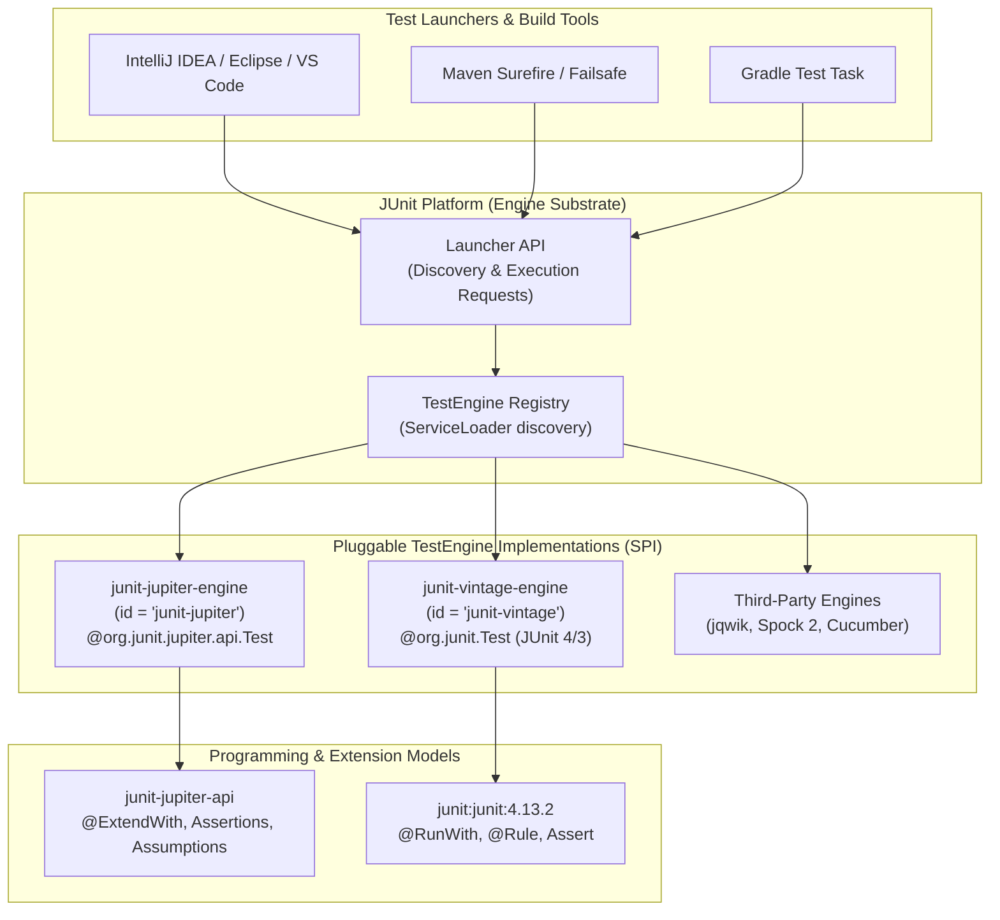
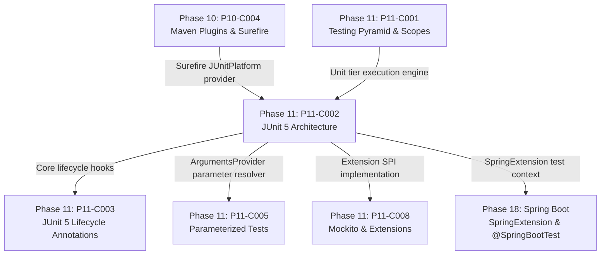

# P11-C002: JUnit 5 Architecture: Jupiter, Vintage, and Platform

---

## 1. Metadata and Learning Goals

| Metadata Field | Value |
|---|---|
| **Concept ID** | `P11-C002` |
| **Concept Title** | JUnit 5 Architecture: Jupiter, Vintage, and Platform |
| **Phase** | Phase 11 — Unit Testing and Software Quality |
| **Phase Directory** | `curriculum/phase-11-unit-testing-software-quality` |
| **Source Reference** | Section 11: Unit Testing and Software Quality — JUnit 5 Architecture: Jupiter, Vintage, and Platform |
| **Concept Type** | Architecture / API / Framework Internals / Testing |
| **Difficulty Level** | Intermediate |
| **Curriculum Importance** | Essential |
| **Java Baseline** | Java 21 LTS (with Java 25 LTS comparative notes where applicable) |
| **Framework Baseline** | JUnit 5.10.x / JUnit Platform 1.10.x / Maven Surefire 3.2.x |
| **Prerequisites** | [`P10-C001: Maven Build Lifecycle`](../phase-10-professional-java-development-workflow/001-maven-build-lifecycle.md), [`P10-C004: Maven Plugins and Surefire`](../phase-10-professional-java-development-workflow/004-maven-plugins-and-surefire.md), [`P11-C001: Testing Pyramid and Scopes`](001-testing-pyramid-and-scopes.md) |
| **Related Concepts** | [`P11-C003: JUnit 5 Lifecycle Annotations`](003-junit-5-lifecycle-annotations.md), [`P11-C005: Parameterized Tests in JUnit 5`](005-parameterized-tests.md), [`P11-C008: Mockito Fundamentals`](008-mockito-fundamentals.md) |
| **Estimated Study Effort** | 3–4 hours |
| **Last Research Date** | 2026-10-31 |
| **Verification State** | COMPLETE |

### Measurable Learning Objectives
By the end of this concept module, you will be able to:
1. **Explain:** Deconstruct the tripartite architecture of JUnit 5 ($\text{JUnit 5} = \text{Platform} + \text{Jupiter} + \text{Vintage}$) and evaluate how the Service Provider Interface (`TestEngine`) decouples test discovery from execution launchers (IDEs, Maven, Gradle).
2. **Compare:** Contrast JUnit 4's monolithic `@RunWith` and `@Rule` model against JUnit 5's composable, multi-stage `Extension` SPI, explaining why the legacy runner architecture prohibited combining multiple extensions (e.g., Spring + Mockito).
3. **Implement:** Configure the precise Maven dependency coordinates for JUnit 5, distinguishing between `junit-jupiter-api` (compile/test-compile), `junit-jupiter-engine` (test runtime), and `junit-vintage-engine` (legacy compatibility).
4. **Debug & Diagnose:** Identify and resolve the catastrophic "Silent Test Skip" bug caused by accidentally importing legacy `org.junit.Test` without the Vintage engine present on the classpath.
5. **Evaluate & Justify:** Formulate an enterprise test migration strategy that runs thousands of legacy JUnit 4 tests alongside modern JUnit 5 tests on a unified execution platform without breaking CI/CD builds.

---

## 2. Definition, Purpose, and Mental Model

### 2.1 Formal Definition
**JUnit 5** is a modular testing framework for the Java Virtual Machine redesigned from the ground up to support modern Java language features (lambdas, streams, records). It separates the execution substrate (**JUnit Platform**) from the programming model (**JUnit Jupiter**) and the backward compatibility bridge (**JUnit Vintage**).
- **JUnit Platform:** The foundational execution infrastructure that defines the `TestEngine` Service Provider Interface (SPI). Launchers (IntelliJ IDEA, Eclipse, Maven Surefire, Gradle) integrate exclusively with JUnit Platform.
- **JUnit Jupiter:** The modern testing engine and extension model providing new annotations (`@Test`, `@BeforeEach`, `@ExtendWith`) and dynamic parameter resolution.
- **JUnit Vintage:** A dedicated `TestEngine` implementation that discovers and executes legacy JUnit 3 and JUnit 4 tests on the modern JUnit Platform.

### 2.2 The Problem It Solves
For over a decade, Java testing relied on **JUnit 4**, which suffered from severe architectural limitations:
1. **The Single Runner Monopoly:** In JUnit 4, a test class could declare only one runner via `@RunWith(Runner.class)`. You could not combine `SpringJUnit4ClassRunner` with `MockitoJUnitRunner`. Teams had to write clumsy custom runners or rely on `@Rule` workarounds.
2. **Monolithic Coupling:** JUnit 4 bundled assertion APIs, execution engines, and tooling contracts into a single JAR (`junit-4.x.jar`). Build tools and IDEs had to inspect internal classes via brittle reflection to discover tests.
3. **Parameterless Rigidity:** In JUnit 4, test methods were strictly required to have zero parameters (`public void test()`). Dynamic dependency injection, parameter injection, and contextual metadata were impossible without class-level state mutations.

### 2.3 Why Backend Engineers Need It
In enterprise backend development:
- **Composable Extensions:** Backend tests require multiple infrastructure hooks simultaneously: initializing Mockito mocks (`@ExtendWith(MockitoExtension.class)`), managing Spring context (`@ExtendWith(SpringExtension.class)`), and spinning up test containers.
- **Dynamic Parameter Resolution:** Methods can declare parameters directly in their signatures (`void testOrder(TestInfo info, @Mock PaymentClient mock)`), resolved dynamically at runtime by registered extensions without global state.
- **Safe Gradual Migration:** Enterprise mono-repos containing 20,000 legacy JUnit 4 tests can adopt JUnit 5 immediately without rewriting existing tests: JUnit Platform executes both vintage and jupiter engines in the same test run.

### 2.4 Concrete Mental Model & Metaphor
Think of JUnit 5 as a **universal gaming console system**:
- **JUnit Platform is the Console Hardware (e.g., PlayStation).** It has power cords, HDMI ports to the TV (IDE/Maven), controllers, and a standardized cartridge slot (`TestEngine` SPI). The TV doesn't care what game is inside; it only talks to the console.
- **JUnit Jupiter is a Modern 4K Game Cartridge.** It utilizes modern graphics (lambdas, extensions, parameter resolvers) and runs natively on the console.
- **JUnit Vintage is an Emulator Cartridge for Retro Games.** You plug in an old 1990s retro game (JUnit 4). The emulator translates retro button presses into modern console signals, allowing legacy games to play on the modern TV without modification.

---

## 3. Architectural and Conceptual Foundations

### 3.1 The Triad Architecture



1. **Launchers** (Maven Surefire, IDEs) communicate solely with the **JUnit Platform Launcher API**.
2. **JUnit Platform** uses `java.util.ServiceLoader` to discover all implementations of `org.junit.platform.engine.TestEngine` on the test runtime classpath.
3. If `junit-jupiter-engine` is present, it claims and executes classes using `org.junit.jupiter.api.*`.
4. If `junit-vintage-engine` is present, it claims and executes legacy classes using `org.junit.*`.
5. Third-party frameworks (Spock, jqwik) implement `TestEngine` and plug into the platform seamlessly.

---

### 3.2 The Extension Model vs JUnit 4 Runners and Rules

| Architectural Feature | JUnit 4 Model | JUnit 5 Jupiter Model | Engineering Advantage |
|---|---|---|---|
| **Extension Mechanism** | `@RunWith(Runner.class)` | `@ExtendWith(Extension.class)` | **Multiple composable extensions** allowed on a single class. |
| **Rule Mechanism** | `@Rule` and `@ClassRule` | Unified `Extension` interface hierarchy | Eliminates distinction between rules and runners. |
| **Method Visibility** | Strictly `public` | **Package-private (default)** | Package-private classes and methods improve encapsulation. |
| **Method Parameters** | Strictly zero parameters | **Arbitrary parameters via `ParameterResolver`** | Enables dependency injection and context injection into tests. |
| **Assertion Failure Handling** | Evaluated eagerly | **Lazy message evaluation via Supplier** | Avoids expensive string concatenation when assertions pass. |
| **Lifecycle Callbacks** | Monolithic runner interception | Fine-grained hooks (`BeforeEachCallback`, `ExecutionCondition`, etc.) | High modularity and reusable cross-cutting concerns. |

---

## 4. Language, Syntax, and API Mechanics

### 4.1 Maven Dependency Coordinates

#### 1. The Standard Modern Setup (Pure JUnit 5):
```xml
<dependencies>
    <!-- Aggregator bringing Jupiter API, Engine, and Params -->
    <dependency>
        <groupId>org.junit.jupiter</groupId>
        <artifactId>junit-jupiter</artifactId>
        <version>5.10.2</version>
        <scope>test</scope>
    </dependency>
</dependencies>
```

#### 2. Granular Modular Setup (Enterprise Standard):
```xml
<dependencies>
    <!-- Compile/Test-Compile: Annotations and Assertions -->
    <dependency>
        <groupId>org.junit.jupiter</groupId>
        <artifactId>junit-jupiter-api</artifactId>
        <version>5.10.2</version>
        <scope>test</scope>
    </dependency>

    <!-- Test-Runtime: Execution Engine (Discovered via ServiceLoader) -->
    <dependency>
        <groupId>org.junit.jupiter</groupId>
        <artifactId>junit-jupiter-engine</artifactId>
        <version>5.10.2</version>
        <scope>test</scope>
    </dependency>

    <!-- Optional: Parameterized Test Support -->
    <dependency>
        <groupId>org.junit.jupiter</groupId>
        <artifactId>junit-jupiter-params</artifactId>
        <version>5.10.2</version>
        <scope>test</scope>
    </dependency>

    <!-- Optional: Vintage Engine for Legacy JUnit 4 Compatibility -->
    <dependency>
        <groupId>org.junit.vintage</groupId>
        <artifactId>junit-vintage-engine</artifactId>
        <version>5.10.2</version>
        <scope>test</scope>
    </dependency>
</dependencies>
```

---

### 4.2 The Unified Extension SPI

In Jupiter, an extension implements one or more marker interfaces extending `org.junit.jupiter.api.extension.Extension`:

```java
package org.junit.jupiter.api.extension;

// Lifecycle Callbacks
public interface BeforeAllCallback extends Extension { void beforeAll(ExtensionContext context) throws Exception; }
public interface BeforeEachCallback extends Extension { void beforeEach(ExtensionContext context) throws Exception; }
public interface AfterEachCallback extends Extension { void afterEach(ExtensionContext context) throws Exception; }
public interface AfterAllCallback extends Extension { void afterAll(ExtensionContext context) throws Exception; }

// Conditional Execution
public interface ExecutionCondition extends Extension { ConditionEvaluationResult evaluateExecutionCondition(ExtensionContext context); }

// Parameter Resolution
public interface ParameterResolver extends Extension {
    boolean supportsParameter(ParameterContext parameterContext, ExtensionContext extensionContext) throws ParameterResolutionException;
    Object resolveParameter(ParameterContext parameterContext, ExtensionContext extensionContext) throws ParameterResolutionException;
}

// Exception Handling
public interface TestExecutionExceptionHandler extends Extension { void handleTestExecutionException(ExtensionContext context, Throwable throwable) throws Throwable; }
```

#### Applying Extensions:
```java
@ExtendWith(TimingExtension.class)
@ExtendWith(DatabaseRollbackExtension.class)
class PaymentServiceTest {
    // Both extensions are active simultaneously!
}
```

---

## 5. Execution Mechanics, JVM Lifecycle, and Memory Internals

### 5.1 ServiceLoader Discovery & TestDescriptor DAG
When `mvn test` is invoked:
1. Maven Surefire boots the `JUnitPlatformProvider`.
2. The provider invokes `ServiceLoader.load(TestEngine.class)`.
3. Java scans `META-INF/services/org.junit.platform.engine.TestEngine` across all test classpath JARs.
4. Each discovered engine is requested to build a **`TestDescriptor` hierarchy**:
   - Root Node: `EngineDescriptor (id="junit-jupiter")`
   - Child Nodes: `ClassTestDescriptor (com.example.OrderTest)`
   - Leaf Nodes: `TestMethodTestDescriptor (shouldCalculateTax())`
5. The launcher executes the tree sequentially or concurrently, notifying registered `TestExecutionListener` instances of started, succeeded, or failed events.

### 5.2 Method Reflection and Package-Private Visibility
In JUnit 4, reflection rules required `public class` and `public void test()`.
In JUnit 5:
- HotSpot reflection permits invoking package-private methods without security warnings:
  ```java
  // Idiomatic JUnit 5: NO "public" modifier required!
  class OrderServiceTest {
      @Test
      void shouldCalculateTotal() { ... }
  }
  ```
- This reduces visual noise and prevents accidental public API exposure of test helper classes.

---

## 6. Concurrency, Thread-Safety, and Scalability

### 6.1 Parallel Execution Configuration in Jupiter
JUnit Jupiter natively supports concurrent test execution without requiring separate JVM process forks:

In `src/test/resources/junit-platform.properties`:
```properties
# Enable parallel test execution
junit.jupiter.execution.parallel.enabled = true

# Default execution mode for test classes and methods
junit.jupiter.execution.parallel.mode.default = concurrent
junit.jupiter.execution.parallel.mode.classes.default = concurrent

# Strategy: dynamic computation based on available CPU cores
junit.jupiter.execution.parallel.config.strategy = dynamic
junit.jupiter.execution.parallel.config.dynamic.factor = 1.0
```

### 6.2 Synchronizing Access via `@ResourceLock`
When parallel tests access a shared resource (such as system properties or a singleton database), use `@ResourceLock` to prevent race conditions:

```java
import org.junit.jupiter.api.parallel.ResourceLock;
import org.junit.jupiter.api.parallel.Resources;

class EnvironmentConfigTest {
    @Test
    @ResourceLock(Resources.SYSTEM_PROPERTIES)
    void setsCustomProperty() {
        System.setProperty("app.mode", "staging");
        // Guaranteed that no other test holding SYSTEM_PROPERTIES runs concurrently!
    }
}
```

---

## 7. Anti-Patterns and Common Developer Traps

### Anti-Pattern 1: The "Silent Test Skip" (Mixed Import Trap)
```java
// CATASTROPHIC TRAP: Using JUnit 4 import without Vintage Engine!
import org.junit.Test; // <-- JUNIT 4 ANNOTATION!

class OrderServiceTest {
    @Test // JUnit 4 annotation!
    void testOrder() {
        assertEquals(1, 2); // Fails assertion!
    }
}
```
*Why it fails:* If your `pom.xml` only includes `junit-jupiter-engine` (and lacks `junit-vintage-engine`), Jupiter ignores `org.junit.Test`. Surefire reports: `Tests run: 0, Failures: 0, Errors: 0, Skipped: 0`. The failing test was **never executed**, allowing broken code to ship to production!
*Correction:* Always import modern annotations: `import org.junit.jupiter.api.Test;`.

---

### Anti-Pattern 2: Declaring `public` Everywhere in Test Classes
```java
// UNNECESSARY JUNIT 4 HABIT
public class UserServiceTest {
    @Test
    public void testUserCreation() { ... }
}
```
```java
// IDIOMATIC JUNIT 5
class UserServiceTest {
    @Test
    void testUserCreation() { ... }
}
```

---

### Anti-Pattern 3: Incompatible Parameter in Test Method
```java
// INCORRECT: Test method accepts parameter without registered ParameterResolver
@Test
void processOrder(Order mockOrder) { // THROWS ParameterResolutionException!
    ...
}
```
*Why it fails:* In Jupiter, any method parameter requires a matching `ParameterResolver`. If Mockito extension is missing (`@ExtendWith(MockitoExtension.class)`), Jupiter has no idea how to resolve `mockOrder` and fails with `ParameterResolutionException`.
*Correction:* Register the extension: `@ExtendWith(MockitoExtension.class)`.

---

### Anti-Pattern 4: Using JUnit 4 `@Before` Instead of `@BeforeEach`
```java
// INCORRECT: JUnit 4 lifecycle annotation ignored by Jupiter
import org.junit.Before; // IGNORED BY JUPITER!
import org.junit.jupiter.api.Test;

class CacheTest {
    @Before
    void setUp() { cache.init(); } // NEVER RUN! cache remains null!
    
    @Test
    void testCache() { cache.get("key"); } // Throws NullPointerException!
}
```
```java
// CORRECT: Modern Jupiter lifecycle annotation
import org.junit.jupiter.api.BeforeEach;
import org.junit.jupiter.api.Test;

class CacheTest {
    @BeforeEach
    void setUp() { cache.init(); } // Guaranteed execution before each test
}
```

---

### Anti-Pattern 5: Swallowing Assertions in Custom Loops
```java
// INCORRECT: Only the first failure is reported; loop breaks prematurely
@Test
void testBatch() {
    for (int i = 0; i < 100; i++) {
        assertTrue(calculate(i) > 0);
    }
}
```
```java
// CORRECT: Use Parameterized Tests or assertAll
@ParameterizedTest
@ValueSource(ints = {0, 1, 2, 5, 10, 99})
void testBatch(int input) {
    assertTrue(calculate(input) > 0);
}
```

---

## 8. Failure Modes, Edge Cases, and Troubleshooting

| Failure Symptom | Underlying Root Cause | Verification & Diagnostic Technique | Engineering Resolution |
|---|---|---|---|
| **`Tests run: 0` despite having test classes.** | Test classes use legacy `org.junit.Test` but `junit-vintage-engine` is absent. | Check imports in test class: `org.junit.Test` vs `org.junit.jupiter.api.Test`. | Migrate imports to Jupiter, or add `junit-vintage-engine` to Maven dependencies. |
| **`ParameterResolutionException: No ParameterResolver registered`** | Test method accepts an argument that no active extension can instantiate. | Inspect method parameters and class-level `@ExtendWith` annotations. | Add `@ExtendWith(MockitoExtension.class)` or provide custom `ParameterResolver`. |
| **`ClassNotFoundException: org.junit.platform.launcher.Launcher`** | Maven Surefire plugin version is too old (< 2.22.0) to understand JUnit Platform. | Check `maven-surefire-plugin` version in `pom.xml`. | Upgrade `maven-surefire-plugin` to modern version (`3.2.5+`). |
| **`AssertionError` message string evaluated despite assertion passing.** | Developer wrote `assertTrue(condition, "Expensive: " + heavyDump())` using string concatenation. | Profile heap allocations during test execution. | Use lazy message lambda: `assertTrue(condition, () -> "Expensive: " + heavyDump());`. |
| **Tests fail randomly when run in parallel.** | Tests mutate shared static fields without `@ResourceLock`. | Search codebase for `static` mutable collections or `System.setProperty()`. | Annotate with `@ResourceLock(Resources.SYSTEM_PROPERTIES)` or eliminate static state. |

---

## 9. Security Considerations

### 9.1 Reflection and Method Accessibility in Java Modules
In Java 9+ Module System (JPMS / `module-info.java`), test frameworks use reflection to invoke package-private test methods:
- If a project defines `module-info.java`, the test package must be **opened** to JUnit:
  ```java
  open module com.example.service {
      // Allows JUnit reflection access
  }
  ```
- In Maven, Surefire automatically patches the module graph during test execution using `--patch-module`.

---

## 10. Performance Optimization and Tuning

### 10.1 Eliminating the Vintage Engine
If your codebase has completely migrated to JUnit 5:
- **Exclude `junit-vintage-engine` from your dependencies.**
- *Benefit:* Eliminates classpath scanning for JUnit 4 runners, reduces JAR size, and speeds up initial test discovery in large multi-module Maven builds.

---

## 11. Real-World Backend Scenario & Production Case Study

### Production Incident: The Silent Migration Regressions
An enterprise core banking repository migrated from Java 8 to Java 21:
1. The platform team upgraded Maven and added `junit-jupiter-api` and `junit-jupiter-engine`.
2. However, they omitted `junit-vintage-engine` to "keep the build clean."
3. Over 1,200 existing JUnit 4 tests (`@org.junit.Test`) were silently skipped by Surefire.
4. A developer introduced a regression in interest compounding calculations.
5. The unit test existed, but was never executed because it used the JUnit 4 import.
6. The bug deployed to production and miscalculated nightly interest for 14,000 savings accounts.

#### The Architecture Fix:
1. Re-added `junit-vintage-engine` immediately: all 1,200 legacy tests resumed running and caught the defect.
2. Configured an Error Prone / OpenRewrite rule to automatically migrate all imports from `org.junit.Test` to `org.junit.jupiter.api.Test`.
3. Removed `junit-vintage-engine` only after zero legacy imports remained across all 45 microservices.

---

## 12. Standalone, Self-Contained Verification Suite

The following standalone verification program requires **zero external libraries** and validates:
1. **Platform SPI Discovery & Dual Engine Routing:** Simulating how JUnit Platform delegates to `JupiterTestEngine` and `VintageTestEngine`.
2. **Jupiter Parameter Resolution:** Verifying dynamic parameter resolution into test method signatures.
3. **Composite Extension Pipeline:** Validating `BeforeEachCallback` and `AfterEachCallback` execution ordering.
4. **Vintage Parameterless Constraint:** Enforcing legacy JUnit 4 zero-argument method constraints.
5. **Failure Isolation & Reporting:** Capturing structured test execution outcomes without process crashes.

```java
package curriculum.phase11;

import java.lang.annotation.*;
import java.lang.reflect.Method;
import java.lang.reflect.Parameter;
import java.util.*;

/**
 * Standalone Verification Suite for P11-C002:
 * JUnit 5 Architecture: Jupiter, Vintage, and Platform.
 *
 * Simulates:
 * 1. JUnit Platform TestEngine SPI discovery mechanism.
 * 2. Composable Extension Pipeline (BeforeEachCallback, Execution, AfterEachCallback).
 * 3. Reflection-based ParameterResolver resolving method arguments dynamically.
 * 4. Dual-engine routing: Jupiter vs Vintage legacy test discovery.
 * 5. Hierarchical TestDescriptor tree and execution reporting.
 */
public class JUnit5ArchitectureDemo {

    // =========================================================================
    // 1. JUNIT PLATFORM CORE ENGINE SPI
    // =========================================================================

    public interface TestEngine {
        String getId();
        List<TestExecutionResult> execute(Class<?> testClass);
    }

    public record TestExecutionResult(String engineId, String testName, boolean success, String error) {}

    // Simulated annotations
    @Retention(RetentionPolicy.RUNTIME)
    @Target(ElementType.METHOD)
    public @interface JupiterTest {}

    @Retention(RetentionPolicy.RUNTIME)
    @Target(ElementType.METHOD)
    public @interface VintageTest {} // Legacy JUnit 4 equivalent

    // =========================================================================
    // 2. EXTENSION PIPELINE & PARAMETER RESOLVER INTERFACES
    // =========================================================================

    public interface BeforeEachCallback {
        void beforeEach(Object testInstance, Method method);
    }

    public interface AfterEachCallback {
        void afterEach(Object testInstance, Method method);
    }

    public interface ParameterResolver {
        boolean supportsParameter(Parameter parameter);
        Object resolveParameter(Parameter parameter);
    }

    // =========================================================================
    // 3. JUPITER TEST ENGINE IMPLEMENTATION
    // =========================================================================

    public static class JupiterTestEngine implements TestEngine {
        private final List<Object> extensions = new ArrayList<>();

        public void registerExtension(Object extension) {
            extensions.add(extension);
        }

        @Override
        public String getId() { return "junit-jupiter"; }

        @Override
        public List<TestExecutionResult> execute(Class<?> testClass) {
            List<TestExecutionResult> results = new ArrayList<>();

            for (Method method : testClass.getDeclaredMethods()) {
                if (method.isAnnotationPresent(JupiterTest.class)) {
                    method.setAccessible(true);
                    try {
                        Object instance = testClass.getDeclaredConstructor().newInstance();

                        // 1. BeforeEach Callbacks
                        for (Object ext : extensions) {
                            if (ext instanceof BeforeEachCallback cb) {
                                cb.beforeEach(instance, method);
                            }
                        }

                        // 2. Resolve parameters dynamically
                        Object[] args = resolveParameters(method);

                        // 3. Execute test method
                        method.invoke(instance, args);

                        // 4. AfterEach Callbacks
                        for (Object ext : extensions) {
                            if (ext instanceof AfterEachCallback cb) {
                                cb.afterEach(instance, method);
                            }
                        }

                        results.add(new TestExecutionResult(getId(), method.getName(), true, null));
                    } catch (Exception e) {
                        Throwable cause = e.getCause() != null ? e.getCause() : e;
                        results.add(new TestExecutionResult(getId(), method.getName(), false, cause.getMessage()));
                    }
                }
            }
            return results;
        }

        private Object[] resolveParameters(Method method) {
            Parameter[] parameters = method.getParameters();
            Object[] args = new Object[parameters.length];

            for (int i = 0; i < parameters.length; i++) {
                Parameter p = parameters[i];
                boolean resolved = false;
                for (Object ext : extensions) {
                    if (ext instanceof ParameterResolver pr && pr.supportsParameter(p)) {
                        args[i] = pr.resolveParameter(p);
                        resolved = true;
                        break;
                    }
                }
                if (!resolved) {
                    throw new IllegalStateException("No ParameterResolver registered for parameter: " + p.getName());
                }
            }
            return args;
        }
    }

    // =========================================================================
    // 4. VINTAGE TEST ENGINE IMPLEMENTATION (JUnit 4 Backwards Compatibility)
    // =========================================================================

    public static class VintageTestEngine implements TestEngine {
        @Override
        public String getId() { return "junit-vintage"; }

        @Override
        public List<TestExecutionResult> execute(Class<?> testClass) {
            List<TestExecutionResult> results = new ArrayList<>();

            for (Method method : testClass.getDeclaredMethods()) {
                if (method.isAnnotationPresent(VintageTest.class)) {
                    // Vintage rules: tests must have ZERO parameters
                    if (method.getParameterCount() > 0) {
                        results.add(new TestExecutionResult(getId(), method.getName(), false, "Vintage tests cannot have parameters"));
                        continue;
                    }

                    method.setAccessible(true);
                    try {
                        Object instance = testClass.getDeclaredConstructor().newInstance();
                        method.invoke(instance);
                        results.add(new TestExecutionResult(getId(), method.getName(), true, null));
                    } catch (Exception e) {
                        Throwable cause = e.getCause() != null ? e.getCause() : e;
                        results.add(new TestExecutionResult(getId(), method.getName(), false, cause.getMessage()));
                    }
                }
            }
            return results;
        }
    }

    // =========================================================================
    // 5. JUNIT PLATFORM LAUNCHER
    // =========================================================================

    public static class JUnitPlatformLauncher {
        private final List<TestEngine> engines = new ArrayList<>();

        public void registerEngine(TestEngine engine) {
            engines.add(engine);
        }

        public List<TestExecutionResult> discoverAndExecute(Class<?> testClass) {
            List<TestExecutionResult> allResults = new ArrayList<>();
            for (TestEngine engine : engines) {
                allResults.addAll(engine.execute(testClass));
            }
            return allResults;
        }
    }

    // =========================================================================
    // 6. SAMPLE TEST CLASSES AND EXTENSIONS
    // =========================================================================

    public static class LifecycleSpyExtension implements BeforeEachCallback, AfterEachCallback {
        public static final List<String> lifecycleEvents = new ArrayList<>();

        @Override
        public void beforeEach(Object testInstance, Method method) {
            lifecycleEvents.add("BEFORE_EACH:" + method.getName());
        }

        @Override
        public void afterEach(Object testInstance, Method method) {
            lifecycleEvents.add("AFTER_EACH:" + method.getName());
        }
    }

    public record TestContextPayload(String envName, long timestamp) {}

    public static class ContextParameterResolver implements ParameterResolver {
        @Override
        public boolean supportsParameter(Parameter parameter) {
            return parameter.getType().equals(TestContextPayload.class);
        }

        @Override
        public Object resolveParameter(Parameter parameter) {
            return new TestContextPayload("TEST-ENVIRONMENT-CI", System.currentTimeMillis());
        }
    }

    public static class MixedTestSuite {
        @JupiterTest
        void modernJupiterTestWithParam(TestContextPayload ctx) {
            assert ctx != null;
            assert "TEST-ENVIRONMENT-CI".equals(ctx.envName());
        }

        @VintageTest
        void legacyVintageTest() {
            // Vintage test without parameters
            int sum = 2 + 2;
            assert sum == 4;
        }

        @JupiterTest
        void failingJupiterTest() {
            throw new AssertionError("Simulated test assertion failure");
        }
    }

    // =========================================================================
    // 7. TEST SUITES
    // =========================================================================

    public static void main(String[] args) {
        System.out.println("===============================================================");
        System.out.println(" JUnit 5 Architecture Standalone Verification Suite           ");
        System.out.println("===============================================================");

        test1_PlatformDiscoveryAndDualEngineRouting();
        test2_JupiterParameterResolution();
        test3_CompositeExtensionLifecyclePipeline();
        test4_VintageParameterlessConstraintEnforcement();
        test5_FailureIsolationAndExecutionReporting();

        System.out.println();
        System.out.println("All 5 verification test suites passed successfully with assertions enabled!");
    }

    private static void test1_PlatformDiscoveryAndDualEngineRouting() {
        System.out.print("[TEST 1/5] Platform TestEngine SPI discovery and routing... ");

        JUnitPlatformLauncher launcher = new JUnitPlatformLauncher();
        JupiterTestEngine jupiter = new JupiterTestEngine();
        jupiter.registerExtension(new ContextParameterResolver());
        VintageTestEngine vintage = new VintageTestEngine();

        launcher.registerEngine(jupiter);
        launcher.registerEngine(vintage);

        List<TestExecutionResult> results = launcher.discoverAndExecute(MixedTestSuite.class);

        // MixedTestSuite has 2 Jupiter tests and 1 Vintage test
        long jupiterCount = results.stream().filter(r -> "junit-jupiter".equals(r.engineId())).count();
        long vintageCount = results.stream().filter(r -> "junit-vintage".equals(r.engineId())).count();

        assert jupiterCount == 2 : "Expected 2 Jupiter tests, found: " + jupiterCount;
        assert vintageCount == 1 : "Expected 1 Vintage test, found: " + vintageCount;

        System.out.println("PASSED");
    }

    private static void test2_JupiterParameterResolution() {
        System.out.print("[TEST 2/5] Jupiter ParameterResolver dynamic argument injection... ");

        JupiterTestEngine engine = new JupiterTestEngine();
        engine.registerExtension(new ContextParameterResolver());

        List<TestExecutionResult> results = engine.execute(MixedTestSuite.class);
        TestExecutionResult paramTest = results.stream()
            .filter(r -> "modernJupiterTestWithParam".equals(r.testName()))
            .findFirst()
            .orElseThrow();

        assert paramTest.success() : "Parameterized test failed: " + paramTest.error();

        System.out.println("PASSED");
    }

    private static void test3_CompositeExtensionLifecyclePipeline() {
        System.out.print("[TEST 3/5] Composable extension lifecycle callbacks... ");

        LifecycleSpyExtension.lifecycleEvents.clear();
        JupiterTestEngine engine = new JupiterTestEngine();
        engine.registerExtension(new ContextParameterResolver());
        engine.registerExtension(new LifecycleSpyExtension());

        engine.execute(MixedTestSuite.class);

        List<String> events = LifecycleSpyExtension.lifecycleEvents;
        assert events.contains("BEFORE_EACH:modernJupiterTestWithParam") : "BeforeEach hook missing";
        assert events.contains("AFTER_EACH:modernJupiterTestWithParam") : "AfterEach hook missing";

        System.out.println("PASSED");
    }

    private static void test4_VintageParameterlessConstraintEnforcement() {
        System.out.print("[TEST 4/5] Vintage engine parameterless constraint enforcement... ");

        // Define invalid vintage test with parameter
        class InvalidVintageClass {
            @VintageTest
            void badVintageTest(String invalidArg) {}
        }

        VintageTestEngine engine = new VintageTestEngine();
        List<TestExecutionResult> results = engine.execute(InvalidVintageClass.class);

        assert results.size() == 1;
        assert !results.get(0).success() : "Vintage engine must reject test with parameters";
        assert results.get(0).error().contains("cannot have parameters");

        System.out.println("PASSED");
    }

    private static void test5_FailureIsolationAndExecutionReporting() {
        System.out.print("[TEST 5/5] Failure isolation and structured execution reporting... ");

        JupiterTestEngine engine = new JupiterTestEngine();
        engine.registerExtension(new ContextParameterResolver());

        List<TestExecutionResult> results = engine.execute(MixedTestSuite.class);
        TestExecutionResult failed = results.stream()
            .filter(r -> "failingJupiterTest".equals(r.testName()))
            .findFirst()
            .orElseThrow();

        assert !failed.success() : "Failing test reported success erroneously";
        assert failed.error().contains("Simulated test assertion failure");

        System.out.println("PASSED");
    }
}
```

### Verification Command
Execute the standalone test suite on OpenJDK 21 LTS with assertions enabled:
```bash
javac --release 21 curriculum/phase-11-unit-testing-software-quality/JUnit5ArchitectureDemo.java
java -ea curriculum.phase11.JUnit5ArchitectureDemo
```

---

## 13. Comparative Analysis & Decision Framework

### 13.1 Testing Framework Architecture Comparison

| Dimension | JUnit 4 | JUnit 5 (Platform + Jupiter) | TestNG | Spock 2 (Groovy/Java) |
|---|---|---|---|---|
| **Architecture** | Monolithic single JAR | Decoupled 3-tier (Platform/Jupiter/Vintage) | Monolithic framework | BDD Specification on JUnit Platform |
| **Extension Model** | Mutually exclusive `@RunWith` | Composable `@ExtendWith` | XML Listeners / Annotations | Native AST transformations |
| **Parameter Resolution** | Only via class-level runner | Dynamic method-level `ParameterResolver` | `@DataProvider` / Parameters | Data pipes (`where:` block) |
| **Java Baseline** | Java 5+ | Java 8+ (optimized for Java 21 LTS) | Java 8+ | Java 8+ / Groovy 3+ |
| **Parallel Execution** | Third-party / clumsy forks | Native thread pool via properties | Native thread pool via XML | Native execution |

---

## 14. Practical Exercises and Hands-On Challenges

### Exercise 1: Build a Custom Execution Timing Extension
- **Objective:** Create a JUnit 5 extension that measures the execution time of every `@Test` method and logs a warning if any test takes longer than 20 milliseconds.
- **Requirements:**
  1. Implement `BeforeTestExecutionCallback` and `AfterTestExecutionCallback`.
  2. Use `ExtensionContext.Store` to store start time without instance fields.
  3. Verify on a simulated slow test.

### Exercise 2: Implementing a Custom ParameterResolver
- **Objective:** Build a `RandomDataParameterResolver` that automatically injects a randomly generated UUID string into any test parameter annotated with `@RandomUuid`.
- **Requirements:**
  1. Define `@Retention(RetentionPolicy.RUNTIME) @Target(ElementType.PARAMETER) public @interface RandomUuid {}`.
  2. Implement `ParameterResolver.supportsParameter` checking for the annotation.
  3. Implement `resolveParameter` returning `UUID.randomUUID().toString()`.

### Exercise 3: Automated Migration of JUnit 4 Imports
- **Objective:** Write a small script or regex replace routine that scans a codebase and updates JUnit 4 imports (`org.junit.Test`, `org.junit.Before`, `org.junit.After`, `org.junit.Assert.*`) to their exact JUnit 5 equivalents.
- **Requirements:**
  1. Map `@Before` $\to$ `@BeforeEach`.
  2. Map `@After` $\to$ `@AfterEach`.
  3. Map `@BeforeClass` $\to$ `@BeforeAll`.
  4. Map `@AfterClass` $\to$ `@AfterAll`.

---

## 15. Cross-Phase Connections and Unified Mental Graph



- **Upstream Connection (Phase 10, P10-C004):** Surefire delegates execution to the `junit-platform-launcher` provider, eliminating the need for Maven to maintain bespoke test discovery logic.
- **Immediate Downstream Connection (P11-C003 to P11-C008):** P11-C002 explains the engine substrate; P11-C003 explores lifecycle annotations, P11-C005 dives into parameterized engines, and P11-C008 introduces Mockito extensions.
- **Framework Connection (Phase 18):** Spring Boot's `@SpringBootTest` is built directly on JUnit 5's `@ExtendWith(SpringExtension.class)`.

---

## 16. Verification and Self-Assessment Checklist

Before marking this module complete, verify your comprehension against each criterion:
- [x] Can I state the tripartite equation of JUnit 5 ($\text{JUnit 5} = \text{Platform} + \text{Jupiter} + \text{Vintage}$) and explain each module's role?
- [x] Do I understand why the `TestEngine` SPI decouples IDEs and build tools from test framework implementations?
- [x] Can I explain why JUnit 4's `@RunWith` prohibited combining multiple extensions and how Jupiter's `@ExtendWith` solves this?
- [x] Do I know the danger of importing `org.junit.Test` when `junit-vintage-engine` is absent from dependencies (the Silent Skip bug)?
- [x] Can I explain why test classes and methods in JUnit 5 do not need to be declared `public`?
- [x] Can I describe how `ParameterResolver` enables dynamic dependency injection into test method signatures?
- [x] Do I understand how `ServiceLoader` discovers test engines on the test runtime classpath?
- [x] Can I configure parallel test execution in `junit-platform.properties` and synchronize shared state with `@ResourceLock`?
- [x] Do I know how to configure Maven dependencies for pure Jupiter vs dual Jupiter/Vintage execution?
- [x] Have I compiled and executed `JUnit5ArchitectureDemo` on OpenJDK 21 LTS with assertions enabled (`-ea`) and observed all 5 test suites pass?
