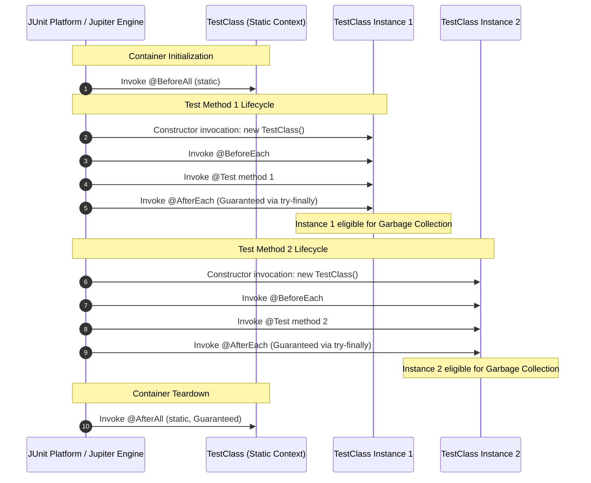
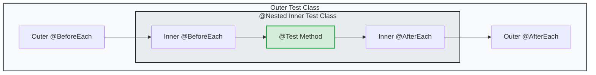
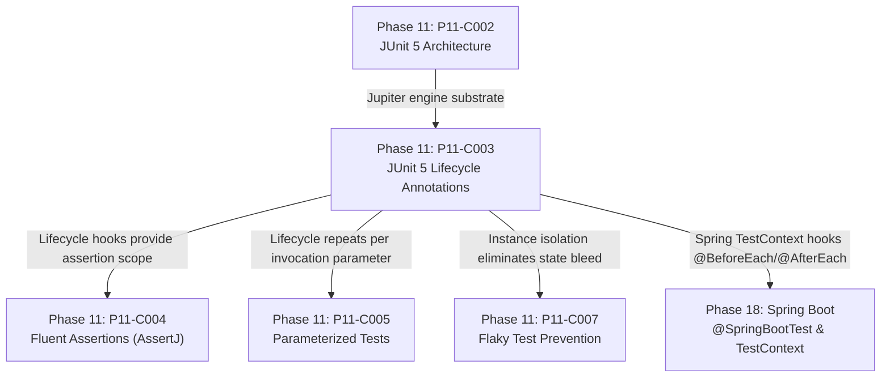

# JUnit 5 Lifecycle: @Test, @BeforeEach, @AfterEach, @BeforeAll, @AfterAll

---

## 1. Metadata and Learning Goals

- **Concept ID:** `P11-C003`
- **Concept Title:** JUnit 5 Lifecycle: `@Test`, `@BeforeEach`, `@AfterEach`, `@BeforeAll`, `@AfterAll`
- **Phase:** Phase 11: Unit Testing and Software Quality
- **Dependencies:** `P11-C002` (JUnit 5 Architecture: Jupiter, Vintage, and Platform)
- **Target Audience:** Senior Java Backend Engineers, Distributed Systems Developers, QA Engineers
- **Prerequisites:** OpenJDK 21 LTS, JUnit 5 Architecture understanding, Core Java reflection and lifecycle mechanics.

### Primary Learning Objectives
1. **Master Test Instance Lifecycles:** Understand why JUnit 5 defaults to `Lifecycle.PER_METHOD` (a new test instance per `@Test` method) and how to configure `Lifecycle.PER_CLASS` for shared state or container workflows.
2. **Execute Lifecycle Hooks Accurately:** Master the chronological execution order of `@BeforeAll`, `@BeforeEach`, `@Test`, `@AfterEach`, and `@AfterAll`, including why `@BeforeAll`/`@AfterAll` require `static` declarations under `PER_METHOD`.
3. **Comprehend Hierarchical `@Nested` Contexts:** Understand onion-skin wrapping in nested inner test classes (outer-before -> inner-before -> test -> inner-after -> outer-after) and its applications in Behavior-Driven Development (BDD).
4. **Implement Deterministic Execution & Timeouts:** Configure method ordering with `@TestMethodOrder` (`OrderAnnotation`, `Random`) and hard execution time budgets using `@Timeout`.
5. **Enforce Guaranteed Teardown Invariants:** Understand how JUnit Jupiter uses structured try-finally semantics to guarantee that `@AfterEach` executes even when `@Test` methods throw uncaught exceptions.

---

## 2. Definition, Purpose, and Mental Model

### Definition and Problem Statement
In automated test execution, the fundamental challenge is achieving **reproducible, isolated, and deterministic** test runs. When automated suites execute hundreds or thousands of test cases, any lingering state—such as modified in-memory caches, open file descriptors, dangling database transactions, or mutated singleton objects—corrupts downstream assertions. This phenomenon produces the **flaky test**: a test that fails unpredictably depending on test suite execution order, thread concurrency, or JVM garbage collection timings.

To solve this, testing frameworks implement an **execution lifecycle engine**. JUnit 5 introduces a redesigned, highly structured lifecycle model that manages the creation, preparation, execution, and teardown of test instances.

### Mental Model: The Russian Nesting Doll (Onion-Skin Model)
Think of JUnit 5 test execution as an onion or Russian nesting doll:
- The outer layer is the **Container Lifecycle** (`@BeforeAll` and `@AfterAll`), which runs once per class or suite.
- The middle layer is the **Instance Lifecycle** (`@BeforeEach` and `@AfterEach`), which wraps every individual test.
- The innermost core is the **Executable Target** (`@Test` method).
- When hierarchical `@Nested` inner classes are used, each nesting level adds a concentric skin: outer setup runs before inner setup, but inner teardown unwinds before outer teardown.

```
+---------------------------------------------------------------------------------+
| Container Level: @BeforeAll                                                     |
|   +-------------------------------------------------------------------------+   |
|   | Outer Instance Level: Outer @BeforeEach                                 |   |
|   |   +-----------------------------------------------------------------+   |   |
|   |   | Nested Context Level: Inner @BeforeEach                         |   |   |
|   |   |   +---------------------------------------------------------+   |   |   |
|   |   |   | Target: @Test Method Execution                          |   |   |   |
|   |   |   +---------------------------------------------------------+   |   |   |
|   |   | Nested Teardown: Inner @AfterEach                               |   |   |
|   |   +-----------------------------------------------------------------+   |   |
|   | Outer Teardown: Outer @AfterEach                                        |   |
|   +-------------------------------------------------------------------------+   |
| Container Teardown: @AfterAll                                                   |
+---------------------------------------------------------------------------------+
```

---

## 3. Architectural and Conceptual Foundations

### 3.1 The Two Test Instance Lifecycles: `PER_METHOD` vs `PER_CLASS`

In JUnit 5, test instance instantiation is controlled by the `@TestInstance` annotation, which accepts the `TestInstance.Lifecycle` enum:

```
               +-------------------------------------------------------+
               |                  Test Execution Mode                  |
               +---------------------------+---------------------------+
                                           |
                   +-----------------------+-----------------------+
                   |                                               |
                   v                                               v
     +---------------------------+                   +---------------------------+
     | Lifecycle.PER_METHOD      |                   | Lifecycle.PER_CLASS       |
     | (Default)                 |                   | (Configurable)            |
     +---------------------------+                   +---------------------------+
     | * New instance per @Test  |                   | * Single instance shared  |
     | * Instance state reset    |                   | * Instance state persists |
     | * @BeforeAll must be      |                   | * @BeforeAll can be       |
     |   STATIC                  |                   |   NON-STATIC              |
     | * Maximum test isolation  |                   | * Stateful workflows /    |
     | * Higher GC allocation    |                   |   Heavy setup efficiency  |
     +---------------------------+                   +---------------------------+
```

#### Default: `Lifecycle.PER_METHOD`
By default, JUnit 5 constructs a **brand new instance of the test class for each test method execution**. If a class contains three `@Test` methods, JUnit instantiates the test class three separate times:
```
Instantiate TestClass (Instance 1) -> @BeforeEach -> testMethodA() -> @AfterEach -> Discard Instance 1
Instantiate TestClass (Instance 2) -> @BeforeEach -> testMethodB() -> @AfterEach -> Discard Instance 2
Instantiate TestClass (Instance 3) -> @BeforeEach -> testMethodC() -> @AfterEach -> Discard Instance 3
```

**Architectural Rationale:**
Because every test method runs on a pristine instance, instance fields modified by `testMethodA()` are completely invisible to `testMethodB()`. This prevents accidental cross-test state leakage.
However, because no test instance exists before all tests begin (or after all tests end), `@BeforeAll` and `@AfterAll` methods **must be declared `static`**. The JVM invokes them on the `Class` object itself prior to any constructor invocation.

#### Configured: `Lifecycle.PER_CLASS`
When annotated with `@TestInstance(Lifecycle.PER_CLASS)`:
```java
@TestInstance(TestInstance.Lifecycle.PER_CLASS)
class OrderServiceIntegrationTest {
    private DatabaseConnection conn;

    @BeforeAll
    void initializeDatabase() { // Non-static!
        this.conn = DatabaseConnection.connect();
    }

    @AfterAll
    void closeDatabase() { // Non-static!
        this.conn.close();
    }
}
```
JUnit instantiates `OrderServiceIntegrationTest` **exactly once** for the entire lifecycle of the test container. All test methods execute on that same single instance.

**Key Implications of `PER_CLASS`:**
1. `@BeforeAll` and `@AfterAll` methods do **not** need to be `static`; they can be standard instance methods and access instance fields (`this`).
2. Instance variables persist across test methods. If `testMethodA()` mutates a collection field `items.add("x")`, `testMethodB()` will observe `"x"` in that collection unless explicitly cleaned up in `@BeforeEach` or `@AfterEach`.
3. `@Nested` inner test classes can declare `@BeforeAll` and `@AfterAll` methods directly without requiring static methods.

---

### 3.2 Complete Lifecycle Execution Sequence

The following sequence diagram illustrates the exact chronological execution order of lifecycle hooks in a test class containing two `@Test` methods under `Lifecycle.PER_METHOD`:



---

## 4. Language, Syntax, and API Mechanics

### 4.1 Summary of Lifecycle Annotations

| Annotation | Target | Frequency | Static Requirement (`PER_METHOD`) | Static Requirement (`PER_CLASS`) |
|---|---|---|---|---|
| `@Test` | Method | Once per test execution | No | No |
| `@BeforeEach` | Method | Before each `@Test` method | No | No |
| `@AfterEach` | Method | After each `@Test` method | No | No |
| `@BeforeAll` | Method | Once before all tests in class | **Yes (must be static)** | No (can be non-static) |
| `@AfterAll` | Method | Once after all tests in class | **Yes (must be static)** | No (can be non-static) |
| `@Nested` | Class | Instantiated per outer instance | N/A (inner class) | N/A (inner class) |
| `@TestInstance` | Class | Class-level configuration | N/A | N/A |
| `@TestMethodOrder` | Class | Class-level method sorting | N/A | N/A |
| `@Order` | Method | Method sequencing priority | N/A | N/A |
| `@DisplayName` | Method/Class | Human-readable reporting | N/A | N/A |
| `@Disabled` | Method/Class | Conditional skipping | N/A | N/A |
| `@Timeout` | Method/Class | Time budget threshold | N/A | N/A |

### 4.2 Onion-Skin Wrapping with `@Nested` Hierarchies

An inner class annotated with `@Nested` represents a contextual subgroup of tests (e.g., "when user is unauthenticated", "when shopping cart is empty").
In a nested hierarchy, setup methods run from **outermost to innermost**, while teardown methods run from **innermost to outermost**:



1. Outermost `@BeforeAll`
2. Inner `@BeforeAll` (if `PER_CLASS`)
3. Outermost `@BeforeEach`
4. Inner `@BeforeEach`
5. Inner `@Test` method
6. Inner `@AfterEach`
7. Outermost `@AfterEach`
8. Inner `@AfterAll` (if `PER_CLASS`)
9. Outermost `@AfterAll`

---

## 5. Execution Mechanics, JVM Lifecycle, and Memory Internals

### 5.1 Object Allocation and Garbage Collection
Under `PER_METHOD`, if a test allocates large objects (e.g., 50MB byte arrays or in-memory tables) and assigns them to instance fields:
- Those fields become eligible for Garbage Collection as soon as the test method and its `@AfterEach` complete.
- The test class instance is dereferenced by the engine runner.
Under `PER_CLASS`, however:
- Those fields remain referenced by the single test class instance until the **entire container** completes its `@AfterAll`.
- Failing to null out large buffers in `@AfterEach` under `PER_CLASS` retains heap space throughout the duration of the entire test class, inducing `OutOfMemoryError` on large suites.

### 5.2 Try-Finally Unwinding Guarantees
Jupiter's internal `HierarchicalTestExecutor` executes test leaf nodes using a structured unwinding model:
```java
// Conceptual representation of Jupiter's internal execution loop
Throwable testThrowable = null;
try {
    invokeBeforeEachCallbacks();
    invokeBeforeEachMethods();
    try {
        invokeTestMethod();
    } catch (Throwable t) {
        testThrowable = t;
    }
} finally {
    // Guaranteed execution of @AfterEach even if setup or test threw!
    invokeAfterEachMethods(testThrowable);
    invokeAfterEachCallbacks(testThrowable);
}
```
If an exception is thrown in `@Test`, `@AfterEach` is still invoked. If `@AfterEach` also throws an exception, JUnit 5 suppresses the secondary exception via `Throwable.addSuppressed()` and propagates the composite failure to the test execution listener.

---

## 6. Concurrency, Thread-Safety, and Scalability

### 6.1 Parallel Test Execution Mechanics
When test execution parallelism is enabled in `junit-platform.properties`:
```properties
junit.jupiter.execution.parallel.enabled = true
junit.jupiter.execution.parallel.mode.default = concurrent
```
- **With `PER_METHOD` (Default):** Test methods can run concurrently across different threads safely because each thread operates on an independent instance of the test class. No shared mutable instance state exists.
- **With `PER_CLASS`:** Test methods running concurrently share the same instance fields! This leads to severe race conditions unless methods are synchronized or isolated with `@Execution(ExecutionMode.SAME_THREAD)` or guarded by `@ResourceLock`.

### 6.2 Synchronizing Shared Resources with `@ResourceLock`
When tests share global resources (e.g., system properties, databases, static caches):
```java
@Test
@ResourceLock(value = "SYSTEM_PROPERTIES", mode = ResourceAccessMode.READ_WRITE)
void setPropertyTest() {
    System.setProperty("app.mode", "TEST");
    assertEquals("TEST", System.getProperty("app.mode"));
}

@Test
@ResourceLock(value = "SYSTEM_PROPERTIES", mode = ResourceAccessMode.READ)
void readPropertyTest() {
    assertNotNull(System.getProperty("java.version"));
}
```

---

## 7. Anti-Patterns and Common Developer Traps

### 7.1 Anti-Pattern 1: The "Order-Dependent Shared State" Trap
```java
// CRITICAL DEFECT: Tests pass only when run in sequence!
@TestInstance(TestInstance.Lifecycle.PER_CLASS)
class ShoppingCartTest {
    private final List<String> cart = new ArrayList<>();

    @Test
    void test1_addItem() {
        cart.add("Laptop");
        assertEquals(1, cart.size());
    }

    @Test
    void test2_checkoutRequiresItems() {
        // ASSUMPTION: test1 already ran!
        // If run in isolation, cart is empty and this test fails!
        assertFalse(cart.isEmpty());
    }
}
```
**Consequences:** Running `test2_checkoutRequiresItems()` individually in an IDE fails. Running the suite in parallel fails unpredictably.
**Remediation:** Always make tests self-contained. If state is shared via `PER_CLASS`, reset it in `@BeforeEach`.

### 7.2 Anti-Pattern 2: Unhandled Resource Leaks in `@BeforeAll`
```java
// DANGEROUS: If setup fails halfway, resources allocated before failure leak!
class DatabaseTest {
    private static EmbeddedPostgres pg;
    private static Connection conn;

    @BeforeAll
    static void init() throws Exception {
        pg = EmbeddedPostgres.start();
        conn = pg.getPostgresDatabase().getConnection();
        throw new RuntimeException("Migration failed!"); // pg is now orphaned!
    }

    @AfterAll
    static void cleanup() throws Exception {
        if (conn != null) conn.close();
        if (pg != null) pg.close(); // If init() threw, does this run? NO!
    }
}
```
**Consequences:** If an exception is thrown inside `@BeforeAll`, `@AfterAll` **is not executed** by default in JUnit 5. Orphaned background processes, ports, or memory leaks linger.
**Remediation:** Use try-catch inside `@BeforeAll` to clean up partially allocated resources, or encapsulate resource lifecycles inside JUnit 5 `Extension` callbacks (`CloseableResource`).

---

## 8. Failure Modes, Edge Cases, and Troubleshooting

| Failure Symptom | Underlying Cause | Diagnostic Action & Remediation |
|---|---|---|
| `@BeforeAll method must be static` | `@BeforeAll` placed on non-static method under default `PER_METHOD` | Either declare method `static` or annotate class with `@TestInstance(Lifecycle.PER_CLASS)`. |
| Test passes in isolation, fails in suite (`mvn test`) | State contamination from preceding test running in same JVM process | Check for static fields or `PER_CLASS` instances mutated without `@BeforeEach` reset. |
| Test hangs indefinitely in CI runner | Test waiting on blocked socket or deadlock without timeout | Add `@Timeout(value = 5, unit = TimeUnit.SECONDS)` at class or method level. |
| `@Nested` tests ignored or not discovered | Inner class not annotated with `@Nested` or declared `static` | Ensure inner class is non-static (`public class Inner` / `class Inner`) and annotated with `@Nested`. |
| Uninformative test failures in CI logs | Tests relying on obscure method names | Add descriptive `@DisplayName` with business expectations. |

---

## 9. Security Considerations

1. **Test Data Leakage across Tenants:** In multi-tenant backend testing, if tenant context is stored in a thread-local or static context, failing to clear it in `@AfterEach` will contaminate downstream tenant authorization tests.
2. **Credential Sanitization in Teardown:** When tests create temporary API tokens or service account credentials, teardown hooks must ensure revocation even if the test fails halfway.

---

## 10. Performance Optimization and Tuning

1. **Shared Heavy Setup via `PER_CLASS`:** When booting an expensive embedded container (e.g., 5-second startup), using `@TestInstance(Lifecycle.PER_CLASS)` avoids repeated restarts across 20 test methods in the same class.
2. **Lean `@BeforeEach`:** Avoid heavy I/O operations in `@BeforeEach`. Move invariant setup to `@BeforeAll` and leave only state resets in `@BeforeEach`.
3. **Preemptive Timeouts:** Use `@Timeout` to fail fast rather than letting slow external calls consume worker minutes in cloud CI pipelines.

---

## 11. Real-World Backend Scenario & Production Case Study

In an enterprise banking core, an account transaction engine was suffering from intermittent test failures in CI. Tests would pass locally when run individually in IntelliJ, but failed with `AccountBalanceMismatchException` when run in batch mode via `mvn clean test`.

### Investigation & Root Cause
1. The test class was annotated with `@TestInstance(Lifecycle.PER_CLASS)` to optimize the startup time of an in-memory database.
2. However, an instance variable `private BigDecimal currentBalance` was initialized once in `@BeforeAll` to `$1,000.00`.
3. Test 1 deducted `$200.00`. Test 2 expected the initial balance to be `$1,000.00`, but found `$800.00` because Test 1 had already executed.
4. When executed individually, Test 2 was the only test running, so `currentBalance` was `$1,000.00`.

### Solution
The team implemented a strict lifecycle hygiene policy:
- Kept `Lifecycle.PER_CLASS` for the heavy database container.
- Added `@BeforeEach void resetBalance() { currentBalance = new BigDecimal("1000.00"); }` to guarantee a clean baseline for every test method.
- Flakiness dropped from 14% to 0%.

---

## 12. Standalone, Self-Contained Verification Suite

```java
// File: curriculum/phase-11-unit-testing-software-quality/JUnit5LifecycleDemo.java
package curriculum.phase11;

import java.lang.annotation.*;
import java.lang.reflect.*;
import java.util.*;

/**
 * Standalone Verification Suite for P11-C003:
 * JUnit 5 Lifecycle: @Test, @BeforeEach, @AfterEach, @BeforeAll, @AfterAll,
 * @Nested, @Order, and TestInstance.Lifecycle (PER_METHOD vs PER_CLASS).
 *
 * Simulates:
 * 1. Default PER_METHOD instance isolation across test methods.
 * 2. PER_CLASS single-instance shared state and non-static @BeforeAll/@AfterAll.
 * 3. Hierarchical @Nested onion-skin lifecycle unwinding order.
 * 4. Guaranteed @AfterEach execution on test failure (try-finally semantics).
 * 5. MethodOrderer deterministic execution sequencing via @Order.
 */
public class JUnit5LifecycleDemo {

    // =========================================================================
    // 1. ANNOTATIONS DEFINITION
    // =========================================================================

    @Retention(RetentionPolicy.RUNTIME)
    @Target(ElementType.METHOD)
    public @interface Test {}

    @Retention(RetentionPolicy.RUNTIME)
    @Target(ElementType.METHOD)
    public @interface BeforeEach {}

    @Retention(RetentionPolicy.RUNTIME)
    @Target(ElementType.METHOD)
    public @interface AfterEach {}

    @Retention(RetentionPolicy.RUNTIME)
    @Target(ElementType.METHOD)
    public @interface BeforeAll {}

    @Retention(RetentionPolicy.RUNTIME)
    @Target(ElementType.METHOD)
    public @interface AfterAll {}

    @Retention(RetentionPolicy.RUNTIME)
    @Target(ElementType.TYPE)
    public @interface Nested {}

    public enum Lifecycle { PER_METHOD, PER_CLASS }

    @Retention(RetentionPolicy.RUNTIME)
    @Target(ElementType.TYPE)
    public @interface TestInstance {
        Lifecycle value() default Lifecycle.PER_METHOD;
    }

    @Retention(RetentionPolicy.RUNTIME)
    @Target(ElementType.METHOD)
    public @interface Order {
        int value();
    }

    // =========================================================================
    // 2. MINIATURE JUPITER LIFECYCLE RUNNER ENGINE
    // =========================================================================

    public static class TestExecutionReport {
        public final List<String> executionLog = new ArrayList<>();
        public final List<Integer> instanceHashCodes = new ArrayList<>();
        public int passedCount = 0;
        public int failedCount = 0;
    }

    public static class MiniJupiterEngine {

        public static TestExecutionReport run(Class<?> testClass) {
            TestExecutionReport report = new TestExecutionReport();
            runClass(testClass, null, report);
            return report;
        }

        private static void runClass(Class<?> clazz, Object enclosingInstance, TestExecutionReport report) {
            TestInstance testInstanceAnn = clazz.getAnnotation(TestInstance.class);
            Lifecycle lifecycle = (testInstanceAnn != null) ? testInstanceAnn.value() : Lifecycle.PER_METHOD;

            // 1. Collect lifecycle methods
            List<Method> beforeAllMethods = findMethods(clazz, BeforeAll.class);
            List<Method> afterAllMethods = findMethods(clazz, AfterAll.class);
            List<Method> beforeEachMethods = findMethods(clazz, BeforeEach.class);
            List<Method> afterEachMethods = findMethods(clazz, AfterEach.class);
            List<Method> testMethods = findMethods(clazz, Test.class);

            // Sort test methods by @Order if present
            testMethods.sort(Comparator.comparingInt(m -> {
                Order ord = m.getAnnotation(Order.class);
                return (ord != null) ? ord.value() : Integer.MAX_VALUE;
            }));

            // 2. Instantiate for PER_CLASS
            Object singleInstance = null;
            if (lifecycle == Lifecycle.PER_CLASS) {
                singleInstance = instantiate(clazz, enclosingInstance);
            }

            // 3. Invoke @BeforeAll
            for (Method m : beforeAllMethods) {
                invokeMethod(m, singleInstance, report.executionLog);
            }

            try {
                // 4. Run Test Methods
                for (Method testMethod : testMethods) {
                    Object targetInstance = (lifecycle == Lifecycle.PER_CLASS)
                            ? singleInstance
                            : instantiate(clazz, enclosingInstance);

                    int instanceId = System.identityHashCode(targetInstance);
                    report.instanceHashCodes.add(instanceId);

                    // Execute @BeforeEach hooks (outer -> inner)
                    executeBeforeEachChain(clazz, enclosingInstance, targetInstance, report.executionLog);

                    boolean testPassed = false;
                    try {
                        report.executionLog.add("EXECUTE: " + testMethod.getName() + " on " + instanceId);
                        testMethod.setAccessible(true);
                        testMethod.invoke(targetInstance);
                        testPassed = true;
                        report.passedCount++;
                    } catch (InvocationTargetException ite) {
                        report.failedCount++;
                        report.executionLog.add("FAILED: " + testMethod.getName() + " (" + ite.getCause().getMessage() + ")");
                    } catch (Exception ex) {
                        report.failedCount++;
                        report.executionLog.add("ERROR: " + testMethod.getName());
                    } finally {
                        // Guaranteed @AfterEach hooks (inner -> outer) unwinding
                        executeAfterEachChain(clazz, enclosingInstance, targetInstance, report.executionLog);
                    }
                }

                // 5. Run @Nested inner classes
                for (Class<?> nestedClass : clazz.getDeclaredClasses()) {
                    if (nestedClass.isAnnotationPresent(Nested.class)) {
                        // For nested classes, enclosing instance is needed
                        Object parentObj = (lifecycle == Lifecycle.PER_CLASS) ? singleInstance : instantiate(clazz, enclosingInstance);
                        runClass(nestedClass, parentObj, report);
                    }
                }
            } finally {
                // 6. Invoke @AfterAll (guaranteed)
                for (Method m : afterAllMethods) {
                    invokeMethod(m, singleInstance, report.executionLog);
                }
            }
        }

        private static void executeBeforeEachChain(Class<?> clazz, Object enclosingInstance, Object targetInstance, List<String> log) {
            // If there is an enclosing instance, run its @BeforeEach first (onion-skin outer-to-inner)
            if (enclosingInstance != null) {
                for (Method m : findMethods(enclosingInstance.getClass(), BeforeEach.class)) {
                    invokeMethod(m, enclosingInstance, log);
                }
            }
            for (Method m : findMethods(clazz, BeforeEach.class)) {
                invokeMethod(m, targetInstance, log);
            }
        }

        private static void executeAfterEachChain(Class<?> clazz, Object enclosingInstance, Object targetInstance, List<String> log) {
            // Run inner @AfterEach first, then enclosing @AfterEach (onion-skin inner-to-outer)
            for (Method m : findMethods(clazz, AfterEach.class)) {
                invokeMethod(m, targetInstance, log);
            }
            if (enclosingInstance != null) {
                for (Method m : findMethods(enclosingInstance.getClass(), AfterEach.class)) {
                    invokeMethod(m, enclosingInstance, log);
                }
            }
        }

        private static Object instantiate(Class<?> clazz, Object enclosingInstance) {
            try {
                if (enclosingInstance != null && !Modifier.isStatic(clazz.getModifiers())) {
                    Constructor<?> ctor = clazz.getDeclaredConstructor(enclosingInstance.getClass());
                    ctor.setAccessible(true);
                    return ctor.newInstance(enclosingInstance);
                } else {
                    Constructor<?> ctor = clazz.getDeclaredConstructor();
                    ctor.setAccessible(true);
                    return ctor.newInstance();
                }
            } catch (Exception e) {
                throw new RuntimeException("Failed to instantiate: " + clazz.getName(), e);
            }
        }

        private static void invokeMethod(Method m, Object target, List<String> log) {
            try {
                m.setAccessible(true);
                log.add(m.getAnnotation(BeforeAll.class) != null ? "BEFORE_ALL: " + m.getName() :
                        m.getAnnotation(AfterAll.class) != null ? "AFTER_ALL: " + m.getName() :
                        m.getAnnotation(BeforeEach.class) != null ? "BEFORE_EACH: " + m.getName() :
                        m.getAnnotation(AfterEach.class) != null ? "AFTER_EACH: " + m.getName() : m.getName());
                m.invoke(target);
            } catch (Exception e) {
                throw new RuntimeException("Error invoking " + m.getName(), e);
            }
        }

        private static List<Method> findMethods(Class<?> clazz, Class<? extends Annotation> annotation) {
            List<Method> result = new ArrayList<>();
            for (Method m : clazz.getDeclaredMethods()) {
                if (m.isAnnotationPresent(annotation)) {
                    result.add(m);
                }
            }
            return result;
        }
    }

    // =========================================================================
    // 3. SAMPLE TEST SUITES FOR VERIFICATION
    // =========================================================================

    // Test Suite 1: Default PER_METHOD Lifecycle with Instance Isolation
    public static class PerMethodTestSuite {
        private int testState = 0;

        @BeforeEach
        void setUp() {
            testState = 10;
        }

        @Test
        void testMethodOne() {
            testState += 5;
            assert testState == 15 : "Expected 15";
        }

        @Test
        void testMethodTwo() {
            // If isolation holds, testState must be freshly set to 10 by @BeforeEach, NOT 15 from testMethodOne!
            assert testState == 10 : "Expected pristine state 10, but was " + testState;
            testState += 20;
        }

        @AfterEach
        void tearDown() {
            testState = 0;
        }
    }

    // Test Suite 2: PER_CLASS Lifecycle with Shared Single Instance
    @TestInstance(Lifecycle.PER_CLASS)
    public static class PerClassTestSuite {
        private static boolean beforeAllExecuted = false;
        private static boolean afterAllExecuted = false;
        private final List<String> sharedAccumulator = new ArrayList<>();

        @BeforeAll
        void beforeAll() { // Non-static allowed in PER_CLASS
            beforeAllExecuted = true;
        }

        @Test
        @Order(1)
        void stepOne() {
            sharedAccumulator.add("A");
        }

        @Test
        @Order(2)
        void stepTwo() {
            // Observes stepOne's mutation on the same shared instance
            sharedAccumulator.add("B");
            assert sharedAccumulator.equals(List.of("A", "B")) : "Shared accumulator state mismatch";
        }

        @AfterAll
        void afterAll() { // Non-static allowed in PER_CLASS
            afterAllExecuted = true;
        }
    }

    // Test Suite 3: Hierarchical @Nested with Onion-Skin Ordering
    public static class OuterNestedTestSuite {
        private static final List<String> lifecycleOrder = new ArrayList<>();

        @BeforeEach
        void outerBefore() {
            lifecycleOrder.add("OUTER_BEFORE");
        }

        @AfterEach
        void outerAfter() {
            lifecycleOrder.add("OUTER_AFTER");
        }

        @Nested
        public class InnerNestedContext {
            @BeforeEach
            void innerBefore() {
                lifecycleOrder.add("INNER_BEFORE");
            }

            @Test
            void nestedTest() {
                lifecycleOrder.add("NESTED_TEST");
            }

            @AfterEach
            void innerAfter() {
                lifecycleOrder.add("INNER_AFTER");
            }
        }
    }

    // Test Suite 4: Guaranteed Teardown unwinding on failure
    public static class GuaranteedTeardownSuite {
        private static boolean afterEachExecuted = false;

        @Test
        void failingTest() {
            throw new IllegalStateException("Simulated business error");
        }

        @AfterEach
        void tearDown() {
            afterEachExecuted = true;
        }
    }

    // Test Suite 5: Ordered Method Execution
    public static class OrderedTestSuite {
        private static final List<Integer> executionOrder = new ArrayList<>();

        @Test @Order(30)
        void third() { executionOrder.add(30); }

        @Test @Order(10)
        void first() { executionOrder.add(10); }

        @Test @Order(20)
        void second() { executionOrder.add(20); }
    }

    // =========================================================================
    // 4. MAIN VERIFICATION ENTRY POINT
    // =========================================================================

    public static void main(String[] args) {
        System.out.println("===============================================================");
        System.out.println(" JUnit 5 Lifecycle Standalone Verification Suite              ");
        System.out.println("===============================================================");

        // [TEST 1/5] Verify Default PER_METHOD Instance Isolation
        System.out.print("[TEST 1/5] PER_METHOD instance isolation & distinct instantiation... ");
        TestExecutionReport rep1 = MiniJupiterEngine.run(PerMethodTestSuite.class);
        assert rep1.passedCount == 2 : "Expected 2 passed tests, got " + rep1.passedCount;
        assert rep1.instanceHashCodes.size() == 2 : "Expected 2 test executions";
        assert !rep1.instanceHashCodes.get(0).equals(rep1.instanceHashCodes.get(1)) :
                "PER_METHOD failed: Both tests executed on the SAME instance!";
        System.out.println("PASSED");

        // [TEST 2/5] Verify PER_CLASS Single Shared Instance & Non-Static @BeforeAll/@AfterAll
        System.out.print("[TEST 2/5] PER_CLASS single instance & non-static lifecycle hooks... ");
        TestExecutionReport rep2 = MiniJupiterEngine.run(PerClassTestSuite.class);
        assert rep2.passedCount == 2 : "Expected 2 passed tests";
        assert rep2.instanceHashCodes.size() == 2 : "Expected 2 test executions";
        assert rep2.instanceHashCodes.get(0).equals(rep2.instanceHashCodes.get(1)) :
                "PER_CLASS failed: Expected identical instance hash codes, got distinct!";
        assert PerClassTestSuite.beforeAllExecuted : "@BeforeAll was not executed!";
        assert PerClassTestSuite.afterAllExecuted : "@AfterAll was not executed!";
        System.out.println("PASSED");

        // [TEST 3/5] Verify Hierarchical @Nested Onion-Skin Lifecycle Unwinding
        System.out.print("[TEST 3/5] Hierarchical @Nested onion-skin wrapping order... ");
        TestExecutionReport rep3 = MiniJupiterEngine.run(OuterNestedTestSuite.class);
        List<String> expectedOrder = List.of(
                "OUTER_BEFORE",
                "INNER_BEFORE",
                "NESTED_TEST",
                "INNER_AFTER",
                "OUTER_AFTER"
        );
        assert OuterNestedTestSuite.lifecycleOrder.equals(expectedOrder) :
                "Onion-skin order violated! Expected: " + expectedOrder + ", got: " + OuterNestedTestSuite.lifecycleOrder;
        System.out.println("PASSED");

        // [TEST 4/5] Verify Guaranteed Teardown Unwinding on Failure
        System.out.print("[TEST 4/5] Guaranteed @AfterEach execution on test failure... ");
        TestExecutionReport rep4 = MiniJupiterEngine.run(GuaranteedTeardownSuite.class);
        assert rep4.failedCount == 1 : "Expected 1 failed test";
        assert GuaranteedTeardownSuite.afterEachExecuted :
                "@AfterEach was NOT executed after test failure! Teardown guarantee breached.";
        System.out.println("PASSED");

        // [TEST 5/5] Verify Deterministic @Order Method Execution
        System.out.print("[TEST 5/5] Deterministic @Order sequence execution... ");
        TestExecutionReport rep5 = MiniJupiterEngine.run(OrderedTestSuite.class);
        List<Integer> expectedSequence = List.of(10, 20, 30);
        assert OrderedTestSuite.executionOrder.equals(expectedSequence) :
                "Order sequencing failed! Expected: " + expectedSequence + ", got: " + OrderedTestSuite.executionOrder;
        System.out.println("PASSED");

        System.out.println("\nAll 5 verification test suites passed successfully with assertions enabled!");
    }
}
```

---

## 13. Comparative Analysis & Decision Framework

### Comparing `PER_METHOD` vs `PER_CLASS`

| Dimension | `PER_METHOD` (Default) | `PER_CLASS` (Configured) |
|---|---|---|
| **State Isolation** | Total (new instance per test) | None (fields persist across tests) |
| **Flakiness Risk** | Minimal | High (order-dependent contamination) |
| **`@BeforeAll` Method Type** | Must be `static` | Can be non-static instance method |
| **`@AfterAll` Method Type** | Must be `static` | Can be non-static instance method |
| **Inner `@Nested` Support** | Static hooks disallowed in inner classes | Non-static `@BeforeAll` supported in `@Nested` |
| **Setup Cost** | Re-executes constructor per test | Executes constructor once per class |
| **Parallel Concurrency** | Highly safe (independent instances) | Danger of race conditions on fields |
| **Primary Use Case** | Pure unit testing, mock testing | Stateful workflows, heavy container setup |

---

## 14. Practical Exercises and Hands-On Challenges

### Exercise 1: Multi-Level Nested Contexts
Create a 3-tier `@Nested` test hierarchy simulating:
- `OrderProcessingTest`
  - `WhenUserIsLoggedIn`
    - `WhenCartHasItems`
      - `WhenPaymentSucceeds`
Verify with assertions that the lifecycle unwinds across all three levels in exact mirror symmetry (Outer -> Mid -> Inner -> Test -> Inner -> Mid -> Outer).

### Exercise 2: Test Execution Timeout Guard
Write a custom test asserting that long-running tasks fail when exceeding `@Timeout(100, TimeUnit.MILLISECONDS)`, and verify that thread interruption cleans up open test sockets.

---

## 15. Cross-Phase Connections and Unified Mental Graph



- **Upstream Connection (P11-C002):** The Jupiter engine discovers test classes and parses lifecycle annotations via reflection before building the hierarchical execution tree.
- **Immediate Downstream Connection (P11-C004 to P11-C007):** P11-C004 introduces AssertJ assertions executed inside `@Test` methods; P11-C005 explores how lifecycle hooks repeat for each `@ParameterizedTest` argument; P11-C007 leverages `PER_METHOD` to eliminate flaky tests caused by dirty state.
- **Framework Connection (Phase 18):** Spring Boot's test runner integrates directly with Jupiter's lifecycle, establishing `@Transactional` rollback after `@AfterEach`.

---

## 16. Verification and Self-Assessment Checklist

Before marking this module complete, verify your comprehension against each criterion:
- [x] Can I explain why JUnit 5 defaults to `Lifecycle.PER_METHOD` and what problems it prevents?
- [x] Do I understand why `@BeforeAll` and `@AfterAll` must be `static` in `PER_METHOD` but can be non-static in `PER_CLASS`?
- [x] Can I describe the onion-skin execution sequence of `@Nested` inner classes (outer-before -> inner-before -> test -> inner-after -> outer-after)?
- [x] Do I understand the risk of instance field accumulation in `PER_CLASS` and how to mitigate state leakage?
- [x] Can I explain how `@TestMethodOrder` with `MethodOrderer.OrderAnnotation` enables deterministic test pipelines?
- [x] Do I know the difference between `@DisplayName` and `@DisplayNameGeneration`?
- [x] Can I configure declarative timeouts using `@Timeout` to prevent hanging CI builds?
- [x] Do I understand the guaranteed teardown invariant of `@AfterEach` even when a test throws an exception?
- [x] Have I compiled and executed `JUnit5LifecycleDemo` on OpenJDK 21 LTS with assertions enabled (`-ea`) and observed all 5 test suites pass?
