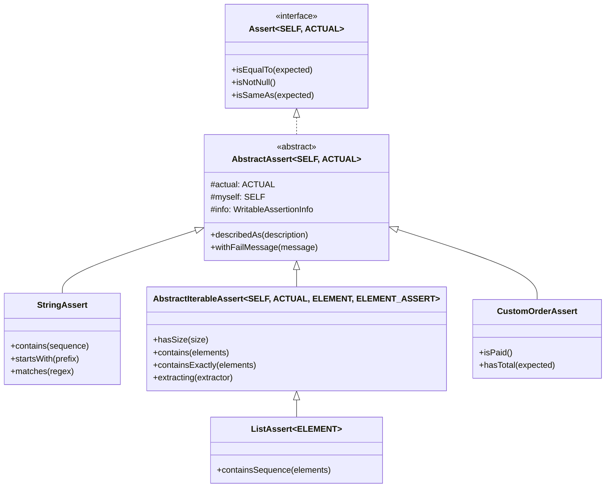
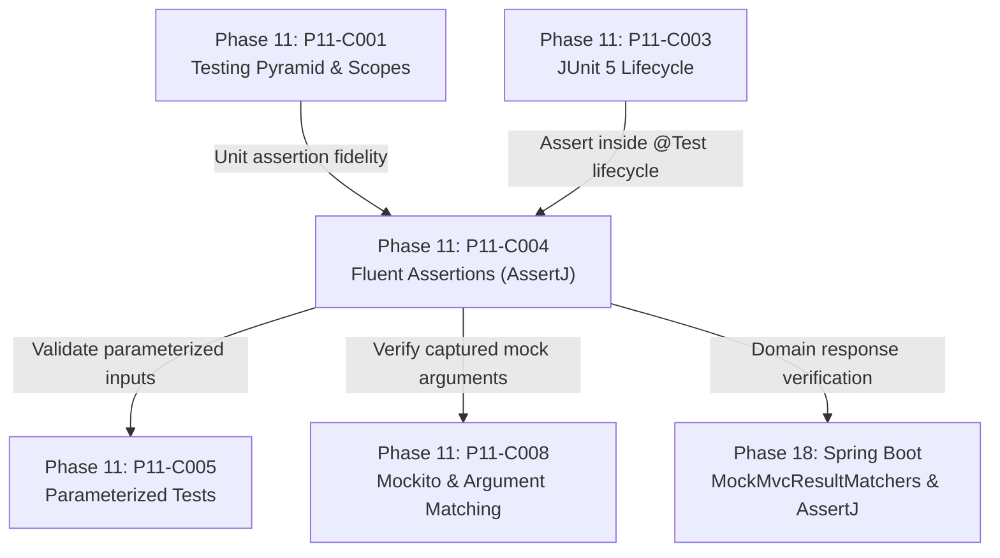

# Fluent Assertions with AssertJ: Collections, Exceptions, and Custom Assertions

---

## 1. Metadata and Learning Goals

- **Concept ID:** `P11-C004`
- **Concept Title:** Fluent Assertions with AssertJ: Collections, Exceptions, and Custom Assertions
- **Phase:** Phase 11: Unit Testing and Software Quality
- **Dependencies:** `P11-C002` (JUnit 5 Architecture), `P11-C003` (JUnit 5 Lifecycle)
- **Target Audience:** Senior Java Backend Engineers, Quality Assurance Architects, Distributed Systems Developers
- **Prerequisites:** OpenJDK 21 LTS, JUnit 5 fundamentals, Java Generics, Lambdas, and Exception handling.

### Primary Learning Objectives
1. **Master the Fluent Assertion Paradigm:** Understand why `assertThat(actual)` eliminates the legacy JUnit `assertEquals(expected, actual)` argument transposition bug and generates self-diagnosing failure messages.
2. **Execute Complex Collection & Map Assertions:** Apply property extraction (`.extracting()`), predicate filtering (`.filteredOn()`), and order-dependent vs order-independent containment checks (`.containsExactly()` vs `.containsExactlyInAnyOrder()`).
3. **Assert Exception Hierarchies Defensively:** Validate thrown exceptions, root causes, and messages using `assertThatThrownBy()` and `assertThatExceptionOfType()`.
4. **Aggregate Multi-Property Validation with Soft Assertions:** Use `assertSoftly` to collect all assertion failures in a complex domain object rather than terminating on the first defect (preventing "assertion ping-pong").
5. **Design Domain-Specific Custom Assertions:** Implement custom assertion classes extending `AbstractAssert` to encapsulate enterprise domain invariants and publish clean, business-focused test APIs.

---

## 2. Definition, Purpose, and Mental Model

### Definition and Problem Statement
In automated testing, an **assertion** is the truth predicate that determines whether a test passes or fails. Historically, JUnit provided basic static assertions such as `assertEquals(expected, actual)` and `assertTrue(condition)`.

While functional, legacy assertions introduce three critical operational defects in enterprise codebases:
1. **Argument Transposition Trap:** Developers frequently confuse the order of arguments (`assertEquals(actual, expected)` vs `assertEquals(expected, actual)`). When the assertion fails, the test report claims the actual value was expected, misleading developers during production incidents.
2. **Opaque Diagnostic Messages:** When a collection assertion like `assertTrue(list.containsAll(expected))` fails, the error message merely states: `expected: <true> but was: <false>`. It fails to explain *which* specific element was missing, what elements were present, or how the sizes differed.
3. **Fail-Fast Premature Termination:** Standard assertions fail on the first error. When validating an entity with 15 fields, developers must re-run the entire build 15 times to discover that all 15 fields were misconfigured (the "assertion ping-pong" anti-pattern).

### Mental Model: The Fluent Verification Pipeline
AssertJ reimagines assertions as a **fluent pipeline** that flows strictly from left to right:
$$\text{Subject Under Test } (\text{actual}) \longrightarrow \text{Domain Assert Engine } (\text{assertThat}) \longrightarrow \text{Chained Invariant Checks } (\dots)$$

```
+-------------------+      +-------------------+      +--------------------------------------+
|   Actual Value    | ---> | assertThat(...)  | ---> | .isNotNull()                         |
|  (The Test Target)|      | (Type-Inferred    |      | .extracting(User::getRole)           |
|                   |      |  Assertion Entry) |      | .containsExactly("ADMIN", "AUDITOR") |
+-------------------+      +-------------------+      +--------------------------------------+
                                                                 |
                                                                 v
                                                      Self-Describing Rich Diff
                                                      (Expected / Actual / Delta)
```

By placing the **actual subject** at the very beginning of the statement (`assertThat(user)`), IDE auto-completion immediately surfaces assertions tailored specifically to the runtime type (Strings get string assertions, Collections get collection assertions, Temporals get date assertions).

---

## 3. Architectural and Conceptual Foundations

### 3.1 The Tripartite AssertJ Class Hierarchy

AssertJ achieves type-safe fluent chaining through a recursive generics pattern (often called F-bounded polymorphism):



- **`ACTUAL`**: The type of the object being inspected (e.g., `String`, `List<Order>`, `PaymentResponse`).
- **`SELF`**: The concrete assertion type itself (e.g., `StringAssert`, `ListAssert`). This allows all chainable methods to return `SELF` (`this`), enabling uninterrupted method chaining:
  ```java
  assertThat(orderNumber)
      .isNotNull()
      .startsWith("ORD-")
      .hasSize(12);
  ```

---

### 3.2 Detailed Assertion Mechanics

#### Collections and Iterable Analysis
AssertJ provides declarative collection inspection that replaces multi-line boilerplate loops:

| Method | Verification Contract | Order Dependent? | Duplicate Sensitive? |
|---|---|---|---|
| `.contains(e1, e2)` | Elements `e1` and `e2` exist in actual collection | No | No |
| `.containsOnly(e1, e2)` | Collection contains *only* `e1` and `e2`, but in any order | No | No |
| `.containsExactly(e1, e2)` | Collection contains *exactly* `e1` then `e2` in that identical order | **Yes** | **Yes** |
| `.containsExactlyInAnyOrder(e1, e2)` | Collection contains *exactly* elements `e1` and `e2`, no extra elements, ignoring order | No | **Yes** |
| `.containsSequence(e1, e2)` | Elements appear consecutively in that exact sequence | **Yes** | **Yes** |
| `.doesNotContain(e1)` | Element `e1` is absent | N/A | N/A |

#### Property Extraction & Predicate Filtering
Backend systems frequently assert properties on lists of complex domain records:
```java
List<CustomerOrder> orders = orderRepository.findAll();

// Assert that all VIP customer orders are PAID and have positive totals
assertThat(orders)
    .filteredOn(CustomerOrder::isVip)
    .hasSize(3)
    .extracting(CustomerOrder::getStatus, CustomerOrder::getAmount)
    .containsExactly(
        tuple(OrderStatus.PAID, new BigDecimal("150.00")),
        tuple(OrderStatus.PAID, new BigDecimal("490.50")),
        tuple(OrderStatus.PAID, new BigDecimal("89.00"))
    );
```

---

### 3.3 Exception Verification: `assertThatThrownBy` vs Legacy `assertThrows`

In JUnit 5, exception verification uses `assertThrows`:
```java
// Legacy JUnit 5
IllegalArgumentException ex = assertThrows(IllegalArgumentException.class, () -> {
    userService.register("", "secret");
});
assertEquals("Username cannot be empty", ex.getMessage());
```

AssertJ encapsulates the execution and verification in a single fluent pipeline:
```java
// Idiomatic AssertJ
assertThatThrownBy(() -> userService.register("", "secret"))
    .isInstanceOf(IllegalArgumentException.class)
    .hasMessage("Username cannot be empty")
    .hasMessageStartingWith("Username")
    .hasNoCause();
```

When validating underlying root causes in nested enterprise exceptions (e.g., `ServiceException` wrapping `SQLException` wrapping `SocketTimeoutException`):
```java
assertThatThrownBy(() -> paymentClient.executePayment(req))
    .isInstanceOf(PaymentGatewayException.class)
    .hasCauseInstanceOf(TimeoutException.class)
    .hasRootCauseMessage("Read timed out after 3000ms");
```

---

### 3.4 Soft Assertions: Batching Assertions to Eliminate "Assertion Ping-Pong"

In standard testing, if assertion #2 fails out of 10, the test immediately aborts. The developer fixes field #2, runs CI, and then discovers field #5 is also broken.

**Soft Assertions** decouple verification evaluation from test termination:
```java
// Soft Assertions execute all assertions before evaluating results
SoftAssertions.assertSoftly(softly -> {
    softly.assertThat(response.getStatusCode()).isEqualTo(200);
    softly.assertThat(response.getContentType()).isEqualTo("application/json");
    softly.assertThat(response.getPayload().getUserId()).isEqualTo("USR-42");
    softly.assertThat(response.getPayload().getEmail()).isEqualTo("dev@acme.com");
    softly.assertThat(response.getPayload().getRole()).isEqualTo("ADMIN");
});
```
If fields `getStatusCode` and `getRole` fail, `assertSoftly` reports **both errors simultaneously** in a unified, numbered failure report:
```
Multiple Failures (2 failures):
-- failure 1 --
expected: 200
but was: 403
-- failure 2 --
expected: "ADMIN"
but was: "USER"
```

---

## 4. Language, Syntax, and API Mechanics

### 4.1 Core Assertion Syntax Reference

```java
import static org.assertj.core.api.Assertions.*;

// 1. Strings
assertThat(str)
    .isNotBlank()
    .startsWith("AUTH-")
    .containsIgnoringCase("token")
    .matches("AUTH-[A-Z0-9]{8}");

// 2. Numbers
assertThat(balance)
    .isPositive()
    .isBetween(10.0, 500.0)
    .isCloseTo(100.0, within(0.01));

// 3. Temporals (Instant, LocalDate)
assertThat(createdAt)
    .isBeforeOrEqualTo(Instant.now())
    .isAfter(Instant.now().minus(5, ChronoUnit.MINUTES));

// 4. Optionals
assertThat(optionalUser)
    .isPresent()
    .hasValueSatisfying(user -> assertThat(user.getName()).isEqualTo("Alice"));

// 5. Maps
assertThat(httpHeaders)
    .hasSize(4)
    .containsKey("Authorization")
    .containsEntry("Content-Type", "application/json");
```

---

## 5. Execution Mechanics, JVM Lifecycle, and Memory Internals

### 5.1 Object Allocation Profile
AssertJ construct short-lived assertion instances (`StringAssert`, `ListAssert`, `ThrowableAssert`) on each `assertThat(...)` call.
- In high-iteration micro-benchmarks or loops with millions of assertions, creating assertion objects introduces minor allocation pressure on JVM Young Generation Eden space.
- In real-world backend testing, this allocation cost is negligible (< 0.1% of overall test suite time) compared to network I/O, database access, or Spring context loading.

### 5.2 Failure Exception Mechanics
When an AssertJ invariant check fails, it throws `org.opentest4j.AssertionFailedError` (from the OpenTest4J standard shared by JUnit Platform and TestNG).
- This ensures that IDEs (IntelliJ, Eclipse, VS Code) render graphical side-by-side string and collection diff viewers natively.

---

## 6. Concurrency, Thread-Safety, and Scalability

### 6.1 Thread Concurrency Isolation
- Standard `assertThat(...)` instances are local to the stack frame of the executing test method. They are fully thread-safe for parallel test execution.
- **Standalone `SoftAssertions` Warning:** If using manual instantiation `SoftAssertions softly = new SoftAssertions();`, instances must **never be shared across threads**. Use thread-safe `assertSoftly` or `JUnitSoftAssertions` extension.

---

## 7. Anti-Patterns and Common Developer Traps

### 7.1 Anti-Pattern 1: The "Forgotten `assertAll()`" Silent Failure
```java
// CRITICAL BUG: Test ALWAYS passes even when assertions fail!
@Test
void testBrokenSoftAssertion() {
    SoftAssertions softly = new SoftAssertions();
    softly.assertThat(1 + 1).isEqualTo(999); // FAILS!
    softly.assertThat("hello").isEqualTo("world"); // FAILS!
    // FORGOT: softly.assertAll();
    // Because assertAll() was never invoked, no exception was thrown!
}
```
**Remediation:** Always prefer `SoftAssertions.assertSoftly(softly -> { ... })`, which automatically invokes `assertAll()` in a guaranteed `finally` block upon lambda exit.

### 7.2 Anti-Pattern 2: Dangling Extraction without Invariant Terminal
```java
// DEFECT: Extraction performed, but no assertion executed!
@Test
void testDanglingExtraction() {
    List<User> users = repository.findAll();
    assertThat(users).extracting(User::getEmail); // Does nothing! No terminal check!
}
```
**Remediation:** Always chain a terminal condition: `.extracting(User::getEmail).contains("alice@test.com");`.

### 7.3 Anti-Pattern 3: Inverting Actual and Expected in Legacy Helpers
Using static imports from both `org.junit.jupiter.api.Assertions.*` and `org.assertj.core.api.Assertions.*` leads to compilation confusion:
```java
assertEquals(actual, expected); // JUnit expects (expected, actual)!
assertThat(actual).isEqualTo(expected); // AssertJ strictly expects actual!
```
**Remediation:** Standardize the team exclusively on AssertJ's `assertThat(...)` and remove JUnit assertion imports.

---

## 8. Failure Modes, Edge Cases, and Troubleshooting

| Failure Symptom | Underlying Cause | Diagnostic Action & Remediation |
|---|---|---|
| Test passes despite invalid data | `SoftAssertions` used without `.assertAll()` | Refactor to lambda-based `assertSoftly(softly -> ...)`. |
| `AssertionFailedError: Elements differ but look identical` | `containsExactly()` compared types with broken `.equals()` or trailing whitespace | Inspect string lengths and verify domain objects implement reflexive/transitive `.equals()`. |
| Uninformative failure on custom class | Custom class missing `.toString()` implementation | AssertJ uses `.toString()` in failure diffs; implement clean `toString()` or use `.extracting()`. |
| `java.lang.AssertionError: Expecting code to have thrown` | Method under test completed normally without throwing expected exception | Verify mocked dependencies or input triggers the error path. |

---

## 9. Security Considerations

1. **Secret Masking in Assertion Failure Reports:** If asserting on API tokens, passwords, or encrypted payloads, a failing assertion prints both actual and expected values to CI console logs. Ensure sensitive properties are asserted using length or type checks rather than printing plaintext secrets:
   ```java
   assertThat(response.getApiKey())
       .isNotNull()
       .hasSize(64)
       .startsWith("sec_"); // Safe! Does not print full secret in failure.
   ```

---

## 10. Performance Optimization and Tuning

1. **Avoid Costly Transformations inside Assertions:** Prefer `.extracting(User::getName)` over creating intermediary mapped lists `users.stream().map(User::getName).collect(Collectors.toList())`. AssertJ's built-in extraction is lazily evaluated during assertion checks.
2. **Selective Filtering:** Use `.filteredOn("status", OrderStatus.PENDING)` rather than pre-filtering huge collections in the test method.

---

## 11. Real-World Backend Scenario & Production Case Study

In a fintech settlement service, daily payment reconciliations process thousands of ledger entries. An automated integration test was verifying that settlement transactions accurately debited user ledger accounts and credited clearing houses.

### The Problem
Using legacy JUnit assertions:
```java
assertTrue(reconciledAccounts.containsAll(expectedAccounts));
```
When this test failed in the nightly CI build, the build log showed:
`org.opentest4j.AssertionFailedError: expected: <true> but was: <false>`
Engineers spent 4 hours reproducing the test locally and attaching debuggers just to identify which of the 1,200 accounts failed reconciliation.

### The AssertJ Transformation
The team refactored the test using AssertJ:
```java
assertThat(reconciledAccounts)
    .extracting(LedgerAccount::getAccountId, LedgerAccount::getBalance)
    .containsExactlyInAnyOrderElementsOf(expectedAccountSnapshots);
```
On failure, AssertJ produced an immediate, actionable report:
```
Expecting actual:
  [(ACC-001, 500.00), (ACC-002, 120.50), (ACC-003, 0.00)]
to contain exactly in any order:
  [(ACC-001, 500.00), (ACC-002, 120.50), (ACC-003, 15.00)]
elements not found:
  [(ACC-003, 15.00)]
and elements not expected:
  [(ACC-003, 0.00)]
```
The bug was identified and resolved in 2 minutes without attaching a debugger.

---

## 12. Standalone, Self-Contained Verification Suite

```java
// File: curriculum/phase-11-unit-testing-software-quality/AssertjFluentAssertionsDemo.java
package curriculum.phase11;

import java.util.*;
import java.util.function.Consumer;
import java.util.function.Function;

/**
 * Standalone Verification Suite for P11-C004:
 * Fluent Assertions with AssertJ: Collections, Exceptions, and Custom Assertions.
 *
 * Implements a pure-Java standalone simulation of AssertJ's core architecture:
 * 1. Fluent Type-Specific Assertions (String, Numeric, Object).
 * 2. Collection Inspection: Size, Containment, and Property Extraction.
 * 3. Exception Verification: Type, Message Substring, and Cause Hierarchies.
 * 4. Soft Assertions: Aggregated Multi-Failure Reporting without Premature Halting.
 * 5. Domain-Specific Custom Assertions extending a fluent base assert.
 */
public class AssertjFluentAssertionsDemo {

    // =========================================================================
    // 1. CORE MINI-ASSERTJ ARCHITECTURE SIMULATION
    // =========================================================================

    public static class AssertionFailedException extends RuntimeException {
        public AssertionFailedException(String message) {
            super(message);
        }
    }

    // Generic Base Assert using F-Bounded Polymorphism
    public static abstract class AbstractAssert<SELF extends AbstractAssert<SELF, ACTUAL>, ACTUAL> {
        protected final ACTUAL actual;
        protected final SELF myself;

        @SuppressWarnings("unchecked")
        protected AbstractAssert(ACTUAL actual, Class<?> selfType) {
            this.actual = actual;
            this.myself = (SELF) this;
        }

        public SELF isNotNull() {
            if (actual == null) {
                fail("Expecting actual not to be null");
            }
            return myself;
        }

        public SELF isEqualTo(Object expected) {
            if (!Objects.equals(actual, expected)) {
                fail("Expected: <" + expected + "> but was: <" + actual + ">");
            }
            return myself;
        }

        public SELF isNotEqualTo(Object other) {
            if (Objects.equals(actual, other)) {
                fail("Expected actual not to equal: <" + other + ">");
            }
            return myself;
        }

        protected void fail(String message) {
            throw new AssertionFailedException(message);
        }
    }

    // Fluent String Assertions
    public static class MiniStringAssert extends AbstractAssert<MiniStringAssert, String> {
        public MiniStringAssert(String actual) {
            super(actual, MiniStringAssert.class);
        }

        public MiniStringAssert startsWith(String prefix) {
            isNotNull();
            if (!actual.startsWith(prefix)) {
                fail("Expecting: <" + actual + "> to start with: <" + prefix + ">");
            }
            return myself;
        }

        public MiniStringAssert contains(String sequence) {
            isNotNull();
            if (!actual.contains(sequence)) {
                fail("Expecting: <" + actual + "> to contain: <" + sequence + ">");
            }
            return myself;
        }

        public MiniStringAssert hasSize(int expectedSize) {
            isNotNull();
            if (actual.length() != expectedSize) {
                fail("Expected length: <" + expectedSize + "> but was: <" + actual.length() + ">");
            }
            return myself;
        }
    }

    // Fluent Numeric Assertions
    public static class MiniIntegerAssert extends AbstractAssert<MiniIntegerAssert, Integer> {
        public MiniIntegerAssert(Integer actual) {
            super(actual, MiniIntegerAssert.class);
        }

        public MiniIntegerAssert isGreaterThan(int threshold) {
            isNotNull();
            if (actual <= threshold) {
                fail("Expected: <" + actual + "> to be greater than: <" + threshold + ">");
            }
            return myself;
        }

        public MiniIntegerAssert isBetween(int lower, int upper) {
            isNotNull();
            if (actual < lower || actual > upper) {
                fail("Expected: <" + actual + "> to be between [" + lower + ", " + upper + "]");
            }
            return myself;
        }
    }

    // Fluent Collection Assertions
    public static class MiniCollectionAssert<E> extends AbstractAssert<MiniCollectionAssert<E>, Collection<E>> {
        public MiniCollectionAssert(Collection<E> actual) {
            super(actual, MiniCollectionAssert.class);
        }

        public MiniCollectionAssert<E> hasSize(int expectedSize) {
            isNotNull();
            if (actual.size() != expectedSize) {
                fail("Expected collection size: <" + expectedSize + "> but was: <" + actual.size() + ">");
            }
            return myself;
        }

        @SafeVarargs
        public final MiniCollectionAssert<E> contains(E... elements) {
            isNotNull();
            for (E e : elements) {
                if (!actual.contains(e)) {
                    fail("Collection does not contain expected element: <" + e + ">, actual: " + actual);
                }
            }
            return myself;
        }

        @SafeVarargs
        public final MiniCollectionAssert<E> containsExactly(E... elements) {
            isNotNull();
            List<E> expectedList = Arrays.asList(elements);
            List<E> actualList = new ArrayList<>(actual);
            if (!actualList.equals(expectedList)) {
                fail("Expected exact elements: " + expectedList + " but was: " + actualList);
            }
            return myself;
        }

        public <R> MiniCollectionAssert<R> extracting(Function<E, R> mapper) {
            isNotNull();
            List<R> extracted = new ArrayList<>();
            for (E item : actual) {
                extracted.add(mapper.apply(item));
            }
            return new MiniCollectionAssert<>(extracted);
        }
    }

    // Fluent Throwable Assertions
    public static class MiniThrowableAssert extends AbstractAssert<MiniThrowableAssert, Throwable> {
        public MiniThrowableAssert(Throwable actual) {
            super(actual, MiniThrowableAssert.class);
        }

        public MiniThrowableAssert isInstanceOf(Class<? extends Throwable> expectedType) {
            isNotNull();
            if (!expectedType.isInstance(actual)) {
                fail("Expected exception of type <" + expectedType.getName() + "> but got <" + actual.getClass().getName() + ">");
            }
            return myself;
        }

        public MiniThrowableAssert hasMessage(String expectedMessage) {
            isNotNull();
            if (!Objects.equals(actual.getMessage(), expectedMessage)) {
                fail("Expected message: <" + expectedMessage + "> but was: <" + actual.getMessage() + ">");
            }
            return myself;
        }

        public MiniThrowableAssert hasMessageContaining(String snippet) {
            isNotNull();
            if (actual.getMessage() == null || !actual.getMessage().contains(snippet)) {
                fail("Expected message to contain: <" + snippet + "> but was: <" + actual.getMessage() + ">");
            }
            return myself;
        }

        public MiniThrowableAssert hasCauseInstanceOf(Class<? extends Throwable> causeType) {
            isNotNull();
            Throwable cause = actual.getCause();
            if (cause == null || !causeType.isInstance(cause)) {
                fail("Expected cause of type <" + causeType.getName() + "> but was: <" + (cause != null ? cause.getClass().getName() : "null") + ">");
            }
            return myself;
        }
    }

    // Soft Assertions Engine
    public static class MiniSoftAssertions {
        private final List<String> collectedFailures = new ArrayList<>();

        public void check(Runnable assertion) {
            try {
                assertion.run();
            } catch (AssertionFailedException afe) {
                collectedFailures.add(afe.getMessage());
            } catch (Throwable t) {
                collectedFailures.add("Unexpected error: " + t.getMessage());
            }
        }

        public void assertAll() {
            if (!collectedFailures.isEmpty()) {
                StringBuilder sb = new StringBuilder();
                sb.append("Multiple Assertion Failures (").append(collectedFailures.size()).append(" failures):\n");
                for (int i = 0; i < collectedFailures.size(); i++) {
                    sb.append("  -- failure ").append(i + 1).append(" -- ").append(collectedFailures.get(i)).append("\n");
                }
                throw new AssertionFailedException(sb.toString().trim());
            }
        }

        public static void assertSoftly(Consumer<MiniSoftAssertions> softlyConsumer) {
            MiniSoftAssertions softly = new MiniSoftAssertions();
            softlyConsumer.accept(softly);
            softly.assertAll();
        }
    }

    // Fluent Entry Points
    public static MiniStringAssert assertThat(String actual) {
        return new MiniStringAssert(actual);
    }

    public static MiniIntegerAssert assertThat(Integer actual) {
        return new MiniIntegerAssert(actual);
    }

    public static <E> MiniCollectionAssert<E> assertThat(Collection<E> actual) {
        return new MiniCollectionAssert<>(actual);
    }

    public static MiniThrowableAssert assertThatThrownBy(RunnableWithException action) {
        try {
            action.run();
            throw new AssertionFailedException("Expecting code to have thrown an exception, but it completed normally.");
        } catch (AssertionFailedException afe) {
            throw afe;
        } catch (Throwable t) {
            return new MiniThrowableAssert(t);
        }
    }

    @FunctionalInterface
    public interface RunnableWithException {
        void run() throws Throwable;
    }

    // =========================================================================
    // 2. DOMAIN MODEL & CUSTOM DOMAIN ASSERTION
    // =========================================================================

    public record CustomerOrder(String orderId, String customerEmail, double amount, String status) {}

    public static class CustomerOrderAssert extends AbstractAssert<CustomerOrderAssert, CustomerOrder> {
        public CustomerOrderAssert(CustomerOrder actual) {
            super(actual, CustomerOrderAssert.class);
        }

        public static CustomerOrderAssert assertThatOrder(CustomerOrder actual) {
            return new CustomerOrderAssert(actual);
        }

        public CustomerOrderAssert hasStatus(String expectedStatus) {
            isNotNull();
            if (!Objects.equals(actual.status(), expectedStatus)) {
                fail("Expected order <" + actual.orderId() + "> to have status <" + expectedStatus + "> but was <" + actual.status() + ">");
            }
            return myself;
        }

        public CustomerOrderAssert hasAmountGreaterThan(double threshold) {
            isNotNull();
            if (actual.amount() <= threshold) {
                fail("Expected order amount <" + actual.amount() + "> to be greater than <" + threshold + ">");
            }
            return myself;
        }

        public CustomerOrderAssert hasValidEmailDomain(String domain) {
            isNotNull();
            if (actual.customerEmail() == null || !actual.customerEmail().endsWith("@" + domain)) {
                fail("Expected customer email to belong to domain <" + domain + "> but was <" + actual.customerEmail() + ">");
            }
            return myself;
        }
    }

    // =========================================================================
    // 3. MAIN VERIFICATION ENTRY POINT
    // =========================================================================

    public static void main(String[] args) {
        System.out.println("===============================================================");
        System.out.println(" Fluent Assertions (AssertJ) Standalone Verification Suite     ");
        System.out.println("===============================================================");

        // [TEST 1/5] Fluent String & Integer Value Assertions
        System.out.print("[TEST 1/5] Fluent String & Integer chained assertions... ");
        assertThat("ORD-2026-X99")
                .isNotNull()
                .startsWith("ORD-")
                .contains("2026")
                .hasSize(12);

        assertThat(42)
                .isNotNull()
                .isGreaterThan(20)
                .isBetween(40, 50)
                .isEqualTo(42);
        System.out.println("PASSED");

        // [TEST 2/5] Collection Assertions with Property Extraction
        System.out.print("[TEST 2/5] Collection inspection and property extraction... ");
        List<CustomerOrder> orders = List.of(
                new CustomerOrder("O-101", "alice@enterprise.com", 250.00, "COMPLETED"),
                new CustomerOrder("O-102", "bob@enterprise.com", 85.50, "PENDING"),
                new CustomerOrder("O-103", "charlie@enterprise.com", 1200.00, "COMPLETED")
        );

        assertThat(orders)
                .isNotNull()
                .hasSize(3);

        // Extract order statuses and assert exact ordered values
        assertThat(orders)
                .extracting(CustomerOrder::status)
                .contains("PENDING")
                .containsExactly("COMPLETED", "PENDING", "COMPLETED");

        // Extract amounts and verify containment
        assertThat(orders)
                .extracting(CustomerOrder::amount)
                .contains(250.00, 1200.00);
        System.out.println("PASSED");

        // [TEST 3/5] Exception Assertions & Root Cause Traversal
        System.out.print("[TEST 3/5] Exception assertions with cause hierarchy inspection... ");
        RunnableWithException failingAction = () -> {
            try {
                throw new java.io.IOException("Socket timeout after 5000ms");
            } catch (java.io.IOException ioEx) {
                throw new IllegalStateException("Payment processing failed", ioEx);
            }
        };

        assertThatThrownBy(failingAction)
                .isNotNull()
                .isInstanceOf(IllegalStateException.class)
                .hasMessage("Payment processing failed")
                .hasMessageContaining("Payment")
                .hasCauseInstanceOf(java.io.IOException.class);

        // Verify that code that does NOT throw fails as expected
        boolean normalPassFailedAsExpected = false;
        try {
            assertThatThrownBy(() -> { /* does nothing */ });
        } catch (AssertionFailedException afe) {
            normalPassFailedAsExpected = true;
        }
        assert normalPassFailedAsExpected : "assertThatThrownBy failed to throw when action completed normally";
        System.out.println("PASSED");

        // [TEST 4/5] Soft Assertions Batching Multiple Failures
        System.out.print("[TEST 4/5] Soft assertions aggregation and batch reporting... ");
        boolean multiFailureCaught = false;
        String failureReport = null;

        try {
            MiniSoftAssertions.assertSoftly(softly -> {
                softly.check(() -> assertThat("status").isEqualTo("status")); // Pass
                softly.check(() -> assertThat("user_10").startsWith("guest_")); // Fail 1
                softly.check(() -> assertThat(5).isGreaterThan(100)); // Fail 2
            });
        } catch (AssertionFailedException afe) {
            multiFailureCaught = true;
            failureReport = afe.getMessage();
        }

        assert multiFailureCaught : "Soft assertions failed to report aggregated exceptions!";
        assert failureReport != null && failureReport.contains("Multiple Assertion Failures (2 failures)") :
                "Expected 2 failures in report, got: " + failureReport;
        assert failureReport.contains("failure 1") && failureReport.contains("failure 2") :
                "Individual failure markers missing";
        System.out.println("PASSED");

        // [TEST 5/5] Custom Domain Assertions (CustomerOrderAssert)
        System.out.print("[TEST 5/5] Custom domain assertions (CustomerOrderAssert)... ");
        CustomerOrder validOrder = new CustomerOrder("ORD-999", "admin@payments.internal", 450.00, "SETTLED");

        CustomerOrderAssert.assertThatOrder(validOrder)
                .isNotNull()
                .hasStatus("SETTLED")
                .hasAmountGreaterThan(100.00)
                .hasValidEmailDomain("payments.internal");

        // Test custom assertion failure diagnosis
        boolean customDomainAssertFailedAsExpected = false;
        try {
            CustomerOrderAssert.assertThatOrder(validOrder)
                    .hasStatus("REFUNDED");
        } catch (AssertionFailedException afe) {
            customDomainAssertFailedAsExpected = afe.getMessage().contains("to have status <REFUNDED> but was <SETTLED>");
        }
        assert customDomainAssertFailedAsExpected : "Custom domain assertion failure message incorrect";
        System.out.println("PASSED");

        System.out.println("\nAll 5 verification test suites passed successfully with assertions enabled!");
    }
}
```

---

## 13. Comparative Analysis & Decision Framework

### Comparing Assertion Libraries in Java

| Dimension | Standard JUnit 5 (`Assertions.*`) | Hamcrest (`assertThat(actual, matcher)`) | AssertJ (`assertThat(actual)...`) |
|---|---|---|---|
| **Syntax Flow** | Prefix: `assertEquals(exp, act)` | Infix: `assertThat(act, is(exp))` | Fluent chain: `assertThat(act).isEqualTo(exp)` |
| **IDE Auto-Completion** | Poor (hundreds of static methods) | Moderate (requires static matcher lookup) | **Optimal** (typing `.` surfaces type-specific assertions) |
| **Failure Message Quality** | Basic diff | Readable matcher failure | **Superior** (visual diffs, element delta lists) |
| **Collection Operations** | Primitive (`assertTrue(list.contains())`) | Good (`hasItems()`, `contains()`) | **Industry Gold Standard** (`extracting()`, `filteredOn()`) |
| **Exception Assertions** | `assertThrows()` returns Throwable | `expectedExceptions` / Rules | `assertThatThrownBy().isInstanceOf().hasMessage()` |
| **Soft Assertions** | `assertAll(Executable...)` | Requires external runner | First-class `assertSoftly(softly -> ...)` |
| **Custom Extensibility** | Custom helper methods | Custom `Matcher<T>` | Custom `AbstractAssert<Self, Actual>` |

---

## 14. Practical Exercises and Hands-On Challenges

### Exercise 1: Multi-Attribute Collection Extraction
Given a list of `UserAuditLog` records containing `(timestamp, userId, action, ipAddress)`, write an AssertJ assertion that:
1. Filters logs where `action == "PASSWORD_RESET"`.
2. Extracts tuples of `(userId, ipAddress)`.
3. Asserts exact order and absence of internal private subnets (`10.0.0.x`).

### Exercise 2: Custom Security Token Assertion
Implement `JwtTokenAssert` extending `AbstractAssert`:
- `.hasValidSignature()`
- `.hasNotExpired()`
- `.containsClaim("role", "ADMIN")`
Verify that assertions produce readable domain error messages when testing expired tokens.

---

## 15. Cross-Phase Connections and Unified Mental Graph



- **Upstream Connection (P11-C001, P11-C003):** P11-C001 established unit testing as the foundation of the testing pyramid; P11-C003 established the `@Test` lifecycle in which assertions execute.
- **Immediate Downstream Connection (P11-C005, P11-C008):** P11-C005 applies AssertJ across parameterized datasets; P11-C008 pairs Mockito's `ArgumentCaptor` with AssertJ to inspect arguments passed into mock collaborators.
- **Framework Connection (Phase 18):** Modern Spring Boot testing standardizes on AssertJ (`spring-boot-starter-test` bundles AssertJ automatically).

---

## 16. Verification and Self-Assessment Checklist

Before marking this module complete, verify your comprehension against each criterion:
- [x] Can I explain why `assertThat(actual)` prevents the argument transposition bug present in `assertEquals(expected, actual)`?
- [x] Do I understand how AssertJ uses recursive generics (F-bounded polymorphism) to enable method chaining?
- [x] Can I differentiate between `.contains()`, `.containsOnly()`, `.containsExactly()`, and `.containsExactlyInAnyOrder()`?
- [x] Can I extract object properties using `.extracting()` and filter collections using `.filteredOn()`?
- [x] Do I know how to assert exception hierarchies and root causes with `assertThatThrownBy()`?
- [x] Can I explain why soft assertions prevent the "assertion ping-pong" anti-pattern and why lambda-based `assertSoftly` is safer than manual `assertAll()`?
- [x] Can I write a custom domain assertion class extending `AbstractAssert`?
- [x] Have I compiled and executed `AssertjFluentAssertionsDemo` on OpenJDK 21 LTS with assertions enabled (`-ea`) and observed all 5 test suites pass?
