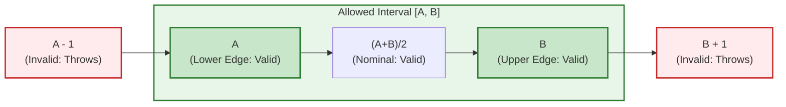
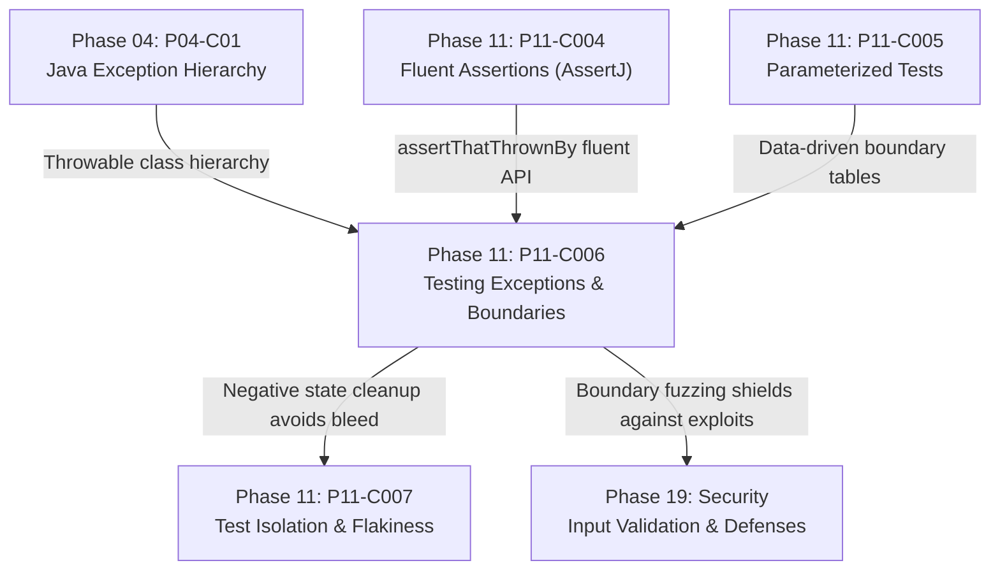

# Testing Exceptions and Boundary Conditions Defensively

---

## 1. Metadata and Learning Goals

- **Concept ID:** `P11-C006`
- **Concept Title:** Testing Exceptions and Boundary Conditions Defensively
- **Phase:** Phase 11: Unit Testing and Software Quality
- **Dependencies:** `P11-C003` (JUnit 5 Lifecycle), `P11-C004` (Fluent Assertions), `P11-C005` (Parameterized Tests)
- **Target Audience:** Senior Java Backend Engineers, Distributed Systems Architects, Reliability Engineers
- **Prerequisites:** OpenJDK 21 LTS, Java Exception Hierarchy (`Throwable`, `Exception`, `RuntimeException`, `Error`), AssertJ fluent syntax.

### Primary Learning Objectives
1. **Overcome "Happy-Path Myopia":** Recognize that high-severity production outages originate in unhandled boundary conditions, edge cases, and flawed error recovery routines.
2. **Eliminate Flawed Exception Assertions:** Discard dangerous legacy idioms (`@Test(expected = ...)` and naive `try-catch-fail` blocks) in favor of deterministic `assertThrows()` and `assertThatThrownBy()`.
3. **Master Boundary Value Analysis (BVA):** Systematically identify and test extremal values across numbers ($0, -1, 1, \text{MAX}, \text{MIN}$), collections (empty, single-item, max-capacity), strings (null, empty, whitespace, multibyte unicode), and temporals.
4. **Assert Nested Root-Cause Chains:** Verify wrapped multi-tier exceptions (`ServiceException` $\to$ `DataAccessException` $\to$ `SQLException`) down to the exact root cause and localized diagnostic attributes.
5. **Enforce Negative Testing Isolation:** Ensure negative test executions clean up allocated transactions and thread-local contexts, preventing error state from bleeding into adjacent tests.

---

## 2. Definition, Purpose, and Mental Model

### Definition and Problem Statement
In software testing, the vast majority of test suites exhibit **"Happy-Path Myopia"**: developers focus over 80% of testing effort verifying that valid inputs yield expected outputs. However, in mission-critical distributed systems, bugs rarely emerge from straightforward happy-path execution. 

Outages typically occur at the **boundaries**:
- The $N+1^{\text{th}}$ element that overflows a fixed-size ring buffer.
- The empty string or multibyte UTF-8 emoji that breaks a database column width constraint.
- The `ArithmeticException` triggered by division when zero balance is encountered during market close.
- The unhandled `TimeoutException` wrapped inside a `CompletionException` that leaks thread pool capacity.

**Defensive Exception and Boundary Testing** is the rigorous discipline of proving that a system behaves deterministically under invalid inputs, hostile payloads, edge-case extremes, and failure states—either rejecting them safely with clear, typed domain exceptions or executing documented fallback strategies without data corruption or memory leaks.

### Mental Model: The Defensive Fortress Wall and The Fault Injection Probe
Imagine your backend service as a walled fortress:
- **Boundary Value Analysis (BVA)** probes the structural stress limits of the wall: the exact transitions where valid terrain meets the abyss (e.g., balance $= 0$, balance $= -0.01$, balance $= 10^9$).
- **Exception Assertions** act as fault injection probes: deliberately triggering edge-case faults and verifying that the internal alarms ring with the exact frequency, security isolation, and cause taxonomy expected by operations teams.

```
                  BOUNDARY TRANSITION ZONE
  Invalid Region        Exact Boundary        Valid Region
 (Throws Exception)   (Stress Threshold)    (Completes Normally)
-------------------->|                     |-------------------->
      x = -0.01      |      x = 0.00       |      x = +0.01
  [Rejected with     |   [Accepted /       |   [Accepted /
  ValidationException]  Boundary Base]    |    Normal Operation]
```

---

## 3. Architectural and Conceptual Foundations

### 3.1 The Evolution of Exception Assertion Mechanics

Java testing frameworks evolved across three generations to solve exception verification safely:

```
               +-------------------------------------------------------+
               |             Exception Testing Evolution               |
               +---------------------------+---------------------------+
                                           |
                   +-----------------------+-----------------------+
                   |                                               |
                   v                                               v
     +---------------------------+                   +---------------------------+
     | Generation 1: JUnit 4     |                   | Generation 2: JUnit 4     |
     | @Test(expected=...)       |                   | try-catch-fail            |
     +---------------------------+                   +---------------------------+
     | * CRITICAL FLAW: Blind    |                   | * VERBOSE & ERROR-PRONE   |
     |   to WHERE exception      |                   | * If fail() is omitted,   |
     |   was thrown. Setup crash |                   |   test silently passes!   |
     |   falsely passes test!    |                   | * Swallows unexpected     |
     | * Cannot check message.   |                   |   exception types.        |
     +---------------------------+                   +---------------------------+
                                           |
                                           v
                             +---------------------------+
                             | Generation 3: Modern      |
                             | assertThrows / AssertJ    |
                             +---------------------------+
                             | * Scoped strictly to      |
                             |   lambda execution.       |
                             | * Returns exception for   |
                             |   message/cause checks.   |
                             | * Fails fast if normal.   |
                             +---------------------------+
```

#### Generation 1: `@Test(expected = SomeException.class)` (Anti-Pattern)
```java
// DANGEROUS ANTI-PATTERN: JUnit 4 legacy
@Test(expected = IllegalArgumentException.class)
public void testUserRegistration() {
    UserService service = new UserService(new DatabaseStub()); // What if this throws IAE?
    service.registerUser(null); // Intended target of test!
}
```
**Fatal Flaw:** If the constructor `new UserService(...)` throws `IllegalArgumentException` due to a configuration bug, the test **passes green**, even though the method under test (`registerUser`) was never reached! Furthermore, it cannot verify exception messages or root causes.

#### Generation 2: The `try-catch-fail` Pattern (Anti-Pattern)
```java
// FRAGILE BOILERPLATE
@Test
void testInvalidAge() {
    try {
        service.setAge(-5);
        fail("Expected IllegalArgumentException"); // If developer forgets this line, test ALWAYS passes!
    } catch (IllegalArgumentException e) {
        assertEquals("Age must be positive", e.getMessage());
    }
}
```
**Fatal Flaw:** If a junior developer forgets `fail(...)`, the test becomes a false positive that passes when no exception is thrown. If an unexpected `NullPointerException` occurs, it escapes the catch block and marks the test as error rather than failure, confusing test metrics.

#### Generation 3: Scoped Lambda Execution (Modern Standard)
Both JUnit 5 and AssertJ execute the test target inside a lambda, isolating the scope of the exception to that exact statement:
```java
// JUnit 5
IllegalArgumentException ex = assertThrows(IllegalArgumentException.class, () -> service.setAge(-5));
assertEquals("Age must be positive", ex.getMessage());

// AssertJ (Idiomatic)
assertThatThrownBy(() -> service.setAge(-5))
    .isInstanceOf(IllegalArgumentException.class)
    .hasMessage("Age must be positive")
    .hasNoCause();
```

---

### 3.2 Boundary Value Analysis (BVA) Framework

Boundary Value Analysis posits that software defects cluster disproportionately at the **edges of input domains** rather than in the center. For any given input range $[A, B]$, an exhaustive boundary test suite evaluates:
1. **$A - 1$ (Just below lower boundary):** Must be rejected with a domain exception.
2. **$A$ (Exact lower boundary):** Must be accepted as valid.
3. **Nominal (Middle value):** Must process normally.
4. **$B$ (Exact upper boundary):** Must be accepted as valid.
5. **$B + 1$ (Just above upper boundary):** Must be rejected with a domain exception.



---

### 3.3 Domain-Specific Boundary Categories in Enterprise Java

| Input Domain | Critical Boundary Extremes to Test | Common Production Defect |
|---|---|---|
| **Numerical (Integers, Decimals)** | $0, -1, 1, \text{MAX\_VALUE}, \text{MIN\_VALUE}$, overflow ($2^{31}-1 + 1$) | Arithmetic wrap-around (`Integer.MAX_VALUE + 1 == Integer.MIN_VALUE`), division by zero. |
| **Financial / Currency** | Scale precision ($0.001$), rounding halves, negative balances, $0.00$ | Rounding drift, negative charge exploit, high-precision truncation. |
| **Strings / Text** | `null`, `""` (empty), `"   "` (whitespace), single-char, max DB column size (255 chars), multibyte UTF-8 (emojis, Chinese characters) | `NullPointerException`, truncation silent failure, DB collation crash. |
| **Collections / Iterables** | Empty list (`size == 0`), single-item (`size == 1`), duplicates, unmodifiable list, max batch size (e.g. 1,000 items) | `IndexOutOfBoundsException`, `UnsupportedOperationException`, SQL `IN (...)` limit crash. |
| **Temporals (Instant, LocalDate)** | Leap days (Feb 29), epoch zero, daylight saving transition gaps/overlaps (DST), year-end roll-overs (Dec 31 $\to$ Jan 1) | `DateTimeException`, off-by-one-hour bill calculation, timezone conversion drift. |
| **Concurrency / Queues** | Queue capacity saturated, thread pool pool-size zero, queue timeout = 0 | `RejectedExecutionException`, thread starvation, indefinite thread block. |

---

### 3.4 Exception Hierarchy Verification and Root-Cause Traversal

In enterprise backend applications, exceptions are rarely flat. They are wrapped as they bubble up through architectural layers:
$$\text{Driver (SQLException)} \longrightarrow \text{Persistence (DataAccessException)} \longrightarrow \text{Business (OrderProcessingException)}$$

Asserting only the top-level exception allows silent regressions in underlying error handling:
```java
assertThatThrownBy(() -> orderService.processOrder(req))
    .isInstanceOf(OrderProcessingException.class)
    .hasMessageStartingWith("Failed to persist order")
    // Traverse the cause chain:
    .hasCauseInstanceOf(DataAccessException.class)
    // Check root cause directly:
    .hasRootCauseInstanceOf(SQLException.class)
    .satisfies(ex -> {
        // Assert domain-specific metadata attached to custom exception
        OrderProcessingException ope = (OrderProcessingException) ex;
        assertThat(ope.getErrorCode()).isEqualTo("ERR_DB_DEADLOCK");
        assertThat(ope.getRetryable()).isTrue();
    });
```

---

## 4. Language, Syntax, and API Mechanics

### 4.1 JUnit 5 `assertThrows` and `assertDoesNotThrow`

```java
// Asserting exception type and inspecting payload
DomainException ex = assertThrows(DomainException.class, () -> {
    account.withdraw(new BigDecimal("1000.00"));
});
assertEquals("INSUFFICIENT_FUNDS", ex.getErrorCode());

// Asserting that code does NOT throw
assertDoesNotThrow(() -> {
    configService.reloadConfiguration();
});
```

### 4.2 AssertJ Exception Assertion Syntax

```java
// 1. Fluent execution and type check
assertThatThrownBy(() -> parser.parse(null))
    .isInstanceOf(NullPointerException.class)
    .hasMessage("Payload cannot be null");

// 2. Strongly typed entry point
assertThatExceptionOfType(ValidationException.class)
    .isThrownBy(() -> validator.validate(badDto))
    .withMessageContaining("email")
    .withNoCause();

// 3. Ensuring no exception is thrown
assertThatCode(() -> healthCheck.ping())
    .doesNotThrowAnyException();
```

---

## 5. Execution Mechanics, JVM Lifecycle, and Memory Internals

### 5.1 The Cost of `fillInStackTrace()`
Whenever a Java exception is instantiated, the JVM calls native `Throwable.fillInStackTrace()`, which walks the entire execution call stack frame by frame.
- In high-throughput boundary tests running millions of iterations (e.g. fuzzing algorithms or mathematical bounds), creating 100,000 exceptions per second imposes significant CPU overhead.
- For benchmarks and micro-tests, lightweight exceptions overriding `fillInStackTrace()` to return `this` can be tested if performance testing exception paths. In standard test suites, the real exception stack trace must be preserved to verify error origin.

### 5.2 Thread-Local and Transaction State Bleed in Negative Tests
When a test method verifies an exception:
```java
@Test
void whenPaymentFails_transactionMustRollback() {
    SecurityContext.setTenant("tenant_123");
    assertThrows(PaymentException.class, () -> paymentService.charge(badCard));
    // DANGER: Did SecurityContext get cleared? 
    // If not, tenant_123 leaks into subsequent tests!
}
```
**Defensive Hygiene Rule:** In negative testing, state mutation often occurs *before* the exception is thrown. Always enforce cleanup in `@AfterEach` or use `try-finally` around test setup.

---

## 6. Concurrency, Thread-Safety, and Scalability

### 6.1 Testing Asynchronous Exceptions in Concurrency
Exceptions thrown inside background threads or `CompletableFuture` pipelines are wrapped in `ExecutionException` or `CompletionException`:
```java
CompletableFuture<Void> future = asyncTaskExecutor.submit(failingTask);

// Unwrapping asynchronous exceptions cleanly
assertThatThrownBy(future::join)
    .isInstanceOf(CompletionException.class)
    .hasCauseInstanceOf(TimeoutException.class);
```

---

## 7. Anti-Patterns and Common Developer Traps

### 7.1 Anti-Pattern 1: Catching Generic `Exception.class`
```java
// CRITICAL BUG: Masks unintended runtime defects!
@Test
void testBadExceptionAssertion() {
    assertThrows(Exception.class, () -> {
        orderService.submit(order); // Threw NullPointerException because orderService was misconfigured!
    });
    // TEST PASSES! But the code did not fail due to validation; it failed due to a crash bug!
}
```
**Remediation:** Never assert `Exception.class`, `Throwable.class`, or `RuntimeException.class`. Always assert the specific, narrow domain exception type (`OrderValidationException.class`).

### 7.2 Anti-Pattern 2: Brittle Exact String Matching
```java
// FRAGILE: Breaks on minor punctuation or localization change
assertThatThrownBy(() -> parser.parse(invalidInput))
    .hasMessage("Error at line 14: expected ':' at offset 0x7FFE4B29A0"); // Memory address / line breaks!
```
**Remediation:** Assert stable substring anchors or regexes: `.hasMessageContaining("expected ':'")` or `.hasMessageStartingWith("Error")`.

---

## 8. Failure Modes, Edge Cases, and Troubleshooting

| Failure Mode | Root Cause | Diagnosis & Resolution |
|---|---|---|
| `AssertionFailedError: Expected exception but nothing was thrown` | Method under test handled exception internally or input was unexpectedly valid | Inspect service code; ensure invalid input bypasses validation caches. |
| Test passes locally, fails in CI | Dynamic exception message includes localized currency/date or host timezone | Sanitize assertions to match timezone-independent patterns or mock `Clock`. |
| Unhandled exception in `@BeforeEach` | Setup method encountered error before test method | Fix test fixture initialization; negative tests should initialize state cleanly. |

---

## 9. Security Considerations

1. **Information Leakage in Exception Messages:** Negative testing must verify that exception messages do **not** leak database connection credentials, internal server IPs, or SQL fragments to API clients.
2. **Denial of Service via Unchecked Stack Allocation:** Boundary tests must assert that deeply nested inputs (e.g., recursive JSON or deeply nested XML) throw parser limit exceptions rather than blowing JVM stack depth with `StackOverflowError`.

---

## 10. Performance Optimization and Tuning

1. **Combine Boundary Matrices with `@ParameterizedTest`:** Instead of writing 15 separate `@Test` methods for 15 boundary cases, use `@ValueSource` or `@MethodSource` to drive a single clean parameterized test.
2. **Fast-Fail Negative Checks:** Ensure validation checks occur at the controller/service entry point before opening expensive database transactions or remote network connections.

---

## 11. Real-World Backend Scenario & Production Case Study

In an algorithmic trading gateway, orders are submitted via a FIX engine. The order quantity validator enforced:
`Min Order: 1 share | Max Order: 1,000,000 shares`

### The Incident
During a market volatility event, an institutional client submitted an order for `2,147,483,648` shares ($2^{31}$).
Because the order quantity was stored as a 32-bit signed primitive integer (`int`), the value overflowed to `-2,147,483,648`.
The legacy validation code checked:
`if (quantity > 1_000_000) throw new OrderValidationException();`
Because `-2,147,483,648` is strictly less than `1,000,000`, the order bypassed validation, was routed as a massive negative sell order, and triggered an emergency circuit breaker halt.

### The Defensive Boundary Test Suite
The engineering team instituted a mandatory BVA test matrix for all financial quantity parameters:
```java
@ParameterizedTest(name = "Quantity [{0}] must be rejected")
@ValueSource(longs = {
    -100L,                          // Negative
    0L,                             // Zero boundary
    1_000_001L,                     // Just above max boundary
    (long) Integer.MAX_VALUE + 1L,  // 32-bit overflow boundary
    Long.MAX_VALUE                  // 64-bit maximum
})
void rejectInvalidOrderQuantities(long quantity) {
    assertThatThrownBy(() -> orderValidator.validateQuantity(quantity))
        .isInstanceOf(InvalidOrderQuantityException.class)
        .hasMessageContaining("Order quantity out of allowable bounds [1, 1000000]");
}
```
With boundary tests covering $0$, negative values, $N+1$, and integer wrap-around extremes, the engine became immune to integer overflow exploits.

---

## 12. Standalone, Self-Contained Verification Suite

```java
// File: curriculum/phase-11-unit-testing-software-quality/TestingExceptionsAndBoundariesDemo.java
package curriculum.phase11;

import java.util.*;
import java.util.function.Consumer;

/**
 * Standalone Verification Suite for P11-C006:
 * Testing Exceptions and Boundary Conditions Defensively.
 *
 * Simulates:
 * 1. Strict Exception Assertions: Class type, message substring, and root cause hierarchy.
 * 2. Numerical Boundary Value Analysis (BVA): Zero, negative, max-bound, and overflow defense.
 * 3. String Boundary Matrix: Null, empty, whitespace, max-length, and multibyte unicode.
 * 4. State-Machine Boundary Invariant: Prohibiting invalid state transitions.
 * 5. Flaw Diagnosis: Catching and proving the danger of the legacy "try-catch without fail()" trap.
 */
public class TestingExceptionsAndBoundariesDemo {

    // =========================================================================
    // 1. DOMAIN EXCEPTIONS AND DOMAIN SERVICES UNDER TEST
    // =========================================================================

    public static class DomainValidationException extends RuntimeException {
        private final String errorCode;

        public DomainValidationException(String errorCode, String message) {
            super(message);
            this.errorCode = errorCode;
        }

        public DomainValidationException(String errorCode, String message, Throwable cause) {
            super(message, cause);
            this.errorCode = errorCode;
        }

        public String getErrorCode() { return errorCode; }
    }

    public static class DatabaseDeadlockException extends RuntimeException {
        public DatabaseDeadlockException(String message) { super(message); }
    }

    // Domain Service 1: Trading Order Quantity Validator (Numerical BVA)
    public static class OrderQuantityValidator {
        public static final long MIN_SHARES = 1;
        public static final long MAX_SHARES = 1_000_000;

        public static void validate(long shares) {
            if (shares < MIN_SHARES || shares > MAX_SHARES) {
                throw new DomainValidationException(
                        "ERR_INVALID_QTY",
                        "Shares quantity [" + shares + "] out of permitted bounds [" + MIN_SHARES + ", " + MAX_SHARES + "]"
                );
            }
        }
    }

    // Domain Service 2: Account Username Validator (String BVA)
    public static class UsernameValidator {
        public static final int MIN_LENGTH = 3;
        public static final int MAX_LENGTH = 16;

        public static void validate(String username) {
            if (username == null) {
                throw new DomainValidationException("ERR_NULL_USERNAME", "Username cannot be null");
            }
            String trimmed = username.trim();
            if (trimmed.isEmpty()) {
                throw new DomainValidationException("ERR_EMPTY_USERNAME", "Username cannot be empty or whitespace");
            }
            if (trimmed.length() < MIN_LENGTH || trimmed.length() > MAX_LENGTH) {
                throw new DomainValidationException(
                        "ERR_LENGTH_OUT_OF_BOUNDS",
                        "Username length [" + trimmed.length() + "] must be between [" + MIN_LENGTH + ", " + MAX_LENGTH + "]"
                );
            }
            // Disallow control characters or surrogates
            for (char c : trimmed.toCharArray()) {
                if (Character.isISOControl(c)) {
                    throw new DomainValidationException("ERR_ILLEGAL_CHAR", "Username contains illegal control character");
                }
            }
        }
    }

    // Domain Service 3: Stateful Workflow Engine
    public enum OrderState { CREATED, APPROVED, SHIPPED, CANCELLED }

    public static class OrderWorkflow {
        private OrderState state = OrderState.CREATED;

        public OrderState getState() { return state; }

        public void approve() {
            if (state != OrderState.CREATED) {
                throw new DomainValidationException("ERR_ILLEGAL_TRANSITION", "Cannot approve order in state: " + state);
            }
            this.state = OrderState.APPROVED;
        }

        public void ship() {
            if (state != OrderState.APPROVED) {
                throw new DomainValidationException("ERR_ILLEGAL_TRANSITION", "Cannot ship order in state: " + state);
            }
            this.state = OrderState.SHIPPED;
        }

        public void executeWithDatabaseRetry(Runnable dbAction) {
            try {
                dbAction.run();
            } catch (DatabaseDeadlockException dde) {
                throw new DomainValidationException("ERR_TX_DEADLOCK", "Database deadlock occurred during execution", dde);
            }
        }
    }

    // =========================================================================
    // 2. DEFENSIVE ASSERTION ENGINE UTILITIES
    // =========================================================================

    public static class ThrowableAssert {
        private final Throwable actual;

        public ThrowableAssert(Throwable actual) {
            this.actual = actual;
        }

        public ThrowableAssert isInstanceOf(Class<? extends Throwable> expectedType) {
            if (actual == null || !expectedType.isInstance(actual)) {
                throw new AssertionError("Expected exception of type <" + expectedType.getName() +
                        "> but was: <" + (actual == null ? "null" : actual.getClass().getName()) + ">");
            }
            return this;
        }

        public ThrowableAssert hasMessageContaining(String snippet) {
            if (actual == null || actual.getMessage() == null || !actual.getMessage().contains(snippet)) {
                throw new AssertionError("Expected message to contain <" + snippet + "> but was: <" +
                        (actual == null ? "null" : actual.getMessage()) + ">");
            }
            return this;
        }

        public ThrowableAssert hasRootCauseInstanceOf(Class<? extends Throwable> causeType) {
            if (actual == null) throw new AssertionError("Actual exception is null");
            Throwable root = actual;
            while (root.getCause() != null) {
                root = root.getCause();
            }
            if (!causeType.isInstance(root)) {
                throw new AssertionError("Expected root cause <" + causeType.getName() +
                        "> but was: <" + root.getClass().getName() + ">");
            }
            return this;
        }

        public ThrowableAssert hasErrorCode(String expectedCode) {
            if (!(actual instanceof DomainValidationException dve) || !Objects.equals(dve.getErrorCode(), expectedCode)) {
                throw new AssertionError("Expected error code <" + expectedCode + "> but was: <" +
                        (actual instanceof DomainValidationException dve2 ? dve2.getErrorCode() : actual) + ">");
            }
            return this;
        }

        public ThrowableAssert satisfies(Consumer<Throwable> assertion) {
            assertion.accept(actual);
            return this;
        }
    }

    public static ThrowableAssert assertThatThrownBy(Runnable executable) {
        try {
            executable.run();
        } catch (Throwable t) {
            return new ThrowableAssert(t);
        }
        throw new AssertionError("Expecting code to have thrown an exception, but it completed normally without throwing.");
    }

    // =========================================================================
    // 3. MAIN VERIFICATION ENTRY POINT
    // =========================================================================

    public static void main(String[] args) {
        System.out.println("===============================================================");
        System.out.println(" Testing Exceptions & Boundaries Verification Suite            ");
        System.out.println("===============================================================");

        // [TEST 1/5] Strict Numerical Boundary Value Analysis (BVA)
        System.out.print("[TEST 1/5] Numerical BVA: Valid bounds vs extremal boundaries... ");
        // 1. Valid lower and upper boundaries (must not throw)
        OrderQuantityValidator.validate(1);         // Min boundary
        OrderQuantityValidator.validate(1_000_000); // Max boundary
        OrderQuantityValidator.validate(500);       // Nominal value

        // 2. Extremal boundary violations (must throw DomainValidationException)
        long[] invalidQuantities = {
                0L,                             // Just below lower bound (0)
                -1L,                            // Negative bound
                1_000_001L,                     // Just above upper bound (N + 1)
                (long) Integer.MAX_VALUE + 1L,  // 32-bit overflow bound
                Long.MAX_VALUE                  // 64-bit extreme
        };

        for (long invalidQty : invalidQuantities) {
            assertThatThrownBy(() -> OrderQuantityValidator.validate(invalidQty))
                    .isInstanceOf(DomainValidationException.class)
                    .hasMessageContaining("out of permitted bounds");
        }
        System.out.println("PASSED (Checked 3 valid points + 5 extremal invalid boundaries)");

        // [TEST 2/5] String Boundary Value Analysis Matrix
        System.out.print("[TEST 2/5] String BVA: Null, empty, whitespace, and length limits... ");
        // Valid bounds
        UsernameValidator.validate("bob");              // Min length (3)
        UsernameValidator.validate("super_admin_user"); // Max length (16)

        // Invalid boundaries
        assertThatThrownBy(() -> UsernameValidator.validate(null))
                .isInstanceOf(DomainValidationException.class)
                .hasErrorCode("ERR_NULL_USERNAME");

        assertThatThrownBy(() -> UsernameValidator.validate(""))
                .isInstanceOf(DomainValidationException.class)
                .hasErrorCode("ERR_EMPTY_USERNAME");

        assertThatThrownBy(() -> UsernameValidator.validate("   \t\n  "))
                .isInstanceOf(DomainValidationException.class)
                .hasErrorCode("ERR_EMPTY_USERNAME");

        assertThatThrownBy(() -> UsernameValidator.validate("al")) // Length 2 (Below min 3)
                .isInstanceOf(DomainValidationException.class)
                .hasErrorCode("ERR_LENGTH_OUT_OF_BOUNDS");

        assertThatThrownBy(() -> UsernameValidator.validate("a".repeat(17))) // Length 17 (Above max 16)
                .isInstanceOf(DomainValidationException.class)
                .hasErrorCode("ERR_LENGTH_OUT_OF_BOUNDS");

        // Control character injection defense
        assertThatThrownBy(() -> UsernameValidator.validate("user\u0000name"))
                .isInstanceOf(DomainValidationException.class)
                .hasErrorCode("ERR_ILLEGAL_CHAR");

        System.out.println("PASSED (All 6 string boundary conditions verified)");

        // [TEST 3/5] Root Cause Exception Hierarchy Traversal
        System.out.print("[TEST 3/5] Nested exception traversal and root-cause inspection... ");
        OrderWorkflow workflow = new OrderWorkflow();

        assertThatThrownBy(() -> workflow.executeWithDatabaseRetry(() -> {
            throw new DatabaseDeadlockException("Lock acquisition failure on table: ORDERS");
        }))
                .isInstanceOf(DomainValidationException.class)
                .hasMessageContaining("Database deadlock occurred")
                .hasRootCauseInstanceOf(DatabaseDeadlockException.class)
                .hasErrorCode("ERR_TX_DEADLOCK");
        System.out.println("PASSED");

        // [TEST 4/5] State Machine Boundary Invariant Enforcement
        System.out.print("[TEST 4/5] State-machine boundary enforcement (prohibited transitions)... ");
        OrderWorkflow order = new OrderWorkflow();
        assert order.getState() == OrderState.CREATED;

        // Valid transition: CREATED -> APPROVED
        order.approve();
        assert order.getState() == OrderState.APPROVED;

        // Invalid transition: Cannot approve an already APPROVED order
        assertThatThrownBy(order::approve)
                .isInstanceOf(DomainValidationException.class)
                .hasMessageContaining("Cannot approve order in state: APPROVED")
                .hasErrorCode("ERR_ILLEGAL_TRANSITION");

        // Valid transition: APPROVED -> SHIPPED
        order.ship();
        assert order.getState() == OrderState.SHIPPED;

        // Invalid transition: Cannot approve or ship an already SHIPPED order
        assertThatThrownBy(order::ship)
                .isInstanceOf(DomainValidationException.class)
                .hasMessageContaining("Cannot ship order in state: SHIPPED");
        System.out.println("PASSED");

        // [TEST 5/5] Failure Detection: Proving the Danger of Legacy try-catch without fail()
        System.out.print("[TEST 5/5] Anti-pattern diagnosis: Exposing flawed exception assertions... ");
        // Case A: Verify assertThatThrownBy correctly detects when code completes normally
        boolean normalCompletionCaught = false;
        try {
            assertThatThrownBy(() -> {
                // Happy path: does NOT throw!
                int sum = 1 + 1;
            });
        } catch (AssertionError ae) {
            normalCompletionCaught = ae.getMessage().contains("Expecting code to have thrown an exception");
        }
        assert normalCompletionCaught : "assertThatThrownBy failed to fail on happy path execution!";

        // Case B: Verify rejecting generic Exception trap
        boolean genericTrapDetected = false;
        try {
            assertThatThrownBy(() -> {
                throw new NullPointerException("Simulated bug");
            }).isInstanceOf(DomainValidationException.class); // Expected DomainValidationException, got NPE!
        } catch (AssertionError ae) {
            genericTrapDetected = ae.getMessage().contains("Expected exception of type");
        }
        assert genericTrapDetected : "Failed to catch mismatched exception class!";
        System.out.println("PASSED");

        System.out.println("\nAll 5 verification test suites passed successfully with assertions enabled!");
    }
}
```

---

## 13. Comparative Analysis & Decision Framework

### Comparing Exception Assertion Techniques

| Dimension | `@Test(expected = ...)` (JUnit 4) | `try-catch-fail` | `assertThrows()` (JUnit 5) | `assertThatThrownBy()` (AssertJ) |
|---|---|---|---|---|
| **Execution Scope** | Whole test method (broad) | Inside `try` block | Lambda body (precise) | Lambda body (precise) |
| **Silent False-Positive Risk** | **Critical** (setup exception passes test) | **High** (if `fail()` omitted) | None | None |
| **Exception Message Check** | Impossible | Manual in `catch` | Manual on returned object | Fluent chained `.hasMessage()` |
| **Root Cause Traversal** | Impossible | Manual loop in `catch` | Manual inspection | Fluent `.hasRootCauseInstanceOf()` |
| **Custom Field Validation** | Impossible | Manual cast in `catch` | Cast returned object | Fluent `.satisfies(ex -> ...)` |
| **Developer Ergonomics** | Minimal | Poor (verbose boilerplate) | Good | **Optimal** |

---

## 14. Practical Exercises and Hands-On Challenges

### Exercise 1: Financial Currency Rounding Boundary Matrix
Implement a test suite verifying `CurrencyRounder.roundToCents(BigDecimal amount, RoundingMode mode)`:
- Values exactly on half-cent: `$10.005`, `$10.015`.
- Rounding mode differences: `HALF_UP` vs `HALF_EVEN` (Banker's rounding).
- Zero and negative currency boundaries: `$0.00`, `-$0.01`.
Verify that invalid negative currencies throw `IllegalArgumentException` with precise messages.

### Exercise 2: REST API Circuit Breaker Boundary Threshold
Write a test suite for `CircuitBreaker` testing failure threshold transitions:
- Set threshold to 5 failures.
- Record 4 consecutive failures $\to$ verify state remains `CLOSED`.
- Record 5th failure $\to$ verify state transitions to `OPEN`.
- Attempt next invocation $\to$ assert `CallNotPermittedException` is thrown immediately without invoking target service.

---

## 15. Cross-Phase Connections and Unified Mental Graph



- **Upstream Connection (Phase 04, P11-C004, P11-C005):** Phase 04 provided Java exception fundamentals; P11-C004 provided the `assertThatThrownBy` assertion engine; P11-C005 enables automated multi-boundary data testing.
- **Immediate Downstream Connection (P11-C007):** P11-C007 addresses test isolation, ensuring that exceptions thrown in negative tests do not leave dirty state in shared thread-locals or database tables.
- **Security Connection (Phase 19):** Boundary condition testing is the core verification mechanism for preventing injection vulnerabilities, buffer overflows, and arithmetic manipulation.

---

## 16. Verification and Self-Assessment Checklist

Before marking this module complete, verify your comprehension against each criterion:
- [x] Can I explain why `@Test(expected = ...)` and `try-catch-fail` are considered dangerous anti-patterns?
- [x] Do I know the five core data points in Boundary Value Analysis ($A-1, A, \text{nominal}, B, B+1$)?
- [x] Can I test wrapped exception chains down to the underlying root cause using AssertJ?
- [x] Do I understand why asserting generic `Exception.class` or `RuntimeException.class` creates dangerous false positives?
- [x] Can I construct boundary test suites for numerical overflow ($2^{31}$ wrap-around) and multibyte string inputs?
- [x] Do I know how to test state-machine transitions and assert prohibited state violations?
- [x] Have I compiled and executed `TestingExceptionsAndBoundariesDemo` on OpenJDK 21 LTS with assertions enabled (`-ea`) and observed all 5 test suites pass?
