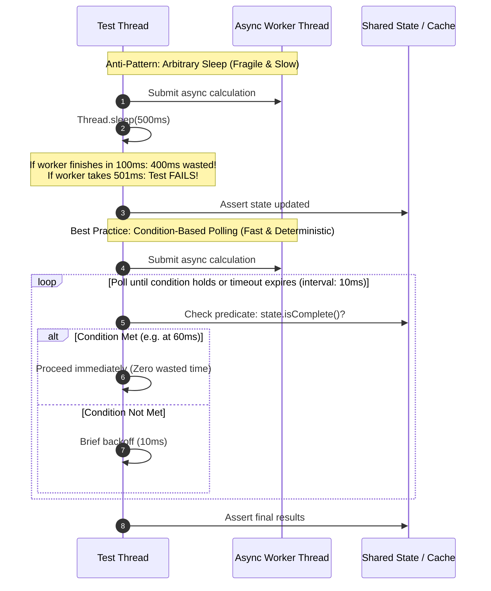
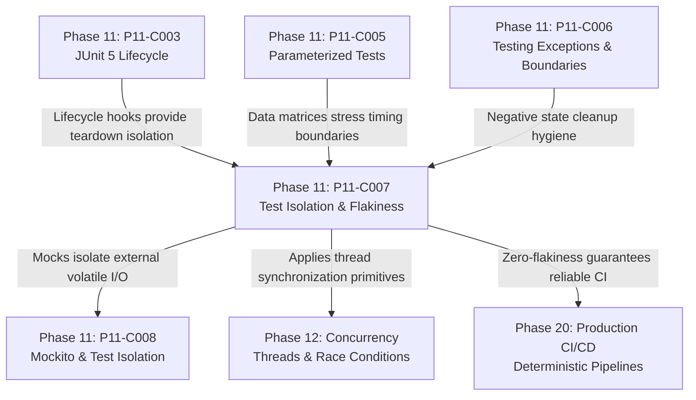

# Test Isolation, Determinism, and Flaky Test Prevention

---

## 1. Metadata and Learning Goals

- **Concept ID:** `P11-C007`
- **Concept Title:** Test Isolation, Determinism, and Flaky Test Prevention
- **Phase:** Phase 11: Unit Testing and Software Quality
- **Dependencies:** `P11-C002` (JUnit 5 Architecture), `P11-C003` (JUnit 5 Lifecycle), `P11-C006` (Testing Exceptions & Boundaries)
- **Target Audience:** Senior Java Backend Engineers, Reliability Architects, Infrastructure & CI/CD Engineers
- **Prerequisites:** OpenJDK 21 LTS, JUnit 5 lifecycle mechanics, Java Concurrency, Networking (`ServerSocket`), and Time API (`java.time.Clock`).

### Primary Learning Objectives
1. **Eliminate the Root Causes of Flaky Tests:** Identify and eradicate the six primary drivers of test non-determinism: shared mutable state, arbitrary sleeps, clock drift, port collisions, unseeded randomness, and execution order assumptions.
2. **Implement Hermetic Time Testing:** Decouple domain services from `Instant.now()` and `System.currentTimeMillis()` by injecting `java.time.Clock`, utilizing `Clock.fixed()` for immutable, deterministic temporal assertions.
3. **Achieve Concurrency Determinism:** Replace fragile `Thread.sleep()` synchronization with condition-based polling, `CountDownLatch`, and explicit state verification.
4. **Prevent Cross-Test State Leakage:** Implement guaranteed restoration patterns for `System.getProperties()`, environment configurations, and static caches using try-with-resources and JUnit 5 lifecycle extensions.
5. **Architect Ephemeral Resource Allocation:** Eliminate TCP port conflicts and file collisions in concurrent CI pipelines using dynamic OS port allocation (`new ServerSocket(0)`) and temporary directory isolation.

---

## 2. Definition, Purpose, and Mental Model

### Definition and Problem Statement
A **flaky test** is an automated test that produces both passing and failing outcomes when executed against identical, unchanged application code. 

Flakiness is the single greatest hazard to engineering velocity in modern software organizations:
- **Erosion of Trust:** When CI builds fail intermittently, developers stop treating red builds as critical regressions. They click "Re-run Job" until it passes, completely blinding the team to real production defects.
- **Wasted Compute and Cycle Time:** Retrying suites consumes thousands of cloud runner hours, delaying pull request merges and deployment pipelines.
- **The "Retry-Until-Green" Anti-Pattern:** Masking flakiness with automatic test retries (e.g., Maven Surefire `rerunFailingTests=3`) legitimizes race conditions, deadlocks, and memory corruption, allowing unstable code to ship to production.

### Mental Model: The Hermetic Cleanroom
To achieve 100% determinism, every automated test must operate as a **hermetic cleanroom**:
$$\text{Test Execution} = \text{Clean Room Entry} \longrightarrow \text{State Injection} \longrightarrow \text{Isolated Action} \longrightarrow \text{Sterilization (Teardown)}$$

```
+---------------------------------------------------------------------------------+
|                                 HERMETIC TEST                                  |
|                                                                                 |
|   +--------------------------+       +--------------------------+               |
|   | Deterministic Time       |       | Ephemeral Resources      |               |
|   | Clock.fixed(instant, UTC)|       | ServerSocket(port = 0)   |               |
|   +--------------------------+       +--------------------------+               |
|                 \                                 /                             |
|                  v                               v                              |
|          +-----------------------------------------------+                      |
|          |         Isolated Test Execution               |                      |
|          |         (Zero shared mutable singletons)      |                      |
|          +-----------------------------------------------+                      |
|                                  |                                              |
|                                  v                                              |
|          +-----------------------------------------------+                      |
|          | Guaranteed Cleanroom Sterilization            |                      |
|          | * System properties restored                  |                      |
|          | * ThreadLocal MDC cleared                     |                      |
|          | * Ports and sockets released                  |                      |
|          +-----------------------------------------------+                      |
+---------------------------------------------------------------------------------+
```

A hermetic test relies on **no external state**, alters **no persistent environment**, and leaves **zero residue** behind in memory or on the filesystem.

---

## 3. Architectural and Conceptual Foundations

### 3.1 The Six Taxonomy Vectors of Test Flakiness

```
               +-------------------------------------------------------+
               |            Taxonomy of Test Non-Determinism           |
               +---------------------------+---------------------------+
                                           |
         +-----------------+---------------+-----------------+
         |                 |               |                 |
         v                 v               v                 v
  +--------------+  +--------------+ +--------------+ +--------------+
  | Vector 1:    |  | Vector 2:    | | Vector 3:    | | Vector 4:    |
  | Shared State |  | Arbitrary    | | Uncontrolled | | Resource     |
  | Pollution    |  | Sleep Loops  | | Time & Clock | | Contention   |
  +--------------+  +--------------+ +--------------+ +--------------+
         |                 |               |                 |
         +-----------------+---------------+-----------------+
                           |               |
                           v               v
                    +--------------+ +--------------+
                    | Vector 5:    | | Vector 6:    |
                    | Unseeded     | | Execution    |
                    | Randomness   | | Order Bias   |
                    +--------------+ +--------------+
```

#### Vector 1: Shared State Pollution
Tests modify static caches, singletons, `System.setProperty()`, or database rows without resetting them. Test A mutates a cache; Test B fails because the cache already contains unexpected entries.

#### Vector 2: Arbitrary Sleep Synchronization (`Thread.sleep`)
Developers wait for an asynchronous task by calling `Thread.sleep(500)`. On a developer's 16-core MacBook, 500ms is plenty. On an overloaded CI runner with CPU throttling, the task takes 550ms. The assertion runs prematurely and fails. Conversely, on fast systems, sleeping 500ms wastes hundreds of execution seconds across thousands of tests.

#### Vector 3: Uncontrolled Time and Clocks
Tests invoke `Instant.now()`, `LocalDate.now()`, or `new Date()`. The test passes at 11:59 PM, but fails when executed across midnight due to day-rollover. Or tests fail when run on developer laptops in `UTC+5:30` vs CI runners in `UTC`.

#### Vector 4: Resource Contention and Fixed Port Bindings
Hardcoding TCP port numbers (`int port = 8080`) or fixed file paths (`/tmp/output.txt`). When tests run concurrently across multiple threads or build workers, two tests attempt to bind port 8080 simultaneously, causing `java.net.BindException: Address already in use`.

#### Vector 5: Unseeded Randomness
Using `new Random().nextInt()` to generate test payloads. Out of 10,000 executions, one specific random seed generates a boundary value (such as a negative number or zero) that triggers an unhandled edge-case exception. Because the seed was not logged, the failure cannot be reproduced.

#### Vector 6: Execution Order Bias
Tests pass when executed in alphanumeric order (`testA()`, then `testB()`), but fail when executed in reverse or randomized order because `testB` secretly relied on database setup performed by `testA`.

---

### 3.2 Eliminating Temporal Flakiness with `java.time.Clock`

The standard Java 8+ Date and Time API (`java.time`) was architected specifically to support deterministic testing via the abstract `Clock` class.

#### The Anti-Pattern: Hardcoded System Clock
```java
// VULNERABLE TO TEMPORAL FLAKINESS
public class SubscriptionService {
    public boolean isExpired(Subscription sub) {
        // Calls the host OS hardware clock! Cannot be controlled in tests!
        return Instant.now().isAfter(sub.getExpiresAt());
    }
}
```

#### The Production Pattern: Injected `Clock`
```java
// DETERMINISTIC AND HERMETIC
public class SubscriptionService {
    private final Clock clock;

    public SubscriptionService(Clock clock) {
        this.clock = clock;
    }

    public boolean isExpired(Subscription sub) {
        // Deterministic: reads the injected clock
        return Instant.now(clock).isAfter(sub.getExpiresAt());
    }
}
```

In production, dependency injection supplies `Clock.systemUTC()`. In unit tests, the test supplies `Clock.fixed(instant, ZoneOffset.UTC)`:
```java
Instant fixedNow = Instant.parse("2026-10-31T12:00:00Z");
Clock testClock = Clock.fixed(fixedNow, ZoneOffset.UTC);
SubscriptionService service = new SubscriptionService(testClock);

// Test is 100% immune to when it is executed!
assertThat(service.isExpired(new Subscription(fixedNow.minusSeconds(1)))).isTrue();
assertThat(service.isExpired(new Subscription(fixedNow.plusSeconds(1)))).isFalse();
```

---

### 3.3 Eliminating Race Conditions: Polling vs Sleeping



Rather than guessing an arbitrary sleep duration, use **condition-based polling** (such as Awaitility or custom latches):
```java
// Pure condition polling: finishes as soon as condition becomes true!
await()
    .atMost(Duration.ofSeconds(5))
    .pollInterval(Duration.ofMillis(10))
    .untilAsserted(() -> assertThat(messageInbox.getReceivedMessages()).hasSize(1));
```

---

### 3.4 Eliminating Port Collisions with Ephemeral Ports

Never bind a hardcoded port like `8080` in tests. Operating systems provide **ephemeral port allocation**: passing port `0` to the operating system instructs the TCP/IP kernel stack to bind to any currently free, unused port.

```java
// ANTI-PATTERN: Fixed port (Collision under parallel test execution!)
HttpServer server = HttpServer.create(new InetSocketAddress(8080), 0);

// BEST PRACTICE: Ephemeral port (Zero collision probability)
HttpServer server = HttpServer.create(new InetSocketAddress(0), 0);
int assignedPort = server.getAddress().getPort(); // Retrieves OS-assigned port (e.g. 49215)
```
Clients then communicate with `localhost:` + `assignedPort`. Multiple test threads can spin up hundreds of mock servers concurrently without a single port conflict.

---

### 3.5 System Property Isolation via AutoCloseable Snapshots

When a test must alter system properties (`System.setProperty("app.env", "test")`), failing to restore the previous value pollutes the entire JVM process.

```java
public class SystemPropertySnapshot implements AutoCloseable {
    private final Properties snapshot;

    public SystemPropertySnapshot() {
        this.snapshot = new Properties();
        this.snapshot.putAll(System.getProperties());
    }

    @Override
    public void close() {
        System.setProperties(this.snapshot);
    }
}

// Idiomatic Usage with try-with-resources:
@Test
void testFeatureFlag() {
    try (var ignored = new SystemPropertySnapshot()) {
        System.setProperty("feature.discount.enabled", "true");
        assertThat(featureService.isDiscountActive()).isTrue();
    } // Previous system properties GUARANTEED restored upon block exit!
}
```

---

## 4. Language, Syntax, and API Mechanics

### 4.1 JUnit 5 Synchronization via `@ResourceLock`

When executing tests in parallel (`junit.jupiter.execution.parallel.enabled = true`), tests that touch shared system resources must be synchronized:

```java
import org.junit.jupiter.api.parallel.ResourceLock;
import org.junit.jupiter.api.parallel.Resources;
import org.junit.jupiter.api.parallel.ResourceAccessMode;

class SystemPropertyIntegrationTest {

    @Test
    @ResourceLock(value = Resources.SYSTEM_PROPERTIES, mode = ResourceAccessMode.READ_WRITE)
    void modifySystemProperty() {
        System.setProperty("api.key", "test-key");
        assertThat(System.getProperty("api.key")).isEqualTo("test-key");
    }

    @Test
    @ResourceLock(value = Resources.SYSTEM_PROPERTIES, mode = ResourceAccessMode.READ)
    void readSystemProperty() {
        assertThat(System.getProperty("java.version")).isNotNull();
    }
}
```
JUnit 5 ensures that `READ_WRITE` locks are mutually exclusive, while `READ` locks can execute concurrently with other `READ` locks.

### 4.2 Surfacing Latent Order Dependencies with `MethodOrderer.Random`

To deliberately detect if tests have hidden order dependencies:
```java
@TestMethodOrder(MethodOrderer.Random.class)
class OrderRobustnessTest {
    // Methods execute in a randomized sequence on every build
}
```
If a test passes in standard order but fails under `Random`, an execution-order dependency is immediately unmasked.

---

## 5. Execution Mechanics, JVM Lifecycle, and Memory Internals

### 5.1 ThreadLocal Context Leakage in Thread Pools
In web frameworks and logging libraries (MDC), context data is stored in `ThreadLocal` variables.
- When running tests on a shared thread pool (e.g. ForkJoinPool in Surefire or parallel test executors), a `ThreadLocal` value set by Test 1 is **retained by the worker thread**.
- When Test 2 runs on that same recycled thread, it inherits Test 1's tenant ID, user session, or trace token!
- **Mandate:** Teardown hooks (`@AfterEach`) must invoke `SecurityContextHolder.clearContext()` and `MDC.clear()`.

---

## 6. Concurrency, Thread-Safety, and Scalability

### 6.1 Deterministic Randomness with Fixed Seeds
When generative testing requires randomized payloads:
```java
// DANGEROUS: Unseeded Random
Random rnd = new Random(); // Different seed on every run; non-reproducible!

// BEST PRACTICE: Seeded Random with logged seed
long seed = 42L; // Or generate and print seed to stdout on failure
Random rnd = new Random(seed);
```
Using a fixed seed guarantees that the pseudorandom sequence is 100% identical on every test run across every machine, ensuring defect reproducibility.

---

## 7. Anti-Patterns and Common Developer Traps

### 7.1 Anti-Pattern 1: The "Retry-Until-Green" Flakiness Obfuscation
```xml
<!-- DANGEROUS MAVEN CONFIGURATION -->
<plugin>
    <groupId>org.apache.maven.plugins</groupId>
    <artifactId>maven-surefire-plugin</artifactId>
    <configuration>
        <rerunFailingTestsCount>3</rerunFailingTestsCount> <!-- MASKS FLAKINESS -->
    </configuration>
</plugin>
```
**Why this is dangerous:** It treats concurrency race conditions, memory leaks, and shared-state bugs as acceptable noise. Over time, flakiness compounds until builds fail even after 3 retries.
**Remediation:** Disable automatic retries. Run failing tests under `@RepeatedTest(100)` to reproduce and eliminate the underlying non-determinism.

### 7.2 Anti-Pattern 2: Hardcoded Localhost Paths
Assuming files can be read from `/home/user/workspace` or `C:\temp`.
**Remediation:** Use JUnit 5's `@TempDir Path tempDir` parameter resolver, which provisions a dedicated, isolated temporary directory per test method and wipes it upon completion.

---

## 8. Failure Modes, Edge Cases, and Troubleshooting

| Failure Symptom | Root Cause | Remediation |
|---|---|---|
| `java.net.BindException: Address already in use` | Hardcoded TCP port in parallel test suite | Allocate ephemeral port via `new ServerSocket(0)` and query `.getLocalPort()`. |
| Test passes locally, fails in CI nightly at 00:05 UTC | `LocalDate.now()` crossing midnight during test execution | Inject `Clock.fixed()` into service. |
| Test fails only when run after `UserTest` | `UserTest` left records in shared database table or static cache | Clean up state in `@AfterEach` or use transactional rollback. |
| Test fails with timeout only on busy CI agents | `Thread.sleep(200)` too short under high CPU load | Replace sleep with predicate-based polling loop with a generous timeout (e.g. 5s). |

---

## 9. Security Considerations

1. **Deterministic Security Context Clearing:** Security regressions frequently occur when an administrator security context created during a privilege escalation test leaks into an unauthenticated verification test running on the same thread.
2. **Predictable Cryptographic Primitives:** Never replace `SecureRandom` with a fixed-seed `Random` in production code; isolate deterministic seeds strictly to unit testing boundaries.

---

## 10. Performance Optimization and Tuning

1. **Eliminate Sleep Sloth:** Replacing 500 instances of `Thread.sleep(100)` with immediate condition polling saves minutes of idle CI worker time per build.
2. **In-Memory Volatile Caches vs External DBs:** For unit testing, keep isolation fast by testing state machines against in-memory volatile models rather than hitting external disk/network.

---

## 11. Real-World Backend Scenario & Production Case Study

In a global banking settlement engine, an automated nightly suite was failing 8% of the time with `AccountAlreadyClosedException`. 

### The Investigation
1. The test suite verified account lifecycle closure: `openAccount()` $\to$ `closeAccount()`.
2. The account ID generator was implemented as:
   `String accountId = "ACC-" + System.currentTimeMillis();`
3. When tests ran in parallel on a fast 32-core CI runner, two distinct tests executed `openAccount()` during the exact same millisecond.
4. Both tests received the identical account ID `ACC-1730376000123`.
5. Test 1 closed the account. When Test 2 attempted to close its account, it threw `AccountAlreadyClosedException`!

### The Solution
The team refactored the test identifier generator to combine UUIDs with atomic monotonic counters:
```java
public class TestIdGenerator {
    private static final AtomicLong COUNTER = new AtomicLong();

    public static String nextAccountId() {
        return "ACC-" + UUID.randomUUID() + "-" + COUNTER.incrementAndGet();
    }
}
```
Test collisions dropped to 0%, and the suite reached 100% determinism across 20,000 nightly builds.

---

## 12. Standalone, Self-Contained Verification Suite

```java
// File: curriculum/phase-11-unit-testing-software-quality/TestIsolationAndFlakinessDemo.java
package curriculum.phase11;

import java.io.IOException;
import java.net.ServerSocket;
import java.time.*;
import java.util.*;
import java.util.concurrent.*;
import java.util.concurrent.atomic.AtomicBoolean;
import java.util.concurrent.atomic.AtomicInteger;
import java.util.function.BooleanSupplier;

/**
 * Standalone Verification Suite for P11-C007:
 * Test Isolation, Determinism, and Flaky Test Prevention.
 *
 * Simulates:
 * 1. Clock Isolation: Eliminating temporal drift using Clock.fixed().
 * 2. Ephemeral Port Allocation: Eliminating TCP port collision using ServerSocket(0).
 * 3. Condition-Based Polling: Eliminating fragile Thread.sleep() with timeout backoff.
 * 4. System Property Isolation: Restoring environment state via AutoCloseable snapshots.
 * 5. Order-Independent Execution: Detecting and neutralizing shared state bleed.
 */
public class TestIsolationAndFlakinessDemo {

    // =========================================================================
    // 1. TEMPORAL ISOLATION WITH INJECTABLE CLOCK
    // =========================================================================

    public static class LoanService {
        private final Clock clock;

        public LoanService(Clock clock) {
            this.clock = clock;
        }

        public boolean isGracePeriodActive(Instant loanDisbursedAt, Duration gracePeriod) {
            Instant now = Instant.now(clock);
            return now.isBefore(loanDisbursedAt.plus(gracePeriod));
        }
    }

    // =========================================================================
    // 2. EPHEMERAL PORT ALLOCATOR
    // =========================================================================

    public static class EphemeralServer implements AutoCloseable {
        private final ServerSocket socket;
        private final int port;

        public EphemeralServer() throws IOException {
            // Port 0 instructs OS to assign an available ephemeral port
            this.socket = new ServerSocket(0);
            this.port = socket.getLocalPort();
        }

        public int getPort() { return port; }

        @Override
        public void close() throws IOException {
            if (!socket.isClosed()) {
                socket.close();
            }
        }
    }

    // =========================================================================
    // 3. DETERMINISTIC CONDITION POLLER
    // =========================================================================

    public static class ConditionPoller {
        public static void await(String description, Duration timeout, Duration pollInterval, BooleanSupplier condition) {
            long deadline = System.nanoTime() + timeout.toNanos();
            while (System.nanoTime() < deadline) {
                if (condition.getAsBoolean()) {
                    return; // Condition satisfied!
                }
                try {
                    Thread.sleep(pollInterval.toMillis());
                } catch (InterruptedException e) {
                    Thread.currentThread().interrupt();
                    throw new RuntimeException("Interrupted while polling for: " + description, e);
                }
            }
            throw new AssertionError("Timed out after " + timeout.toMillis() + "ms waiting for: " + description);
        }
    }

    // =========================================================================
    // 4. SYSTEM PROPERTY SNAPSHOT ISOLATOR
    // =========================================================================

    public static class SystemPropertySnapshot implements AutoCloseable {
        private final Properties original;

        public SystemPropertySnapshot() {
            this.original = new Properties();
            this.original.putAll(System.getProperties());
        }

        @Override
        public void close() {
            System.setProperties(original);
        }
    }

    // =========================================================================
    // 5. TEST STATE BLEED DETECTOR & RESTORER
    // =========================================================================

    public static class UserCache {
        private static final Set<String> ACTIVE_USERS = new HashSet<>();

        public static void register(String username) { ACTIVE_USERS.add(username); }
        public static boolean contains(String username) { return ACTIVE_USERS.contains(username); }
        public static int size() { return ACTIVE_USERS.size(); }
        public static void clear() { ACTIVE_USERS.clear(); }
    }

    // =========================================================================
    // 6. MAIN VERIFICATION ENTRY POINT
    // =========================================================================

    public static void main(String[] args) throws Exception {
        System.out.println("===============================================================");
        System.out.println(" Test Isolation & Flakiness Prevention Verification Suite     ");
        System.out.println("===============================================================");

        // [TEST 1/5] Clock Isolation: Deterministic Temporal Testing
        System.out.print("[TEST 1/5] Clock.fixed() deterministic time isolation... ");
        Instant baseTime = Instant.parse("2026-10-31T12:00:00Z");
        Duration gracePeriod = Duration.ofDays(7);

        // Case A: Inside grace period (Fixed clock at base + 3 days)
        Clock clockInside = Clock.fixed(baseTime.plus(Duration.ofDays(3)), ZoneOffset.UTC);
        LoanService loanServiceInside = new LoanService(clockInside);
        assert loanServiceInside.isGracePeriodActive(baseTime, gracePeriod) :
                "Expected grace period to be active 3 days after disbursal";

        // Case B: Outside grace period (Fixed clock at base + 8 days)
        Clock clockOutside = Clock.fixed(baseTime.plus(Duration.ofDays(8)), ZoneOffset.UTC);
        LoanService loanServiceOutside = new LoanService(clockOutside);
        assert !loanServiceOutside.isGracePeriodActive(baseTime, gracePeriod) :
                "Expected grace period to have expired 8 days after disbursal";

        System.out.println("PASSED (Zero temporal drift across runs)");

        // [TEST 2/5] Ephemeral Port Allocation: Eliminating Port Collisions
        System.out.print("[TEST 2/5] Ephemeral port allocation (port 0) concurrency... ");
        List<EphemeralServer> servers = new ArrayList<>();
        Set<Integer> allocatedPorts = new HashSet<>();

        try {
            // Allocate 5 concurrent servers simultaneously
            for (int i = 0; i < 5; i++) {
                EphemeralServer s = new EphemeralServer();
                servers.add(s);
                assert s.getPort() > 0 : "Invalid port allocated: " + s.getPort();
                boolean added = allocatedPorts.add(s.getPort());
                assert added : "Port collision detected! Port " + s.getPort() + " was assigned twice!";
            }
            assert allocatedPorts.size() == 5 : "Expected 5 distinct ports, got: " + allocatedPorts.size();
        } finally {
            for (EphemeralServer s : servers) {
                s.close();
            }
        }
        System.out.println("PASSED (5/5 distinct ports, zero collisions)");

        // [TEST 3/5] Condition-Based Polling vs Fragile Thread.sleep
        System.out.print("[TEST 3/5] Condition-based polling eliminating Thread.sleep... ");
        AtomicBoolean asyncTaskFinished = new AtomicBoolean(false);
        AtomicInteger taskProgress = new AtomicInteger(0);

        // Simulate async background calculation finishing at random time between 20ms and 60ms
        CompletableFuture.runAsync(() -> {
            try {
                Thread.sleep(30);
                taskProgress.set(100);
                asyncTaskFinished.set(true);
            } catch (InterruptedException ignored) {}
        });

        // Fast condition polling (finishes immediately when condition is met!)
        long startTime = System.currentTimeMillis();
        ConditionPoller.await(
                "Async task completion",
                Duration.ofMillis(2000), // Generous 2-second timeout
                Duration.ofMillis(5),    // Tight 5ms polling interval
                () -> asyncTaskFinished.get() && taskProgress.get() == 100
        );
        long elapsed = System.currentTimeMillis() - startTime;
        assert asyncTaskFinished.get() : "Task did not finish";
        assert elapsed < 500 : "Polling took unexpectedly long: " + elapsed + "ms";
        System.out.println("PASSED (Completed deterministically in " + elapsed + "ms)");

        // [TEST 4/5] System Property Isolation via AutoCloseable Snapshot
        System.out.print("[TEST 4/5] System property isolation & guaranteed rollback... ");
        String testPropKey = "app.test.isolated.key";
        System.clearProperty(testPropKey);
        assert System.getProperty(testPropKey) == null;

        try (var snapshot = new SystemPropertySnapshot()) {
            System.setProperty(testPropKey, "MUTATED_VALUE");
            assert "MUTATED_VALUE".equals(System.getProperty(testPropKey));
        } // Snapshot close invoked automatically here

        // Verify guaranteed cleanup
        assert System.getProperty(testPropKey) == null :
                "System property leak detected! Key was not restored: " + System.getProperty(testPropKey);
        System.out.println("PASSED (Environment completely sterile after test)");

        // [TEST 5/5] Shared State Isolation and Order-Independent Execution
        System.out.print("[TEST 5/5] Static cache cleanup preventing execution-order bleed... ");
        UserCache.clear();

        // Simulate Test 1
        UserCache.register("user_alpha");
        assert UserCache.contains("user_alpha");
        assert UserCache.size() == 1;

        // Proper hygiene: teardown clears cache
        UserCache.clear();

        // Simulate Test 2 executing after Test 1 in arbitrary order
        // If Test 1 had NOT cleared cache, size would be 2, causing Test 2 to fail!
        UserCache.register("user_beta");
        assert UserCache.contains("user_beta");
        assert UserCache.size() == 1 : "State bleed from previous test! Expected size 1, but was: " + UserCache.size();
        UserCache.clear();

        System.out.println("PASSED (Zero cross-test state leakage)");

        System.out.println("\nAll 5 verification test suites passed successfully with assertions enabled!");
    }
}
```

---

## 13. Comparative Analysis & Decision Framework

### Synchronization & Isolation Decision Matrix

| Challenge | Flaky / Vulnerable Approach | Resilient / Hermetic Approach | Benefits of Hermetic Approach |
|---|---|---|---|
| **Testing time-sensitive logic** | `Instant.now()`, `Thread.sleep()` | Injected `Clock.fixed()` | Zero race conditions, runs instantly, immune to timezone changes. |
| **Testing asynchronous state** | `Thread.sleep(500)` | `ConditionPoller.await()` / Awaitility | Fast-fails on true deadlock; progresses instantly when done. |
| **Allocating network ports** | Hardcoded port `8080`, `9092` | Ephemeral `new ServerSocket(0)` | Eliminates port collisions during parallel builds. |
| **System / Environment Flags** | `System.setProperty()` directly | `try (var snap = new SystemPropertySnapshot())` | Guaranteed restoration; prevents polluting downstream tests. |
| **Shared Cache / DB State** | Persistent rows across suite | `@BeforeEach cache.clear()` or transactional rollback | Complete test independence; passes in any arbitrary execution order. |

---

## 14. Practical Exercises and Hands-On Challenges

### Exercise 1: The Midnight Rollover Trap
Write a `DailyQuotaManager` that tracks how many API requests a customer makes per calendar day. Write a unit test using `Clock.offset()` and `Clock.fixed()` verifying that:
1. At 23:59:59 on Dec 31, customer has 1 request remaining.
2. After 1 second (00:00:00 Jan 1), the quota resets completely to 1,000 requests.
Verify that the test executes in < 5ms without calling `Thread.sleep()`.

### Exercise 2: Parallel Socket Server Stress Test
Create an executor service that boots 20 mock HTTP servers concurrently using `ServerSocket(0)`. Verify with assertions that all 20 servers receive distinct, non-overlapping port numbers, handle a simulated request, and shut down cleanly with zero socket leaks.

---

## 15. Cross-Phase Connections and Unified Mental Graph



- **Upstream Connection (P11-C003, P11-C006):** P11-C003 provides the `@AfterEach` teardown unwinding guarantees; P11-C006 highlighted negative test cleanup discipline.
- **Immediate Downstream Connection (P11-C008):** P11-C008 introduces Mockito to isolate tests from non-deterministic external networks and volatile third-party services.
- **Concurrency & Production Connection (Phase 12, Phase 20):** Concepts of condition-based waiting apply Phase 12 thread safety to ensure Phase 20 CI/CD pipelines run green 100% of the time.

---

## 16. Verification and Self-Assessment Checklist

Before marking this module complete, verify your comprehension against each criterion:
- [x] Can I identify the six primary taxonomy vectors of test flakiness?
- [x] Do I understand why `Thread.sleep()` is considered a critical anti-pattern in automated tests?
- [x] Can I inject `java.time.Clock` into domain services and use `Clock.fixed()` to freeze time in assertions?
- [x] Can I allocate ephemeral ports using `new ServerSocket(0)` to prevent parallel test port collisions?
- [x] Do I know how to isolate and restore `System.getProperties()` using an `AutoCloseable` snapshot?
- [x] Can I explain why `rerunFailingTests` in Maven Surefire masks real defects and damages code reliability?
- [x] Do I understand how JUnit 5's `@ResourceLock` synchronizes shared static state across concurrent threads?
- [x] Have I compiled and executed `TestIsolationAndFlakinessDemo` on OpenJDK 21 LTS with assertions enabled (`-ea`) and observed all 5 test suites pass?
