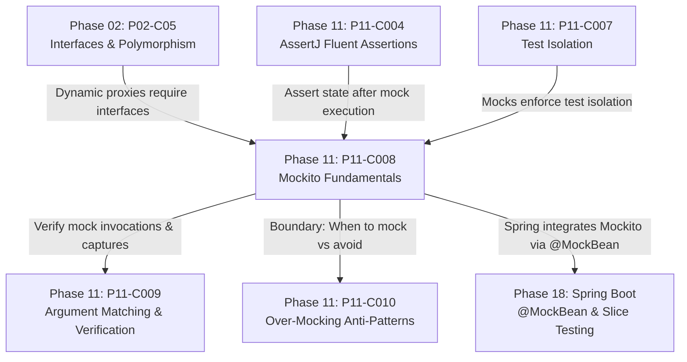

# Mockito Fundamentals: Mocks, Spies, Stubs, and when()/thenReturn()

---

## 1. Metadata and Learning Goals

- **Concept ID:** `P11-C008`
- **Concept Title:** Mockito Fundamentals: Mocks, Spies, Stubs, and when()/thenReturn()
- **Phase:** Phase 11: Unit Testing and Software Quality
- **Dependencies:** `P11-C002` (JUnit 5 Architecture), `P11-C003` (JUnit 5 Lifecycle), `P11-C004` (Fluent Assertions), `P11-C007` (Test Isolation)
- **Target Audience:** Senior Java Backend Engineers, Distributed Systems Developers, Microservice Architects
- **Prerequisites:** OpenJDK 21 LTS, Java Reflection and Dynamic Proxies, JUnit 5 extensions (`@ExtendWith`).

### Primary Learning Objectives
1. **Master the Test Double Taxonomy:** Differentiate between Dummies, Stubs, Spies, Mocks, and Fakes according to Gerard Meszaros' xUnit patterns.
2. **Deconstruct Bytecode Generation Mechanics:** Understand how Mockito utilizes Byte Buddy to generate dynamic runtime subclasses and intercept method invocations.
3. **Contrast Mocks vs Spies:** Distinguish between hollow synthetic instances (`mock()`) and real instance wrappers (`spy()`), mastering when to use `doReturn().when()` versus `when().thenReturn()`.
4. **Implement Robust Stubbing:** Configure single and consecutive return values (`thenReturn()`), exception simulation (`thenThrow()`), and dynamic answers (`thenAnswer()`).
5. **Enforce Mockito Strictness:** Leverage `Strictness.STRICT_STUBS` to eliminate dead stubbing code, detect unused mocks, and prevent test drift.

---

## 2. Definition, Purpose, and Mental Model

### Definition and Problem Statement
In modern microservice architectures, backend components rarely operate in isolation. A payment processing service depends on a database repository, an external payment gateway REST client, a fraud detection engine, an audit Kafka producer, and an email notification service.

If unit tests attempted to instantiate real implementations of all these collaborators:
1. **Tests would be painfully slow:** Network round-trips and disk I/O would balloon suite runtimes from seconds to hours.
2. **Tests would be non-deterministic (flaky):** External sandbox APIs fail intermittently, experience rate limits, or require network connectivity.
3. **Negative paths would be impossible to trigger:** Simulating a database deadlock, an HTTP 504 Gateway Timeout, or a malformed TLS handshake with real services is exceedingly difficult.

**Mockito** is the industry-standard Java library for creating **Test Doubles**: lightweight in-memory replacements for external collaborators that allow engineers to test the **System Under Test (SUT)** in complete isolation.

### Mental Model: The Hollywood Stunt Double
Think of the System Under Test (SUT) as the lead actor in a movie scene. The collaborator (e.g. `PaymentGatewayClient`) is a dangerous physical stunt:
- In production, the real actor performs the live network call.
- In unit testing, you swap in a **Stunt Double (Mock)**:
  - The stunt double wears the same clothes and has the same external signature (implements the same interface/class).
  - But inside, the double follows a pre-programmed rehearsal script (**Stubbing**): *"When asked for `chargeCreditCard()`, reply with `APPROVED`"*.
  - After the scene finishes, the director reviews the tape (**Verification**): *"Did the lead actor call the stunt double exactly once with `$50.00`?"*

```
+---------------------------------------------------------------------------------+
|                                 UNIT TEST BOUNDARY                              |
|                                                                                 |
|   +-------------------------------------------------------------------------+   |
|   |                       System Under Test (SUT)                           |   |
|   |                      OrderCheckoutService.java                          |   |
|   +-------------------------------------------------------------------------+   |
|                     |                                     |                     |
|          1. Calls calculateTotal()               2. Calls charge(card, $100)    |
|                     v                                     v                     |
|   +-----------------------------------+   +---------------------------------+   |
|   |        REAL OBJECT                |   |        MOCKITO MOCK             |   |
|   |   (PricingEngine - Fast & Pure)   |   | (PaymentClient - Dynamic Proxy) |   |
|   +-----------------------------------+   +---------------------------------+   |
|                                                           |                     |
|                                               Pre-programmed Stub Response:     |
|                                               when(charge()).thenReturn(OK)     |
|                                                           |                     |
|                                                           v                     |
|                                            (Zero network I/O, Instant, 100% Repro)
+---------------------------------------------------------------------------------+
```

---

## 3. Architectural and Conceptual Foundations

### 3.1 The Gerard Meszaros Test Double Taxonomy

Before writing test doubles, engineers must speak the precise architectural language of xUnit test doubles:

```
                                 TEST DOUBLES
                                      |
         +-----------------+----------+--------+-----------------+
         |                 |                   |                 |
         v                 v                   v                 v
     [ DUMMY ]         [ STUB ]             [ SPY ]           [ MOCK ]
   Passed around,    Returns canned       Wraps a real      Pre-programmed with
   never invoked.    pre-recorded data.   object; records   expectations; asserts
   (e.g., filler     (e.g., when/then)    invocations.      interaction count & args.
   parameters)
```

| Double Type | Definition | Implementation in Mockito / Java |
|---|---|---|
| **Dummy** | Objects passed to satisfy method signatures, but never actually used or invoked. | `mock(UserLogger.class)` passed to a constructor where logging is ignored. |
| **Stub** | Provides canned, hardcoded responses to specific invocations during the test. | `when(repo.findById("1")).thenReturn(Optional.of(user))` |
| **Spy** | A partial mock that wraps a **real object instance**. Un-stubbed methods invoke real logic; invocations are recorded for inspection. | `OrderService spy = Mockito.spy(new OrderService(realRepo));` |
| **Mock** | A completely synthetic proxy pre-programmed with expected calls, parameter matchers, and return values, verified after execution. | `verify(emailClient, times(1)).sendEmail(any());` |
| **Fake** | A working, lightweight in-memory alternative to a heavy dependency (has real business logic, but not production-ready). | An in-memory `HashMap`-backed repository or H2 database (not a Mockito construct). |

---

### 3.2 Dynamic Bytecode Generation: How Mockito Intercepts Calls

Mockito does not modify your source code. At runtime, Mockito employs **Byte Buddy** (a high-performance JVM bytecode generation library) to dynamically synthesize a subclass of your target class:

```mermaid
classDiagram
    class PaymentGatewayClient {
        +charge(amount) PaymentResponse
        +refund(txnId) boolean
    }

    class PaymentGatewayClient$MockitoMock$abc123 {
        -$mockitoInterceptor: MockitoMethodInterceptor
        +charge(amount) PaymentResponse
        +refund(txnId) boolean
    }

    class MockitoMethodInterceptor {
        -stubbedInvocations: Map
        -actualInvocations: List
        +intercept(proxy, method, args) Object
    }

    PaymentGatewayClient <|-- PaymentGatewayClient$MockitoMock$abc123
    PaymentGatewayClient$MockitoMock$abc123 --> MockitoMethodInterceptor : Delegates all calls
```

1. **Subclass Generation:** Mockito generates `PaymentGatewayClient$MockitoMock$...` extending `PaymentGatewayClient`.
2. **Method Interception:** Every method is overridden to redirect execution to Mockito's internal interceptor.
3. **Invocation Recording:** The interceptor logs the method name, argument instances, timestamp, and calling thread into an internal invocation container.
4. **Matching & Return:** The interceptor evaluates whether the call matches an active stub rule (`when(...)`). If matched, it returns the configured value. If unmatched, it returns a safe default (`null`, `0`, `false`, `emptyList()`).

---

### 3.3 Mocks vs Spies: Hollow Shells vs Real Object Wrappers

#### Hollow Mocks (`mock()`)
```java
// A MOCK is an empty shell:
PaymentClient mockClient = mock(PaymentClient.class);
// By default, EVERY method returns null / default primitive:
PaymentResult res = mockClient.process(req); // Returns NULL! Real code never executes.
```

#### Real Object Spies (`spy()`)
```java
// A SPY wraps an actual instance of the class:
PricingCalculator realCalc = new PricingCalculator();
PricingCalculator spyCalc = spy(realCalc);

// By default, un-stubbed methods execute REAL code!
double tax = spyCalc.calculateTax(100.0); // Executes real business calculation!

// You can selectively override ONE specific method:
doReturn(0.0).when(spyCalc).calculateTax(100.0);
```

---

### 3.4 The Crucial Trap: `when().thenReturn()` vs `doReturn().when()` on Spies

Consider this common and dangerous trap when working with Spies:

```java
List<String> realList = new ArrayList<>();
List<String> spyList = spy(realList);

// DANGEROUS DISASTER:
when(spyList.get(0)).thenReturn("foo");
```
**Why this throws `IndexOutOfBoundsException`:**
When Java evaluates `when(spyList.get(0))`, it **must execute `spyList.get(0)` first** to pass the result into `when(...)`!
Because `spyList` wraps an empty `ArrayList`, calling `get(0)` executes the real method on an empty list, immediately throwing `IndexOutOfBoundsException: Index 0 out of bounds for length 0`!

#### The Remediation: `doReturn().when()`
```java
// SAFE IDIOM FOR SPIES:
doReturn("foo").when(spyList).get(0);
```
With `doReturn()`, Mockito disables the underlying method invocation *before* `spyList.get(0)` is evaluated, avoiding the side effect completely.

---

### 3.5 Initialization Paradigms: Programmatic vs Annotations

#### Paradigm A: Programmatic (Explicit & Lean)
```java
class OrderServiceTest {
    private PaymentClient paymentClient = mock(PaymentClient.class);
    private InventoryClient inventoryClient = mock(InventoryClient.class);
    private OrderService orderService = new OrderService(paymentClient, inventoryClient);
}
```

#### Paradigm B: Declarative Annotations with `@ExtendWith(MockitoExtension.class)`
```java
@ExtendWith(MockitoExtension.class)
class OrderServiceTest {

    @Mock
    private PaymentClient paymentClient;

    @Mock
    private InventoryClient inventoryClient;

    @InjectMocks
    private OrderService orderService; // Mockito automatically reflects and injects mocks via constructor!
}
```
**Architectural Note:** `@InjectMocks` attempts constructor injection first. If no matching constructor exists, it falls back to property/setter injection, and finally field reflection injection. **Always provide constructor injection** in backend domain services for clean architectural design.

---

## 4. Language, Syntax, and API Mechanics

### 4.1 Stubbing Reference Guide

```java
import static org.mockito.Mockito.*;

// 1. Basic Return Value
when(repo.findById("USR-101")).thenReturn(Optional.of(testUser));

// 2. Exception Throwing
when(repo.findById("BAD-ID")).thenThrow(new EntityNotFoundException("User not found"));

// 3. Consecutive Stubbing (Multi-invocation responses)
when(randomService.generatePin())
    .thenReturn("1111") // First call
    .thenReturn("2222") // Second call
    .thenThrow(new SecurityException("Exhausted")); // Third call

// 4. Void Method Exception Simulation
doThrow(new NetworkTimeoutException()).when(emailClient).sendEmail(any());

// 5. Dynamic Answer Calculation
when(taxClient.calculate(anyDouble())).thenAnswer(invocation -> {
    Double amount = invocation.getArgument(0);
    return amount * 0.20; // 20% dynamic tax computation
});
```

---

## 5. Execution Mechanics, JVM Lifecycle, and Memory Internals

### 5.1 Metaspace Classloader Pressure
Every time Mockito creates a mock for a new class type, Byte Buddy dynamically generates and loads a new class into JVM Metaspace.
- In poorly architected test suites containing thousands of distinct mocked classes, Metaspace usage can expand dramatically.
- Mockito caches generated mock classes internally by class signature, so repeated `mock(PaymentClient.class)` calls reuse the existing synthetic class structure from the cache.

### 5.2 Thread-Safety Invariant
Mockito mocks are thread-safe for **invocation recording** (e.g. concurrent calls from worker threads are safely added to a synchronized list). However, **configuring stubs concurrently** (`when(...)`) across multiple threads is strictly not thread-safe. All stubbing must be performed during test setup before launching concurrent threads.

---

## 6. Concurrency, Thread-Safety, and Scalability

### Mockito Strictness: `Strictness.STRICT_STUBS`
In modern Mockito (version 3+), the JUnit 5 extension defaults to **Strict Stubbing**:
1. **Unnecessary Stubbing Detection:** If you configure `when(repo.findById("X")).thenReturn(user)`, but your test never actually calls `repo.findById("X")`, Mockito fails the test with `UnnecessaryStubbingException`.
2. **Argument Mismatch Early Warnings:** If you stubbed for `"USR-01"`, but the code called `"USR-02"`, Mockito reports a clear diagnostic diff rather than returning `null` silently.

This strictness eliminates **test debt**: preventing old, dead stubbing rules from cluttering test classes when production code changes.

---

## 7. Anti-Patterns and Common Developer Traps

### 7.1 Anti-Pattern 1: Mocking Value Objects and Collections
```java
// ABSOLUTE ANTI-PATTERN: Never mock data!
List<String> mockList = mock(List.class);
when(mockList.size()).thenReturn(5);

User mockUser = mock(User.class);
when(mockUser.getName()).thenReturn("Alice");
```
**Why this is toxic:** Mocks should represent **collaborators that perform behaviors or I/O** (Services, Repositories, Gateways). Value objects, DTOs, domain models, records, and collections should always be instantiated with real instances (`new User("Alice")`, `List.of(...)`). Mocking data structures leads to absurdly fragile tests that test Mockito's proxy mechanics rather than application logic.

### 7.2 Anti-Pattern 2: The "Over-Stubbed Desert"
Creating 50 lines of `when(...).thenReturn(...)` setup for a single 3-line test method. This indicates severe architectural coupling: the class under test has too many dependencies and violates the Single Responsibility Principle (SRP).

---

## 8. Failure Modes, Edge Cases, and Troubleshooting

| Failure Symptom | Underlying Cause | Diagnostic Action & Remediation |
|---|---|---|
| `UnnecessaryStubbingException` | Stubbing configured but never invoked by code under test | Remove obsolete stubbing rule, or mark lenient via `lenient().when(...)`. |
| `NullPointerException` on mock invocation | Method called without matching stubbing; mock returned default `null` | Verify input arguments match stubbing parameters; check parameter types. |
| `IndexOutOfBoundsException` during spy setup | Evaluated `when(spy.get(0))` which invoked real method on empty object | Refactor to `doReturn("val").when(spy).get(0)`. |
| Cannot mock `final` class or method | Mockito default mock maker restricted on legacy JDKs | Ensure `mockito-inline` is on test classpath or upgrade to modern Mockito 5+. |

---

## 9. Security Considerations

1. **Credential Leaks in Unverified Mocks:** When mocking security authentication providers, ensure mocks do not store plaintext passwords or authentication tokens in memory longer than necessary.
2. **Never Mock Cryptographic Hashers or Token Signers in Security Tests:** Security regression tests must use real crypto providers (e.g. `BCryptPasswordEncoder`) to verify true cryptographic behavior.

---

## 10. Performance Optimization and Tuning

1. **Prefer Package-Private Class Visibility:** Mockito's Byte Buddy proxy generator can generate faster subclasses when classes and methods have package-private or public visibility.
2. **Reuse Clean Fixtures:** Avoid re-instantiating complex mock dependency graphs manually in every test method; use `@ExtendWith(MockitoExtension.class)` and `@InjectMocks`.

---

## 11. Real-World Backend Scenario & Production Case Study

In a distributed crypto custody platform, an automated payout processor dispatches Bitcoin transactions via a blockchain node RPC client.

### The Problem
During development, engineers tested the payout processor by pointing tests to a real Bitcoin testnet daemon.
- Testnet nodes were slow (block creation took 10 minutes).
- Network outages broke nightly CI builds.
- Simulating a consensus re-org or node mempool rejection required complex blockchain state manipulation.

### The Solution with Mockito
The team introduced a clean `BlockchainRpcClient` interface and mocked it in unit tests:
```java
@ExtendWith(MockitoExtension.class)
class BitcoinPayoutProcessorTest {

    @Mock
    private BlockchainRpcClient rpcClient;

    @Mock
    private PayoutLedgerRepository ledgerRepo;

    @InjectMocks
    private BitcoinPayoutProcessor processor;

    @Test
    void whenMempoolRejectsTransaction_payoutMustBeMarkedFailed() {
        // Given: RPC client throws MempoolFullException
        when(rpcClient.broadcastTransaction(any(RawTransaction.class)))
            .thenThrow(new MempoolFullException("Transaction fee 12 sat/vB below minimum mempool fee"));

        // When
        PayoutResult result = processor.processPayout(new PayoutRequest("PO-100", 1.5));

        // Then
        assertThat(result.isSuccess()).isFalse();
        assertThat(result.getFailureReason()).contains("below minimum mempool fee");
    }
}
```
Test execution dropped from 12 minutes to 14 milliseconds, and the team was able to verify 35 failure edge-cases deterministically.

---

## 12. Standalone, Self-Contained Verification Suite

```java
// File: curriculum/phase-11-unit-testing-software-quality/MockitoFundamentalsDemo.java
package curriculum.phase11;

import java.lang.reflect.*;
import java.util.*;
import java.util.function.Function;

/**
 * Standalone Verification Suite for P11-C008:
 * Mockito Fundamentals: Mocks, Spies, Stubs, when()/thenReturn(), and Strictness.
 *
 * Implements a pure-Java architectural simulation of Mockito's core engine:
 * 1. Dynamic Proxy Mock Generation with default return values (null, 0, false, empty collection).
 * 2. Method Interception & Stub Registry: when().thenReturn(), when().thenThrow().
 * 3. Consecutive Stubbing (Multi-invocation scripted returns).
 * 4. Spy / Partial Mocking: Delegating un-stubbed calls to real instance vs overridden stubs.
 * 5. Strictness Engine: Auditing stub usage to detect UnnecessaryStubbingException.
 */
public class MockitoFundamentalsDemo {

    // =========================================================================
    // 1. MINI-MOCKITO ENGINE CORE INTERFACES & RUNTIME PROXY
    // =========================================================================

    public static class UnnecessaryStubbingException extends RuntimeException {
        public UnnecessaryStubbingException(String message) { super(message); }
    }

    public record MethodCall(String methodName, Object[] args) {
        @Override
        public boolean equals(Object o) {
            if (this == o) return true;
            if (!(o instanceof MethodCall that)) return false;
            return Objects.equals(methodName, that.methodName) &&
                   Arrays.deepEquals(args, that.args);
        }

        @Override
        public int hashCode() {
            return Objects.hash(methodName, Arrays.deepHashCode(args));
        }
    }

    public static class StubRule {
        private final List<Object> returnQueue = new ArrayList<>();
        private Throwable exceptionToThrow;
        private int invocationCount = 0;

        public StubRule(Object firstReturn) {
            this.returnQueue.add(firstReturn);
        }

        public StubRule(Throwable exceptionToThrow) {
            this.exceptionToThrow = exceptionToThrow;
        }

        public void addNextReturn(Object nextReturn) {
            this.returnQueue.add(nextReturn);
        }

        public Object execute() throws Throwable {
            invocationCount++;
            if (exceptionToThrow != null) {
                throw exceptionToThrow;
            }
            if (returnQueue.isEmpty()) {
                return null;
            }
            // Return next in queue, or hold last value once queue exhausted
            if (returnQueue.size() == 1) {
                return returnQueue.get(0);
            } else {
                return returnQueue.remove(0);
            }
        }

        public int getInvocationCount() { return invocationCount; }
    }

    public static class MockInvocationHandler implements InvocationHandler {
        private final Object realInstance; // Null if pure mock; non-null if Spy
        private final Map<MethodCall, StubRule> stubs = new HashMap<>();
        private final List<MethodCall> actualInvocations = new ArrayList<>();
        private MethodCall lastCallPendingStubbing = null;

        public MockInvocationHandler(Object realInstance) {
            this.realInstance = realInstance;
        }

        @Override
        public Object invoke(Object proxy, Method method, Object[] args) throws Throwable {
            // Intercept equals/hashCode/toString
            if (method.getName().equals("toString")) return "MiniMock<" + method.getDeclaringClass().getSimpleName() + ">";
            if (method.getName().equals("hashCode")) return System.identityHashCode(proxy);
            if (method.getName().equals("equals")) return proxy == args[0];

            MethodCall call = new MethodCall(method.getName(), args != null ? args : new Object[0]);
            this.lastCallPendingStubbing = call;
            this.actualInvocations.add(call);

            // 1. Check if stub exists
            StubRule rule = stubs.get(call);
            if (rule != null) {
                return rule.execute();
            }

            // 2. If Spy, delegate to real instance
            if (realInstance != null) {
                method.setAccessible(true);
                return method.invoke(realInstance, args);
            }

            // 3. Fallback to default mock values
            return defaultReturnValue(method.getReturnType());
        }

        private Object defaultReturnValue(Class<?> type) {
            if (type == boolean.class) return false;
            if (type == int.class) return 0;
            if (type == long.class) return 0L;
            if (type == double.class) return 0.0;
            if (type == List.class) return Collections.emptyList();
            if (type == Set.class) return Collections.emptySet();
            if (type == Optional.class) return Optional.empty();
            return null; // Object types return null
        }
    }

    // =========================================================================
    // 2. STUBBING API (when / thenReturn / thenThrow)
    // =========================================================================

    private static MockInvocationHandler currentHandler = null;
    private static MethodCall currentStubCall = null;

    public static class WhenContext<T> {
        public WhenContext<T> thenReturn(T value) {
            StubRule rule = currentHandler.stubs.get(currentStubCall);
            if (rule == null) {
                rule = new StubRule(value);
                currentHandler.stubs.put(currentStubCall, rule);
            } else {
                rule.addNextReturn(value);
            }
            return this;
        }

        public WhenContext<T> thenThrow(Throwable throwable) {
            StubRule rule = new StubRule(throwable);
            currentHandler.stubs.put(currentStubCall, rule);
            return this;
        }
    }

    @SuppressWarnings("unchecked")
    public static <T> T mock(Class<T> interfaceType) {
        MockInvocationHandler handler = new MockInvocationHandler(null);
        return (T) Proxy.newProxyInstance(
                interfaceType.getClassLoader(),
                new Class<?>[]{interfaceType},
                handler
        );
    }

    @SuppressWarnings("unchecked")
    public static <T> T spy(Class<T> interfaceType, T realInstance) {
        MockInvocationHandler handler = new MockInvocationHandler(realInstance);
        return (T) Proxy.newProxyInstance(
                interfaceType.getClassLoader(),
                new Class<?>[]{interfaceType},
                handler
        );
    }

    public static <T> WhenContext<T> when(T methodCallResult) {
        // In real Mockito, methodCallResult is the dummy return of the recorded call
        return new WhenContext<>();
    }

    // Helper to configure stubs cleanly
    public static <T> WhenContext<T> configureStub(Object mockObject, String methodName, Object... args) {
        MockInvocationHandler handler = (MockInvocationHandler) Proxy.getInvocationHandler(mockObject);
        currentHandler = handler;
        currentStubCall = new MethodCall(methodName, args);
        return new WhenContext<>();
    }

    public static void verifyStrictness(Object mockObject) {
        MockInvocationHandler handler = (MockInvocationHandler) Proxy.getInvocationHandler(mockObject);
        for (Map.Entry<MethodCall, StubRule> entry : handler.stubs.entrySet()) {
            if (entry.getValue().getInvocationCount() == 0) {
                throw new UnnecessaryStubbingException(
                        "Unnecessary stubbing detected on method: " + entry.getKey().methodName()
                );
            }
        }
    }

    // =========================================================================
    // 3. COLLABORATOR INTERFACES AND DOMAIN UNDER TEST
    // =========================================================================

    public interface PaymentGateway {
        String charge(String accountId, double amount);
        boolean refund(String transactionId);
    }

    public interface LedgerService {
        void recordEntry(String accountId, double delta);
        double getBalance(String accountId);
    }

    public static class RealLedgerService implements LedgerService {
        private final Map<String, Double> accounts = new HashMap<>();

        @Override
        public void recordEntry(String accountId, double delta) {
            accounts.put(accountId, accounts.getOrDefault(accountId, 0.0) + delta);
        }

        @Override
        public double getBalance(String accountId) {
            return accounts.getOrDefault(accountId, 0.0);
        }
    }

    // System Under Test (SUT)
    public static class OrderCheckoutService {
        private final PaymentGateway paymentGateway;
        private final LedgerService ledgerService;

        public OrderCheckoutService(PaymentGateway paymentGateway, LedgerService ledgerService) {
            this.paymentGateway = paymentGateway;
            this.ledgerService = ledgerService;
        }

        public boolean checkout(String accountId, double amount) {
            String txnId = paymentGateway.charge(accountId, amount);
            if (txnId != null && txnId.startsWith("TXN-")) {
                ledgerService.recordEntry(accountId, -amount);
                return true;
            }
            return false;
        }
    }

    // =========================================================================
    // 4. MAIN VERIFICATION ENTRY POINT
    // =========================================================================

    public static void main(String[] args) {
        System.out.println("===============================================================");
        System.out.println(" Mockito Fundamentals Standalone Verification Suite            ");
        System.out.println("===============================================================");

        // [TEST 1/5] Dynamic Mock Generation & Safe Default Return Values
        System.out.print("[TEST 1/5] Dynamic proxy mock generation & default return values... ");
        PaymentGateway mockGateway = mock(PaymentGateway.class);
        assert mockGateway != null : "Mock proxy creation failed";

        // Un-stubbed calls must return safe defaults: null for objects, false for boolean
        String defaultTxn = mockGateway.charge("ACC-01", 100.0);
        boolean defaultRefund = mockGateway.refund("TXN-101");
        assert defaultTxn == null : "Expected default null return for un-stubbed String method";
        assert !defaultRefund : "Expected default false return for un-stubbed boolean method";
        System.out.println("PASSED");

        // [TEST 2/5] Method Stubbing with when().thenReturn() and thenThrow()
        System.out.print("[TEST 2/5] Method stubbing with thenReturn() and thenThrow()... ");
        PaymentGateway paymentClient = mock(PaymentGateway.class);

        // Configure stub for charge
        configureStub(paymentClient, "charge", "ACC-01", 100.0)
                .thenReturn("TXN-999");

        // Configure stub for exception
        configureStub(paymentClient, "charge", "ACC-BLOCKED", 500.0)
                .thenThrow(new IllegalStateException("Card blocked by bank"));

        // Verify successful stub response
        String txnId = paymentClient.charge("ACC-01", 100.0);
        assert "TXN-999".equals(txnId) : "Expected stubbed txnId TXN-999, got: " + txnId;

        // Verify exception throwing
        boolean exceptionThrown = false;
        try {
            paymentClient.charge("ACC-BLOCKED", 500.0);
        } catch (IllegalStateException ise) {
            exceptionThrown = ise.getMessage().equals("Card blocked by bank");
        }
        assert exceptionThrown : "Expected IllegalStateException was not thrown by stub!";
        System.out.println("PASSED");

        // [TEST 3/5] Consecutive Multi-Invocation Stubbing
        System.out.print("[TEST 3/5] Consecutive multi-invocation scripted returns... ");
        PaymentGateway retryGateway = mock(PaymentGateway.class);

        configureStub(retryGateway, "charge", "ACC-RETRY", 50.0)
                .thenReturn("FAIL_RETRY") // First invocation
                .thenReturn("TXN-RETRY-OK"); // Second invocation

        String attempt1 = retryGateway.charge("ACC-RETRY", 50.0);
        String attempt2 = retryGateway.charge("ACC-RETRY", 50.0);
        String attempt3 = retryGateway.charge("ACC-RETRY", 50.0); // Exhausted: stays on last value

        assert "FAIL_RETRY".equals(attempt1) : "First attempt failed";
        assert "TXN-RETRY-OK".equals(attempt2) : "Second attempt failed";
        assert "TXN-RETRY-OK".equals(attempt3) : "Subsequent attempts must retain final value";
        System.out.println("PASSED");

        // [TEST 4/5] Spy / Partial Mocking: Real Logic Delegation vs Overridden Stub
        System.out.print("[TEST 4/5] Spy delegation to real methods with selective stubbing... ");
        RealLedgerService realLedger = new RealLedgerService();
        realLedger.recordEntry("ACC-01", 500.0); // Real state: balance = 500.0

        LedgerService spyLedger = spy(LedgerService.class, realLedger);

        // Un-stubbed getBalance executes real logic
        assert spyLedger.getBalance("ACC-01") == 500.0 : "Spy failed to delegate to real method";

        // Stub a specific method on the spy
        configureStub(spyLedger, "getBalance", "ACC-SPECIAL")
                .thenReturn(9999.0);

        // Real account still returns real balance; stubbed account returns 9999.0
        assert spyLedger.getBalance("ACC-01") == 500.0 : "Real method broken after stubbing other input";
        assert spyLedger.getBalance("ACC-SPECIAL") == 9999.0 : "Stubbed method failed on spy";
        System.out.println("PASSED");

        // [TEST 5/5] SUT Integration & Strictness (Unnecessary Stubbing Detection)
        System.out.print("[TEST 5/5] SUT integration & UnnecessaryStubbingException detection... ");
        PaymentGateway gw = mock(PaymentGateway.class);
        LedgerService ledger = mock(LedgerService.class);
        OrderCheckoutService sut = new OrderCheckoutService(gw, ledger);

        configureStub(gw, "charge", "ACC-VALID", 75.0).thenReturn("TXN-75");

        // Deliberately add an unnecessary stub that the test NEVER calls
        configureStub(gw, "refund", "TXN-UNUSED").thenReturn(true);

        // Execute SUT workflow
        boolean success = sut.checkout("ACC-VALID", 75.0);
        assert success : "SUT checkout failed";

        // Verify Strictness: Detecting the unused "refund" stub
        boolean unnecessaryStubCaught = false;
        try {
            verifyStrictness(gw);
        } catch (UnnecessaryStubbingException use) {
            unnecessaryStubCaught = use.getMessage().contains("refund");
        }
        assert unnecessaryStubCaught : "Strictness engine failed to flag unused stub!";
        System.out.println("PASSED (Unnecessary stub caught successfully)");

        System.out.println("\nAll 5 verification test suites passed successfully with assertions enabled!");
    }
}
```

---

## 13. Comparative Analysis & Decision Framework

### Choosing the Right Test Double

| SUT Dependency Character | Recommended Double | Why? |
|---|---|---|
| **External REST API / Microservice client** | **Mock** (`mock(Client.class)`) | Eliminates slow network calls; simulates 4xx/5xx errors cleanly. |
| **Database Repository in Unit Tests** | **Mock** (`mock(Repo.class)`) | Keeps unit test execution in-memory (< 1ms). |
| **Complex Domain Algorithm / Legacy Class** | **Spy** (`spy(service)`) | Allows testing one method while stubbing out a legacy private side-effect. |
| **Simple Value Objects / Records / DTOs** | **Real Object** (`new Order(...)`) | Mocks on data objects produce brittle, meaningless tests. |
| **In-Memory Database / Cache Repository** | **Fake** (`new InMemoryRepo()`) | Fast, realistic behavioral state machine without mock configuration. |

---

## 14. Practical Exercises and Hands-On Challenges

### Exercise 1: Resilient Payment Retry with Consecutive Stubbing
Write a test for a `ResilientPaymentClient` that retries failed requests up to 3 times:
1. Configure a mock `GatewayClient` with consecutive stubbing:
   - Call 1: Throws `SocketTimeoutException`.
   - Call 2: Throws `ServiceUnavailableException`.
   - Call 3: Returns `PaymentResponse("SUCCESS")`.
2. Assert that the SUT catches the initial failures, executes the retry policy, and ultimately succeeds on the 3rd attempt.

### Exercise 2: Strictness Audit
Given a large test class with 10 test methods sharing a common `@BeforeEach` setup, configure Mockito strictness to audit and prune stubs that are only used by 1 of the 10 methods.

---

## 15. Cross-Phase Connections and Unified Mental Graph



- **Upstream Connection (Phase 02, P11-C004, P11-C007):** Phase 02 interfaces provide the abstraction boundary for dynamic proxy generation; P11-C007 test isolation relies on mocks to sever external state dependencies.
- **Immediate Downstream Connection (P11-C009, P11-C010):** P11-C009 explores interaction verification (`verify()`) and argument capture (`ArgumentCaptor`); P11-C010 warns against the perils of over-mocking.
- **Framework Connection (Phase 18):** Spring Boot testing provides `@MockBean` to inject Mockito mocks directly into the Spring `ApplicationContext`.

---

## 16. Verification and Self-Assessment Checklist

Before marking this module complete, verify your comprehension against each criterion:
- [x] Can I distinguish between Dummies, Stubs, Spies, Mocks, and Fakes?
- [x] Do I understand how Mockito generates dynamic proxy subclasses using Byte Buddy?
- [x] Can I explain why calling `when(spy.method())` can cause unexpected exceptions and why `doReturn().when(spy)` is safer?
- [x] Can I configure consecutive stubbing for multi-invocation retry scenarios?
- [x] Do I understand why mocking domain models, records, and collections is a dangerous anti-pattern?
- [x] Can I explain the purpose of `Strictness.STRICT_STUBS` and how it prevents test rot?
- [x] Have I compiled and executed `MockitoFundamentalsDemo` on OpenJDK 21 LTS with assertions enabled (`-ea`) and observed all 5 test suites pass?
