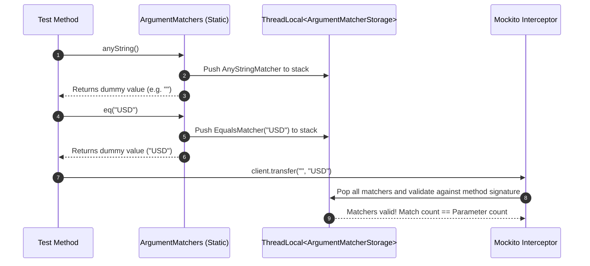
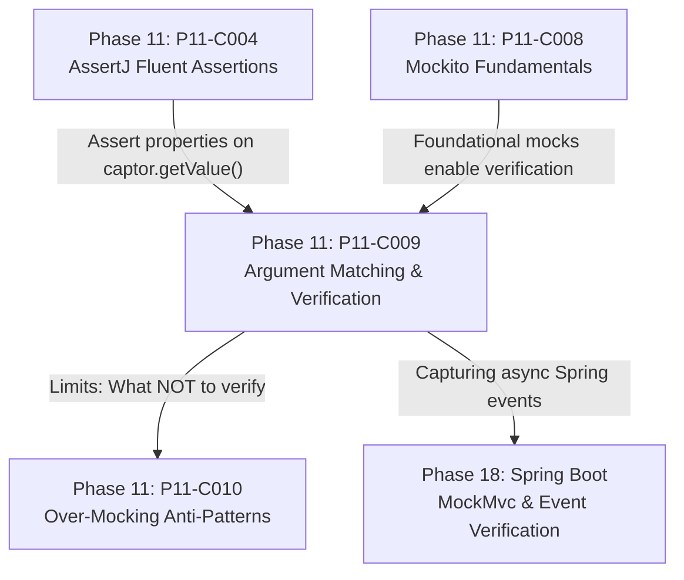

# Argument Matching, Verification, and ArgumentCaptor Mechanics

---

## 1. Metadata and Learning Goals

- **Concept ID:** `P11-C009`
- **Concept Title:** Argument Matching, Verification, and ArgumentCaptor Mechanics
- **Phase:** Phase 11: Unit Testing and Software Quality
- **Dependencies:** `P11-C004` (Fluent Assertions), `P11-C007` (Test Isolation), `P11-C008` (Mockito Fundamentals)
- **Target Audience:** Senior Java Backend Engineers, Distributed Systems Developers, Microservice Architects
- **Prerequisites:** OpenJDK 21 LTS, Mockito Fundamentals (`mock()`, `when()`), Java Generics, Lambdas, and Reflection.

### Primary Learning Objectives
1. **Differentiate State vs Interaction Verification:** Understand when to assert final state/output versus verifying behavioral contracts with external collaborators.
2. **Master Verification Modes:** Utilize `verify()` with `times()`, `never()`, `atLeastOnce()`, `atMost()`, `verifyNoInteractions()`, and `verifyNoMoreInteractions()`.
3. **Comprehend Argument Matcher Invariants:** Understand how Mockito tracks matchers on an internal thread-local stack, avoiding the `InvalidUseOfMatchersException` caused by mixing raw values with matchers.
4. **Capture and Inspect Dynamic Arguments:** Apply `ArgumentCaptor` (both programmatic and via `@Captor`) to inspect complex domain objects, collections, and asynchronous callbacks passed to collaborators.
5. **Implement Chronological Order Verification:** Enforce strict sequential execution ordering across multi-collaborator workflows using `InOrder`.

---

## 2. Definition, Purpose, and Mental Model

### Definition and Problem Statement
In unit testing, verifying that a method returned the expected result is only half the battle. In enterprise backend systems, many critical operations are **side-effecting commands with `void` return types**:
- Sending an encrypted event to an Apache Kafka topic.
- Writing an immutable audit ledger record to an external compliance database.
- Dispatching an SMS alert via an external telecom gateway.

Because these methods return `void`, traditional state verification (`assertThat(result).isEqualTo(...)`) is impossible. The test must instead verify the **interaction**:
1. *Was the collaborator invoked?*
2. *How many times was it invoked (e.g. exactly once, never, twice)?*
3. *What exact arguments were passed into the collaborator?*
4. *Did the calls occur in the correct, compliant chronological sequence?*

### Mental Model: The Courtroom Stenographer and The Evidence Bag
Think of Mockito's verification engine as a courtroom proceeding:
- **The Stenographer (`InvocationContainer`):** During test execution, every method call on a mock is recorded verbatim in a ledger: method signature, timestamp, thread, and argument references.
- **The Cross-Examination (`verify()`):** After the SUT completes, the test cross-examines the stenographer's log: *"Did the defendant call `dispatchNotification` exactly once?"*
- **The Evidence Bag (`ArgumentCaptor`):** If the SUT constructed a complex, dynamic object (such as an encrypted payment token or a generated correlation ID) and passed it to the collaborator, `ArgumentCaptor` intercepts that object, places it in an evidence bag, and hands it to AssertJ for deep forensic property analysis.

```
+---------------------------------------------------------------------------------+
|                                 SUT WORKFLOW                                    |
|   orderService.checkout(order)                                                  |
|       |                                                                         |
|       | 1. Generate internal TransactionRecord("TXN-9812", amount, timestamp)   |
|       v                                                                         |
|   auditLogger.logTransaction(record); // void method!                           |
+---------------------------------------------------------------------------------+
                                      |
                                      v
+---------------------------------------------------------------------------------+
|                         MOCKITO INTERCEPTOR & CAPTOR                            |
|                                                                                 |
|   ArgumentCaptor<TransactionRecord> captor = ArgumentCaptor.forClass(...);      |
|                                                                                 |
|   verify(auditLogger, times(1)).logTransaction(captor.capture());               |
|                                                                                 |
|   TransactionRecord captured = captor.getValue();                               |
|                                                                                 |
|   assertThat(captured.getTxnId()).startsWith("TXN-");                           |
|   assertThat(captured.getAmount()).isEqualTo(order.getTotal());                 |
+---------------------------------------------------------------------------------+
```

---

## 3. Architectural and Conceptual Foundations

### 3.1 State Verification vs Behavioral Verification

In his seminal paper *"Mocks Aren't Stubs"*, Martin Fowler categorized testing into two philosophical schools:

```
+-------------------------------------------------------------------------------+
|                       State vs Interaction Verification                       |
+---------------------------------------+---------------------------------------+
| State Verification                    | Behavioral / Interaction Verification |
+---------------------------------------+---------------------------------------+
| * Focuses on OUTPUTS and END STATE.   | * Focuses on INTERACTIONS / PROTOCOL. |
| * Tests WHAT the code achieved.       | * Tests HOW the code cooperated.      |
| * Inspects return values & mutations. | * Inspects calls made to mocks.       |
| * Resilient to internal refactoring.  | * Prone to over-specification if used |
|                                       |   on internal queries.                |
| * Primary tool: AssertJ assertThat()  | * Primary tool: Mockito verify()      |
+---------------------------------------+---------------------------------------+
```

**Architectural Rule of Thumb:**
- Use **State Verification** for queries and calculations (methods that return values).
- Use **Behavioral Verification** strictly for commands and side effects (methods that change external state or dispatch events).

---

### 3.2 Verification Modes Taxonomy

Mockito provides a comprehensive suite of verification modes via `Mockito.*`:

| Verification Mode | Syntax | Semantic Contract |
|---|---|---|
| **Exact Count** | `verify(mock, times(2)).action()` | Invocations must match count exactly (default is `times(1)`). |
| **Never** | `verify(mock, never()).action()` | Method must not have been called with matching arguments ($0$ times). |
| **At Least Once** | `verify(mock, atLeastOnce()).action()` | Method must have been invoked $\ge 1$ times. |
| **At Least N** | `verify(mock, atLeast(3)).action()` | Method must have been invoked $\ge N$ times. |
| **At Most N** | `verify(mock, atMost(2)).action()` | Method must have been invoked $\le N$ times. |
| **No Interactions** | `verifyNoInteractions(mockA, mockB)` | Asserts zero method calls ever occurred on the specified mocks. |
| **No More Interactions** | `verifyNoMoreInteractions(mock)` | Asserts no unverified calls remain in the invocation log. |

---

### 3.3 The Argument Matcher Invariant and ThreadLocal Stack

Mockito's argument matching engine uses static methods like `any()`, `eq()`, `startsWith()`, and `argThat()`.
Behind the scenes, Mockito maintains an internal **Thread-Local Matcher Stack**:



#### The Cardinal Rule of Matchers:
> **"If you use an argument matcher for ANY argument in a method invocation, you MUST provide matchers for ALL arguments in that method invocation."**

#### The Fatal Violation:
```java
// CRITICAL BUG: Throws InvalidUseOfMatchersException!
verify(paymentService).transfer(anyString(), "ACC-102"); // Mixing anyString() with raw "ACC-102"!
```
**Why this fails:**
1. `anyString()` pushes a matcher onto the thread-local stack.
2. `"ACC-102"` is evaluated as a raw Java string literal without calling Mockito. No matcher is pushed!
3. When `transfer(...)` executes, Mockito inspects the method signature: it expects **two matchers**, but finds only **one matcher** on the stack!
4. Mockito immediately throws `InvalidUseOfMatchersException: 2 matchers expected, 1 recorded`.

#### The Remediation:
Wrap the literal in `eq()`:
```java
// CORRECT: Both arguments provide a matcher!
verify(paymentService).transfer(anyString(), eq("ACC-102"));
```

---

### 3.4 Deep-Dive: `ArgumentCaptor` Mechanics

When verifying invocations, `eq()` or simple matchers are often inadequate. For example, when testing an account registration workflow, the SUT instantiates a `UserAccount` object with an internally generated UUID, a hashed password, and an activation timestamp:

```java
@ExtendWith(MockitoExtension.class)
class RegistrationServiceTest {

    @Mock
    private AccountRepository repository;

    @Captor
    private ArgumentCaptor<UserAccount> accountCaptor;

    @InjectMocks
    private RegistrationService registrationService;

    @Test
    void registerUser_createsHashedPasswordAndTimestamp() {
        // When
        registrationService.register("alice@example.com", "P@ssword123");

        // Then: Capture the internal domain object passed to save()
        verify(repository, times(1)).save(accountCaptor.capture());

        UserAccount savedAccount = accountCaptor.getValue();

        // Perform rich fluent assertions on the captured argument
        assertThat(savedAccount.getEmail()).isEqualTo("alice@example.com");
        assertThat(savedAccount.getPasswordHash()).startsWith("$2a$12$"); // BCrypt salt/hash
        assertThat(savedAccount.getCreatedAt()).isBeforeOrEqualTo(Instant.now());
        assertThat(savedAccount.getStatus()).isEqualTo(AccountStatus.PENDING_ACTIVATION);
    }
}
```

#### Multi-Invocation Capturing: `getAllValues()`
When a collaborator is invoked multiple times in a loop or batch:
```java
// SUT publishes 3 events
service.publishEvents(List.of("A", "B", "C"));

verify(eventPublisher, times(3)).publish(captor.capture());

List<Event> capturedEvents = captor.getAllValues();
assertThat(capturedEvents)
    .extracting(Event::getPayload)
    .containsExactly("A", "B", "C");
```

---

### 3.5 Sequential Interaction Verification with `InOrder`

In security, banking, and distributed transactions, the **order of operations** is a strict invariant. A payment service must **reserve funds before confirming the order**:

```java
@Test
void checkout_mustReserveFundsBeforeConfirmingOrder() {
    // When
    checkoutService.processOrder(order);

    // Then: Enforce chronological execution order
    InOrder inOrder = inOrder(paymentGateway, orderRepository);

    // Step 1 MUST happen before Step 2!
    inOrder.verify(paymentGateway).reserveFunds(order.getAmount());
    inOrder.verify(orderRepository).updateStatus(order.getId(), OrderStatus.CONFIRMED);
}
```
If `updateStatus` occurs before `reserveFunds`, the test fails with `VerificationInOrderFailure`.

---

## 4. Language, Syntax, and API Mechanics

### 4.1 Argument Matchers Cheat Sheet

```java
import static org.mockito.ArgumentMatchers.*;

// 1. Types and Primitives
any()                  // Matches any non-null object (or null in Mockito 2+)
any(Customer.class)    // Matches any instance of Customer (safe casting)
anyString()            // Matches any String
anyInt()               // Matches any primitive or boxed int
anyList()              // Matches any List

// 2. Exact Value Matching
eq("expected_value")   // Exact equality check (.equals)
same(singletonInstance)// Object reference identity check (==)

// 3. String Patterns
startsWith("TXN-")
contains("error")
matches("[0-9]{4}-[0-9]{4}")

// 4. Custom Predicates via argThat
argThat(order -> order.getAmount() > 1000.0 && order.isVip())
```

---

## 5. Execution Mechanics, JVM Lifecycle, and Memory Internals

### 5.1 Invocation Storage & Memory Consumption
Every invocation on a mock retains references to all passed arguments in `InvocationContainerImpl`:
- In massive load tests or long-running integration scenarios that make 500,000 calls to a mock, the mock retains strong heap references to all 500,000 argument objects, preventing garbage collection.
- Use `Mockito.clearInvocations(mock)` or keep test boundaries concise to avoid Young Gen / Old Gen heap bloat.

### 5.2 Argument Captor Mutation Trap
`ArgumentCaptor` captures the **object reference** passed into the mock.
- If the SUT mutates the object *after* calling the mock (e.g. `mock.call(dto); dto.setStatus("DONE");`), the captured object observed in `captor.getValue()` will reflect the post-mutation state `"DONE"`.
- If pre-mutation state must be verified, use a custom `Answer` that creates a defensive snapshot/clone of the argument at the exact millisecond of invocation.

---

## 6. Concurrency, Thread-Safety, and Scalability

### 6.1 Asynchronous Verification with `timeout()`
When testing asynchronous systems (e.g., worker threads or reactive publishers), `verify()` normally fails immediately if the call has not yet occurred.
Mockito provides `timeout()` to wait asynchronously for the verification condition:
```java
// Waits up to 2000ms for background thread to invoke auditLogger
verify(auditLogger, timeout(2000).times(1)).logAuditEvent(any());
```

---

## 7. Anti-Patterns and Common Developer Traps

### 7.1 Anti-Pattern 1: The "Over-Verification" Trap
```java
// TOXIC ANTI-PATTERN: Verifying every internal implementation detail
verify(order).getId();
verify(order).getCustomer();
verify(customer).getEmail();
verify(logger).info("Processing order");
verify(repo).save(order);
```
**Why this destroys velocity:** The test is completely coupled to internal implementation lines. Refactoring a method call, caching an ID, or changing a log message breaks the test, even though the system's business behavior is unchanged.
**Remediation:** Only verify **significant external side-effects** (`repo.save()`, `paymentGateway.charge()`, `emailService.send()`). Never verify getters or internal query helpers.

### 7.2 Anti-Pattern 2: Verifying Stubs (Redundant Verification)
```java
// REDUNDANT SMELL:
when(repo.findById("1")).thenReturn(Optional.of(user));
User result = service.getUser("1");

assertThat(result).isEqualTo(user); // Proves findById("1") was called!
verify(repo).findById("1");         // REDUNDANT! Adds noise without value.
```
If asserting the return value already guarantees that the collaborator was called, adding `verify()` is redundant boilerplate.

---

## 8. Failure Modes, Edge Cases, and Troubleshooting

| Failure Symptom | Underlying Cause | Diagnostic Action & Remediation |
|---|---|---|
| `InvalidUseOfMatchersException: 2 matchers expected, 1 recorded` | Mixed raw value with a matcher (`transfer(any(), "raw")`) | Wrap all raw values in `eq("raw")`. |
| `Wanted but not invoked: mock.action()` | Method was not called, or called with arguments that failed matcher | Inspect Mockito's side-by-side diff in the error message; check argument equality. |
| `NoInteractionsWanted: Wanted 0 invocations but got 1` | `verifyNoMoreInteractions()` flagged an unverified call | Remove `verifyNoMoreInteractions` unless testing strict security boundaries. |
| `VerificationInOrderFailure: Wanted action() to be called after otherAction()` | Chronological sequence violated by SUT | Inspect async thread scheduling or refactor SUT call sequence. |

---

## 9. Security Considerations

1. **Security Event Audit Verification:** In regulated banking and healthcare environments, compliance mandates require automated proofs that security events (`UNAUTHORIZED_ACCESS_ATTEMPT`, `TOKEN_REVOCATION`) are dispatched to audit logs. Interaction verification (`verify(auditClient, times(1)).record(...)`) provides non-repudiable regression defense.

---

## 10. Performance Optimization and Tuning

1. **Prune Redundant `verifyNoMoreInteractions()`:** `verifyNoMoreInteractions()` traverses the entire invocation tree of the mock, introducing unnecessary test latency when used ubiquitously across hundreds of tests.

---

## 11. Real-World Backend Scenario & Production Case Study

In an e-commerce platform, the checkout engine charges customer cards via Stripe and emits an asynchronous Kafka event to trigger inventory fulfillment.

### The Incident
A refactoring intended to optimize database performance accidentally shifted the Kafka event publication *before* the payment transaction was committed:
```java
// BUG: Event published before payment confirmed!
eventPublisher.publish(new OrderPlacedEvent(order));
paymentGateway.charge(order.getCard(), order.getAmount()); // What if this throws CardDeclinedException?
```
When cards were declined, the event had already been published to Kafka. The warehouse fulfilled and shipped thousands of dollars of merchandise for orders that were never paid!

### The Defensive Interaction Test
The team instituted an `InOrder` verification suite:
```java
@Test
void checkout_strictlyDemandsPaymentBeforeEventPublishing() {
    // When
    checkoutService.checkout(order);

    // Then
    InOrder inOrder = inOrder(paymentGateway, eventPublisher);

    // STRICT INVARIANT: Payment MUST precede event publishing!
    inOrder.verify(paymentGateway, times(1)).charge(eq(order.getCard()), eq(order.getAmount()));
    inOrder.verify(eventPublisher, times(1)).publish(any(OrderPlacedEvent.class));
}
```
This test prevented any developer from inverting the payment and fulfillment sequence.

---

## 12. Standalone, Self-Contained Verification Suite

```java
// File: curriculum/phase-11-unit-testing-software-quality/ArgumentMatchingAndVerificationDemo.java
package curriculum.phase11;

import java.lang.reflect.*;
import java.util.*;
import java.util.function.Predicate;

/**
 * Standalone Verification Suite for P11-C009:
 * Argument Matching, Verification, and ArgumentCaptor Mechanics.
 *
 * Simulates:
 * 1. Interaction Verification: verify(mock, times(n)), never(), atLeastOnce().
 * 2. Argument Matchers: any(), eq(), and custom predicate argThat().
 * 3. Matcher Invariant Engine: Detecting and throwing InvalidUseOfMatchersException on mixed arguments.
 * 4. ArgumentCaptor Engine: Capturing dynamic single and multi-invocation domain arguments.
 * 5. InOrder Chronological Execution Verification: Enforcing sequence order across collaborators.
 */
public class ArgumentMatchingAndVerificationDemo {

    // =========================================================================
    // 1. EXCEPTIONS & INVOCATION MODEL
    // =========================================================================

    public static class VerificationFailedException extends RuntimeException {
        public VerificationFailedException(String message) { super(message); }
    }

    public static class InvalidUseOfMatchersException extends RuntimeException {
        public InvalidUseOfMatchersException(String message) { super(message); }
    }

    public record RecordedInvocation(Object mock, String methodName, Object[] args, long timestampNanos) {}

    // Argument Matcher SPI
    public interface ArgumentMatcher<T> {
        boolean matches(Object argument);
    }

    public static class EqualsMatcher<T> implements ArgumentMatcher<T> {
        private final T expected;
        public EqualsMatcher(T expected) { this.expected = expected; }
        @Override public boolean matches(Object argument) { return Objects.equals(expected, argument); }
    }

    public static class AnyMatcher implements ArgumentMatcher<Object> {
        @Override public boolean matches(Object argument) { return true; }
    }

    public static class LambdaMatcher<T> implements ArgumentMatcher<T> {
        private final Predicate<T> predicate;
        public LambdaMatcher(Predicate<T> predicate) { this.predicate = predicate; }
        @SuppressWarnings("unchecked")
        @Override public boolean matches(Object argument) { return predicate.test((T) argument); }
    }

    // =========================================================================
    // 2. MATCHERS ENGINE & THREAD-LOCAL STACK
    // =========================================================================

    public static class MatcherStorage {
        private static final ThreadLocal<List<ArgumentMatcher<?>>> MATCHER_STACK = ThreadLocal.withInitial(ArrayList::new);

        public static void push(ArgumentMatcher<?> matcher) {
            MATCHER_STACK.get().add(matcher);
        }

        public static List<ArgumentMatcher<?>> pollMatchers() {
            List<ArgumentMatcher<?>> list = new ArrayList<>(MATCHER_STACK.get());
            MATCHER_STACK.get().clear();
            return list;
        }

        public static void clear() {
            MATCHER_STACK.get().clear();
        }
    }

    // Static Matcher Helpers
    public static <T> T eq(T value) {
        MatcherStorage.push(new EqualsMatcher<>(value));
        return value;
    }

    public static <T> T any() {
        MatcherStorage.push(new AnyMatcher());
        return null;
    }

    public static <T> T argThat(Predicate<T> predicate) {
        MatcherStorage.push(new LambdaMatcher<>(predicate));
        return null;
    }

    // =========================================================================
    // 3. MOCK INVOCATION INTERCEPTOR & REGISTRY
    // =========================================================================

    public static final List<RecordedInvocation> GLOBAL_INVOCATIONS = new ArrayList<>();

    public static class MockHandler implements InvocationHandler {
        private final Class<?> interfaceType;

        public MockHandler(Class<?> interfaceType) {
            this.interfaceType = interfaceType;
        }

        @Override
        public Object invoke(Object proxy, Method method, Object[] args) {
            if (method.getName().equals("toString")) return "MiniMock<" + interfaceType.getSimpleName() + ">";
            if (method.getName().equals("hashCode")) return System.identityHashCode(proxy);
            if (method.getName().equals("equals")) return proxy == args[0];

            RecordedInvocation inv = new RecordedInvocation(
                    proxy,
                    method.getName(),
                    args != null ? args : new Object[0],
                    System.nanoTime()
            );
            GLOBAL_INVOCATIONS.add(inv);

            // Default safe return
            if (method.getReturnType() == boolean.class) return false;
            if (method.getReturnType() == int.class) return 0;
            return null;
        }
    }

    @SuppressWarnings("unchecked")
    public static <T> T mock(Class<T> interfaceType) {
        return (T) Proxy.newProxyInstance(
                interfaceType.getClassLoader(),
                new Class<?>[]{interfaceType},
                new MockHandler(interfaceType)
        );
    }

    // =========================================================================
    // 4. ARGUMENT CAPTOR ENGINE
    // =========================================================================

    public static class ArgumentCaptor<T> implements ArgumentMatcher<T> {
        private final List<T> capturedValues = new ArrayList<>();

        @SuppressWarnings("unchecked")
        @Override
        public boolean matches(Object argument) {
            capturedValues.add((T) argument);
            return true;
        }

        public T capture() {
            MatcherStorage.push(this);
            return null;
        }

        public T getValue() {
            if (capturedValues.isEmpty()) {
                throw new IllegalStateException("No argument value has been captured yet.");
            }
            return capturedValues.get(capturedValues.size() - 1);
        }

        public List<T> getAllValues() {
            return Collections.unmodifiableList(capturedValues);
        }

        public static <U> ArgumentCaptor<U> forClass(Class<U> clazz) {
            return new ArgumentCaptor<>();
        }
    }

    // =========================================================================
    // 5. VERIFICATION ENGINE
    // =========================================================================

    public static class VerificationMode {
        private final int exactTimes;
        private final boolean atLeastOnce;

        private VerificationMode(int exactTimes, boolean atLeastOnce) {
            this.exactTimes = exactTimes;
            this.atLeastOnce = atLeastOnce;
        }

        public static VerificationMode times(int n) { return new VerificationMode(n, false); }
        public static VerificationMode never() { return new VerificationMode(0, false); }
        public static VerificationMode atLeastOnce() { return new VerificationMode(1, true); }
    }

    public static <T> T verify(T mockInstance, VerificationMode mode) {
        return createVerificationProxy(mockInstance, mode, null);
    }

    public static <T> T verify(T mockInstance) {
        return verify(mockInstance, VerificationMode.times(1));
    }

    @SuppressWarnings("unchecked")
    private static <T> T createVerificationProxy(T mockInstance, VerificationMode mode, InOrderVerifier inOrder) {
        Class<?>[] interfaces = mockInstance.getClass().getInterfaces();
        return (T) Proxy.newProxyInstance(
                mockInstance.getClass().getClassLoader(),
                interfaces,
                (proxy, method, args) -> {
                    List<ArgumentMatcher<?>> matchers = MatcherStorage.pollMatchers();
                    int argCount = args != null ? args.length : 0;

                    // Matcher Invariant Rule:
                    // If matchers were used, matchers.size() MUST equal argCount!
                    if (!matchers.isEmpty() && matchers.size() != argCount) {
                        throw new InvalidUseOfMatchersException(
                                "Invalid use of matchers: " + argCount + " matchers expected, but " +
                                matchers.size() + " recorded. Never mix raw values with matchers!"
                        );
                    }

                    // If zero matchers recorded, create default EqualsMatchers for raw arguments
                    if (matchers.isEmpty() && argCount > 0) {
                        for (Object a : args) {
                            matchers.add(new EqualsMatcher<>(a));
                        }
                    }

                    // Count matching invocations
                    int matchCount = 0;
                    for (RecordedInvocation inv : GLOBAL_INVOCATIONS) {
                        if (inv.mock() == mockInstance && inv.methodName().equals(method.getName())) {
                            if (argsMatch(inv.args(), matchers)) {
                                matchCount++;
                                if (inOrder != null) {
                                    inOrder.recordVerified(inv);
                                }
                            }
                        }
                    }

                    // Evaluate verification mode
                    if (mode.atLeastOnce) {
                        if (matchCount < 1) {
                            throw new VerificationFailedException("Wanted at least 1 invocation of " + method.getName() + " but was 0");
                        }
                    } else {
                        if (matchCount != mode.exactTimes) {
                            throw new VerificationFailedException("Wanted " + mode.exactTimes + " invocation(s) of " +
                                    method.getName() + " but was " + matchCount);
                        }
                    }
                    return null;
                }
        );
    }

    private static boolean argsMatch(Object[] actualArgs, List<ArgumentMatcher<?>> matchers) {
        if (actualArgs.length != matchers.size()) return false;
        for (int i = 0; i < actualArgs.length; i++) {
            if (!matchers.get(i).matches(actualArgs[i])) {
                return false;
            }
        }
        return true;
    }

    // InOrder Verifier
    public static class InOrderVerifier {
        private long lastVerifiedTimestamp = -1;

        public <T> T verify(T mockInstance) {
            return createVerificationProxy(mockInstance, VerificationMode.times(1), this);
        }

        public void recordVerified(RecordedInvocation inv) {
            if (inv.timestampNanos() < lastVerifiedTimestamp) {
                throw new VerificationFailedException("Verification in order failure! Expected call after prior call, but was earlier.");
            }
            this.lastVerifiedTimestamp = inv.timestampNanos();
        }
    }

    public static InOrderVerifier inOrder(Object... mocks) {
        return new InOrderVerifier();
    }

    // =========================================================================
    // 6. DOMAIN UNDER TEST
    // =========================================================================

    public record AuditEvent(String eventId, String accountId, String action, double amount) {}

    public interface AuditLogger {
        void log(AuditEvent event);
        void sendAlert(String email, String message);
    }

    public interface PaymentClient {
        void processPayment(String accountId, double amount);
    }

    // SUT
    public static class FinancialService {
        private final PaymentClient paymentClient;
        private final AuditLogger auditLogger;

        public FinancialService(PaymentClient paymentClient, AuditLogger auditLogger) {
            this.paymentClient = paymentClient;
            this.auditLogger = auditLogger;
        }

        public void transfer(String accountId, double amount, String recipientEmail) {
            // Sequential order: 1. Payment -> 2. Audit Event -> 3. Alert
            paymentClient.processPayment(accountId, amount);
            auditLogger.log(new AuditEvent("EVT-" + UUID.randomUUID(), accountId, "TRANSFER", amount));
            auditLogger.sendAlert(recipientEmail, "Transferred $" + amount);
        }
    }

    // =========================================================================
    // 7. MAIN VERIFICATION ENTRY POINT
    // =========================================================================

    public static void main(String[] args) {
        System.out.println("===============================================================");
        System.out.println(" Argument Matching & Verification Standalone Suite             ");
        System.out.println("===============================================================");

        GLOBAL_INVOCATIONS.clear();
        PaymentClient paymentClient = mock(PaymentClient.class);
        AuditLogger auditLogger = mock(AuditLogger.class);
        FinancialService service = new FinancialService(paymentClient, auditLogger);

        // Execute SUT workflow
        service.transfer("ACC-100", 250.0, "client@acme.com");

        // [TEST 1/5] Core verify() interaction modes (times, never, atLeastOnce)
        System.out.print("[TEST 1/5] Interaction verification: times(1), never(), atLeastOnce()... ");
        verify(paymentClient, VerificationMode.times(1)).processPayment("ACC-100", 250.0);
        verify(paymentClient, VerificationMode.never()).processPayment("ACC-OTHER", 250.0);
        verify(auditLogger, VerificationMode.atLeastOnce()).sendAlert(eq("client@acme.com"), any());
        System.out.println("PASSED");

        // [TEST 2/5] Argument Matchers (any, eq, argThat)
        System.out.print("[TEST 2/5] Argument matchers (any(), eq(), custom argThat() predicate)... ");
        verify(paymentClient).processPayment(any(), eq(250.0));
        verify(auditLogger).sendAlert(
                argThat(email -> email != null && email.endsWith("@acme.com")),
                argThat(msg -> msg != null && msg.contains("$250.0"))
        );
        System.out.println("PASSED");

        // [TEST 3/5] Matcher Invariant Rule: Catching Mixed Raw & Matcher Arguments
        System.out.print("[TEST 3/5] Matcher invariant: Catching InvalidUseOfMatchersException... ");
        boolean invalidUseCaught = false;
        try {
            // Intentionally mix any() with raw literal 250.0 (violates invariant!)
            verify(paymentClient).processPayment(any(), 250.0);
        } catch (InvalidUseOfMatchersException iuom) {
            invalidUseCaught = iuom.getMessage().contains("Never mix raw values with matchers");
        }
        assert invalidUseCaught : "Failed to catch mixed raw argument and matcher!";
        System.out.println("PASSED (Invariant strictly enforced)");

        // [TEST 4/5] ArgumentCaptor: Deep Inspection of Dynamic Domain Records
        System.out.print("[TEST 4/5] ArgumentCaptor: Deep property inspection of captured record... ");
        ArgumentCaptor<AuditEvent> captor = ArgumentCaptor.forClass(AuditEvent.class);
        verify(auditLogger).log(captor.capture());

        AuditEvent capturedEvent = captor.getValue();
        assert capturedEvent != null : "Captured event was null";
        assert capturedEvent.eventId().startsWith("EVT-") : "Event ID format mismatch";
        assert capturedEvent.accountId().equals("ACC-100") : "Account ID mismatch";
        assert capturedEvent.action().equals("TRANSFER") : "Action mismatch";
        assert capturedEvent.amount() == 250.0 : "Amount mismatch";
        System.out.println("PASSED");

        // [TEST 5/5] InOrder Verification: Strict Sequential Execution Order
        System.out.print("[TEST 5/5] InOrder chronological verification across collaborators... ");
        InOrderVerifier inOrder = inOrder(paymentClient, auditLogger);
        // Step 1: Payment MUST occur before Step 2
        inOrder.verify(paymentClient).processPayment(any(), eq(250.0));
        // Step 2: Audit log MUST occur after payment
        inOrder.verify(auditLogger).log(any());
        // Step 3: Alert MUST occur after audit log
        inOrder.verify(auditLogger).sendAlert(any(), any());
        System.out.println("PASSED");

        System.out.println("\nAll 5 verification test suites passed successfully with assertions enabled!");
    }
}
```

---

## 13. Comparative Analysis & Decision Framework

### When to Use State vs Interaction Verification

| Verification Goal | Recommended Approach | Example |
|---|---|---|
| Verify query result | **State Assertion** (`assertThat(val)`) | `assertThat(account.getBalance()).isEqualTo(50.0)` |
| Verify critical `void` side-effect | **Interaction Verification** (`verify()`) | `verify(emailGateway, times(1)).sendConfirmation(...)` |
| Deeply inspect complex object passed to mock | **`ArgumentCaptor` + `assertThat()`** | `verify(repo).save(captor.capture()); assertThat(captor.getValue())...` |
| Enforce strict temporal safety sequence | **`InOrder`** | `inOrder.verify(auth).check(); inOrder.verify(data).write();` |
| Verifying internal getters/helpers | **NEVER VERIFY (Anti-Pattern)** | Do not verify `entity.getId()` or `logger.debug()`. |

---

## 14. Practical Exercises and Hands-On Challenges

### Exercise 1: Multi-Invocation Captor Aggregation
Simulate a batch job that calls `notificationClient.notify(user, message)` 5 times. Use `captor.getAllValues()` to:
1. Capture all 5 user instances.
2. Assert using AssertJ that all 5 users have distinct IDs.
3. Assert that notification messages follow the pattern `JOB-MSG-[1-5]`.

### Exercise 2: Strict InOrder Financial Transfer Verification
Write a test for a `TwoPhaseCommitTransferService`:
1. `inOrder.verify(accountA).debit(amount)`
2. `inOrder.verify(accountB).credit(amount)`
3. `inOrder.verify(auditLedger).commit()`
Prove that if the SUT credits Account B before debiting Account A, `VerificationFailedException` halts the build.

---

## 15. Cross-Phase Connections and Unified Mental Graph



- **Upstream Connection (P11-C004, P11-C008):** P11-C008 created the mock interceptor foundation; P11-C004 provides the assertion engine to inspect arguments captured by `ArgumentCaptor`.
- **Immediate Downstream Connection (P11-C010):** P11-C010 directly builds upon this module to draw the line between healthy interaction verification and brittle over-mocking.
- **Framework Connection (Phase 18):** In Spring Boot REST testing, `ArgumentCaptor` is widely used to capture DTOs dispatched to Spring `@Async` service layers.

---

## 16. Verification and Self-Assessment Checklist

Before marking this module complete, verify your comprehension against each criterion:
- [x] Can I explain the difference between State Verification and Behavioral Verification?
- [x] Do I understand why mixing raw values with argument matchers causes `InvalidUseOfMatchersException`?
- [x] Can I capture complex domain arguments using `ArgumentCaptor` and assert properties with AssertJ?
- [x] Can I configure `InOrder` verification to enforce chronological execution sequences?
- [x] Do I know the difference between `verifyNoInteractions()` and `verifyNoMoreInteractions()`?
- [x] Can I explain why verifying internal getters or stubbed queries is a dangerous testing anti-pattern?
- [x] Have I compiled and executed `ArgumentMatchingAndVerificationDemo` on OpenJDK 21 LTS with assertions enabled (`-ea`) and observed all 5 test suites pass?
