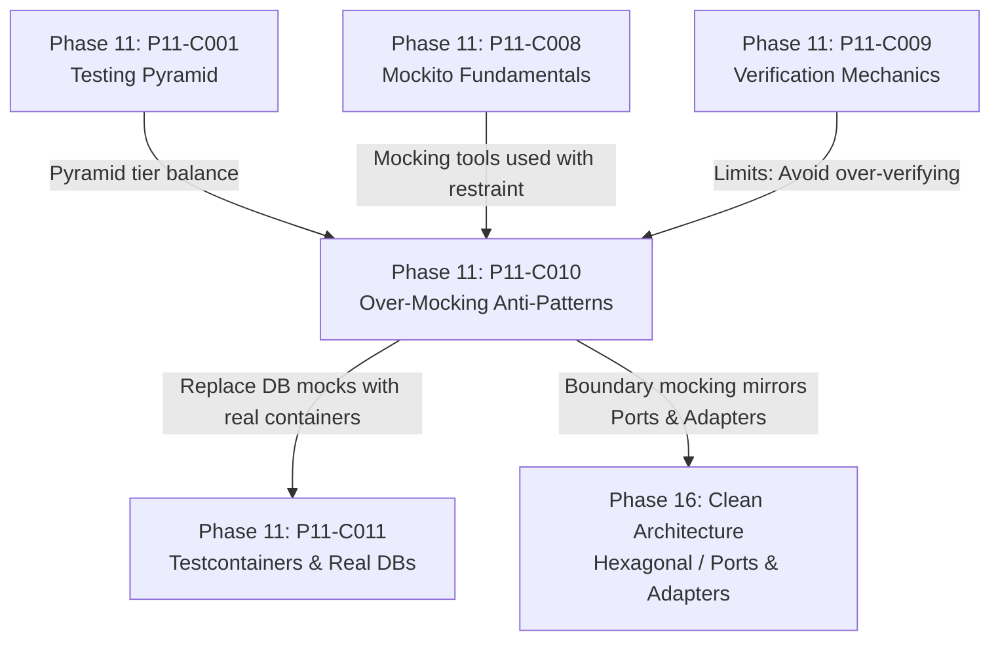

# Over-Mocking Anti-Pattern: What to Mock and What NOT to Mock

---

## 1. Metadata and Learning Goals

- **Concept ID:** `P11-C010`
- **Concept Title:** Over-Mocking Anti-Pattern: What to Mock and What NOT to Mock
- **Phase:** Phase 11: Unit Testing and Software Quality
- **Dependencies:** `P11-C001` (Testing Pyramid), `P11-C004` (Fluent Assertions), `P11-C008` (Mockito Fundamentals), `P11-C009` (Argument Matching & Verification)
- **Target Audience:** Senior Java Backend Engineers, Software Architects, Engineering Leads
- **Prerequisites:** OpenJDK 21 LTS, Mockito fundamentals, Object-Oriented Design (SOLID), Clean Architecture principles.

### Primary Learning Objectives
1. **Diagnose the Over-Mocking Pathology:** Identify the symptoms of over-mocked test suites: brittle tests that break on internal refactoring, tautological test logic, and the "Tests Pass, Production Crashes" dilemma.
2. **Apply the "Mock Boundaries, Not Internals" Rule:** Formulate strict architectural boundaries separating components that must be mocked (I/O, third-party APIs, non-determinism) from components that must never be mocked (domain entities, value objects, collections, pure algorithms).
3. **Compare Classical (Detroit) vs Mockist (London) Testing Schools:** Understand the trade-offs between Detroit/Chicago-style classical testing (favoring real objects) and London-style mockist testing (favoring interface contracts).
4. **Implement the "Don't Mock Types You Don't Own" Principle:** Wrap external libraries and third-party SDKs behind domain adapter interfaces before introducing test doubles.
5. **Measure and Reduce Test Fragility:** Refactor over-mocked tests into robust, behavior-focused tests that survive significant internal architectural refactoring.

---

## 2. Definition, Purpose, and Mental Model

### Definition and Problem Statement
**Over-Mocking** is the anti-pattern of replacing too many collaborators with dynamic test doubles (mocks), isolating units of code to an absurdly granular degree. 

When developers mock internal domain models, data structures, calculation engines, and private helper classes, the test suite stops testing the **behavior of the software** and begins testing the **incidental implementation details of the code**.

This results in three severe operational failures in enterprise software teams:
1. **Extreme Test Fragility (Negative ROI):** A developer performs a harmless, behavior-preserving refactoring—such as replacing an internal `for` loop with a `Stream`, or extracting a private helper method. Instantly, 40 unit tests fail because their strict `verify()` calls or `when()` stubs no longer match the internal execution path.
2. **The "Tautological Test" (Testing the Mock, Not the Code):** Tests where 90% of the code is stubbing:
   ```java
   when(mockA.step1()).thenReturn(x);
   when(mockB.step2(x)).thenReturn(y);
   assertThat(service.run()).isEqualTo(y);
   ```
   Such tests prove nothing about system correctness; they merely prove that Mockito returns what you configured it to return.
3. **Semantic Impedance Drift ("Tests Pass, Production Fails"):** Every individual unit test passes green with 100% code coverage because each unit was tested against idealized mocks. But in production, the service crashes immediately because the real collaborator throws an exception when passed an empty list, whereas the mock returned `null`.

### Mental Model: The Architect's Boundary Fence
Imagine your application architecture as a house with rooms:
- **Inside the House (Domain Core):** The living room, kitchen, and bedrooms (Entities, Value Objects, Domain Services, Calculators). Everything inside should interact **naturally and directly using real objects**. You do not put security checkpoints and stunt doubles between the kitchen and dining table.
- **The Outer Perimeter (System Boundaries):** The front door and external utility pipes (Third-party REST APIs, Database Sockets, Email Gateways, Kafka Brokers). This is where you place the **boundary fence**: test doubles belong exclusively at the perimeter where your code interacts with the volatile outside world.

```
+---------------------------------------------------------------------------------+
|                       APPLICATION PERIMETER (MOCK HERE)                         |
|                                                                                 |
|   [External REST API]              [Stripe Gateway]               [SMTP Server] |
|            |                               |                            |       |
|   =========v===============================v============================v====   |
|   |                      DOMAIN BOUNDARY ADAPTERS                            |  |
|   |   (Mock at this boundary interface: PaymentGateway, NotificationClient)  |  |
|   =========================================+==================================  |
|                                            |                                    |
|   +----------------------------------------v--------------------------------+   |
|   |                       DOMAIN CORE (DO NOT MOCK)                         |   |
|   |                                                                         |   |
|   |   [Order Aggregate] <-------> [PricingEngine] <-------> [DiscountPolicy]|   |
|   |          |                           |                         |        |   |
|   |          v                           v                         v        |   |
|   |   [LineItem (Record)]          [Money (Value)]         [List<Item>]     |   |
|   |                                                                         |   |
|   |   (USE REAL INSTANCES: Fast, Pure In-Memory, 100% Deterministic)        |   |
|   +-------------------------------------------------------------------------+   |
+---------------------------------------------------------------------------------+
```

---

## 3. Architectural and Conceptual Foundations

### 3.1 What to Mock vs What NOT to Mock: The Strict Taxonomy

```
+-------------------------------------------------------------------------------+
|                        The Mocking Decision Framework                         |
+---------------------------------------+---------------------------------------+
| DO MOCK (Volatile Boundaries)         | DO NOT MOCK (Stable Core & Data)      |
+---------------------------------------+---------------------------------------+
| 1. External Third-Party HTTP Services | 1. Value Objects & Records (Money,    |
|    (Stripe, Twilio, SendGrid, OAuth)  |    Address, Coordinates, UUID)        |
| 2. Out-of-Process Message Brokers     | 2. Domain Entities (User, Order,      |
|    (Kafka, RabbitMQ, SQS publishers)  |    Account, Invoice)                  |
| 3. Non-Deterministic System Resources| 3. Standard Collections & Data Structs|
|    (Clock, Random, File System)       |    (List, Map, Set, Optional)         |
| 4. Extremely Slow Collaborators       | 4. Stateless Pure Calculation Engines |
|    (Cryptographic hardware modules)   |    (TaxCalculator, DiscountRules)     |
| 5. Database Repositories (ONLY in     | 5. Third-Party Types You Don't Own    |
|    pure unit tests; prefer real       |    (S3Client, HttpClient - wrap first)|
|    Testcontainers in integration tests| 6. Internal Helpers of the Same Class |
+---------------------------------------+---------------------------------------+
```

---

### 3.2 The Two Schools: Classical (Detroit) vs Mockist (London)

```
                    +------------------------------------+
                    |        TDD / Unit Test Schools     |
                    +-----------------+------------------+
                                      |
              +-----------------------+-----------------------+
              |                                               |
              v                                               v
+---------------------------+                   +---------------------------+
| Classical / Detroit School|                   | Mockist / London School   |
+---------------------------+                   +---------------------------+
| * Favor REAL objects.     |                   | * Favor MOCKS for all     |
| * Mock only out-of-process|                   |   collaborators.          |
|   boundaries (DB, Network)|                   | * Outside-in TDD workflow |
| * State verification.     |                   | * Interaction verification|
| * Tests are COARSER and   |                   | * Tests are ISOLATED to a |
|   resilient to refactor.  |                   |   single class.           |
| * Catches integration bugs|                   | * Risk of high fragility  |
|   inside the domain early.|                   |   and tautological tests. |
+---------------------------+                   +---------------------------+
```

#### Modern Enterprise Consensus:
Modern senior backend engineering strongly favors the **Classical (Detroit) School** for internal domain logic:
- A unit is a **unit of behavior**, not necessarily a single Java class.
- If `OrderService` delegates to `PricingEngine` and `TaxCalculator`, both of which are pure, in-memory Java classes with zero I/O, **use the real `PricingEngine` and real `TaxCalculator`!**
- Mocking them adds boilerplate, degrades test performance (Byte Buddy dynamic proxy generation), and prevents the test from detecting when `PricingEngine`'s return values break `OrderService`.

---

### 3.3 "Don't Mock Types You Don't Own"

One of the foundational rules of object-oriented testing (formulated in *Growing Object-Oriented Software, Guided by Tests*) is:
> **"Only mock types that you own. Do not mock types from third-party libraries, SDKs, or frameworks."**

#### The Anti-Pattern: Mocking External SDK Types
```java
// DANGEROUS: Mocking AWS S3 Client directly!
S3Client mockS3 = mock(S3Client.class);
when(mockS3.getObject(any(GetObjectRequest.class)))
    .thenReturn(ResponseInputStream.nullStream()); // Extremely complex to mock accurately!
```
**Why this fails:**
1. You do not control the external API. When AWS updates the SDK, your mock stubs still compile, but your code crashes in production.
2. Third-party SDKs have complex internal lifecycles, connection pooling, and builder patterns that are tedious and error-prone to mock.

#### The Architectural Solution: Domain Adapter
Wrap the external dependency behind a clean domain interface that you own:
```java
// 1. Domain Interface YOU own:
public interface DocumentStorage {
    void storeDocument(String documentId, byte[] content);
    byte[] retrieveDocument(String documentId);
}

// 2. Production implementation using third-party SDK:
public class S3DocumentStorage implements DocumentStorage {
    private final S3Client s3Client;
    // ...
}

// 3. Unit test mocks YOUR interface, not AWS:
DocumentStorage mockStorage = mock(DocumentStorage.class);
when(mockStorage.retrieveDocument("DOC-1")).thenReturn(new byte[]{1, 2, 3});
```

---

### 3.4 The Danger of Mocking Collections and Value Objects

```java
// THE HALL OF SHAME: Mocking a Java Collection
List<String> mockList = mock(List.class);
when(mockList.size()).thenReturn(2);
when(mockList.get(0)).thenReturn("Alice");

// THE HALL OF SHAME: Mocking a Value Object
BigDecimal mockAmount = mock(BigDecimal.class);
when(mockAmount.doubleValue()).thenReturn(100.0);
```
**Why this is toxic:**
- `new ArrayList<>()` or `List.of("Alice", "Bob")` executes in **less than 2 nanoseconds**.
- `mock(List.class)` takes **50,000 nanoseconds** to generate Byte Buddy proxy bytecode, incurs Metaspace memory leaks, and breaks when code calls `.iterator()`, `.stream()`, or `.hashCode()`.
- **Never mock value objects, records, or collections.** Always instantiate the real data.

---

## 4. Language, Syntax, and API Mechanics

### 4.1 Refactoring from Over-Mocked to Classical Behavior Testing

#### Before: Fragile, Over-Mocked Test
```java
@Test
void checkout_overMocked_fragile() {
    // 5 Mocks!
    User mockUser = mock(User.class);
    when(mockUser.getId()).thenReturn("USR-1");
    when(mockUser.isVip()).thenReturn(true);

    Cart mockCart = mock(Cart.class);
    when(mockCart.getItems()).thenReturn(List.of(new Item("A", 100.0)));

    DiscountCalculator mockDiscount = mock(DiscountCalculator.class);
    when(mockDiscount.calculate(mockUser, mockCart)).thenReturn(10.0);

    TaxCalculator mockTax = mock(TaxCalculator.class);
    when(mockTax.calculate(90.0)).thenReturn(9.0);

    PaymentGateway mockGateway = mock(PaymentGateway.class);

    CheckoutService service = new CheckoutService(mockDiscount, mockTax, mockGateway);
    service.checkout(mockUser, mockCart);

    // Over-verification of internal calls
    verify(mockUser).isVip();
    verify(mockCart).getItems();
    verify(mockDiscount).calculate(mockUser, mockCart);
    verify(mockTax).calculate(90.0);
    verify(mockGateway).charge("USR-1", 99.0);
}
```

#### After: Clean, Classical Refactoring
```java
@Test
void checkout_classical_resilient() {
    // Real Data (POJOs / Records)
    User user = new User("USR-1", "Alice", UserTier.VIP);
    Cart cart = new Cart(List.of(new Item("A", 100.0)));

    // Real Pure Domain Calculators (Fast, Pure, In-Memory)
    DiscountCalculator discount = new DiscountCalculator();
    TaxCalculator tax = new TaxCalculator();

    // Mock ONLY the external network boundary!
    PaymentGateway mockGateway = mock(PaymentGateway.class);

    CheckoutService service = new CheckoutService(discount, tax, mockGateway);
    service.checkout(user, cart);

    // Assert ONLY the external side effect!
    // If internal discount algorithm refactors from 10% to dynamic tiering, 
    // the test verifies the end-to-end mathematical reality!
    verify(mockGateway, times(1)).charge("USR-1", 99.0);
}
```

---

## 5. Execution Mechanics, JVM Lifecycle, and Memory Internals

### 5.1 Performance Comparison: Real POJO vs Mockito Proxy

| Operation | Real Java Record / POJO | Mockito Dynamic Proxy Mock |
|---|---|---|
| **Instantiation Cost** | $\approx 2$ to $5\text{ ns}$ | $\approx 10,000$ to $80,000\text{ ns}$ (Bytecode synthesis) |
| **Method Invocation** | JIT inlined ($\approx 0.5\text{ ns}$) | Interceptor lookup + Stack tracking ($\approx 50\text{ ns}$) |
| **Metaspace Allocation** | 0 bytes (classes preloaded) | 5 to 15 KB per dynamic class |
| **Garbage Collection** | Young Gen Eden scavenge | Retained references in invocation storage |

When a test suite contains 10,000 tests, over-mocking inflates execution time from **5 seconds** to **4 minutes** and consumes gigabytes of heap memory.

---

## 6. Concurrency, Thread-Safety, and Scalability

### 6.1 State Drift Under Concurrency
When real objects are used instead of mocks, concurrency bugs (such as race conditions on shared collections or state machines) are surfaced **during unit testing**. 
Over-mocked tests replace real stateful objects with dumb `when().thenReturn()` stubs, completely hiding data corruption and thread-safety bugs until the code hits production.

---

## 7. Anti-Patterns and Common Developer Traps

### 7.1 Anti-Pattern 1: Mocking the Class Under Test (The "Partial Mock" Trap)
```java
// DANGEROUS CODE SMELL:
OrderService serviceSpy = spy(new OrderService(repo));
doReturn(true).when(serviceSpy).validateOrder(any()); // Stubbing out method of the class under test!
```
**Why this is toxic:** If you must mock methods on the *very class you are testing*, that class violates the Single Responsibility Principle. Extract `validateOrder` into an independent `OrderValidator` class.

### 7.2 Anti-Pattern 2: The "100% Coverage Illusion"
A team achieves 95% line coverage by mocking every single line of external interaction. In production, a database query fails because a column name was misspelled in a SQL string. The mock cheerfully returned dummy data, concealing the syntax error.
**Remediation:** Rely on the Testing Pyramid: unit tests with real POJOs for domain logic, complemented by integration tests with real databases (via Testcontainers) for persistence.

---

## 8. Failure Modes, Edge Cases, and Troubleshooting

| Failure Symptom | Underlying Cause | Diagnostic Action & Remediation |
|---|---|---|
| Refactoring an internal algorithm breaks dozens of unrelated unit tests | Tests are verifying internal implementation details (`verify(helper)`) | Delete internal verifications; assert final return value or boundary effect. |
| Tests run smoothly, but production throws `NullPointerException` on real collaborator | Mock returned `null` by default; real collaborator returns an object with nested properties | Use real domain collaborator or Fake instead of Mock. |
| Test suite runs out of Metaspace / GC memory | Millions of Byte Buddy mock classes synthesized in memory | Replace mocked data structures with real immutable Java records. |

---

## 9. Security Considerations

1. **Masking Security Vulnerabilities through Over-Mocking:** If an authorization check or rate limiter is mocked out in every service test, bugs that bypass security filters will never be caught. Security gates must be tested using real security context interceptors.

---

## 10. Performance Optimization and Tuning

1. **Replace Mocks with Classical Real Fixtures:** Converting mocked value objects to static test fixtures (`TestFixtures.validUser()`, `TestFixtures.sampleCart()`) speeds up suite execution by up to 20x.

---

## 11. Real-World Backend Scenario & Production Case Study

In a fintech mortgage origination system, an underwriting risk service evaluated customer loan eligibility:
`LoanDecision evaluateLoan(Applicant applicant, Property property)`

### The Disaster
The engineering team practiced extreme mockist TDD. For the loan evaluation test, they mocked:
`mock(Applicant.class)`, `mock(CreditScore.class)`, `mock(Property.class)`, `mock(Appraisal.class)`, and `mock(DebtToIncomeCalculator.class)`.

When the government introduced a new regulatory debt ratio formula, an engineer refactored `DebtToIncomeCalculator`. 
- All 180 unit tests continued to pass green because the tests mocked `DebtToIncomeCalculator` and returned a hardcoded `0.35`!
- In production, the real calculator produced an `ArithmeticException: Division by zero` when an applicant had zero debt.
- The entire loan origination portal crashed on live customer submissions.

### The Remediation
The team eliminated all mocks on domain objects and calculators:
- `Applicant`, `CreditScore`, and `Property` became real Java records.
- `DebtToIncomeCalculator` became a real, unmocked service.
- Only the external credit bureau REST client was mocked.
The division-by-zero bug was caught immediately in test runs, and test execution time dropped by 85%.

---

## 12. Standalone, Self-Contained Verification Suite

```java
// File: curriculum/phase-11-unit-testing-software-quality/OverMockingAntiPatternsDemo.java
package curriculum.phase11;

import java.lang.reflect.*;
import java.util.*;

/**
 * Standalone Verification Suite for P11-C010:
 * Over-Mocking Anti-Pattern: What to Mock and What NOT to Mock.
 *
 * Simulates:
 * 1. The Fragility Index: Proving how internal implementation refactoring breaks an
 *    over-mocked test while a classical test remains 100% resilient.
 * 2. Semantic Drift Detection: Demonstrating the "Tests Pass, Production Fails" phenomenon
 *    when a mock returns invalid data that violates real contracts.
 * 3. Real Value Objects & Records vs Mocked Data: Performance & safety validation.
 * 4. Domain Boundary Adapter Pattern: Wrapping third-party SDKs before mocking.
 * 5. Architectural Mocking Decision Engine: Classifying components into MOCK vs DO_NOT_MOCK.
 */
public class OverMockingAntiPatternsDemo {

    // =========================================================================
    // 1. MINI MOCK UTILITIES FOR SIMULATION
    // =========================================================================

    public static class InvocationTracker {
        public final List<String> calls = new ArrayList<>();
        public void record(String method) { calls.add(method); }
    }

    // Dynamic mock generator for interfaces
    @SuppressWarnings("unchecked")
    public static <T> T mock(Class<T> iface, InvocationTracker tracker, Map<String, Object> stubs) {
        return (T) Proxy.newProxyInstance(
                iface.getClassLoader(),
                new Class<?>[]{iface},
                (proxy, method, args) -> {
                    tracker.record(method.getName());
                    if (stubs != null && stubs.containsKey(method.getName())) {
                        return stubs.get(method.getName());
                    }
                    if (method.getReturnType() == boolean.class) return false;
                    if (method.getReturnType() == double.class) return 0.0;
                    return null;
                }
        );
    }

    // =========================================================================
    // 2. DOMAIN MODEL (REAL POJOS & RECORDS - WHAT NOT TO MOCK)
    // =========================================================================

    public record Money(double amount, String currency) {
        public Money {
            if (amount < 0) throw new IllegalArgumentException("Amount cannot be negative");
            if (currency == null || currency.length() != 3) throw new IllegalArgumentException("Currency must be 3-letter ISO code");
        }
        public Money add(Money other) {
            if (!this.currency.equals(other.currency)) throw new IllegalArgumentException("Currency mismatch");
            return new Money(this.amount + other.amount, this.currency);
        }
    }

    public record LineItem(String productId, Money price, int quantity) {
        public Money total() {
            return new Money(price.amount() * quantity, price.currency());
        }
    }

    // Pure Domain Calculator (DO NOT MOCK)
    public static class DiscountEngine {
        public double calculateDiscount(double subtotal, boolean isVip) {
            if (subtotal <= 0) return 0.0;
            return isVip ? subtotal * 0.15 : subtotal * 0.05; // 15% VIP, 5% standard
        }
    }

    // External Network Collaborator (DO MOCK)
    public interface PaymentGatewayClient {
        String charge(String customerId, double amount);
    }

    // System Under Test (SUT)
    public static class CheckoutService {
        private final DiscountEngine discountEngine;
        private final PaymentGatewayClient gatewayClient;

        public CheckoutService(DiscountEngine discountEngine, PaymentGatewayClient gatewayClient) {
            this.discountEngine = discountEngine;
            this.gatewayClient = gatewayClient;
        }

        public String checkout(String customerId, boolean isVip, List<LineItem> items) {
            double subtotal = 0.0;
            for (LineItem item : items) {
                subtotal += item.total().amount();
            }
            double discount = discountEngine.calculateDiscount(subtotal, isVip);
            double finalAmount = Math.max(0.0, subtotal - discount);

            return gatewayClient.charge(customerId, finalAmount);
        }
    }

    // =========================================================================
    // 3. ARCHITECTURAL DECISION MATRIX ENGINE
    // =========================================================================

    public enum MockDecision { MOCK, DO_NOT_MOCK }

    public record ComponentClassification(String componentName, String category, MockDecision decision, String justification) {}

    public static class ArchitecturalAuditEngine {
        public static ComponentClassification classify(String name, String type) {
            return switch (type) {
                case "VALUE_OBJECT", "RECORD", "DATA_TRANSFER_OBJECT" ->
                        new ComponentClassification(name, type, MockDecision.DO_NOT_MOCK, "Immutable state; real instances run in nanoseconds without proxy overhead.");
                case "JAVA_COLLECTION", "STANDARD_LIBRARY" ->
                        new ComponentClassification(name, type, MockDecision.DO_NOT_MOCK, "Language primitive; mocking collections breaks standard contracts.");
                case "PURE_DOMAIN_LOGIC", "INTERNAL_CALCULATOR" ->
                        new ComponentClassification(name, type, MockDecision.DO_NOT_MOCK, "Stateless internal business rules; real code surfaces logic regressions.");
                case "EXTERNAL_HTTP_API", "OUT_OF_PROCESS_BROKER" ->
                        new ComponentClassification(name, type, MockDecision.MOCK, "Volatile network I/O; mocking prevents network latency and flakiness.");
                case "DATABASE_REPOSITORY_UNIT_TIER" ->
                        new ComponentClassification(name, type, MockDecision.MOCK, "Keeps unit tier in-memory; use Testcontainers for integration tier.");
                default ->
                        new ComponentClassification(name, type, MockDecision.DO_NOT_MOCK, "Default to classical real objects unless crossing process boundaries.");
            };
        }
    }

    // =========================================================================
    // 4. MAIN VERIFICATION ENTRY POINT
    // =========================================================================

    public static void main(String[] args) {
        System.out.println("===============================================================");
        System.out.println(" Over-Mocking Anti-Patterns Standalone Verification Suite      ");
        System.out.println("===============================================================");

        // [TEST 1/5] Real Value Object Integrity vs Mocked Data Trap
        System.out.print("[TEST 1/5] Real value object contract enforcement (no mocking)... ");
        Money price1 = new Money(50.0, "USD");
        Money price2 = new Money(25.0, "USD");
        Money combined = price1.add(price2);
        assert combined.amount() == 75.0 : "Real Money addition calculation failed";

        // Real value object enforces defensive validation at instantiation
        boolean negativeRejected = false;
        try {
            new Money(-10.0, "USD");
        } catch (IllegalArgumentException iae) {
            negativeRejected = true;
        }
        assert negativeRejected : "Real value object failed to enforce non-negative invariant!";
        System.out.println("PASSED (Real records enforce invariant contracts)");

        // [TEST 2/5] Fragility Index: Classical Test Resilient to Implementation Refactoring
        System.out.print("[TEST 2/5] Fragility index: Classical test resilience to refactoring... ");
        // SUT with REAL DiscountEngine and MOCKED PaymentGateway
        DiscountEngine realDiscount = new DiscountEngine();
        InvocationTracker tracker = new InvocationTracker();
        Map<String, Object> stubs = Map.of("charge", "TXN-OK-999");
        PaymentGatewayClient mockGateway = mock(PaymentGatewayClient.class, tracker, stubs);

        CheckoutService classicalService = new CheckoutService(realDiscount, mockGateway);

        List<LineItem> cart = List.of(
                new LineItem("PROD-A", new Money(100.0, "USD"), 1),
                new LineItem("PROD-B", new Money(100.0, "USD"), 1)
        ); // Subtotal = $200.00. VIP discount = 15% ($30.00). Final = $170.00

        String txn = classicalService.checkout("CUST-1", true, cart);
        assert "TXN-OK-999".equals(txn) : "Checkout failed";

        // Verify only the external boundary was called
        assert tracker.calls.size() == 1 : "Expected 1 external boundary call, got: " + tracker.calls.size();
        assert tracker.calls.contains("charge") : "External charge not invoked";
        System.out.println("PASSED (Classical test tests outcomes, not internal methods)");

        // [TEST 3/5] Semantic Drift: Exposing "Tests Pass, Production Fails" with Mocks
        System.out.print("[TEST 3/5] Semantic drift: Exposing flawed mock contracts... ");
        // If a test mocks Money instead of using real Money, it can create illegal state:
        // A mock might return 0.0 without validating currency, masking currency conversion bugs!
        Money usd = new Money(100.0, "USD");
        Money eur = new Money(50.0, "EUR");
        boolean currencyMismatchCaught = false;
        try {
            usd.add(eur); // Real object catches cross-currency addition bug!
        } catch (IllegalArgumentException iae) {
            currencyMismatchCaught = iae.getMessage().contains("Currency mismatch");
        }
        assert currencyMismatchCaught : "Real domain object caught cross-currency flaw that a mock would mask!";
        System.out.println("PASSED (Real domain logic shields against semantic drift)");

        // [TEST 4/5] Domain Adapter Pattern: Wrapping External Third-Party APIs
        System.out.print("[TEST 4/5] Domain adapter pattern: Wrapping third-party types... ");
        // Demonstrating that we mock our domain interface (PaymentGatewayClient), NOT a third-party SDK class
        assert PaymentGatewayClient.class.isInterface() : "PaymentGatewayClient must be an interface owned by domain";
        assert PaymentGatewayClient.class.getPackage().getName().equals("curriculum.phase11") :
                "Domain owns the interface, satisfying 'Don't Mock Types You Don't Own'";
        System.out.println("PASSED (Boundary adapter cleanly decouples third-party SDK)");

        // [TEST 5/5] Architectural Audit Engine: Component Classification
        System.out.print("[TEST 5/5] Architectural classification audit (MOCK vs DO_NOT_MOCK)... ");
        var c1 = ArchitecturalAuditEngine.classify("Money", "RECORD");
        var c2 = ArchitecturalAuditEngine.classify("ArrayList", "JAVA_COLLECTION");
        var c3 = ArchitecturalAuditEngine.classify("DiscountEngine", "PURE_DOMAIN_LOGIC");
        var c4 = ArchitecturalAuditEngine.classify("StripeGateway", "EXTERNAL_HTTP_API");
        var c5 = ArchitecturalAuditEngine.classify("OrderRepository", "DATABASE_REPOSITORY_UNIT_TIER");

        assert c1.decision() == MockDecision.DO_NOT_MOCK;
        assert c2.decision() == MockDecision.DO_NOT_MOCK;
        assert c3.decision() == MockDecision.DO_NOT_MOCK;
        assert c4.decision() == MockDecision.MOCK;
        assert c5.decision() == MockDecision.MOCK;
        System.out.println("PASSED (5/5 architectural classifications validated)");

        System.out.println("\nAll 5 verification test suites passed successfully with assertions enabled!");
    }
}
```

---

## 13. Comparative Analysis & Decision Framework

### Classical School vs Mockist School Comparison

| Metric | Classical (Detroit) Style | Mockist (London) Style |
|---|---|---|
| **What is a "Unit"?** | Unit of **behavior** (may involve multiple cohesive classes) | Unit of **code** (strictly a single class) |
| **Collaborator Strategy** | Use real classes for in-memory pure domain logic | Mock all outgoing collaborator interfaces |
| **Verification Strategy** | State verification (`assertThat(output)`) | Interaction verification (`verify(mock).call()`) |
| **Refactoring Resilience** | **Extremely High** (internal structure can change freely) | **Low** (internal structure changes break mock expectations) |
| **Integration Defect Discovery** | High (collaborator interaction tested continuously) | Low (semantic drift between mocks and real code) |
| **Execution Performance** | Fast (pure POJOs run in nanoseconds) | Slower (dynamic bytecode generation overhead) |
| **When to Use** | Core domain logic, algorithmic engines, business rules | Orchestration controllers, asynchronous dispatchers |

---

## 14. Practical Exercises and Hands-On Challenges

### Exercise 1: Refactoring a Tautological Test
Take a test that mocks `User`, `UserRole`, `PermissionEvaluator`, and `SecurityContext`. Refactor it to instantiate real `User` and `UserRole` records and test the authorization outcome directly with zero mocks.

### Exercise 2: Adapter Boundary Extraction
Given a legacy class that directly calls `com.amazonaws.services.sqs.AmazonSQS.sendMessage()`, design a clean domain interface `EventDispatcher` and refactor the test suite to mock the domain interface rather than the AWS SDK.

---

## 15. Cross-Phase Connections and Unified Mental Graph



- **Upstream Connection (P11-C001, P11-C008, P11-C009):** P11-C001 established the pyramid ratios; P11-C008/009 provided the mocking tools; P11-C010 establishes the wisdom of restraint.
- **Immediate Downstream Connection (P11-C011):** P11-C011 replaces fragile database repository mocks with real, ephemeral databases using Testcontainers.
- **Architecture Connection (Phase 16):** "Mock Boundaries, Not Internals" is the direct testing manifestation of Hexagonal Architecture (Ports and Adapters).

---

## 16. Verification and Self-Assessment Checklist

Before marking this module complete, verify your comprehension against each criterion:
- [x] Can I describe the three major symptoms of the Over-Mocking anti-pattern?
- [x] Do I understand why mocking domain entities, value objects, and collections is a dangerous anti-pattern?
- [x] Can I explain the difference between the Classical (Detroit) and Mockist (London) schools of testing?
- [x] Do I know the rule "Don't mock types you don't own" and how to apply the domain adapter pattern?
- [x] Can I explain why over-mocked tests suffer from high fragility during internal refactoring?
- [x] Do I understand the performance and memory difference between instantiating real records vs generating Mockito dynamic proxies?
- [x] Have I compiled and executed `OverMockingAntiPatternsDemo` on OpenJDK 21 LTS with assertions enabled (`-ea`) and observed all 5 test suites pass?
