# Phase 17: Spring Framework Fundamentals

---

## 1. Phase Overview and Purpose

### 1.1 Goal
Master Inversion of Control (IoC), Dependency Injection (DI), Spring ApplicationContext, Bean Lifecycles, Scopes, and Spring AOP.

### 1.2 Context in Backend Engineering
Spring is the standard enterprise Java platform. Knowing how Spring manages dependencies, creates dynamic CGLIB/JDK proxies, and resolves beans is mandatory for debugging backend applications.

---

## 2. Prerequisites and Co-requisites

- **Direct Prerequisites:**
  - Phase 02 (OOP), Phase 10 (Workflow), Phase 16 (Clean Code / DIP).
- **Downstream Dependent Phases:**
  - Phase 18 (Spring Boot REST), Phase 19 (Security).

---

## 3. Measurable Phase Learning Outcomes

By completing Phase 17, the learner will independently be able to:
1. Explain Inversion of Control and Dependency Injection mechanics.
2. Configure Spring ApplicationContext using Java Configuration (@Configuration, @Bean) and Component Scanning.
3. Understand the complete Spring Bean Lifecycle: instantiation, population, post-processors, initialization, destruction.
4. Differentiate between Bean Scopes (singleton, prototype) and their thread-safety implications.
5. Explain how Spring AOP creates runtime dynamic proxies and recognize self-invocation limitations.

---

## 4. Concept Inventory and Study Order

| Concept ID | Concept Title | File Name | Importance | Status |
|---|---|---|---|---|
| `P17-C001` | Inversion of Control (IoC) and Dependency Injection (DI) Foundations | [`001-ioc-and-di-foundations.md`](001-ioc-and-di-foundations.md) | Essential | NOT_STARTED |
| `P17-C002` | Spring Bean Container: BeanFactory vs ApplicationContext Architectures | [`002-beanfactory-vs-applicationcontext.md`](002-beanfactory-vs-applicationcontext.md) | Essential | NOT_STARTED |
| `P17-C003` | Stereotype Annotations: @Component, @Service, @Repository, @Controller | [`003-stereotype-annotations.md`](003-stereotype-annotations.md) | Essential | NOT_STARTED |
| `P17-C004` | Dependency Injection Strategies: Constructor vs Setter vs Field Injection (Why Field Injection is Bad) | [`004-dependency-injection-strategies.md`](004-dependency-injection-strategies.md) | Essential | NOT_STARTED |
| `P17-C005` | Java Configuration: @Configuration, @Bean, and Conditional Bean Registration | [`005-java-configuration-and-conditional-beans.md`](005-java-configuration-and-conditional-beans.md) | Essential | NOT_STARTED |
| `P17-C006` | Spring Bean Lifecycle: BeanPostProcessors, InitializingBean, and @PostConstruct | [`006-spring-bean-lifecycle.md`](006-spring-bean-lifecycle.md) | Essential | NOT_STARTED |
| `P17-C007` | Spring Bean Scopes: Singleton, Prototype, Request, Session, and Thread Safety | [`007-spring-bean-scopes.md`](007-spring-bean-scopes.md) | Essential | NOT_STARTED |
| `P17-C008` | Configuration Properties, @Value, Profiles, and Environment Abstraction | [`008-configuration-properties-profiles.md`](008-configuration-properties-profiles.md) | Essential | NOT_STARTED |
| `P17-C009` | Spring AOP Fundamentals: Aspects, Pointcuts, JoinPoints, and Advices | [`009-spring-aop-fundamentals.md`](009-spring-aop-fundamentals.md) | Essential | NOT_STARTED |
| `P17-C010` | JDK Dynamic Proxies vs CGLIB Proxies and the Self-Invocation Trap | [`010-proxy-mechanics-self-invocation.md`](010-proxy-mechanics-self-invocation.md) | Essential | NOT_STARTED |
| `P17-C011` | Spring Framework vs Spring Boot: Auto-Configuration and Opinionated Defaults | [`011-spring-framework-vs-spring-boot.md`](011-spring-framework-vs-spring-boot.md) | Essential | NOT_STARTED |

### Recommended Pedagogical Sequence

```mermaid
flowchart LR
    P17C001["P17-C001: Inversion of Control (IoC..."] --> P17C002["P17-C002: Spring Bean Container: Be..."]
    P17C002["P17-C002: Spring Bean Container: Be..."] --> P17C003["P17-C003: Stereotype Annotations: @..."]
    P17C003["P17-C003: Stereotype Annotations: @..."] --> P17C004["P17-C004: Dependency Injection Stra..."]
    P17C004["P17-C004: Dependency Injection Stra..."] --> P17C005["P17-C005: Java Configuration: @Conf..."]
    P17C005["P17-C005: Java Configuration: @Conf..."] --> P17C006["P17-C006: Spring Bean Lifecycle: Be..."]
    P17C006["P17-C006: Spring Bean Lifecycle: Be..."] --> P17C007["P17-C007: Spring Bean Scopes: Singl..."]
    P17C007["P17-C007: Spring Bean Scopes: Singl..."] --> P17C008["P17-C008: Configuration Properties,..."]
    P17C008["P17-C008: Configuration Properties,..."] --> P17C009["P17-C009: Spring AOP Fundamentals: ..."]
    P17C009["P17-C009: Spring AOP Fundamentals: ..."] --> P17C010["P17-C010: JDK Dynamic Proxies vs CG..."]
    P17C010["P17-C010: JDK Dynamic Proxies vs CG..."] --> P17C011["P17-C011: Spring Framework vs Sprin..."]

```

---

## 5. Critical Distinctions and Common Misconceptions

| Misconception / Simplification | Technical Reality from First Principles |
|---|---|
| "Spring singleton beans are thread-safe by default." | Spring singletons are instantiated once per ApplicationContext. If a singleton bean contains mutable instance state, concurrent request threads will corrupt that state. Singleton beans should be stateless. |
| "Calling an @Transactional method from another method inside the same class triggers a transaction." | Spring AOP operates via proxy interception. A call from within the same class (this.method()) bypasses the proxy entirely, silently skipping transaction boundaries and aspect interceptors. |

---

## 6. Phase Integration Project / Capstone Exercise

### Scenario Overview
Build a core Spring application without Spring Boot, manually configuring an ApplicationContext with custom BeanPostProcessors, lifecycle hooks, and an audit-logging AOP aspect with join-point execution timing.

### Requirements and Acceptance Criteria
- [ ] Requirements fully implemented and demonstrated with executable Java code.
- [ ] Zero unhandled exceptions or edge-case crashes.
- [ ] Verification through automated tests and terminal execution.

---

## 7. Phase Completion Gate and Self-Assessment

Before marking Phase 17 as complete:
- [ ] All concept modules in this phase are thoroughly studied and exercises completed.
- [ ] You can explain every concept in the table from memory without AI assistance.
- [ ] The capstone exercise compiles, passes automated tests, and handles edge cases.
- [ ] Common failure modes can be diagnosed and resolved using standard tooling.

---

## 8. Status and Progress Reconciler

- **Total Planned Concepts:** `11`
- **Completed Concepts:** `0`
- **In Progress:** `0`
- **Completion Rate:** `0%`
- **Last Verified Date:** `2026-10-29`
