# Phase 22: Performance, Scalability, and Reliability

---

## 1. Phase Overview and Purpose

### 1.1 Goal
Master performance profiling, JVM benchmarking, load testing, latency percentiles, database query optimization, and reliability engineering.

### 1.2 Context in Backend Engineering
Under heavy production traffic, small inefficiencies in database queries, garbage collection pauses, or thread pool exhaustion cause severe outages. Engineers must diagnose bottlenecks using metrics and profilers rather than guessing.

---

## 2. Prerequisites and Co-requisites

- **Direct Prerequisites:**
  - Phase 08 (JVM Internals), Phase 12 (Concurrency), Phase 20 (Production Backend).
- **Downstream Dependent Phases:**
  - Phase 23 (Professional Habits).

---

## 3. Measurable Phase Learning Outcomes

By completing Phase 22, the learner will independently be able to:
1. Distinguish between latency and throughput, evaluating p50, p95, p99, and p99.9 percentiles.
2. Identify CPU-bound vs I/O-bound performance bottlenecks using profiling tools.
3. Write microbenchmarks correctly using Java Microbenchmark Harness (JMH).
4. Execute load tests with Gatling / k6 to uncover capacity limits and connection pool bottlenecks.
5. Establish Service Level Objectives (SLOs), Service Level Indicators (SLIs), and error budgets.

---

## 4. Concept Inventory and Study Order

| Concept ID | Concept Title | File Name | Importance | Status |
|---|---|---|---|---|
| `P22-C001` | Latency vs Throughput, Response Time Distributions, and Percentiles (p95, p99, p99.9) | [`001-latency-throughput-percentiles.md`](001-latency-throughput-percentiles.md) | Essential | NOT_STARTED |
| `P22-C002` | CPU-Bound vs I/O-Bound Workload Diagnosis and System Resource Limits | [`002-cpu-vs-io-bound-diagnosis.md`](002-cpu-vs-io-bound-diagnosis.md) | Essential | NOT_STARTED |
| `P22-C003` | Java Microbenchmark Harness (JMH): Benchmarking Pitfalls and JIT Dead Code Elimination | [`003-jmh-microbenchmarking-pitfalls.md`](003-jmh-microbenchmarking-pitfalls.md) | Essential | NOT_STARTED |
| `P22-C004` | Profiling Java Applications: CPU & Allocation Profiling with async-profiler and JFR | [`004-profiling-async-profiler-jfr.md`](004-profiling-async-profiler-jfr.md) | Essential | NOT_STARTED |
| `P22-C005` | Database Bottlenecks: Indexing Strategy, Connection Starvation, and Query Optimization | [`005-database-bottlenecks-query-tuning.md`](005-database-bottlenecks-query-tuning.md) | Essential | NOT_STARTED |
| `P22-C006` | Load Testing and Stress Testing Methodology: k6, Gatling, and Coordinated Omission | [`006-load-testing-coordinated-omission.md`](006-load-testing-coordinated-omission.md) | Essential | NOT_STARTED |
| `P22-C007` | Capacity Planning, Scalability Models, and Little's Law | [`007-capacity-planning-littles-law.md`](007-capacity-planning-littles-law.md) | Essential | NOT_STARTED |
| `P22-C008` | Reliability Engineering: SLIs, SLOs, SLAs, Error Budgets, and Alerting Design | [`008-slis-slos-error-budgets.md`](008-slis-slos-error-budgets.md) | Essential | NOT_STARTED |

### Recommended Pedagogical Sequence

```mermaid
flowchart LR
    P22C001["P22-C001: Latency vs Throughput, Re..."] --> P22C002["P22-C002: CPU-Bound vs I/O-Bound Wo..."]
    P22C002["P22-C002: CPU-Bound vs I/O-Bound Wo..."] --> P22C003["P22-C003: Java Microbenchmark Harne..."]
    P22C003["P22-C003: Java Microbenchmark Harne..."] --> P22C004["P22-C004: Profiling Java Applicatio..."]
    P22C004["P22-C004: Profiling Java Applicatio..."] --> P22C005["P22-C005: Database Bottlenecks: Ind..."]
    P22C005["P22-C005: Database Bottlenecks: Ind..."] --> P22C006["P22-C006: Load Testing and Stress T..."]
    P22C006["P22-C006: Load Testing and Stress T..."] --> P22C007["P22-C007: Capacity Planning, Scalab..."]
    P22C007["P22-C007: Capacity Planning, Scalab..."] --> P22C008["P22-C008: Reliability Engineering: ..."]

```

---

## 5. Critical Distinctions and Common Misconceptions

| Misconception / Simplification | Technical Reality from First Principles |
|---|---|
| "Average response time is an adequate metric for measuring backend API performance." | Averages completely mask long-tail latency outliers. A system with a 50ms average latency may have a p99 latency of 5 seconds, resulting in terrible experiences for high-frequency users. |
| "System.currentTimeMillis() or nanoTime() in a simple loop is sufficient for benchmarking Java methods." | Naive loops are distorted by JIT warm-up, dead code elimination, constant folding, and branch prediction optimizations. The Java Microbenchmark Harness (JMH) must be used. |

---

## 6. Phase Integration Project / Capstone Exercise

### Scenario Overview
Profile a high-latency Spring Boot endpoint using async-profiler, identify an unindexed database query and unnecessary object allocations, optimize the implementation, and prove the latency reduction using a repeatable k6 load test.

### Requirements and Acceptance Criteria
- [ ] Requirements fully implemented and demonstrated with executable Java code.
- [ ] Zero unhandled exceptions or edge-case crashes.
- [ ] Verification through automated tests and terminal execution.

---

## 7. Phase Completion Gate and Self-Assessment

Before marking Phase 22 as complete:
- [ ] All concept modules in this phase are thoroughly studied and exercises completed.
- [ ] You can explain every concept in the table from memory without AI assistance.
- [ ] The capstone exercise compiles, passes automated tests, and handles edge cases.
- [ ] Common failure modes can be diagnosed and resolved using standard tooling.

---

## 8. Status and Progress Reconciler

- **Total Planned Concepts:** `8`
- **Completed Concepts:** `0`
- **In Progress:** `0`
- **Completion Rate:** `0%`
- **Last Verified Date:** `2026-10-29`
