# Phase 23: Professional Engineering Habits

---

## 1. Phase Overview and Purpose

### 1.1 Goal
Master disciplined software engineering: reproducing bugs, reading documentation, conducting rigorous code reviews, architecture decision records (ADRs), and autonomous problem solving.

### 1.2 Context in Backend Engineering
Professional backend engineering is defined by sound habits: debugging from confirmed evidence, keeping dependencies healthy, writing clear technical specifications, and taking ownership of production reliability.

---

## 2. Prerequisites and Co-requisites

- **Direct Prerequisites:**
  - Phase 00 through Phase 22.
- **Downstream Dependent Phases:**
  - Ready to execute the 100 Real-World Backend Projects independently.

---

## 3. Measurable Phase Learning Outcomes

By completing Phase 23, the learner will independently be able to:
1. Reproduce and diagnose bugs methodically before writing code fixes.
2. Write clear, structured Architecture Decision Records (ADRs) to document trade-offs.
3. Conduct thorough, empathetic, and security-conscious code reviews.
4. Maintain operational runbooks and conduct root cause analysis (RCA) postmortems.
5. Demonstrate autonomous engineering judgment without depending on AI hallucinations.

---

## 4. Concept Inventory and Study Order

| Concept ID | Concept Title | File Name | Importance | Status |
|---|---|---|---|---|
| `P23-C001` | Scientific Debugging: Hypothesis Generation, Controlled Isolation, and Root Cause Analysis | [`001-scientific-debugging-methodology.md`](001-scientific-debugging-methodology.md) | Essential | NOT_STARTED |
| `P23-C002` | Reading and Navigating Legacy Codebases and External Open-Source Libraries | [`002-reading-legacy-codebases.md`](002-reading-legacy-codebases.md) | Essential | NOT_STARTED |
| `P23-C003` | Writing Architecture Decision Records (ADRs) to Document Technical Trade-Offs | [`003-architecture-decision-records-adrs.md`](003-architecture-decision-records-adrs.md) | Essential | NOT_STARTED |
| `P23-C004` | Code Review Excellence: Reviewing for Correctness, Security, Performance, and Empathy | [`004-code-review-standards.md`](004-code-review-standards.md) | Essential | NOT_STARTED |
| `P23-C005` | Incident Management: Severity Classification, Operational Runbooks, and Blameless Postmortems | [`005-incident-management-runbooks.md`](005-incident-management-runbooks.md) | Essential | NOT_STARTED |
| `P23-C006` | Dependency Lifecycle Management: Upgrades, Deprecation Horizons, and Security CVEs | [`006-dependency-lifecycle-cves.md`](006-dependency-lifecycle-cves.md) | Essential | NOT_STARTED |
| `P23-C007` | Autonomous Engineering Habits: Thinking from First Principles Without AI Hallucinations | [`007-autonomous-engineering-habits.md`](007-autonomous-engineering-habits.md) | Essential | NOT_STARTED |

### Recommended Pedagogical Sequence

```mermaid
flowchart LR
    P23C001["P23-C001: Scientific Debugging: Hyp..."] --> P23C002["P23-C002: Reading and Navigating Le..."]
    P23C002["P23-C002: Reading and Navigating Le..."] --> P23C003["P23-C003: Writing Architecture Deci..."]
    P23C003["P23-C003: Writing Architecture Deci..."] --> P23C004["P23-C004: Code Review Excellence: R..."]
    P23C004["P23-C004: Code Review Excellence: R..."] --> P23C005["P23-C005: Incident Management: Seve..."]
    P23C005["P23-C005: Incident Management: Seve..."] --> P23C006["P23-C006: Dependency Lifecycle Mana..."]
    P23C006["P23-C006: Dependency Lifecycle Mana..."] --> P23C007["P23-C007: Autonomous Engineering Ha..."]

```

---

## 5. Critical Distinctions and Common Misconceptions

| Misconception / Simplification | Technical Reality from First Principles |
|---|---|
| "Senior engineers immediately know how to fix a bug without reproducing it first." | Experienced engineers never apply fixes based on guesswork. They formulate testable hypotheses, isolate the failure in a reproducible test case, verify the failure, and then apply the minimal root-cause fix. |
| "AI coding assistants eliminate the need to understand low-level Java internals." | AI assistants frequently generate plausible-looking code that contains subtle race conditions, memory leaks, security holes, and broken contracts. The engineer remains solely responsible for verifying correctness. |

---

## 6. Phase Integration Project / Capstone Exercise

### Scenario Overview
Conduct an end-to-end incident investigation on an unfamiliar broken backend service: reproduce the bug with an automated regression test, author a blameless postmortem and ADR, refactor the root cause, and verify resolution.

### Requirements and Acceptance Criteria
- [ ] Requirements fully implemented and demonstrated with executable Java code.
- [ ] Zero unhandled exceptions or edge-case crashes.
- [ ] Verification through automated tests and terminal execution.

---

## 7. Phase Completion Gate and Self-Assessment

Before marking Phase 23 as complete:
- [ ] All concept modules in this phase are thoroughly studied and exercises completed.
- [ ] You can explain every concept in the table from memory without AI assistance.
- [ ] The capstone exercise compiles, passes automated tests, and handles edge cases.
- [ ] Common failure modes can be diagnosed and resolved using standard tooling.

---

## 8. Status and Progress Reconciler

- **Total Planned Concepts:** `7`
- **Completed Concepts:** `0`
- **In Progress:** `0`
- **Completion Rate:** `0%`
- **Last Verified Date:** `2026-10-29`
