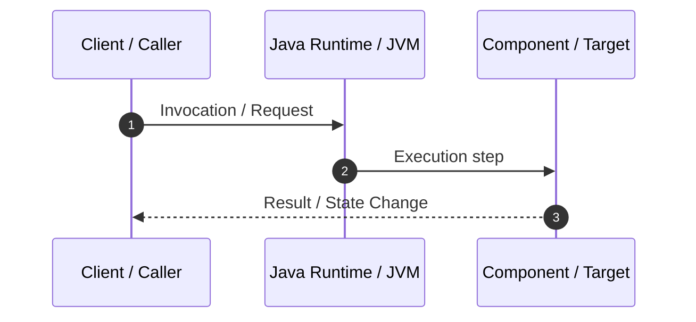
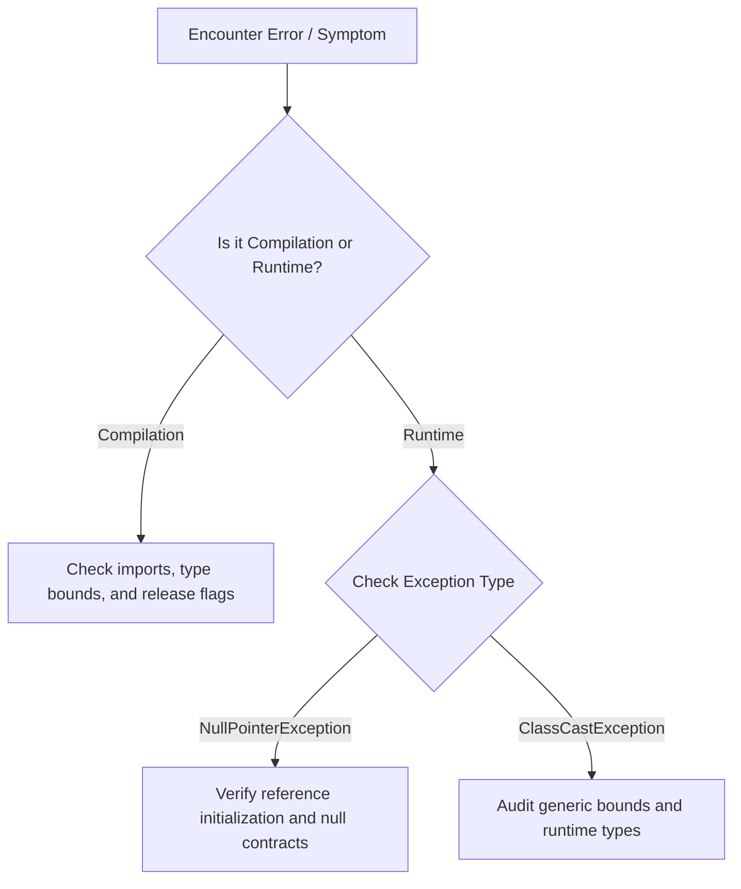

# [Concept ID]: [Concept Title]

---

## 1. Metadata and Learning Goals

| Metadata Field | Value |
|---|---|
| **Concept ID** | `[e.g., P00-C001]` |
| **Concept Title** | `[Descriptive Title]` |
| **Phase** | `[Phase XX — Phase Name]` |
| **Phase Directory** | `[curriculum/phase-XX-name]` |
| **Source Reference** | `[Section / Heading / Bullet wording from source roadmap]` |
| **Concept Type** | `[Language / Runtime / API / Architecture / Database / Security / Testing / Tooling]` |
| **Difficulty Level** | `[Foundation / Intermediate / Advanced / Specialist]` |
| **Curriculum Importance** | `[Essential / Recommended / Advanced / Optional]` |
| **Java Baseline** | `Java 21 LTS (with Java 25 LTS comparative notes where applicable)` |
| **Framework Baseline** | `Spring Boot 3.3.x / Spring Framework 6.1.x (if applicable)` |
| **Prerequisites** | `[Links to preceding concept markdown files, or None for initial concepts]` |
| **Related Concepts** | `[Links to related concept files]` |
| **Estimated Study Effort** | `[e.g., 2–3 hours]` |
| **Last Research Date** | `YYYY-MM-DD` |
| **Verification State** | `[RESEARCHED / DRAFTED / TECHNICALLY_REVIEWED / EXAMPLES_CHECKED / LINKS_CHECKED / COMPLETE]` |

### Measurable Learning Objectives
By the end of this concept module, you will be able to:
1. **Explain:** [Objective using precise, unambiguous engineering terminology]
2. **Compare:** [Objective distinguishing this concept from commonly confused alternatives]
3. **Implement:** [Objective demonstrating practical, idiomatic Java implementation]
4. **Debug & Diagnose:** [Objective identifying and resolving typical runtime or compiler failures]
5. **Evaluate & Justify:** [Objective articulating architectural and operational trade-offs in backend systems]

---

## 2. Definition, Purpose, and Mental Model

### 2.1 Formal Definition
[A rigorous, technically accurate definition in plain English without circular phrasing or vague buzzwords.]

### 2.2 The Problem It Solves
[Why this concept was created. What systemic failure, performance bottleneck, or software engineering challenge existed before it was introduced.]

### 2.3 Why Backend Engineers Need It
[How this concept directly affects server-side applications, throughput, data integrity, microservice boundaries, or database interactions.]

### 2.4 Real-World System Analogy (and Where It Breaks Down)
- **The Analogy:** [Intuitive mental model for rapid comprehension]
- **Where the Analogy Fails:** [Crucial technical boundary where the real Java/JVM mechanics differ from the metaphor]

### 2.5 What This Concept Is NOT (Common Confusions)
- **Not [Alternative A]:** [Precise technical distinction]
- **Not [Alternative B]:** [Precise technical distinction]

### 2.6 Relationship to Adjacent Concepts
[How this concept connects to adjacent concepts in this phase and downstream phases.]

---

## 3. Foundations and Theory

### 3.1 First Principles and Mechanics
[Exhaustive breakdown of underlying theoretical foundations, JLS/JVMS specifications, memory models, protocol contracts, or algorithm design.]

### 3.2 Execution / Lifecycle Sequence


### 3.3 Specification Guarantees vs. Implementation-Specific Behavior
- **Specification Contract (JLS/RFC):** [Guarantees guaranteed by the specification across all conforming implementations]
- **Implementation Detail (e.g., HotSpot / OpenJDK / PostgreSQL):** [Vendor-specific or runtime-dependent behavior that must not be assumed universally]

### 3.4 Invariants and Edge Cases
- **Boundary Condition 1:** [Detail and behavior]
- **Boundary Condition 2:** [Detail and behavior]

---

## 4. Syntax, API, and Command Reference

### 4.1 CLI Commands / Build Configuration (if applicable)
```bash
# Minimal execution command
javac -d out src/com/example/MyClass.java
java -cp out com.example.MyClass
```

### 4.2 Key Standard Library Classes and Signatures
```java
package java.lang; // or appropriate package

// Important class, interface, method signatures with parameter contracts
```

### 4.3 Version History and Evolution
- **Java 1.0–8:** [Historical status]
- **Java 9–17:** [Modular or modern evolution]
- **Java 21 LTS (Baseline):** [Current LTS standard behavior]
- **Java 25 LTS Notes:** [Preview or finalized modern enhancements]

---

## 5. Runnable Examples and Demonstrations

### 5.1 Minimal Reproducible Example
```java
// Complete, self-contained runnable class
package com.example.concept;

public class MinimalExample {
    public static void main(String[] args) {
        // Core demonstration
    }
}
```
*Expected Output:*
```text
[Exact stdout/stderr text]
```

### 5.2 Step-by-Step Execution Walkthrough
[Detailed explanation of stack frames, heap allocations, bytecode instructions, or control transitions occurring during execution.]

### 5.3 Realistic Backend Application Context
[A production-style example simulating a realistic domain such as user management, banking, order fulfillment, or telemetry.]

### 5.4 Anti-Pattern / Faulty Implementation
```java
// Flawed implementation showing subtle bug, leak, or concurrency race
```

### 5.5 Corrected Idiomatic Implementation
```java
// Refactored, production-grade correction
```
*Why this correction is superior:* [Technical explanation of correctness, safety, or performance improvements]

---

## 6. Real-World Backend Application

### 6.1 Architectural Placement
- **Tier/Layer:** [e.g., Controller, Domain Model, Persistence, Infrastructure, Transport]
- **Data Ingress & Egress:** [How data flows in, transforms, and exits]

### 6.2 Production Failure Modes
- **Failure Mode 1:** [Symptom, impact, and mitigation]
- **Failure Mode 2:** [Symptom, impact, and mitigation]

### 6.3 Operational Consequences (Observability, Logging, Metrics)
- [Log emission standards, MDC correlation, metrics instrumentation, health indicators]

### 6.4 When NOT to Use This Concept
[Explicit engineering criteria where choosing this pattern or tool is an anti-pattern or adds accidental complexity.]

---

## 7. Design Choices, Alternatives, and Trade-Offs

| Decision Factor | This Concept / Approach | Alternative A | Alternative B |
|---|---|---|---|
| **Memory Footprint** | Low / Moderate / High | ... | ... |
| **Throughput / Latency** | ... | ... | ... |
| **Complexity / Maintainability** | ... | ... | ... |
| **Testability** | ... | ... | ... |
| **Failure Blast Radius** | ... | ... | ... |

*Trade-off Assessment:* [Under which specific conditions to choose each approach.]

---

## 8. Performance and Complexity

### 8.1 Algorithmic / Runtime Complexity
- **Time Complexity:** $O(...) $
- **Space Complexity:** $O(...) $
- **Allocation Profile:** [Garbage collector pressure, escape analysis, heap vs. stack]

### 8.2 Bottlenecks and Contention Risks
[Cache lines, synchronization bottlenecks, lock contention, I/O blocking, context switching.]

### 8.3 Profiling and Measurement
[How to measure using async-profiler, JFR, JMC, or JMH.]

---

## 9. Security and Robustness

### 9.1 Threat Vectors and Vulnerabilities
- **Untrusted Input / Injection:** [Mitigation]
- **Resource Exhaustion / Denial of Service:** [Mitigation]
- **Information Leakage:** [Mitigation]

### 9.2 Defensive Programming Patterns
[Boundary validation, immutability, safe copies, zeroization of credentials.]

---

## 10. Testing and Verification

### 10.1 Automated Unit Tests (JUnit 5)
```java
import org.junit.jupiter.api.DisplayName;
import org.junit.jupiter.api.Test;
import static org.assertj.core.api.Assertions.assertThat;

class ConceptTest {
    @Test
    @DisplayName("Should behave correctly under nominal conditions")
    void testNominal() {
        // Arrange, Act, Assert
    }
}
```

### 10.2 Edge Case and Failure Verification
[Testing boundary values, exceptions, and null handling.]

### 10.3 What NOT to Mock
[Guidelines on real collaborators vs. test doubles.]

---

## 11. Debugging and Failure Analysis

### 11.1 Diagnostic Flowchart / Procedure


### 11.2 Common Exceptions and Root Causes
- `ExceptionName`: [Exact root cause and diagnostic command]

### 11.3 Diagnostic Commands and Tooling
```bash
# Useful diagnostic command
jcmd <PID> VM.version
```

---

## 12. Best Practices and Anti-Patterns

### 12.1 Industry Best Practices
- [Best practice 1 with technical justification]
- [Best practice 2 with technical justification]

### 12.2 Anti-Patterns to Avoid
- [Anti-pattern 1 and why it fails in production]
- [Anti-pattern 2 and why it fails in production]

---

## 13. Interview Preparation

### 13.1 Foundational Questions
1. **Q:** [Foundational Question]
   - **Answer:** [Clear, authoritative answer from first principles]
   - **Follow-up:** [Interviewer follow-up]

### 13.2 Intermediate & Scenario Questions
2. **Q:** [Scenario Question]
   - **Answer:** [Architectural and diagnostic answer]
   - **Follow-up:** [Interviewer follow-up]

### 13.3 Advanced / Lead Engineer Questions
3. **Q:** [Internal mechanics / JMM / HotSpot question]
   - **Answer:** [Deep systems answer]
   - **Common Weak Answer:** [What candidates say that reveals superficial knowledge]

---

## 14. Practice and Assessment

### Exercise 1: Beginner (Foundational Implementation)
- **Goal:** [Clear objective]
- **Task:** [Specific requirements]
- **Acceptance Criteria:** [Checklist of criteria]

### Exercise 2: Applied (Backend Domain Integration)
- **Goal:** [Clear objective]
- **Task:** [Specific requirements]
- **Acceptance Criteria:** [Checklist of criteria]

### Exercise 3: Challenge (Edge Cases & Resilience)
- **Goal:** [Clear objective]
- **Task:** [Specific requirements]
- **Acceptance Criteria:** [Checklist of criteria]

### Hints
<details>
<summary>View Hints</summary>

- **Exercise 1 Hint:** [...]
- **Exercise 2 Hint:** [...]
- **Exercise 3 Hint:** [...]
</details>

### Solutions Walkthrough
<details>
<summary>View Full Solutions</summary>

```java
// Solution to Exercise 1
```

```java
// Solution to Exercise 2
```

```java
// Solution to Exercise 3
```
</details>

### Mastery Self-Assessment Checklist
- [ ] I can explain this concept from first principles without reading notes or asking AI.
- [ ] I can write a working, idiomatic implementation with correct exception handling and edge-case validation.
- [ ] I can diagnose and resolve its top failure modes using standard JDK diagnostic tools.
- [ ] I can evaluate when this approach is inappropriate and select the correct alternative.

---

## 15. Summary, Cheat Sheet, and Memory Aids

### Key Takeaways
- [Bullet 1]
- [Bullet 2]
- [Bullet 3]

### Quick Reference Cheat Sheet
| Syntax / Command / Class | Purpose | Key Caveat |
|---|---|---|
| `...` | `...` | `...` |

### Flashcard Prompts
- **Prompt:** [...] -> **Key Insight:** [...]
- **Prompt:** [...] -> **Key Insight:** [...]

---

## 16. Sources and Further Reading

### Primary Sources & Specifications
1. **Java Language Specification (JLS):** Section X.Y, Oracle / OpenJDK. URL: https://docs.oracle.com/javase/specs/
2. **Java Virtual Machine Specification (JVMS):** Section X.Y, Oracle / OpenJDK. URL: https://docs.oracle.com/javase/specs/
3. **OpenJDK JEPs:** JEP XXX: [Title]. URL: https://openjdk.org/jeps/XXX

### Authoritative Documentation & Engineering Guides
4. **Dev.java Documentation:** Oracle Java Developer Portal. URL: https://dev.java/
5. **Spring Framework Documentation:** Broadcom / VMware. URL: https://docs.spring.io/
