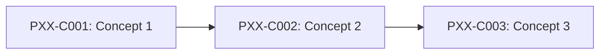

# Phase [XX]: [Phase Name]

---

## 1. Phase Overview and Purpose

### 1.1 Goal
[Statement of the core learning outcome and engineering objective of this phase.]

### 1.2 Context in Backend Engineering
[Why this specific phase is foundational or required for professional Java backend systems.]

---

## 2. Prerequisites and Co-requisites

- **Direct Prerequisites:**
  - `Phase [YY]: [Phase Name]` (Key concepts: ...)
- **Recommended Prior Knowledge:**
  - [...]
- **Downstream Dependent Phases:**
  - `Phase [ZZ]: [Phase Name]`

---

## 3. Measurable Phase Learning Outcomes

By completing Phase [XX], the learner will independently be able to:
1. [...]
2. [...]
3. [...]
4. [...]

---

## 4. Concept Inventory and Study Order

| Concept ID | Concept Title | File Name | Importance | Status |
|---|---|---|---|---|
| `PXX-C001` | [Title 1] | [`001-slug.md`](001-slug.md) | Essential | NOT_STARTED |
| `PXX-C002` | [Title 2] | [`002-slug.md`](002-slug.md) | Essential | NOT_STARTED |
| ... | ... | ... | ... | ... |

### Recommended Pedagogical Sequence

---

## 5. Critical Distinctions and Common Misconceptions

| Misconception / Simplification | Technical Reality from First Principles |
|---|---|
| "[Common misconception 1]" | [Detailed technical explanation of why it is flawed] |
| "[Common misconception 2]" | [Detailed technical explanation of why it is flawed] |

---

## 6. Phase Integration Project / Capstone Exercise

### Scenario Overview
[A comprehensive problem integrating the concepts of this phase into a cohesive backend scenario.]

### Requirements and Acceptance Criteria
- [ ] Requirement 1
- [ ] Requirement 2
- [ ] Requirement 3

---

## 7. Phase Completion Gate and Self-Assessment

Before marking Phase [XX] as complete:
- [ ] All concept modules in this phase are thoroughly read and exercises completed.
- [ ] You can explain every concept in the table from memory without AI assistance.
- [ ] The capstone exercise compiles, passes automated tests, and handles edge cases.
- [ ] Common failure modes can be diagnosed and resolved using standard tooling.

---

## 8. Status and Progress Reconciler

- **Total Planned Concepts:** `N`
- **Completed Concepts:** `0`
- **In Progress:** `0`
- **Completion Rate:** `0%`
- **Last Verified Date:** `YYYY-MM-DD`
